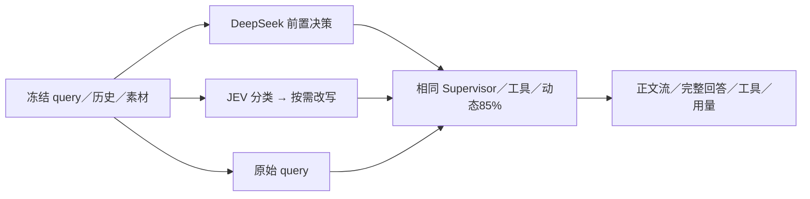

# 1. 问题与现状

2026-11-13 复测更正：本轮目标是 **JEV 单独分类，关闭独立改写器**。前一轮 B 为 JEV＋改写器，不能代表这个目标；此前相对 B 的速度判断仅适用于含改写器的历史实验。新工作分支为 `perf/query-intent-jev-only`，目标 `dev`，PR 创建后回填。复测协议见第 7 节，原始数据和历史记录保留。

需求：核对 Cloud Chat 前置意图判断的实际配置，恢复 JEV，并比较 DeepSeek 前置决策、JEV＋改写器与 Supervisor 直接判断。提出日期：2026-11-13；工作分支：`perf/query-intent-routing-comparison`；目标分支：`dev`；PR：[#145](https://github.com/owariband/Seekino/pull/145)。依赖：动态模型窗口与 85% compact 策略已通过 [#144](https://github.com/owariband/Seekino/pull/144) 集成到 `dev`，本轮作为共同实验基线。

Chat 可能先分类和改写，再让 Supervisor 组织回复及检索。多一次串行请求可能增加等待；省去前置层又可能把反馈、否定、混合任务和指代误解为新的检索，导致额外工具调用和错误回答。需要比较完整交付，不能只根据省去一次模型调用推断收益。

2026-11-13 核对 Cloud `/data/config/cloud/models.yaml`：JEV 参数为 `typesafe/jev-1.14`，但同时存在 `models.query_hook=deepseek-flash/high/256`。`server/bootstrap.py` 将该绑定注入 `decision_model`，`agent/chat/query_hook.py` 据此选用合并决策图，绕过 JEV 路由及独立改写。这与预期的 JEV 职责不同。现有 JEV 连接实测成功，一条新建非私密反馈 query 返回 `respond`，耗时 1.845 秒；它只是连通性证据，不是整轮 Chat 延迟。

本次授权范围包括：备份并修改 Cloud 配置，只移除 DeepSeek 前置决策绑定，保留 JEV 与改写器参数；必要时重载 API 并验证实际接线；在隔离本地实验中完成三路径真实模型对照。不迁移或清理数据，不把 Supervisor 直接判断自动部署到 Cloud，不改三组共同的 Supervisor prompt、工具合同、reasoning effort 与输出预算。Cloud 当前镜像不支持新 compact 字段，本轮配置切换不能被记为 Cloud 已部署动态 85%。

# 2. 影响因素、假设与评价指标

H1：合并决策的 DeepSeek high 推理比 JEV 分类增加前置等待，且可能因统一 8 秒期限失败开放；需记录实际 action、追加内容、超时与错误，不能将失败跳过记为成功加速。H2：Supervisor 已具备判断职责，可直接处理部分反馈，但在混合任务和指代场景可能增加检索或漏答。H3：JEV 分类与独立改写的串行成本能换取更稳定的工具选择；改写器自身 high／256 和 4 秒期限可能成为另一失败点。

| 指标 | 口径与测量条件 | 基线 | 预设判断与护栏 |
| --- | --- | --- | --- |
| 输出内容与任务完成 | 由 Codex 主 Agent 按冻结规则逐例核对回答、工具与最终卡片；未做独立人工评审 | A／B／C 的 Codex 评阅为 6／8／8 通过 | 少检索不能以漏掉必要证据换取；无证据编造为失败 |
| FTT | 本地 Chat 执行开始至首个非空用户可见正文事件；排除 reasoning、状态和工具事件；本批首次均为 snapshot，非 provider 原生 TTFT | A 平均 6.099s | 所有失败和无正文保留为缺失／失败，不能记 0 |
| TT | 同一起点至整轮自然终态，包含工具、整理和持久化 | A 平均 8.319s | 每轮最多观察 300 秒，超时计失败；不把一次续推当整轮 |
| 前置阶段 | 路由／决策／改写的耗时、action、追加文本、失败开放 | A 平均 1.452s，B 2.701s | 使用真实 provider usage，缺失不填 0 |
| Token | 按角色、provider、operation 分列 input、output、reasoning、cache；reasoning 是 output 子集 | A／B／C 合计 238332／260639／311226 | 汇总全部模型阶段，不只计 Supervisor |
| 稳定性与工具成本 | 完成／超时／失败、检索次数、子 Agent 次数、重复检索与 compact 次数 | 正式 27/27 完成，无超时 | 保留全部样本；样本不足不报告 p95／p99 或显著性 |

首轮为机制与质量探索，不预设未经业务支持的“至少快多少”。候选方案只有在相同样本没有关键任务退化且有可复核的延迟／用量收益时，才具备进一步试点依据。

# 3. 改造方案与建模

复用现有 QueryHook 与生产 Supervisor，实验只通过装配选取路径，不新增业务分类算法，不分别优化三组 prompt。

| 实验组 | 前置路径 | 固定参数 |
| --- | --- | --- |
| A `deepseek_decider` | 原 Cloud 合并决策：DeepSeek 判断 action 并给 retrieval slot | Flash／high／256，既有 8 秒总期限 |
| B `jev_rewriter` | JEV 分类；retrieve／mixed 再调用现有改写器 | JEV 1.14，网络 timeout 配置 3 秒；改写 Flash／high／256，4 秒；8 秒总期限 |
| C `supervisor_direct` | 跳过 QueryHook，由当前 Supervisor 直接判断并交付 | 与 A／B 完全相同的 Supervisor prompt 与工具 |

三组 Supervisor 和 Query Agent 使用同一 DeepSeek Flash／high／8192，模型 context 动态获取，compact 比例 85%。历史、素材范围、检索索引、能力配置和可见工具保持相同。附件／回放的既有 bypass 合同保持；本轮以文本主流程为主。缓存属于 provider 自然状态，记录命中并轮换顺序，不能承诺完全相同。

Cloud 先确认没有正在处理的 Chat，备份原配置并校验 SHA，只删除 `models.query_hook`，随后重载并验证 JEV 生效。备份包含配置，保留在 Cloud 私有目录，不提交 Git。实验原始响应和配置留本机私有产物，仓库只保留不含凭据的协议、指标与选定公开用例输出。

# 4. 对照实验与结果分析

先核对本地数据库与 ES 是否具备已有 MyGO 素材，确认隔离环境后再运行，禁止把 Cloud 私密历史直接当作本轮默认评测集。优先复用已提交的 `intent_routing`、`chat_behavior` 和 `query_capabilities` 样本；只把 query／history 发给被测模型，不能把 expected 或事实答案泄漏给模型。

环境预检后，将整季素材计划缩小为本机已发布的 MyGO EP04 12.012 秒片段：一条正式 Chunk、六个 Event。只读复制该片段及必要解析事实到 `seekino_intent_20261113_test`，ES 使用独立 `seekino_intent_chunks_20261113_test`／`seekino_intent_events_20261113_test`；未复制原有聊天、个人配置或凭据。复制后的发布收据只重绑定真实目标索引名，内容、版本和编码合同保持不变；真实 Event 与 Chunk 两条检索均各命中并回源 1 个正式片段。embedding 保持该素材的 `doubao-embedding-vision-251215`／1024 合同，三组一致。此范围不能代表整季搜索或大索引表现。

在观察结果前冻结六类主样本：反馈不检索、仅整理已有证据、明确停止检索、混合反馈与新检索、含指代的新检索、保留原话／否定约束的检索。样本保存于 `evals/benchmark/intent_routing/three_path_20261113_cases.json`；前三例沿用已提交意图用例，后三例在同样意图结构下改为这段真实片段。expected 单独保存，仅供审阅，不进入模型输入。每例三组各一次，共 18 个完整 turn；再重复反馈、混合、检索各一例，共 9 个 turn，总计 27 个。首轮轮换组顺序，复测反转 case 顺序；如环境／素材缺失，先记录调整理由并重新冻结，不能看见优劣后换例。

先运行一个不检索的集成探针核对正文流、终态与用量完整性，探针不并入正式指标。采样覆盖每轮按 YAML 所选模型构建的实际 runtime，不能只包装启动时的默认实例；完成 turn 若缺主模型输入或 provider usage 即判采样失败。

环境诊断批次共运行 16 turn 后因连续三个基础设施失败停止：Event 检索有效，但环境继承的索引 generation=2 与复制片段的 generation=1 不一致，选择 Chunk 检索会被一致性校验拒绝。该批完整保留，不能混入三组性能排名；修正仅发生在测试启动环境，随后两条检索均预检通过，显式冻结 generation=1 并全量重跑原先同一份 27 turn 样本，不只重跑失败例。探针／诊断会使 provider 缓存自然变暖，仍轮换顺序并记录 cache usage。每轮最长 300 秒，连续三个基础设施失败则暂停扩展并修复；失败样本保留。完整协议保存代码和配置哈希、样本与顺序、模型参数、观测时间、工具与用量日志。优先执行全部已冻结对照，再作结论，不按单个成功案例提前宣称优化。

| 结果 | A DeepSeek 前置决策 | B JEV＋改写器 | C Supervisor 直接判断 |
| --- | --- | --- | --- |
| FTT 平均（秒） | 6.099 | 8.886 | 7.713 |
| TT 平均／中位（秒） | 8.319 / 9.560 | 10.404 / 11.488 | 9.588 / 8.102 |
| 全阶段总 token | 238332 | 260639 | 311226 |
| Codex 逐条评阅 pass／partial／fail | 6 / 2 / 1 | 8 / 1 / 0 | 8 / 1 / 0 |
| 完成／失败／超时 | 9 / 0 / 0 | 9 / 0 / 0 | 9 / 0 / 0 |

# 5. 试点验证与方案取舍

Cloud 恢复 JEV 是已授权的配置纠正，与三路实验推荐分开验收。以新建非私密 query 验证实际 route，观察 API 健康与改写器错误，不用启动成功代替真实路径证据。若 JEV 连通失败或配置无法加载，恢复备份并记录原因。

本地试点需包含真实检索与完整回答。若只完成替身工具或模型边界测试，只能报告相应边界，不宣称完整 Chat 效果。对直接判断的推荐综合内容、首字、完成耗时、总用量及额外检索；保留退化例并解释代价。扩大到 Cloud 直接路径需要后续明确决定，本轮不自动推广。

# 6. 结果验收与闭环

Cloud 配置备份、唯一改动、重启健康和实际 JEV/respond 新消息均已验证。本地正式 27/27 自然完成，132 次 provider 用量完整，合计 810197 token；独立 SQL 核对 27/27 正文与完成状态一致，测试库无 PROCESSING。所有分项与逐字回答见[完整报告](../../report/agent/chat/query-intent-routing-20261113/README.md)，判断已补入 [devlog](../../dev/devlog.md#devlog-chat-intent-routing-20261113)，唯一当前状态见[管理工作台](../../dev/workbench.html) `CHAT-INTENT-01`。

2026-11-13 Cloud 已完成唯一配置变更并重启健康：删除 `models.query_hook`，保留 JEV／改写器；原配置 SHA `5f85d0…9c6af4`，新配置 SHA `fef405…4a9da`，备份留在同目录的 `models.yaml.before-jev-20261113T100259Z.bak`。新建非私密验证消息已通过实际 API 完成，日志为 JEV `action=respond`、1.533 秒，整轮 4.690 秒；这不是正式三组实验样本。

H1 在本批未获支持：DeepSeek 合并决策平均 1.452 秒，JEV＋改写平均 2.701 秒，两者均无失败开放。H2 仅部分支持：C 较 B 平均 TT 减少 7.8%，却多 19.4% 总 token；较 A 平均 TT 增加 15.2%，但 TT 中位数更低。H3 未证明 JEV 带来可归因的质量优势：A/B action 均 9/9 正确，且 6/9 对追加后输入相同，几例后续输出差异包含生成随机性。

本次有界比较已完成，Cloud 继续使用 JEV，不自动推广 C。三组均存在部分输出、顺序或卡片问题，C19 全场景仍未关闭。后续优先核对重复检索／相同 cursor 读取、单 Chunk 更新卡片语义，再按同条件扩大样本；这些生产改造没有纳入本轮。整季、大索引、长历史、附件／回放、Query 子 Agent、并发、浏览器播放和完整费用未验证。测试启动的本地服务已按自有 PID 停止，数据保留。

2026-11-13 文档纠正：[#145](https://github.com/owariband/Seekino/pull/145) 初版将 Codex 主 Agent 的逐条评阅误写为“人工审阅”。后续以 `docs/chat-intent-review-attribution` 分支纠正评阅来源，关联 [PR #148](https://github.com/owariband/Seekino/pull/148)；这是同一实验的说明纠正，不变更数据、规则或分数。评分模型为本次会话的 Codex 主 Agent，具体模型 ID 未导出；依据为冻结 expected、真实工具轨迹、已发布 Timeline 与最终卡片，程序审计只校验用量、输入、时间及持久化。没有独立模型评委或人工盲评，语义评分仍有判断性。

# 7. 关闭独立改写器的同条件复测

## 7.1 问题与现状

前一轮把可选改写器作为 B 的默认组成，测量了不符合预期的路径，不能据其结果判断 JEV-only 的代价。当前授权重新测量表格；仅变更隔离实验，不改 Cloud 配置或重启云端服务。

## 7.2 因素、假设与指标

H4：关闭独立改写能减少 B 的串行模型调用，但后续 Supervisor 的生成与工具选择可能抵消收益。指标沿用原表：前置平均、服务层首段正文 FTT 平均／中位、整轮 TT 平均／中位、全阶段 input／output／total token、Supervisor 请求数、完成数，以及逐例内容／卡片。不得直接从旧表减去改写耗时或混合新旧组数据。

护栏：B 的 JEV 调用存在，独立改写调用为 0；A／B／C 都显式关闭 `rewriter_enabled` 并移除未用的 `models.query_rewriter`。A 保留原合并决策职责和 prompt，C 保留原始消息直接判断。主模型、effort、预算、工具、样本、素材与容量策略不变。

## 7.3 方案与装配

复用既有真实 Chat harness，增加明确的 JEV-only 模式，保留历史 JEV＋改写器协议的复跑能力。A=`deepseek_decider`，B=`jev_only`，C=`supervisor_direct`。B 仅分类和追加固定处理说明，不生成候选检索词；metadata 与真实 usage 均验证关闭生效。生成调用由主 Agent 运行，Flash 只修改必要评测装配，主 Agent复核。

## 7.4 冻结与实验计划

沿用已提交的六类样本和三个复测项，三组各 9 turn、共 27 个完整 turn，顺序保持原轮换和反序规则。重新跑全部三组，不只补测 B。沿用独立 `*_test` 库、两个索引、generation=1 和已发布 12.012 秒 MyGO 片段，expected 不进模型。当前 dev 的 17 个旧协议关键源码哈希与上一轮一致；本轮只调整评测模式。

正式前检查 Event／Chunk 回源和一次非正式 JEV-only 集成探针，随后冻结新配置与源码。300 秒观察上限，连续三个基础设施失败停下处理；全部失败保留。旧结果不可覆盖，新结果目录独立。新表数据全部待测。

## 7.5 试点与取舍

复测仍为小素材有界试点，不推广到 Cloud，不改变 prompt 或生产工具语义。检索／混合任务、事实和卡片逐条检查，评分由本次 Codex 主 Agent依据冻结规则评阅并明确无独立人工盲评。观察缓存明细，不把总 token 比例当费用比例。

## 7.6 验收与闭环

交付一张全部重新实测的三路径表，B 清晰标为 JEV-only，提供独立原始 usage、零改写检查、输入一致性、持久化及逐字输出证据；将新结果与旧实验分别记录在报告和 devlog。当前尚未开始本轮真实调用，不提前给出性能或质量结论。Cloud 改写器状态未在本轮变更。
