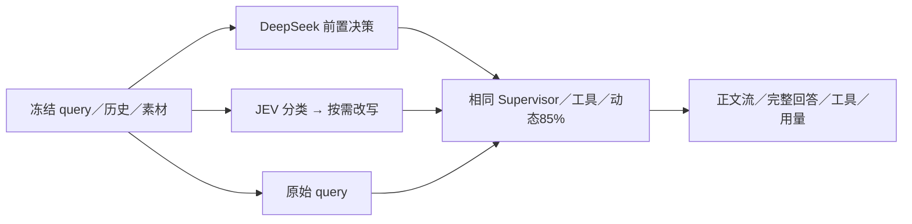

# 1. 问题与现状

需求：核对 Cloud Chat 前置意图判断的实际配置，恢复 JEV，并比较 DeepSeek 前置决策、JEV＋改写器与 Supervisor 直接判断。提出日期：2026-11-13；工作分支：`perf/query-intent-routing-comparison`；目标分支：`dev`；PR：创建后回填。依赖：动态模型窗口与 85% compact 策略已通过 [#144](https://github.com/owariband/Seekino/pull/144) 集成到 `dev`，本轮作为共同实验基线。

Chat 可能先分类和改写，再让 Supervisor 组织回复及检索。多一次串行请求可能增加等待；省去前置层又可能把反馈、否定、混合任务和指代误解为新的检索，导致额外工具调用和错误回答。需要比较完整交付，不能只根据省去一次模型调用推断收益。

2026-11-13 核对 Cloud `/data/config/cloud/models.yaml`：JEV 参数为 `typesafe/jev-1.14`，但同时存在 `models.query_hook=deepseek-flash/high/256`。`server/bootstrap.py` 将该绑定注入 `decision_model`，`agent/chat/query_hook.py` 据此选用合并决策图，绕过 JEV 路由及独立改写。这与预期的 JEV 职责不同。现有 JEV 连接实测成功，一条新建非私密反馈 query 返回 `respond`，耗时 1.845 秒；它只是连通性证据，不是整轮 Chat 延迟。

本次授权范围包括：备份并修改 Cloud 配置，只移除 DeepSeek 前置决策绑定，保留 JEV 与改写器参数；必要时重载 API 并验证实际接线；在隔离本地实验中完成三路径真实模型对照。不迁移或清理数据，不把 Supervisor 直接判断自动部署到 Cloud，不改三组共同的 Supervisor prompt、工具合同、reasoning effort 与输出预算。Cloud 当前镜像不支持新 compact 字段，本轮配置切换不能被记为 Cloud 已部署动态 85%。

# 2. 影响因素、假设与评价指标

H1：合并决策的 DeepSeek high 推理比 JEV 分类增加前置等待，且可能因统一 8 秒期限失败开放；需记录实际 action、追加内容、超时与错误，不能将失败跳过记为成功加速。H2：Supervisor 已具备判断职责，可直接处理部分反馈，但在混合任务和指代场景可能增加检索或漏答。H3：JEV 分类与独立改写的串行成本能换取更稳定的工具选择；改写器自身 high／256 和 4 秒期限可能成为另一失败点。

| 指标 | 口径与测量条件 | 基线 | 预设判断与护栏 |
| --- | --- | --- | --- |
| 输出内容与任务完成 | 保存逐字回答、引用和工具轨迹；按冻结规则逐例检查反馈响应、是否应检索、混合任务顺序、指代与事实来源 | 三组待测 | 少检索不能以漏掉必要证据换取；无证据编造为失败 |
| FTT | 本地 Chat 执行开始至首个非空用户可见正文流事件；排除 reasoning、状态和工具事件；记录测量层，不冒充浏览器渲染时间 | 待测 | 所有失败和无正文保留为缺失／失败，不能记 0 |
| TT | 同一起点至整轮自然终态，包含工具、子 Agent、整理和持久化 | 待测 | 每轮最多观察 300 秒，超时计失败；不把一次续推当整轮 |
| 前置阶段 | 路由／决策／改写的耗时、action、追加文本、失败开放 | 待测 | 使用真实 provider usage，缺失不填 0 |
| Token | 按角色、provider、operation 分列 input、output、reasoning、cache；reasoning 是 output 子集 | 待测 | 汇总全部模型阶段，不只计 Supervisor |
| 稳定性与工具成本 | 完成／超时／失败、检索次数、子 Agent 次数、重复检索与 compact 次数 | 待测 | 保留全部样本；样本不足不报告 p95／p99 或显著性 |

首轮为机制与质量探索，不预设未经业务支持的“至少快多少”。候选方案只有在相同样本没有关键任务退化且有可复核的延迟／用量收益时，才具备进一步试点依据。

# 3. 改造方案与建模

复用现有 QueryHook 与生产 Supervisor，实验只通过装配选取路径，不新增业务分类算法，不分别优化三组 prompt。

| 实验组 | 前置路径 | 固定参数 |
| --- | --- | --- |
| A `deepseek_decider` | 原 Cloud 合并决策：DeepSeek 判断 action 并给 retrieval slot | Flash／high／256，既有 8 秒总期限 |
| B `jev_rewriter` | JEV 分类；retrieve／mixed 再调用现有改写器 | JEV 1.14，3 秒分类；改写 Flash／high／256，4 秒；8 秒总期限 |
| C `supervisor_direct` | 跳过 QueryHook，由当前 Supervisor 直接判断并交付 | 与 A／B 完全相同的 Supervisor prompt 与工具 |

三组 Supervisor 和 Query Agent 使用同一 DeepSeek Flash／high／8192，模型 context 动态获取，compact 比例 85%。历史、素材范围、检索索引、能力配置和可见工具保持相同。附件／回放的既有 bypass 合同保持；本轮以文本主流程为主。缓存属于 provider 自然状态，记录命中并轮换顺序，不能承诺完全相同。

Cloud 先确认没有正在处理的 Chat，备份原配置并校验 SHA，只删除 `models.query_hook`，随后重载并验证 JEV 生效。备份包含配置，保留在 Cloud 私有目录，不提交 Git。实验原始响应和配置留本机私有产物，仓库只保留不含凭据的协议、指标与选定公开用例输出。

# 4. 对照实验与结果分析

先核对本地数据库与 ES 是否具备已有 MyGO 素材，确认隔离环境后再运行，禁止把 Cloud 私密历史直接当作本轮默认评测集。优先复用已提交的 `intent_routing`、`chat_behavior` 和 `query_capabilities` 样本；只把 query／history 发给被测模型，不能把 expected 或事实答案泄漏给模型。

在观察结果前冻结六类主样本：反馈不检索、仅整理已有证据、明确停止检索、混合反馈与新检索、含指代的新检索、保留原话／否定约束的检索。每例三组各一次，共 18 个完整 turn；再重复反馈、混合、检索各一例，共 9 个 turn，总计 27 个。首轮轮换组顺序，复测反转 case 顺序；如环境／素材缺失，先记录调整理由并重新冻结，不能看见优劣后换例。

先运行一个不检索的集成探针核对正文流、终态与用量完整性，探针不并入正式指标。每轮最长 300 秒，连续三个基础设施失败则暂停扩展并修复；失败样本保留。完整协议保存代码和配置哈希、样本与顺序、模型参数、观测时间、工具与用量日志。优先执行全部已冻结对照，再作结论，不按单个成功案例提前宣称优化。

| 结果 | A DeepSeek 前置决策 | B JEV＋改写器 | C Supervisor 直接判断 |
| --- | --- | --- | --- |
| FTT／TT／Token／质量 | 待测 | 待测 | 待测 |
| 完成与失败 | 待测 | 待测 | 待测 |

# 5. 试点验证与方案取舍

Cloud 恢复 JEV 是已授权的配置纠正，与三路实验推荐分开验收。以新建非私密 query 验证实际 route，观察 API 健康与改写器错误，不用启动成功代替真实路径证据。若 JEV 连通失败或配置无法加载，恢复备份并记录原因。

本地试点需包含真实检索与完整回答。若只完成替身工具或模型边界测试，只能报告相应边界，不宣称完整 Chat 效果。对直接判断的推荐综合内容、首字、完成耗时、总用量及额外检索；保留退化例并解释代价。扩大到 Cloud 直接路径需要后续明确决定，本轮不自动推广。

# 6. 结果验收与闭环

待补证：Cloud 配置已备份且唯一改动符合预期、实际运行 JEV 路径、新建 query 验证；本地三组完整对照；逐例输出与延迟／用量；失败与限制。实验报告放 `docs/report/agent/chat/query-intent-routing-20261113/`，决策补入 devlog，并在管理工作台维护唯一当前状态。

当前没有三组实测结果，不能判断哪条路径最优。完成后分别说明配置已部署、实验已执行、质量是否达标及仍需验证的生产长尾。
