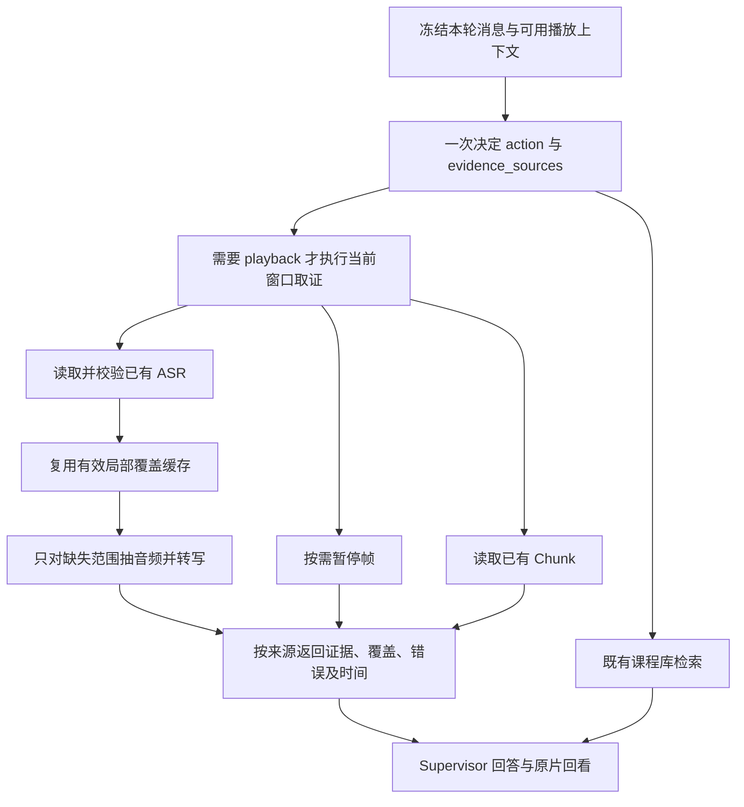

# 1. 问题与现状

需求：Chat 实时 ASR 取证与本轮路由设计。日期：2026-11-03。分支：`fix/realtime-asr-evidence`。PR：[Draft #31](https://github.com/owariband/Seekino/pull/31)；目标 `dev`。当前阶段：设计待评审，实施暂停。关联问题 C28、课程 QA RT07。

本需求包含两项交付，不能用其中一项替代另一项：

1. **对于某一时刻实时解析的 ASR 引入问题：** 冻结当前视频与播放点，先读已有转写，缺失时只补局部语音；整课或 Chunk 失败不能阻断有效 ASR。
2. **对于实时解析的路由问题：** 回答 `realtime/offtime` 预先分层与新增平级 `realtime` enum 的取舍，明确本轮是否需要新证据、从哪里取证，以及 Jev / Query Hook / Supervisor 的实际接入。实时问答也可能继续检索课程库。

用户要求先评审 TRD 再放行实施。此前把“只负责 Chat”的范围澄清误作实施授权，已提前产生本地未提交代码与局部验证；这些不是获批交付。本次仅补齐设计和 PR 范围，远端 PR 保持文档变更，等待明确放行；没有切换或重启体验服务。

42:53.152 提问“现在老师在讲什么？”时，`understand_current_video` 用时 4.034 秒，返回 41:00–44:00 三个 Chunk 的 `PARSING_FAILED` 缺证信息。相同媒体的独立 ASR 已有 2,476 条，通过 Schema、结果哈希和媒体身份校验；39:53.152–42:53.152 有 62 条重叠 cue，包含 B/T/C = 4/8/2 的讲解。工具没有读取 ASR，助手又误称语音转写失败，导致可回答的问题没有交付。

证据来自 [QA 复现报告](https://github.com/owariband/Seekino/blob/chore/course-qa/docs/report/server/course-qa-realtime-asr-gap-20261103.md)、[RT07](https://github.com/owariband/Seekino/blob/chore/course-qa/docs/design/03-product-reassessment/course-qa-trd.md)。历史请求未测 FTT，页面约 7 秒仅为用户报告值。复现任务 `2a531c4f-2c73-4cc2-adaf-5156edc26236`，不能用另一个已经补齐 Chunk 的任务替代失败态验收。

合并 #18 后的基线调用链：Supervisor → realtime runtime → Server `prepare_context/ensure_chunk/observe_frames`。准备阶段要求固定 Chunk 拓扑，`ensure_chunk` 受父任务失败状态影响。现有 `load_or_begin_video_asr` 还绑定正式解析租约，不能直接用作失败任务的只读取证。

路由现状已从源码核对：[`QueryHook.__call__`](../../../agent/chat/query_hook.py) 遇到 `extra_context.playback` 直接跳过，返回值是追加提示后的字符串；Supervisor 没有收到结构化路由对象。Hook 开启时有两条实现：已配置 `query_hook` 通用模型则一次生成 `action + retrieval_query`；否则由 [Jev 分类后调用 rewriter 填槽](../../../gateway/query_hook.py)。实际枚举拼写是 `respond / retrieve / mixed`，不是 `mixture`。QA 当前未启用 Jev，故 42:53 故障不归因于三类枚举，也不能等 Jev 改造后才恢复 ASR；但路由仍是本需求的独立交付，不能只在 Supervisor prompt 中增加一句约定。

依赖 [#18](https://github.com/owariband/Seekino/pull/18) 的 `video_parse_content` 与既有 ASR 适配器；该 PR 已于 11-03 合入 dev（`99e27b04`）。本分支直接基于合并后的 dev。[#30](https://github.com/owariband/Seekino/pull/30) 的任务查询与 Consumer 恢复独立进行，本需求不接管其运行任务或修改完整解析生命周期。

本次交付 A：语音独立读取、局部补算与覆盖缓存、暂停边界、按需视觉及已有 Chunk 组合、Supervisor 回答与回看。交付 B：正交路由合同、Query Hook 的播放上下文接入、Jev 开启/关闭时一致的来源选择、Supervisor 的结构化消费与组合取证验收。建议同一个独立 Chat PR 承接 A/B，分别提交和验收；A 的开发与故障验证不依赖 B 先完成。

保留权限、来源版本、原片回看及既有直接回应行为。完整解析恢复、#30 的任务推进、Jev 模型替换或训练、声学强制对齐、课程全量质量与性能不纳入本 PR。

# 2. 影响因素、假设与评价指标

| 因素 | 判断与假设 | 验证 |
| --- | --- | --- |
| 状态耦合 | 父任务失败不等于独立 ASR 无效；只读取证应基于授权、媒体和成果完整性 | 失败任务、无 Chunk 拓扑、有效/损坏 ASR 的隔离用例 |
| 路由维度 | `realtime` 与 `retrieve` 可以同时成立；播放器存在也不代表需要新证据 | 三种候选方案对照、冻结路由样本集 |
| 实际接入 | Hook 跳过 playback 且仅返回字符串，扩枚举或改 prompt 不足以证明接入 | Hook → Supervisor → 工具的结构化决定与实际调用轨迹 |
| 证据选择 | 讲解问题应首先取得语音，具体视觉主张才需要看帧 | Supervisor 工具调用与真实问答 |
| 时间窗口 | 默认向前 180,000ms 足以解释当前讲解；跨暂停 cue 需显式区分 | 首尾、换位置、边界 cue、真实 42:53 样本 |
| 重复计算 | 按媒体身份、ASR 配置及实际覆盖复用可避免每轮重跑三分钟 | 重复、相邻、并发请求和失效场景 |
| 缺口表达 | 按来源报告状态可避免把 Chunk 失败解释为 ASR 失败 | 部分成功、空语音、超时、媒体/模型失败 |

| 指标 | 定义 | 基线 | 目标/护栏 | 测量条件 |
| --- | --- | --- | --- | --- |
| 内容与回看 | 回答有语音依据，引用原视频绝对时间 | RT07 失败 | 正确解释讲解，链接可定位，不把后续话当成已听内容 | 同媒体同暂停点，保留失败任务样本 |
| FTT | 客户端发出至首个真实正文 delta；另标记是否仅前言 | 未采集 | 待补同条件基线，不以进度冒充正文 | 冻结代码/模型/输入，记录样本量 |
| TT | 客户端发出至本轮完成 | 页面报告约7秒，非精确实测 | 待测；分别报告命中和首次补算 | 包含取证、最终回答与失败 |
| 语音取证耗时 | 读取/补算开始至证据或失败返回 | 无独立语音路径 | 待测；缓存、已有 ASR、冷补算分列 | 记录读取、音频提取、转写和覆盖 |
| 新增 ASR 次数 | 实际 Provider 转写调用次数，含失败与重试 | 该历史工具未调用 ASR | RT07 为0；重复完整覆盖请求为0 | 按单请求及共享工作归属计数 |
| 路由符合率 | 同时比较 action、证据来源集合与实际工具调用 | 需冻结样本并补测 | 第4节必过样本全部符合；感谢/改写不新增取证，两源请求不漏课程库 | 同一组输入分别运行 Hook 关闭、通用决策模型、Jev 路线 |
| 路由成本 | 路由调用数、路由耗时及填槽调用数，独立于取证模型调用 | Hook 关闭为0次前置；通用决策1次；Jev分类后可能填槽 | 不为 realtime/offtime 再加串行分类；关闭 Hook 不强制启用 Jev | trace 分开记录决策、填槽和 Supervisor 循环 |
| 状态与隔离 | 任务、媒体、内容和租户身份 | 已有合同 | 不改完整解析状态，不跨身份复用，不误报完成 | 请求前后核对与越权回归 |

延迟阈值在探索性基线测量后冻结；样本不足不宣称稳定分位数。功能通过、模型质量与服务部署分别报告。

# 3. 改造方案与建模

## 3.1 时间、来源和调用链

冻结本轮授权视频、媒体身份、播放点与问题，默认语音请求为 `[max(0,t-180000),t)`。t=0 返回空的过去窗口，不人为取未来音频。字段内部统一原片绝对毫秒。



已有有效整片 ASR 可直接完成语音路径，无需创建 Provider、下载权重或触发 Chunk 生成。读取使用 Server 的受权查询与独立验证，不调用带写入及正式租约要求的 `load_or_begin`。保留来源任务/版本、正文摘要、媒体身份及实际覆盖；拒绝损坏或身份不符的结果。成功覆盖但无语音与未处理区间分别表示。

局部缺失经既有模型配置及 Whisper 适配器补算；使用原视频抽音频、公共时间归一并添加起点偏移。局部成果不冒充整片完成，不写入完整 ASR 列，不触发 Understanding、Refine、Index。模型或媒体失败保留明确来源与原因。

Chunk 为已有的补充事实；语音不依赖固定 Chunk 拓扑就绪。问讲解优先语音，问代码/公式/符号时按需并行看暂停帧。画面和 Chunk 部分失败不抹掉已取得语音。返回结构区分请求窗口、各来源覆盖、转写、原帧观察、错误、裁剪/省略和来源身份；保留工具输出预算，省略不能伪装成缺证。

## 3.2 暂停边界

不改变正式 Parse 的完整跨 Chunk cue 合同。实时返回单独标注跨窗口/暂停的 cue，保留原始时间；仅在有可信词级时间时裁剪文字。不能只截时间戳却保留未来的整句文字。PR #18 当前 Mac 路线没有独立声学强制对齐，因此不默认声学精确性。完全位于暂停点后的 cue 不进入默认语音结果；边界 cue 不得被表述为已全部听过。

## 3.3 缓存、并发与取消

局部转写与问题无关。缓存按授权视频/媒体摘要、ASR 模型和配置身份及覆盖区间复用；相邻请求先减去有效覆盖，只补缺口，必要音频边界重叠应记录。首次采用有容量上限的 Server 进程缓存，成功结果和无语音结果均记录覆盖；重启后的跨进程复用不作为首批承诺，整片持久成果仍可读取。若实测显示局部重启成本需要持久化，再调整本节及验收，不静默引入新表或 Redis。

相同身份的并发工作合并；等待者取消不能破坏其他等待者，但共享工作保留原始期限、容量限制和媒体生命周期。未完成、失败、损坏结果不作为成功覆盖。新请求重新使用冻结的播放点，媒体/模型变化失效缓存。回包前再次检查权限和来源身份；取消/超时不能伪装成来源失败继续生成答案。

## 3.4 路由与职责

### 3.4.1 候选方案与推荐

| 方案 | 能表达什么 | 主要代价与问题 | 本次判断 |
| --- | --- | --- | --- |
| 先 `realtime/offtime`，再 `respond/retrieve/mixed` | 把播放情境与任务动作分层 | 若做两次模型调用会增加串行延迟；若 realtime 独占执行分支仍可能漏掉课程库 | 保留“分层”的语义，不新增必须先跑的模型层 |
| 将 `realtime` 加为第四个平级 action | 能单独识别实时入口 | 无法自然表达 realtime + retrieve；也无法说明改写是否要再取证，随后仍需第二个维度 | 不采用 |
| 一次输出 `action + evidence_sources` | 同时表达本轮任务性质与证据来源，支持 playback + library | 需要新增结构化合同与接入测试 | 推荐 |

**播放上下文是否存在是输入事实，是否需要读取是本轮决定。** 冻结的 `extra_context.playback` 携带授权视频与播放点，但不触发 ASR。`evidence_sources` 表示本轮需要获取的视频证据，不表示用户当前打开了哪些页面，也不把已有对话列成新的取证来源。因此没有必要再增加一个由模型判断的 `mode=realtime/offtime` 字段。

### 3.4.2 数据合同与不变量

建议定义共享的 `TurnRouteDecision`，由 Agent 层持有并由 Supervisor 消费，不能只拼进用户消息：

```json
{
  "action": "retrieve",
  "evidence_sources": ["playback", "library"],
  "retrieval_query": null
}
```

核心维度只有两个：`action` 沿用 `respond / retrieve / mixed`；`evidence_sources` 是去重的来源集合，当前视频来源取值为 `playback / library`。`retrieval_query` 保留为课程库检索的可选候选词，不参与分类；具体公式尚待当前窗口解释时允许为空，不能提前编造公式或把 null 解释成无需检索。

- `respond` 使用已有对话或直接回应，视频 `evidence_sources=[]`，不启动新的语音、帧或课程库查询。
- `retrieve` 获取新证据并回答；围绕所得证据的解释属于该任务本身。
- `mixed` 同时有独立回应任务与取证任务，例如先改写旧答案再找例子。不能只看到“解释 + 查找”就判 mixed。
- 非空视频来源要求 action 为 retrieve 或 mixed；来源与当前权限分开校验。选择 playback 不扩大课程库范围，选择 library 也不能补造授权系列。
- 已有 `search_web` 能力继续走现有授权与来源合同；本次两种来源指视频证据，不用空的视频来源集合推断“没有任何新取证”，也不为迁就新枚举删除网页能力。
- 只在本轮生效；上一轮的 retrieve、已有播放器、缓存命中或对话中的历史 ASR 都不自动成为本轮的取证请求。
- 记录计划来源与实际执行来源、覆盖和失败。计划包含 library 但没有实际检索或明确缺口时，不能标为组合取证完成。

| 请求 | action | evidence_sources |
| --- | --- | --- |
| 现在老师在讲什么 | retrieve | playback |
| 压缩你刚才的解释 | respond | 空 |
| 当前公式在其他课程哪里讲过 | retrieve | playback + library |
| 先改写刚才解释，再找另一门课例子 | mixed | library |
| 已有播放器时只说谢谢 | respond | 空 |
| 播放中查找另一门课程的指定概念，不涉及当前片段 | retrieve | library |

### 3.4.3 Query Hook、Jev 与 Supervisor 接入

本节为待实现方案，以下接口行为不能作为当前可用能力。

1. **输入：** 同一轮冻结的消息、有限已完成对话、播放上下文及可用课程库范围进入决策。Hook 不再仅因存在 playback 而直接跳过；没有读过的语音和画面不能作为已知事实。图像输入超出路由器能力时保留 Supervisor 接管，不能伪造路由成功。
2. **Hook 开启且有通用决策模型：** 扩展现有一次结构化生成，在同一响应中返回两个维度与可选检索词。`QueryHook.__call__` 改为返回路由结果和必要提示，Supervisor 读取对象；不再仅靠字符串模板传递决定。
3. **Hook 开启且使用 Jev：** 候选实现是在同一次 Decisions 请求中提交 action 与来源两个问题；来源可用 `none / playback / library / both` 单选，在本地规范化为集合。此多问题调用尚未实测，必须先做适配器合同验证；不能把“请求体已有 questions 字段”当作已经验证。原 rewriter 只为确需 library 的请求按需填词，不增加实时分类调用；仅 playback 不应为凑检索词再跑 rewriter。
4. **Hook 关闭或失败：** 沿用 Supervisor 的第一轮工具选择来同时表达两个维度，不强制打开 Jev，不新增仅为路由的前置模型调用。建议在现有取证工具调用参数处接收共享 `TurnRouteDecision`：第一条取证调用携带本轮计划，校验与登记后同一次工具执行直接取证，避免先调用一个“登记路由”空工具再等待模型。没有取证且直接给出已有上下文回答的轮次记录 respond。mixed 在首次取证计划中显式标记，不能仅由“有工具调用”反推。需先用现有工具适配器验证此接法及流式正文兼容性，再完成代码实现。
5. **消费与执行：** 同一共享校验器处理 Hook 或 Supervisor 提供的决定；来源计划用于核对所需证据和完成条件，实际访问权限仍由 Server 判断。playback 指向实时语音/必要画面，library 指向既有直接检索或 Query。来源只是计划，不代表证据已经取得，也不自动启动所有工具。
6. **组合与依赖：** 当前公式需要先识别再检索时，先完成 playback，再据真实概念查询 library；互不依赖时允许并行。两者不进入互斥分支。若执行发现路由漏掉用户明确要求的来源，由现有 Supervisor 修正计划并记录原因，不额外再跑一轮 Jev；不能静默漏项或通过预先隐藏课程库工具把错误固化。
7. **失败与取消：** 非法输出、超时和不支持的输入返回明确的“未决定”，由 Supervisor 接管，不能默认 respond。取消与整轮期限仍向上传播。缺少视频/播放点时说明所缺上下文；不能借用上一轮播放点。库未就绪时仍完成可用的当前讲解，并明确跨课部分尚未取得证据。

Jev 批量双问题是否稳定可用、Supervisor 首次工具参数能否稳定承载计划，是需要验证的实现假设；它们不改变两个维度的产品合同。若 Jev 单次协议不支持，不用两次串行分类兜底，保留 Supervisor 接管并如实标记 Jev 适配未完成。不能将这种降级算作 Jev 路线验收通过。

### 3.4.4 模块边界与验证顺序

Server 负责权限、数据、媒体、缓存和执行；Engine 复用媒体与转写时间合同；Agent 负责按需取证、结果结构和交付；Gateway 保持通用模型适配。保留既有当前视频访问与课程库范围，播放上下文不扩大库检索权限。

实现落点：Agent 的路由模型、`query_hook.py` / prompts 与 Supervisor 共同使用合同；Gateway 只调整 Jev 请求/响应适配与现有模型配置接入，不决定视频业务规则；Server 的实时服务读取 ASR、缓存并调用转写适配器。前端继续提供本轮冻结的播放上下文和回看入口，本方案不要求新造一个 realtime 页面或业务模式。

评审放行后先验证路由合同与两个适配假设，并独立复现 ASR 读取；再实现 A/B、验证实际 Chat 调用链，最后进行真实问答验收。模型调用预算、单轮期限、正文流式交付及既有非播放请求需要回归；没有为新来源默认切换 Jev 开关的配置迁移。

## 3.5 本次评审需要确认的边界

建议按第3.4节采用正交路由，A/B 都由本 Chat PR 覆盖。两个产品取舍需在放行时一并确认：首批局部 ASR 缓存只保证同一服务进程内的重复/相邻复用，重启后的复用另需持久化设计；没有可信词级时间的跨暂停 cue 保留原时段并显式标记，不把整句作为已听内容。若要求重启后仍不得重复转写，或严格禁止将边界句中的后续文字交给模型，应在实施前扩展这两处合同。

Jev 协议与工具参数适配属于 Agent 负责验证的技术项，不要求用户提供测试课程来决定架构。真实跨课效果最终需要可检索样本，但它不是 TRD 评审、路由合同测试或 ASR 修复的前置条件。

# 4. 对照实验与结果分析

以下为待评审的验收计划。先跑直接覆盖行为的自动化，再真实隔离试点，不把现有服务作为测试 fixture。保存代码、输入身份、模型配置、调用与时间证据。提前进行的本地局部验证不替代本计划的端到端验收，也不能用它证明路由已接入。

| 用例 | 基线 | 通过标准 | 本 PR 结果 |
| --- | --- | --- | --- |
| RT07 42:53：父任务失败、无 Chunk、已有 ASR | 工具漏读，回答失败 | 已有语音解释与回看，新增ASR=0 | 待测 |
| 无拓扑但有有效语音 | 准备阶段可能阻断 | 无需补完整解析即可取证 | 待测 |
| 独立缺转写 | 无轻量语音路径 | 默认最近三分钟，绝对时间正确 | 待测 |
| 重复/相邻/并发请求 | 无局部覆盖缓存 | 重复0次；相邻只补缺口；并发共享 | 待测 |
| 换位置、视频首尾、跨暂停 cue | 部分边界未覆盖 | 新窗口，不把未来或旧位置当当前 | 待测 |
| playback + library | 已有两类工具 | 实际完成两源取证与来源解释 | 待测 |
| 谢谢/改写/压缩 | 需保留行为 | 不新增语音或画面调用 | 待测 |
| 播放中只查其他课程 | 不能由播放上下文决定取证 | library，且不调用 playback / ASR | 待测 |
| 新证据解释与独立改写后检索 | 容易把“解释+查找”全归 mixed | 前者 retrieve，后者 mixed，实际完成相应任务 | 待测 |
| Hook 关闭/通用模型/Jev 三路线 | QA 只覆盖 Hook 关闭 | 同样本得到一致来源计划与调用；不绕过 playback | 待测 |
| 双来源合同与无额外分类调用 | 当前无结构化来源字段 | 两维决定被消费；无 realtime→action 两次串行分类 | 待测 |
| 路由超时/非法组合/首次工具计划冲突 | 当前可降级字符串原文 | 明确接管、保留原请求与授权，不静默漏项 | 待测 |
| 无语音/损坏/越权/媒体失败/取消超时 | 来源混淆风险 | 区分原因，守住授权与取消合同 | 待测 |

真实样本按“已有 ASR / 首次局部补算 / 局部缓存命中”分组记录 FTT、TT、语音耗时和新增 ASR 次数。失败样本保留，不用库里已补齐 Chunk 的成功任务替代 RT07。

先冻结第3.4节六类路由样本及其改述、上下文反例，再比较三条决策路线。桩测试只能证明合同、调度和权限；真实模型用同一输入比较 route、实际工具与回答。READY 课程数据缺口只会限制真实跨课效果结论，不能阻挡其余验收，也不能用模拟检索声称实际跨课完成。

# 5. 试点验证与方案取舍

在独立环境读取已授权素材，先只读提取原 RT07 的媒体/ASR 证据，避免更改共享课程库。局部缺证使用独立样本；模型调用记录实际次数。真实 Chat 需要从请求、工具、正文到原片时间链接核对。运行环境不足时写清缺口，不用模拟结果宣称实模效果。

现有 #30 的 API/Consumer 与 v11 不由本 PR 接管或重启。试点服务独立端口和存储，正式测试禁止初始化/清理共享课程库。复用收益以少调用、正确讲解和实际延迟评价；按需视觉的行为变更通过具体视觉问题回归。

# 6. 结果验收与闭环

当前设计待评审，两个交付均未验收完成，体验服务未切换。本地已有提前产生的 ASR 改动及局部验证，尚未提交实现代码；路由仅有 prompt 层尝试，未实现第3.4节结构化合同。下一步由用户评审本 TRD，明确放行后再继续实施。

首批完成需逐项满足第4节，记录相关定向测试、真实效果、部署状态与未验证项。C28 的 TODO/DONE 只在 problems 维护；决策与对照进入统一 devlog，证据放 `docs/report/server/`。同步原[实时理解设计](../02-agent-harness/realtime-parse-trd.md)的现行入口，保留其历史合同。

完成时分别回到两个原问题：已有 ASR 时能够根据讲解回答并回看；实时取证与课程库检索可组合，而观看状态不会触发每轮取证。不能只提供更准确的失败说明，也不能仅凭模型偶然选择对工具宣称路由合同完成。实现、测试、真实问答与部署分开报告；未完成必过项保持 Draft 并列明下一动作。

| 日期 | 原判断或方案 | 新证据 | 调整与原因 | 对交付的影响 |
| --- | --- | --- | --- | --- |
| 2026-11-03 | ASR 为主要实现，路由仅写 Supervisor 提示，范围澄清被误作放行 | 原始要求明确包含两项，并要求先 review TRD；Hook 返回字符串且跳过 playback | 补齐路由候选、结构化合同、实际接入与验收，实施暂停 | PR 保持设计评审；A/B 分别验收，用户明确放行后再继续 |
