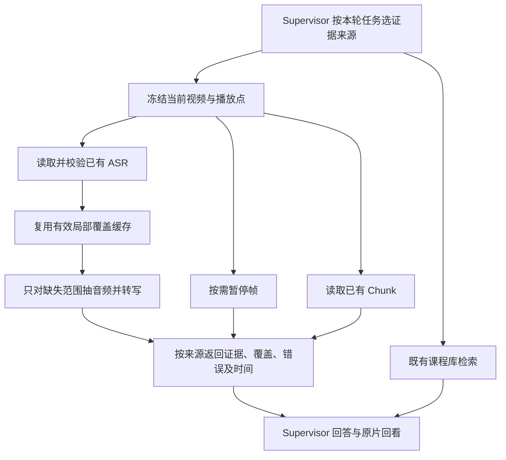

# 1. 问题与现状

需求：Chat 实时问答读取已有 ASR，缺失时补取局部语音证据。日期：2026-11-03。分支：`fix/realtime-asr-evidence`。PR：待创建后回填；目标 `dev`。当前阶段：设计初稿，尚未实施。关联问题 C28、课程 QA RT07。

42:53.152 提问“现在老师在讲什么？”时，`understand_current_video` 用时 4.034 秒，返回 41:00–44:00 三个 Chunk 的 `PARSING_FAILED` 缺证信息。相同媒体的独立 ASR 已有 2,476 条，通过 Schema、结果哈希和媒体身份校验；39:53.152–42:53.152 有 62 条重叠 cue，包含 B/T/C = 4/8/2 的讲解。工具没有读取 ASR，助手又误称语音转写失败，导致可回答的问题没有交付。

证据来自 [QA 复现报告](https://github.com/owariband/Seekino/blob/chore/course-qa/docs/report/server/course-qa-realtime-asr-gap-20261103.md)、[RT07](https://github.com/owariband/Seekino/blob/chore/course-qa/docs/design/03-product-reassessment/course-qa-trd.md)。历史请求未测 FTT，页面约 7 秒仅为用户报告值。复现任务 `2a531c4f-2c73-4cc2-adaf-5156edc26236`，不能用另一个已经补齐 Chunk 的任务替代失败态验收。

当前调用链：Supervisor → realtime runtime → Server `prepare_context/ensure_chunk/observe_frames`。准备阶段要求固定 Chunk 拓扑，`ensure_chunk` 受父任务失败状态影响。现有 `load_or_begin_video_asr` 还绑定正式解析租约，不能直接用作失败任务的只读取证。当前 Query Hook 对 playback 输入跳过，QA 未启用 Jev，故本故障不归因于 action 枚举。

依赖 [#18](https://github.com/owariband/Seekino/pull/18) 的 `video_parse_content` 与既有 ASR 适配器；该 PR 已于 11-03 合入 dev（`99e27b04`）。本分支直接基于合并后的 dev。[#30](https://github.com/owariband/Seekino/pull/30) 的任务查询与 Consumer 恢复独立进行，本需求不接管其运行任务或修改完整解析生命周期。

本次交付：语音独立读取、局部补算与覆盖缓存、暂停边界、按需视觉及已有 Chunk 组合、Supervisor 交付及课程库组合取证。保留权限、来源版本和原片回看。完整解析恢复、Jev 全面改造、声学强制对齐、课程全量质量与性能不纳入本 PR。

# 2. 影响因素、假设与评价指标

| 因素 | 判断与假设 | 验证 |
| --- | --- | --- |
| 状态耦合 | 父任务失败不等于独立 ASR 无效；只读取证应基于授权、媒体和成果完整性 | 失败任务、无 Chunk 拓扑、有效/损坏 ASR 的隔离用例 |
| 证据选择 | 讲解问题应首先取得语音，具体视觉主张才需要看帧 | Supervisor 工具调用与真实问答 |
| 时间窗口 | 默认向前 180,000ms 足以解释当前讲解；跨暂停 cue 需显式区分 | 首尾、换位置、边界 cue、真实 42:53 样本 |
| 重复计算 | 按媒体身份、ASR 配置及实际覆盖复用可避免每轮重跑三分钟 | 重复、相邻、并发请求和失效场景 |
| 缺口表达 | 按来源报告状态可避免把 Chunk 失败解释为 ASR 失败 | 部分成功、空语音、超时、媒体/模型失败 |

| 指标 | 定义 | 基线 | 目标/护栏 | 测量条件 |
| --- | --- | --- | --- | --- |
| 内容与回看 | 回答有语音依据，引用原视频绝对时间 | RT07 失败 | 正确解释讲解，链接可定位，不把后续话当成已听内容 | 同媒体同暂停点，保留失败任务样本 |
| FTT | 客户端发出至首个真实正文 delta；另标记是否仅前言 | 未采集 | 待补同条件基线，不以进度冒充正文 | 冻结代码/模型/输入，记录样本量 |
| TT | 客户端发出至本轮完成 | 页面报告约7秒，非精确实测 | 待测；分别报告命中和首次补算 | 包含取证、最终回答与失败 |
| 语音取证耗时 | 读取/补算开始至证据或失败返回 | 无独立语音路径 | 待测；缓存、已有 ASR、冷补算分列 | 记录读取、音频提取、转写和覆盖 |
| 新增 ASR 次数 | 实际 Provider 转写调用次数，含失败与重试 | 该历史工具未调用 ASR | RT07 为0；重复完整覆盖请求为0 | 按单请求及共享工作归属计数 |
| 状态与隔离 | 任务、媒体、内容和租户身份 | 已有合同 | 不改完整解析状态，不跨身份复用，不误报完成 | 请求前后核对与越权回归 |

延迟阈值在探索性基线测量后冻结；样本不足不宣称稳定分位数。功能通过、模型质量与服务部署分别报告。

# 3. 改造方案与建模

## 3.1 时间、来源和调用链

冻结本轮授权视频、媒体身份、播放点与问题，默认语音请求为 `[max(0,t-180000),t)`。t=0 返回空的过去窗口，不人为取未来音频。字段内部统一原片绝对毫秒。

已有有效整片 ASR 可直接完成语音路径，无需创建 Provider、下载权重或触发 Chunk 生成。读取使用 Server 的受权查询与独立验证，不调用带写入及正式租约要求的 `load_or_begin`。保留来源任务/版本、正文摘要、媒体身份及实际覆盖；拒绝损坏或身份不符的结果。成功覆盖但无语音与未处理区间分别表示。

局部缺失经既有模型配置及 Whisper 适配器补算；使用原视频抽音频、公共时间归一并添加起点偏移。局部成果不冒充整片完成，不写入完整 ASR 列，不触发 Understanding、Refine、Index。模型或媒体失败保留明确来源与原因。

Chunk 为已有的补充事实；语音不依赖固定 Chunk 拓扑就绪。问讲解优先语音，问代码/公式/符号时按需并行看暂停帧。画面和 Chunk 部分失败不抹掉已取得语音。返回结构区分请求窗口、各来源覆盖、转写、原帧观察、错误、裁剪/省略和来源身份；保留工具输出预算，省略不能伪装成缺证。

## 3.2 暂停边界

不改变正式 Parse 的完整跨 Chunk cue 合同。实时返回单独标注跨窗口/暂停的 cue，保留原始时间；仅在有可信词级时间时裁剪文字。不能只截时间戳却保留未来的整句文字。PR #18 当前 Mac 路线没有独立声学强制对齐，因此不默认声学精确性。完全位于暂停点后的 cue 不进入默认语音结果；边界 cue 不得被表述为已全部听过。

## 3.3 缓存、并发与取消

局部转写与问题无关。缓存按授权视频/媒体摘要、ASR 模型和配置身份及覆盖区间复用；相邻请求先减去有效覆盖，只补缺口，必要音频边界重叠应记录。首次采用有容量上限的 Server 进程缓存，成功结果和无语音结果均记录覆盖；重启后的跨进程复用不作为首批承诺，整片持久成果仍可读取。若实测显示局部重启成本需要持久化，再调整本节及验收，不静默引入新表或 Redis。

相同身份的并发工作合并；等待者取消不能破坏其他等待者，但共享工作保留原始期限、容量限制和媒体生命周期。未完成、失败、损坏结果不作为成功覆盖。新请求重新使用冻结的播放点，媒体/模型变化失效缓存。回包前再次检查权限和来源身份；取消/超时不能伪装成来源失败继续生成答案。

## 3.4 路由与职责

`action` 沿用 `respond/retrieve/mixed`；`evidence_sources` 允许空、`playback`、`library` 及两者组合。由现有 Supervisor 的一次本轮取证决策表达，不新增两次串行前置模型调用，也不以 Jev 改造为前置依赖。普通感谢或改写已有内容不自动触发实时取证；依据新证据进行解释仍属于 retrieve，mixed 须含独立回应任务。

| 请求 | action | evidence_sources |
| --- | --- | --- |
| 现在老师在讲什么 | retrieve | playback |
| 压缩你刚才的解释 | respond | 空 |
| 当前公式在其他课程哪里讲过 | retrieve | playback + library |
| 先改写刚才解释，再找另一门课例子 | mixed | library |

Server 负责权限、数据、媒体、缓存和执行；Engine 复用媒体与转写时间合同；Agent 负责按需取证、结果结构和交付；Gateway 保持通用模型适配。保留既有当前视频访问与课程库范围，播放上下文不扩大库检索权限。

# 4. 对照实验与结果分析

初稿仅列计划，尚无本 PR 实测。先跑直接覆盖行为的自动化，再真实隔离试点，不把现有服务作为测试 fixture。保存代码、输入身份、模型配置、调用与时间证据。

| 用例 | 基线 | 通过标准 | 本 PR 结果 |
| --- | --- | --- | --- |
| RT07 42:53：父任务失败、无 Chunk、已有 ASR | 工具漏读，回答失败 | 已有语音解释与回看，新增ASR=0 | 待测 |
| 无拓扑但有有效语音 | 准备阶段可能阻断 | 无需补完整解析即可取证 | 待测 |
| 独立缺转写 | 无轻量语音路径 | 默认最近三分钟，绝对时间正确 | 待测 |
| 重复/相邻/并发请求 | 无局部覆盖缓存 | 重复0次；相邻只补缺口；并发共享 | 待测 |
| 换位置、视频首尾、跨暂停 cue | 部分边界未覆盖 | 新窗口，不把未来或旧位置当当前 | 待测 |
| playback + library | 已有两类工具 | 实际完成两源取证与来源解释 | 待测 |
| 谢谢/改写/压缩 | 需保留行为 | 不新增语音或画面调用 | 待测 |
| 无语音/损坏/越权/媒体失败/取消超时 | 来源混淆风险 | 区分原因，守住授权与取消合同 | 待测 |

真实样本按“已有 ASR / 首次局部补算 / 局部缓存命中”分组记录 FTT、TT、语音耗时和新增 ASR 次数。失败样本保留，不用库里已补齐 Chunk 的成功任务替代 RT07。

# 5. 试点验证与方案取舍

在独立环境读取已授权素材，先只读提取原 RT07 的媒体/ASR 证据，避免更改共享课程库。局部缺证使用独立样本；模型调用记录实际次数。真实 Chat 需要从请求、工具、正文到原片时间链接核对。运行环境不足时写清缺口，不用模拟结果宣称实模效果。

现有 #30 的 API/Consumer 与 v11 不由本 PR 接管或重启。试点服务独立端口和存储，正式测试禁止初始化/清理共享课程库。复用收益以少调用、正确讲解和实际延迟评价；按需视觉的行为变更通过具体视觉问题回归。

# 6. 结果验收与闭环

当前仅建立设计。首批完成需逐项满足第4节，记录相关定向测试、真实效果、部署状态与未验证项。C28 的 TODO/DONE 只在 problems 维护；决策与对照进入统一 devlog，证据放 `docs/report/server/`。同步原[实时理解设计](../02-agent-harness/realtime-parse-trd.md)的现行入口，保留其历史合同。

完成时回到“已有 ASR 却无法回答”验证，不能只提供更准确的失败说明。实现、测试、真实问答与部署分开报告；未完成必过项保持 Draft 并列明下一动作。
