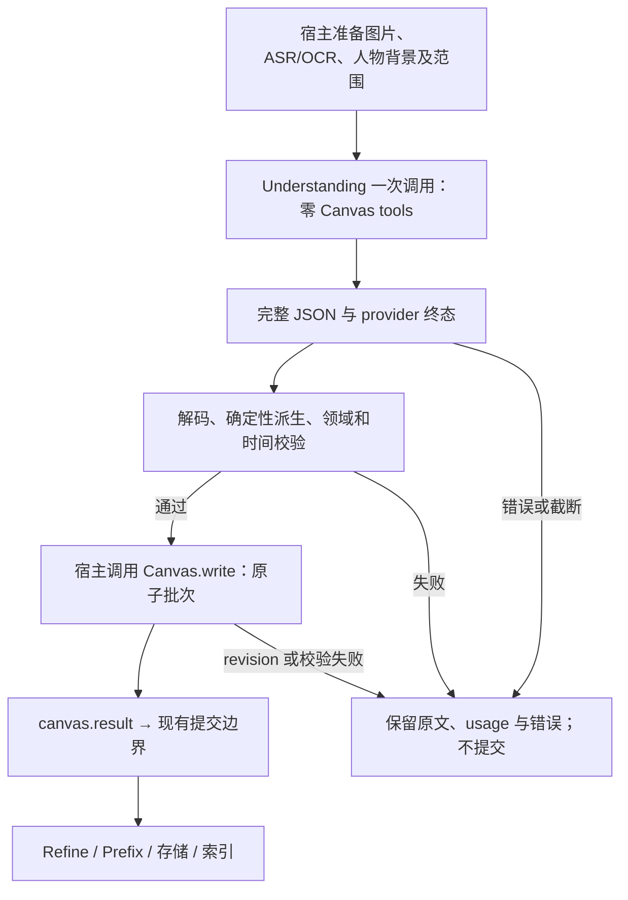
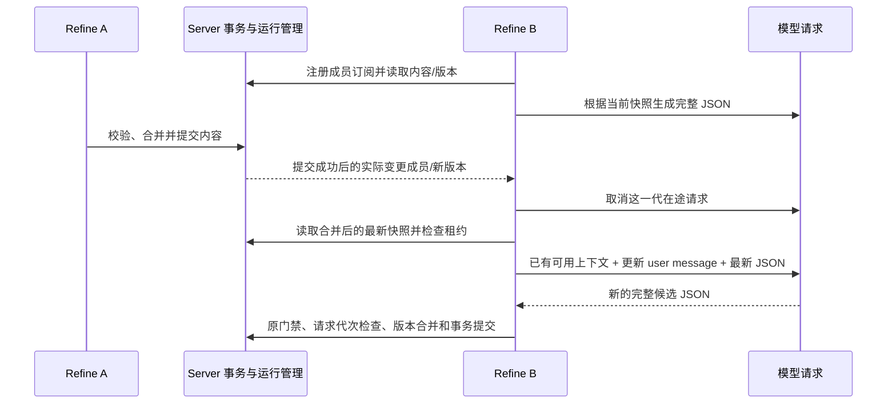

# 1. 问题与现状

**需求：视频解析耗时治理与 Understanding 输出协议验证。** 类型为 `perf`；协议接线属于实现手段，独立正确性修复按 `fix` 记录。更新：2026-11-02（Asia/Shanghai；历史结论保留日期）。 11-01 最新：Refine 已接入直接 JSON 并完成真实区间提交试点，详见 §3.9、§4.14、§6.4。本轮最新评审增量见 §1.9、§2.7、§3.11、§4.16、§5.6、§6.6；中断重发已于 11-01 获准实施，实现计划见 §1.10/2.8/3.12/4.17/5.7/6.8；交付统一归于 [PR #18](https://github.com/owariband/Seekino/pull/18) / `fix/video-asr-recovery`，同日撤回另开 #26 的安排，见 §6.10。11-02 实现与本地验证见 §1.11/3.13/4.18/5.8/6.9；真实 Kimi 并发收益尚未测。遵循 [TRD Principle](../common/trd-principle.md)。

已完成两轮各 8 次单 Chunk 协议实验。第二轮按用户意图取消人物名单并增加 SHOT，同字段精简 XML 的尝试耗时中位数比 JSON 高 21.97%（K3）/18.21%（豆包），未取得替换依据；豆包 JSON 仍有一次合同失败，全部结果仍错认已知画外音。用户已作出最终取舍：保留 Schema 精简，继续使用 JSON，不采用 XML；解析质量优先，不再追求单 Chunk 30 秒，以既有可靠并行解析策略满足当前效率需求。此次协议选型研究结束。2026-10-30 已在 dev 将正式 Understanding 改为直接 JSON、宿主原子导入 Canvas，并将默认及本机视觉主模型/fallback 输出预算改为 30,000；Refine 保留工具。精简字段/SHOT 合同仍未迁移，服务加载与新实模时延尚待验证。问题状态统一归入 [problems B07](../../dev/problems.md#b07视频解析成本高昂且耗时超过片长数倍)，阶段决策见 [初稿 devlog](../../dev/devlog.md#devlog-parse-performance-20261028)、[首轮实验 devlog](../../dev/devlog.md#devlog-parse-protocol-20261029)、[精简合同实验 devlog](../../dev/devlog.md#devlog-parse-compact-shot-20261029)、[最终取舍 devlog](../../dev/devlog.md#devlog-parse-protocol-decision-20261029)。本文维护设计、验收口径及证据边界，不另建任务看板。

**11-01 当前续版：** Kimi 流式下的 Understanding/Refine 推理耗时调查已落入 §1.6、§2.4、§4.10；本次按用户授权仅做全量图片与 timestamp 相邻配对，已恢复同一隔离课程任务实跑约 10 分钟；新增 10 个 Understanding、2 个 Refine，重现 600 秒总预算超时后暂停。其他条件保持，未证明整体提速。旧协议结论仍按 10-29/30 日期理解，不能将下文历史“待部署”当作本轮状态。

## 1.1 用户问题与期望

用户导入影视素材后，需要尽快获得可检索、可回看和可供剪辑消费的剧本事件。历史上约 23 分 40 秒的 EP04，即使 4 并发，媒体、OCR 与 Understanding 仍曾耗时约 28 分钟；长等待和失败重算增加使用成本。只得到更短的摘要、少量对白或可解析的空洞结构，无法满足这个需求。

用户提出的排查维度包括：每 Chunk 的 FFmpeg 启动与 warm-up、模型承担过多工具职责、thinking、输出 Schema、ASR 与 OCR 选型。它们是需要分别验证的因素，不能把整份列表直接称为“已定位根因”。目标是建立**质量合格且可复现的性能基线，再减少无效工作**。60 秒 Chunk 理解约 30～40 秒是历史探索目标；2026-10-29 用户明确不再把单 Chunk 30 秒作为优化或验收目标，原因是需要保障解析质量，当前效率由既有并行策略承担。该取舍不倒改历史实验门槛或成绩。

## 1.2 当前实现及证据

| 环节 | 核对到的事实 | 对本次工作的约束 |
| --- | --- | --- |
| 媒体准备 | 已有整集批量抽帧、一次音轨提取和共享资产路径；见 [媒体 Service](../../../server/service/video_parse_media.py)、[历史交接 §2.2](handoff_to_new_pc.md) | 不从零重做，也不将 FFmpeg 常驻作为已证实解法 |
| Understanding | [workflow._understand](../../../agent/video_parse_v2/understanding/workflow.py) 建 Canvas 并登记观察，最终读取 `canvas.result`；[Service.understand_chunk](../../../server/service/video_parse.py) 直接生成 `VideoParseResult` JSON；宿主原子写入人物及事件 | Refine 继续用 Canvas tools 和 Deep Agents；旧提交边界不变 |
| 模型调用 | [Gateway factory](../../../gateway/model_factory.py) 的结构化生成入口预检 JSON Schema；[Ark adapter](../../../gateway/ark/multimodal.py) 有结构化输出约束；已有文本流入口不能直接等同于所需的多图文本生成 | 正式接入复用现有结构化 JSON 生成与终态校验，不接 XML；实验普通文本通道与此不同 |
| 领域与下游 | [VideoParseResult](../../../engine/parsev2/schemas.py)、[时间校验](../../../engine/parsev2/validation.py)、[ParseContextCanvas](../../../agent/video_parse_v2/timelineEvent_canvas.py) 已定义结果与提交约束 | 首轮 XML 可转换旧对象；第二轮 SHOT/删名单改变语义合同，暂存实验模型，不能直接承诺旧链路兼容 |
| 协议实验 | [首轮](../../report/agent/video_parse_v2/parse-protocol-20261029.md) 8 次有 6 份合同有效；[第二轮](../../report/agent/video_parse_v2/parse-compact-shot-20261029.md) 8 次有 7 份有效；相关测试合计 58 项通过 | 精简后 XML 未显示整体性能收益；两轮均未通过已知画外音目标，未验证生产端到端提速 |

2026-10-26 的 [XML v2 设计](parse-output-xml.md) 和 [交接记录](handoff_to_new_pc.md) 保留历史规则与数字。两轮实验曾采用用户提出的 `<event><dialogue>…</dialogue></event>` 方向，以下称“事件包装 XML”；最终决定不采用，保留为研究证据，不再作为后续默认候选。

## 1.3 本次边界与材料缺口

先验证单 Chunk 的直接 JSON 与事件包装 XML，再决定生产接入和扩大样本。首轮沿用七种 Event 和人物名单；2026-10-29 用户进一步确认第二轮删除逐事件 `participants`、`visible_persons`，增加独立 `SHOT`，具体候选见 §3.5。原文/译文、可靠 speaker、绝对毫秒和左闭右开边界继续保留。Refine、Prefix、声纹、数据库、索引的职责不在本次实验修改范围内；其耗时仍须进入整集诊断。

2026-10-29 已在 `assets/library/sources/mygo/` 恢复 EP04，SHA-256 为 `50e981e49a3d74e8c0aca7571ffae8265b88f6388f1d34849876b61ad8bf5814`，与旧记录相同；容器时长 1420.178345 s、1920×1080 H.264、AAC 音轨。旧 `outputs/verification` 输入与模型原文仍未恢复，旧数字仅为文档留存。本轮另建冻结目录，不将新转写、新 Prompt 或新模型结果冒充旧实验复现。数据库恢复另行核验，本轮不修改 Video、SQL 或 ES。

## 1.4 最终取舍：精简 Schema，继续 JSON，质量优先

2026-10-29 用户原始结论：

> 精简了schema，但是不换xml，因为收益不明显
>
> 同时为了解析质量认为没有必要盲目追求单chunk 30s的效率
>
> 我们虽然引入了更高的人力成本，可是我们提出了很可靠的并行解析策略，足够了。

据此确认当前方向：

- **输出协议采用 JSON，保留 Schema 精简与 SHOT 方向。** XML 的替换收益不足以支持新增接入和维护成本，本轮协议选型闭环，不继续默认追加 XML 对照。
- **质量优先。** 不为达到 30 秒而减少必要事实、削弱身份/时间判断或压缩必要推理；单块耗时保留为诊断数据，不是孤立的硬性目标。
- **沿用既有可靠并行解析策略。** 接受更高的人力成本，认为该策略足以满足当前效率需求；以整集到索引可见的实际耗时、完成率、失败恢复、成本和内容质量评价实际表现，不用单块速度代替吞吐与交付。此处记录用户的工程取舍，不新增未经测量的并行加速比或人力成本数值。
- **实施状态分别记录。** 精简合同已完成实验，生产 Schema/SHOT、旧数据与下游兼容尚未迁移；2026-10-30 已先接入宿主直接 JSON 输出与 30k，沿用现有提交与恢复边界，未修改并发配置或重启服务。

此前提出的视觉输入裁剪实验不再作为自动续跑事项。用户随后要求以更长、更多元的片段补足质量证据，新增 §4.7 的分阶段计划；它不重开 XML 选型，也不以证明某供应商较差为目标。47 秒身份错误属于两模型共有的缺证场景，不能由此推定豆包 non-thinking 质量更低或串行无法 Refine。说话人/分段问题保留在原入口，补证机制与调度方式分别验证。用户进一步明确比较对象是“携带前文上下文的轻量串行 workflow”；此前实验只是独立请求按顺序执行，不能代表该基线。保留当前生产并行是现行选择，其额外复杂度是否优于这个串行方案仍未由本轮证明。

## 1.5 2026-10-29：Karpathy 正式任务未推进的独立故障

用户发现正式任务持续失败。8 集提交快照意外启用了独立 OCR，与用户要求关闭 OCR 不一致；前两集出现 OCR `finish_reason=length`、连接断开/超时，理解阶段累计 119 次成功 HTTP 返回却未提交 Chunk。Context Controller 在 provider 实报约 248K 后仍取约 422K 的通用图片估算上界，持续释放新读到的工具结果；恢复时还发现子任务等待已停止父任务的媒体文件，却继续给自己续租。原始快照及修复验证保存在 `outputs/verification/parse-failures-20261029/`，与上文协议实验分开解释。

## 1.6 2026-11-01 续版：Kimi Parse 推理耗时调查

沿用 ASR 恢复工作分支 `fix/video-asr-recovery` 和 [PR #18](https://github.com/owariband/Seekino/pull/18)，本次是完整课程接入试点发现的下游问题与最小输入改动，不另开重复 PR。前置流式实现来自已合并 [PR #20](https://github.com/owariband/Seekino/pull/20)。以下是 10-31 已暂停实跑证据与 11-01 用户新授权，不覆盖 §1.4 的历史取舍。

完整 Let's build GPT（116 分 20 秒，117 Chunk）已完成整片 ASR 持久恢复，但 Kimi stream=true 下仍慢：14 个成功 Understanding（每块 60 秒，无工具）的阶段中位数 320.173 秒、平均 335.174 秒，最慢 563.118 秒。每次实际 198 张图、约 24.4 万 input tokens；85.1% 的已上报 output tokens 属于 reasoning。慢样本在逐帧映射时间及核对事件；这只是行为诊断，尚未证明因果与无效推理占比。

Refine 有 5 次真实超时，其中 1 次首轮 0 SSE、4 次多轮共用 600 秒耗尽；另 2 次完成分析后因并发时间线冲突重算。暂停时只提交 20/117 Understanding、1/115 Refine，本轮新增 ASR 为 0；完整闭环未验收。详细时序、工具、usage 和不确定性见[报告](../../report/server/kimi-parse-trace-20261101.md)。

## 1.7 11-01：整片 ASR 跨 Chunk 对白与 Refine JSON 对照

用户明确调整合同：输出时间允许超过 Chunk；整片 ASR 默认作为主要对白依据，包含画面范围外的对白也应保留，由 Refine 处理重复和衔接。Prompt 只描述“整片 ASR”，不注入底层实现名。用户同时要求比较 Canvas 工具精修与直接修改输入 JSON。沿用 PR #18，不增加并行需求。

上一首块 trace 中两段约 43/52 秒的可见推理在切句及边界处理间反复，且最终仍把跨界正文写进截短时间。运行时目前仍在 Agent、Canvas 与 Server 提交处限制 Chunk/Interval 时间；仅改 Prompt 不等于正式接线。先使用已保存真实输入、生产 Gateway 和模型，运行不写库的有界对照；不重启 API、不恢复整集、不重算 ASR。

## 1.8 11-01：可修正错误丢失原输出，放大 Refine 重算成本

10 路 GPT v4（`2a531c4f-2c73-4cc2-adaf-5156edc26236`）中，两份完整模型结果因 timeline 未按 start_seconds 排序被拒。两次实际第二请求都包含字段位置和 guide；此前把单次请求 failed 当作整个 Refine 失败的解释不完整。一个区间修正后于 19:25:35 提交成功、总计 416.023 秒；另一个于 19:25:45 通过结构校验后，与相邻区间对共享 Chunk 的修改冲突，刷新快照后耗尽 600.106 秒，19:29:07 进入任务重试。

已确认的反馈缺口是：模型返回值先在适配器内按业务 Schema 校验，失败时完整 JSON 没有送到 Refine；Harness 只把原始输入和错误描述重新交给模型。它不能在刚产出的 JSON 上定位修正，且纯数组顺序也需要额外模型请求。原有 mock 测试只确认错误提示存在，未证明真实接收边界保留了上一份输出。本次仍属于 PR #18 的 Refine 接线补强，不新增 Gateway 业务能力，不改变并发、超时、租约或媒体合同。

## 1.9 11-01 22:00 续版：重叠 Refine 使用旧快照，等待整轮生成后才发现冲突

本节与 §2.7、§3.11、§4.16、§5.6、§6.6 构成本轮评审增量，沿用 `fix/video-asr-recovery` / [Draft PR #18](https://github.com/owariband/Seekino/pull/18)。**本轮只收集旧实现基线和完善设计；先 review TRD，再决定是否开发内容更新通知、中断和重发。** 原始记录及可复核数据见[基线报告](../../report/server/refine-interruption-baseline-20261101.md)。下文旧试点的“暂停”“运行中”均按各自时点理解。

完整《Let's build GPT》为 116 分 20 秒、117 个 Chunk、115 个三块重叠 Refine 区间。11-01 21:56:22（Asia/Shanghai）重新查询隔离 API19621/MySQL：v4 `2a531c4f-2c73-4cc2-adaf-5156edc26236` 为 `PARSING_FAILED`，Understanding 81/117、Refine 53/115、索引 47/117，新增 ASR 0。任务 19:12:25.373 开始，20:51:27.825 结束，实际经过 5942.452 秒；完整课程检索、回看、追问尚未验收。最终一批为 `worker lease expired / Video Parse V2 worker lease was lost`；租约失效的触发原因还未定位，不能把本轮停止直接归因于某一次 merge 或 504。

**当前 Refine 链路：** Server 读取三个成员的内容、版本和证据 → Agent 组织完整 JSON 输入 → 一次流式模型请求返回完整 members JSON → 宿主 Schema/成员/来源校验 → Server 在租约事务内三方合并并提交。相邻区间共享 Chunk，各自生成期间仍持有旧输入；提交发生冲突时，Server 只返回 `False`，Agent 刷新快照重新生成，上一份候选和具体冲突没有进入下一轮上下文。协调器的普通唤醒事件不会把内容更新送给在途 Refine。

**已存在 merge，但不能处理所有内容修改。** `merge_refinement_content` 以 base/current/proposed 比较。只有类型、起止时间构成的唯一有序锚点保持一致，才可对齐事件并合并互不冲突的修改；双方都改 timeline 且出现拆分、合并、排序或时间变化时，会以 `timeline_structure_changed` 拒绝。当前 49 次冲突都属于这一类。这说明宿主无法可靠对齐，并不证明 49 次都是语义上不兼容的修改；本轮不靠放宽门禁静默覆盖新内容。

出现两个不同的恢复缺口：① Schema 拒绝后，旧进程仅传错误提示而没有上一份 JSON；§3.10 的反馈/排序修复已经写入源码并通过离线回归，但 API PID5207（18:49:36 启动）没有加载。② 内容变化在提交时才被发现，且冲突后丢失候选上下文；这是本轮拟实验的问题。运行源码来自未提交工作区，不能仅凭 HEAD `67223c16` 重建进程；报告保留修复前源码哈希、配置、请求和日志校验值，并明确缺少完整启动代码快照。

## 1.10 11-01：Refine 冲突恢复进入独立修复

**历史拆分记录，现已撤回：** 下述单独分支 / PR 及先后合入 dev 的计划不再执行。该缺陷属于 #18 已有解析链路的未完成验收工作，全部提交保留并归回 #18，现行交付范围见 §6.10。

分支 `fix/refine-conflict-recovery`，[Draft PR #26](https://github.com/owariband/Seekino/pull/26)。上游 [PR #18](https://github.com/owariband/Seekino/pull/18) / `fix/video-asr-recovery@b01afce9` 提供直接 JSON、完整 Schema 反馈和稳定排序；本修复只交付共享成员更新通知、请求范围中断、候选保留和冲突恢复。PR 暂以上游分支为 base，只展示修复差异；#18 先合入 dev，本修复再转向 dev。首个提交只修订本 TRD，不夹带实现。本文仍为解析性能主设计，不新增竞争 TRD。

49 次合法输出因共享 timeline 已变化而未提交，已用真实 base/current/proposed JSON 重放并关联实际提交者。GPT v4 的 99 分 02 秒是失败经过时间，不是 204 分钟并发请求累计占用。最后完成索引的 Chunk 49 等待 `[48,49,50]`：输入在 19:49:06 就绪，31 分钟后才启动；第一次因两次冲突耗尽约 600 秒，重试后 170 秒成功。固定输入就绪和派发顺序的时间重排估算，删去已确认冲突请求可让同一批 47 个索引提前约 10 分 41 秒；该估算不是已测提速，也不是整集完成时间。

产品目标为整集 116 分 20 秒在约 58 分 10 秒至 69 分 48 秒完成解析/索引。新片音频准备计入、缓存恢复单列。本修复解决冲突造成的无效生成，不能单独承诺整课达标；首 SSE 限时、Understanding 批次调度、模型/帧数和音频选型不在本次实现中。

## 1.11 11-02：实现阶段发现实际 HTTP 取消仍可能阻塞

共享成员更新通知、完整候选恢复和请求范围取消已落入 #26。可控回调测试不能覆盖真实 socket：用实际 OpenAI SDK、同步 HTTPX 和本地 HTTP/SSE 连接复现，取消后的读线程仍停在 `recv`，直到本次 0.7 秒总期限耗尽；这是连接退出缺口，不能把“发送取消信号”当成停止计算的证据。补充通用 HTTP/1 读流唤醒后，本地 HTTP 和 HTTPS 验证才通过。

11-02 只读核对原隔离服务：PID5207 与 API19621/MySQL13361/Kimi代理18846/ES19231 均未运行。本次未重启这些服务、修改旧任务或调用外部模型；11-01 的 99 分钟失败仍为历史基线，不是本次实时进度。完整课程效果不因离线测试通过而验收。

# 2. 影响因素、假设与评价指标

## 2.1 因素与可证伪假设

以下保留两轮实验的因素拆解与可选诊断方法；最终执行优先级以 §1.4 为准，不把每一项可能对照转成新的默认任务。

| 因素 | 已有证据与未知部分 | 下一项对照及影响的决策 |
| --- | --- | --- |
| F1 媒体重复准备与冷启动 | 批量解码已实现；历史整集媒体准备 24.32 s，但整个流程反而变慢。没有“每块 FFmpeg 启动必浪费几秒”的独立测量 | 分别记录进程启动、探测、解码与复用时间；固定媒体输出比较重复准备/共享资产，再决定是否仍需改媒体路径 |
| F2 工具职责与上下文 | 改造前模型需读观察、写 Canvas、检查与完成；10-30 已去除此职责；旧 Canvas 和零工具实验的帧数、并发不同 | 同一输入比较 Canvas 与直接输出，统计请求轮次、工具读写、输入预算与质量；只在独立实验中改变工具条件 |
| F3 模型与 thinking | reasoning 和首正文等待可能很长；首正文前还混合上传、排队、预填充等 | 固定精确模型版本与实际出站 effort；同模型内做协议对照。不可观测的服务端阶段保持未知 |
| F4 输出协议与冗余字段 | 首轮 XML 对完整 JSON 的任务负担不同；名单遗漏不应在删除该需求后继续判为业务质量失败，但说话人/主体错误仍有业务影响 | 第二轮采用同字段精简 JSON/XML，均去掉人物名单并增加 SHOT；保持业务事实检查。新旧轮次包含多项共同任务变化，不能将差值全部归因于删除两个字段 |
| F5 视觉输入与缓存 | 180 张 720p 帧；旧 detail=low 减少输入 token，却出现单字化。新旧缓存命中不同 | 首轮固定图像字节、顺序和 detail；记录 cached tokens，交叉顺序复跑。后续单独调整 FPS/分辨率/detail，不混进协议结论 |
| F6 本地 ASR | 2026-10-29 本机 whisper.cpp + large-v3-turbo Q5 已完成一次转写；专名误识别和偏宽时间段仍存在，不能当真值 | 两协议共用同一份冻结观察；模型加载、ASR 与 Understanding 分开记录。量化影响和精确时间质量未做对照 |
| F7 OCR | 用户将首轮条件改为关闭独立 OCR，由 Understanding 直接读图；字幕不能自动变成独立画面文字事件 | 本轮只能比较无独立 OCR 条件下的协议。是否可长期省略 OCR，仍需后续字幕、小字、斜体、运动帧对照；PaddleOCR、DeepSeek-OCR-2 保留候选 |
| F8 重试、限流与 Refine 重算 | 旧专家分支触发 429、重复读图；B07 有 Refine 快照刷新记录 | 单块先禁隐式修复/fallback；保留失败调用。整集测调用和重算关键路径，不从并发累计时间直接扣实际耗时 |

两轮已验证 F4：精简可减少正文负担，XML 未显示足够替换收益，且关键内容仍有错误。因此不采用 XML；F3/F5 保留为未来出现实际整集瓶颈时的诊断方向，本轮不继续压缩标签或自动开展输入裁剪。

## 2.2 指标、计时与预设门槛

| 指标 | 定义与统计口径 | 基线 | 目标或允许退化 | 测量与证据 |
| --- | --- | --- | --- | --- |
| 诊断：`T_understanding` | 观察和帧文件就绪后，从本地请求组装开始到完整响应解码、领域及范围校验结束，单位 s | 首轮原始尝试值见 §4.4，尚无质量合格的配对基线；旧成绩见 §4.1 | 原两轮以质量合格配对降低 ≥10% 为协议探索门槛；最终不采用 XML。单块 30 秒不作为当前验收要求 | monotonic 时间、每次调用原始记录；包含图像编码/上传，不含预先完成的 ASR/OCR/抽帧 |
| 结果：`T_pipeline` | 从媒体准备开始到目标成果可用；整集接入验收终点为索引可见，包含 Refine、失败重试及等待 | 同片同配置的新基线待测 | 质量优先，沿用现有并行策略满足整集交付效率；记录完成率、失败恢复和成本，不以单块 30 秒替代 | 阶段时间线和执行区间并集；预计算 ASR 的实验另列，不拼成新鲜端到端结果 |
| 诊断：首正文/正文/宿主 | 请求组装、发出请求、首个非 reasoning 正文、末正文、终态、校验结束分别记时 | 两轮阶段样本见 §4.4/4.6 | 定位收益来源，不单独作为验收 | 实际流事件与单调时钟；首事件不等于首正文；正文到终态的间隔单列 |
| 诊断：token、调用与资源 | input/cached/reasoning/output、调用/工具/重试次数、本机峰值内存及 ASR/OCR 加载时间 | 两轮 provider usage 已留存；本机峰值资源及精确加载耗时未测 | 不因性能制造不可解释的成本或资源增长；试点前固定可接受预算 | provider usage 与本机观测；缺失记 unknown，不能记 0；reasoning 若包含在 output 中不重复相加 |
| 护栏：结构与完整性 | completed 且未截断，解码、领域/范围校验均通过；失败数/全部尝试数 | 离线 58 项通过；两轮均 8/8 completed；首轮 JSON/XML 各 3/4，第二轮 3/4 与 4/4 合同有效 | 候选样本无截断、隐式修复、非法结果被提交；失败不删样本 | 原始响应、终态、校验错误和归一化结果分别留存 |
| 护栏：内容 | 逐条标注对白、speaker、动作主体、动作/情绪/场景/镜头及画面文字；首轮另验名单，第二轮已删名单不再计错；分别算关键事实命中/应有事实、错误事实/输出事实，原文字符错误率 | 已有事前视觉检查表和逐次非盲审，完整金标及独立盲审仍缺失 | 关键证据无新增漏项/幻觉/错误人物；相对 JSON 不退化，同时须满足独立金标，不能两组都差仍验收 | 先冻结人工检查表，确认实验再独立盲审；翻译语义单独评分，不拿译文与日文做字符比较 |
| 护栏：时间定位 | 按已匹配事件分别统计起止绝对误差，未匹配事件记漏检；跨块台词检查相邻两块 | 待人工音视频边界标注 | 范围合法率 100%；业务可接受的边界误差阈值在确认实验前冻结，目前待定 | 不能仅以 ASR 与输出一致当真值；不能以范围校验替代剪辑入出点质量 |

10% 保留为两轮协议实验的原始筛选门槛，未因最终决定而倒改为达标。当前不继续追求协议提速或单块 30 秒；生产接入仍需按业务冻结绝对内容覆盖、时间误差及可接受成本，现有探索数据不代替验收。

每组报告全部耗时、成功/失败数、样本量、日期窗口、并发和缓存条件。首轮每组 2 次，只报告原始值、范围和探索性中位数，不发布 p95/p99 或“稳定快多少”。扩大样本后再按实际数量报告经验分位数及其局限；不得用均值掩盖超时。失败耗时独立列出，同时计入全部尝试成本；重试条件下从首次开始到有效结果的时间另算。

## 2.3 正式运行故障的验证口径

本次固定 WhisperX large-v3、3 fps、720 高度与全部视觉帧，按用户要求关闭独立 OCR。诊断指标为新版本 OCR 请求数（应为 0）、provider 实报与压缩估算关系、停止父任务后媒体等待是否退出。结果指标为真实 Chunk 的内容/ASR 时间证据提交，随后检查 Refine 与索引；服务启动和 HTTP 200 不作为解析完成。基线为前两集 0 个提交 Chunk；整集完成率与耗时仍需完整运行观察。

## 2.4 11-01 因素与本次指标

本轮只验证“图片与时间标签分离是否增加映射工作”这一假设。当前把 198 张图连续排列，末尾才给时间数组；改为逐图相邻标签可消除按位置查表的歧义，但能否缩短推理、提高时间正确性仍待实测。600 秒总预算、上下文增长、精修范围、工具误用和提交冲突是已发现的其他因素，本轮只留证，不并行修改。

| 指标 | 流式基线/口径 | 本轮目标与边界 |
| --- | --- | --- |
| 输入配对与完整性（护栏） | 内部 Chunk 198 图，3 FPS、720 上限、±3 秒 overlap | 每图前一条 timestamp_ms，顺序、帧 SHA 与采样不变；无分页/丢图 |
| Understanding 阶段时延（诊断） | 14 个成功样本 min/p50/mean/max=85.231/320.173/335.174/563.118 s | 记录新分布及失败；续跑不同 Chunk，不预设提速率，不报告 p95/p99 |
| 推理流/正文/usage（诊断） | 模型请求平均 334.626 s，推理流窗口 265.291 s | 用 SSE 边界计时；窗口含网络，不当纯 GPU；缺失 usage 不记 0 |
| 持久成果（护栏） | ASR 行/SHA 固定；已有 20 个 Understanding | 新增 ASR=0、已有提交保留、结果完成校验后才提交 |
| 业务效果（结果） | 整课未完成，人工内容与边界金标不足 | 记录提交/错误及抽查；输入配对成功不代表质量或整集验收通过 |

## 2.5 11-01 对照假设与护栏

假设 H1：简化职责、信任完整 ASR、取消 Chunk 截断可减少边界反复推理；H2：同一 JSON 精修任务使用直接结果能减少 Canvas 读写回合。两者分别比较，不把效果混算。首 SSE、reasoning 流、正文/工具输出、模型回合、usage、工具错误/超时分别记录；每臂仅 1 次，是探索，不报稳定提速率或尾分位。

护栏：图片/ASR/背景与模型参数固定；新增转写 0；不覆盖真实任务成果。结果必须通过 Schema、源视频范围与成员身份校验。人工逐项对照主要对白、跨界尾句、重复及原有视觉事件；只满足 JSON 格式不构成业务通过，耗时缩短伴随遗漏须作为失败记录。

## 2.6 11-01：错误修正的因素与护栏

把协议接收、业务拒绝、模型修正、版本冲突刷新、执行尝试失败和最终提交分别观察；一个 provider/request 状态不能代表整个区间终态。关键指标为：反馈是否保留完整最近输出、错误位置是否能在该输出中定位、纯排序是否触发新模型请求、语义错误修正是否仍受预算限制、非法时间/人物/成员能否落库，以及最终提交率与耗时。修复完整结果时新增输入 token 是明确代价；是否减少推理与重写时间需实模分布验证，不预报固定提速比例。

结构和语义不合法的输出不能因为接收类型宽松而成为成果。排序只能稳定调整真实整数 start_seconds 的事件排列，同时间保持相对顺序；不转数字类型、不截时间、不去重、不补字段、不改人物或文本。对照材料采用本次两份真实原始输出，以及经过适配器同一 model_validate_json 边界的坏 Schema、坏 JSON 和多轮修正用例。

## 2.7 11-01：内容更新通知的假设、指标与否决条件

核心假设是：有共享成员发生实际内容提交时，让仍在生成的 Refine 提前看到最新内容，可能减少“生成完成后才发现输入失效”的重算。**效率尚未保证。** 提交频繁时反复中断会丢弃在途生成、重新传入长上下文，可能使耗时与 token 增长；取消客户端请求也不保证供应商立即停止计算或停止计费。

| 指标 | 历史旧进程基线 / 口径 | 对照目标与护栏 |
| --- | --- | --- |
| 区间有效结果时长 | 已完成 53 个区间，从首次执行开始至最终提交，包含失败和重试等待；p50 820.336 s | 同输入 A/B 的主要耗时指标；不得只比较最后一次成功请求 |
| 成功尝试时长 | Refine n=53，p50 247.989 s；失败尝试 n=39，p50 600.781 s | 成功、失败、取消及未完成分别列出；不把失败删掉后宣称提速 |
| 冲突与重算 | 49 次 `timeline_structure_changed`，36 次尝试超时；29 次超时尝试同时出现冲突 | 按区间/租约/请求关联通知、中断、重发、再次冲突与提交；降低无效重算 |
| 模型调用与 token | Refine 190 次请求；141 次有 usage，其余 49 次未知；详见 §4.16 | 全部调用计入成本；缺失 usage 不是 0，不能仅按已知 token 判定省钱 |
| 内容与提交安全 | 当前版本/租约/来源门禁仍生效；整体人工质量未验 | 旧请求迟到、非成员及失效租约提交为 0；人工核对对白补漏/去重、speaker、时间与无关事件保留 |
| 中断代价及公平性 | 当前无主动内容更新中断，相关指标待测 | 记录通知合并率、被丢弃输出、取消耗时、在途重叠及饥饿；deadline 不延长 |

小样本先作探索。拟定进入完整 10 路课程试点的门槛：两轮相同输入的对照均有不低于 A 的完成率；区间有效结果耗时 p50 至少降低 10%，全批完成实际用时不增加；已上报总 token 增幅不超过 10%，且 usage 缺失比例不得恶化，否则成本结论保持未知；上述内容/提交护栏全部通过。10% 是本次拟定的工程筛选门槛，不是已验证收益或原单 Chunk 30 秒目标。若样本波动、网络变化或 usage 缺失无法支持判断，结论为待补证，不自动扩展实验。

## 2.8 11-01：冲突恢复的验证标准

| 对象 | 基线 | 本次标准与验证 |
| --- | --- | --- |
| 在途旧输入 | 实际冲突后继续生成数分钟，甚至 Schema 修正沿用旧快照 | 本进程普通 Refine 实际内容提交后，仅共享成员执行收到更新；可取消流在确定性用例中及时关闭，下一请求读取最新版本 |
| 已完成候选 | 提交 False 后候选丢弃 | 能合并直接提交；不能合并则保留完整候选、具体冲突位置与最新 JSON 再请求，不重新 ASR/Understanding |
| 并发正确性 | 原租约/版本/内容摘要事务校验 | 保留全部门禁；旧请求晚到不能提交，不覆盖他人提交；回滚/无内容变化不通知 |
| 资源与预算 | 整个执行 cancel 后不可继续；600 秒有效预算 | 请求取消不取消整个 Refine；等待旧调用释放后重发；总 deadline 不重置，租约失效和用户暂停正常终止 |
| 恢复成本 | 旧 v4 非受控且未完成 | 使用既有相邻区间冻结副本对照总经过时间、完成数、被中断后的继续生成时间、请求数及完整 token 覆盖率，不把并发累计耗时当经过时间 |

取消可能不能即时停止供应商远端计算；本地旧流未退出时不启动新请求。通知误中断本来可安全合并的候选可能抵消收益，因此已返回完整候选优先提交，真实性能必须试验后判断。没有足够完整样本不报告稳定 p95/p99。

# 3. 改造方案与建模

## 3.1 方案与取舍

| 方案 | 作用因素与预期收益 | 代价与当前选择 |
| --- | --- | --- |
| 保留 Canvas 工具流程 | 保持原有工具编辑能力 | 作为既有行为基线；不能解决本次职责过重问题 |
| 零工具直接完整 JSON | 移除 F2 工具回合，复用现有领域模型 | 作为协议对照；保留冗余字段，但实现风险较低 |
| 零工具事件包装 XML | 减少 F2/F4 的工具与重复表达，明确 speaker/正文边界 | 不采用；两轮实测未形成足够收益，保留历史代码和证据，停止协议扩跑 |
| 零工具精简 JSON | 与 XML 使用相同语义字段、默认值与校验 | 选定输出方向；第二轮已实测，仍需完善质量及完成生产接入 |
| 多专家拆分/降低视觉预算 | 影响 F3/F5/F8 | 旧结果有 429、重复图像输入和质量缺口；本轮不继续，以后仅针对具体业务瓶颈另作判断 |

已有研究可用于设计检查表：[OmniScript 调研](../../research/2026-10-24-omniscript.md) 提醒分别验收内容与时间、维护跨段身份。外部模型得分不是 Seekino 效果；更换模型、视觉压缩或 OCR 都需自己的对照。

## 3.2 事件包装 XML 的候选合同

**以下保留首轮合同与样例。第二轮模型输出采用 §3.5 的精简合同；本节原有名单要求不继续施加给新一轮。** 历史结果仍按当时合同记录，不倒改失败。

沿用用户提出的层次，修正为标准 XML 属性引号和语言标签。下例只演示语法，不是模型结果或对片段事实的认证：

```xml
<timeline>
<event start="60000" end="64200" participants="千早爱音,高松灯" visible="千早爱音">
<dialogue speaker="千早爱音" lang="zh-Hans">
你其实很想组乐队吧
<original lang="ja">本当はバンドやりたいんじゃないの？</original>
<description>千早爱音没有看着高松灯，抬头询问。</description>
</dialogue>
</event>
<event start="64200" end="66000" participants="高松灯" visible="高松灯">
<action>
高松灯低下头。
</action>
</event>
</timeline>
```

- 每个 `event` 有且只有一个主类型：`scene/dialogue/action/emotion/relation-change/screen-text/other`。时间放包装层，为原视频绝对整数毫秒；运行时传入允许范围，禁止硬编码第一块 `[0,60000)`。
- speaker 使用属性，台词正文不再重复姓名；未知 speaker 省略并映射为 null。`participants` 为完整语义参与者，已知 speaker 必须在其中；`visible` 独立记录可见人物，不能靠程序补人物关系来过校验。
- 任务级默认主语言、主角色、原文语言只声明一次；示例为 `zh-Hans/TRANSLATION/ja`。允许 `lang/role` 覆盖；`original` 可用默认原文语言，额外 `translation` 必须写 `lang`，禁止同 language+role 重复。没有译文证据就保留原文，不能为默认语言编造翻译。
- 对白 `description` 可选，只写额外观察；缺省由宿主用“speaker：台词”生成内部描述。非对白正文是描述，screen-text 正文是文字。`persons` 从明确名单和 speaker 汇总，类型从标签映射，时间由宿主稳定排序；这些都不要求模型反复生成。
- 换行和缩进不是语法分隔符：紧凑、分行、CRLF 均能解析。解码器只剥离正文边界空白，正文内部空格和换行保留；删除台词内部换行可能改变内容，不能无条件预清洗整个 XML。
- 属性必须带引号；`&`、`<` 等按 XML 转义。拒绝未知字段、DTD/entity 声明、非法时间、截断及重复补充字段；不补闭合标签、不用正则修复半份输出。流式接收完整后才校验提交，不逐事件提前写库。

上述规则已经落在实验 decoder，覆盖的是实验输入合同。最终字段语义仍由用户继续完善；任何改变须同步 Prompt、decoder、样例与质量检查表，再开始对照。旧 v2 原文保留供历史阅读，不能混用两版 Prompt。

## 3.3 接入职责与失败路径（2026-10-30 已实现直接 JSON）

本次按用户点名的两项先落地去工具与输出预算，沿用生产 `VideoParseResult`，不做字段或枚举迁移。第二轮新增 SHOT 后暂存独立 `CompactTimeline`，不能直接声称兼容旧 Canvas，也不通过将 SHOT 改写为 SCENE 来规避生产枚举。未来接入需同步领域枚举、名单消费/出镜条件、旧数据读取与索引合同，再沿用下面的宿主提交边界。



1. **Agent：** 新模式直接提供真实证据与输出合同，去除“先读 Canvas、写入、核验、complete”的旧 Prompt；模型只做人物、内容、时间与类型判断。保留 Canvas 作为宿主内部结构，其他 Agent 的工具仍按各自职责使用。
2. **Gateway：** 正式路径复用 `generate(result_type=VideoParseResult, tools=())`，各现有适配器按原结构化 JSON 通道处理和校验终态。Understanding 不进入 DeepAgents 工具循环；Refine 不变。模型 ID、thinking、detail 与输出预算继续由任务冻结绑定提供。
3. **宿主 Service / 领域边界：** 解码为 `VideoParseResult` 后调用现有 Canvas 的 Python 写入接口，`persons` 和全部 events 一次原子提交；保留 revision、batch 幂等和时间校验。`workflow` 最终消费 `canvas.result`，必须确认写入后有结果，避免“模型返回了但 Canvas 仍为空”。
4. **兼容与恢复：** 对外 API、数据库 Schema、Event 类型和毫秒语义不迁移；`speaker_source` 由实际宿主链路记录。Refine/Prefix/索引保持原合同，不能从内存往返测试推定数据库集成已通过。生产不得依赖 `evals/` 或 `outputs/verification/` 的代码。
5. **失败：** 探索轮不启用隐式模型修复或 fallback；所有错误保留。后续接入使用既有任务失败、重试、取消与版本机制，失败不提交部分 Timeline；若需额外修复调用，单列耗时/质量/成本后再决策。

`config.yaml` 与本机 `.env.local` 指定的 `config/local-dev-config.yaml` 的 `vision` / `vision_fallback` 均为 `max_output_tokens: 30000`；其他角色不统一改值。此前 30,000 只写在实验脚本里，正式 YAML 仍为 8,192。服务启动时加载配置；已有任务保留冻结预算，普通重试不覆盖。提高输出上限防止截断，不保证更快；本次不重启服务、不改已有任务快照。

## 3.4 模型与观察源约束

- **Kimi 3.0：** 2026-10-29 通过 Coding models 列表确认 `k3`，本轮请求及返回均为 `k3`、effort=low。2026-10-28 已查阅的 [Kimi K3 API 文档](https://platform.kimi.com/docs/guide/kimi-k3-quickstart) 与 [Coding 模型文档](https://www.kimi.com/help/kimi-code/models) 表明 K3 使用 thinking 档位；Coding 的 disabled 可能路由到其他模型。本轮不是 non-thinking，也未静默替换成 K3.1 或 K2.8。
- **Doubao 2.1 Pro：** 按 [Ark 参数支持文档](https://docs.volcengine.com/docs/ark/model-parameter-support?lang=zh) 核对精确版本与权限，用 `thinking={"type":"disabled"}`；当前配置中的 260628 与其他版本不能混记。跨模型成绩分别报告，同一模型的 JSON/XML 才构成协议对照。
- **ASR：** 用户最终指定 localhost Whisper，取代此前考虑的云端 ASR。本轮直接启动仅监听 `127.0.0.1:18842` 的 whisper.cpp server，使用官方 large-v3-turbo Q5 权重、Metal/Accelerate、日语、max_context=0、best_of=5、beam_size=5、6 threads；从原视频直接提取前 60 秒 16 kHz 单声道 PCM，两协议共享归一化转写。没有更改全局模型配置；正式服务接线仍可复用 [本地服务脚本](../../../scripts/local_whisper.py)。本轮未比较 Q5 与完整精度质量，也没有连续冷/热重复测试。
- **OCR：** 本轮按用户要求关闭独立 OCR，冻结 `ocr.json=null`，由 Understanding 读取相同图片中的字幕和文字。这是实验条件，不是 OCR 已可永久删除的结论。[DeepSeek-OCR-2](https://github.com/deepseek-ai/DeepSeek-OCR-2) 保留候选，其官方实现使用 CUDA 路径，尚无新 Mac 验证；[PaddleOCR](https://github.com/PaddlePaddle/PaddleOCR) 保留轻量对照。若后续引入字幕检测、跨帧去重与帧时间映射，仍由宿主管理；OCR 本身不提供可信对白时间真值。

## 3.5 第二轮：取消名单并分离镜头的精简合同

用户确认沿此方案复测。实验版本为 `compact-shot-v2`，代码见 [共享合同与解码器](../../../evals/parse_compact_protocol.py)。不把候选试验误写为生产 Schema 已升级。

| 内容 | 两种格式共同语义 |
| --- | --- |
| 事件公共字段 | start/end 为绝对整数毫秒，每条只有一个类型和正文；取消 participants、visible/visible_persons、根级 persons |
| 类型 | scene、**shot**、action、dialogue、emotion、relation-change、screen-text、other；shot 承载画面主体/景别/构图/角度/镜头运动，场景改变才写 scene，人物动作归 action |
| 对白 | 已知 speaker 填姓名，未知可省略或 JSON null；主正文只写台词。lang 默认 zh-Hans，role 默认 translation；original 默认 ja，可附带其他语言 translation；description 可选，不要求重述台词 |
| 语义主体 | 动作、关系和镜头正文写清已确认的人物；不会因名单被取消而取消主体正确性要求。画面人物仍不能自动等同 speaker |
| JSON 表达 | 根 `timeline`；事件含 start/end/type/text，dialogue 可增加 speaker/lang/role/original/translations/description；original、translations 的元素使用 lang/text |
| XML 表达 | 根 timeline；event 仅有 start/end，唯一主类型标签承载正文；dialogue 属性与 original/translation/description 子节点表达相同语义 |
| 校验与输出 | 两种格式归一化为同一个实验 `CompactTimeline`；拒绝旧名单字段、非法类型、时间、重复语言版本、未知字段、截断、DTD/entity；稳定排序，允许镜头与对白/动作重叠 |

两种 Prompt 的虚构样例已离线验证归一化相同；不再向 JSON 组附完整生产 JSON Schema。新合同测试 34 项、旧合同测试 24 项，合计 **58 passed**。旧 24 项中的 Canvas/Refine 往返只证明旧合同兼容，不能外推到 SHOT。实验解码器不自动猜人物、补名单或修复模型原文。

本轮的成功标准按业务事实而非已删字段重新冻结：对白与 speaker、动作主体、镜头/场景分类、爽世入场、SUNWAY/ESP、已确认的约 47 秒画外音以及合法范围；旧名单缺失不再计错。完整金标、独立盲审和精确音频边界仍缺失。相同字段下 XML 相对 JSON 达到 ≥10% 探索收益且无关键质量退化才考虑扩大试点；两次重复不足以决定生产推广。

## 3.6 正式调用与恢复修复

- 本机 `models.ocr` 绑定删除，令正式默认配置关闭独立 OCR。已提交任务的快照不可随 YAML 静默变化；通过既有 reparse 服务创建新版本，原视频和旧版本保留。
- reparse 支持已排队或已停止且全部执行租约已回收的任务。锁住父任务及 Interval/Chunk 行，拒绝任何残留执行租约；新版本建立时撤销旧非终态版本的 `accepted` 和容量占用，防止重复调度。运行中的任务仍须先停止并走正常租约回收。
- Gateway 使用最近一次 provider 输入 token 加后续消息变化量校准估算，允许校准向下；忽略 0/缺失用量。字符预算和其他上下文约束继续生效。
- 媒体文件尚未就绪时额外检查父任务版本、持有者、阶段和失败收尾状态。父任务已停止或换租约则退出等待；已发布媒体的现有硬链接复用保持原行为。

独立 OCR 的分批尝试已撤回：它不符合本批关闭 OCR 的目标。本次不降低视觉帧率、不切换 Understanding 模型，也不以故障修复代替精简 Schema 的生产接入。

## 3.7 11-01 最小改造：全量图片与绝对时间相邻

仅在 `VideoParseRuntimeService.understand_chunk` 装配 `TextInput("timestamp_ms=<ms>") → ImageInput`，对所有既有帧逐一生成，最后保留原业务 Prompt；视觉 fallback 复用同一帧序列。去掉末尾独立的长时间数组。原生 video 输入、Refine 的局部取帧、时间与 Schema 校验、一次 Chunk 原子提交均保留。

不减少 FPS/帧数/overlap，不分页，不切换推理或模型，不修改 600/1800 秒配置和并发。已有 `inspect_video_frames` 已逐图标注时间且每次最多 4 张，不为这次改动扩大它的合同。验证先跑既有输入/JSON/Refine/SSE 用例，再恢复原隔离进程通过正式 API 续跑。

## 3.8 11-01 最小候选：完整对白、简单任务与 JSON 精修

Understanding 候选默认信任整片 ASR 的正文、时间与声源分组，保留跨名义 Chunk 的完整对白；仅有明确证据时修正，不为凑成句子或贴合画面边界重切。保留事件类型、人物字段、绝对毫秒和输出 JSON，不增加工具、模型或并发。

Refine 两臂执行同一精修职责：按整片 ASR 修复遗漏、重复、衔接和有背景依据的 speaker，保持无关视觉事实。Canvas 臂使用现有 get/write 工具及 DeepAgents；JSON 臂直接给三个成员的完整内容/相同证据，返回完整 members 数组。此文本编辑对照均不提供额外看帧/声纹工具，不等同旧线上所有工具的耗时基线。Canvas 实验副本仅把时间范围放宽到已提供 ASR 的 181440 ms；不修改正式提交边界。Gateway 管 JSON/Schema，成员身份、源视频范围和未来事务提交仍由宿主负责。

## 3.9 11-01 Refine 完整 JSON 提交：正式接线

本节记录 PR #18 既有工作树的现行实现。11-01 已接入实测有效的无工具完整 JSON 路径，保留原方案中的业务结果门禁；接口及真实执行验证见本节对应的接入报告。实验数据原表已[原样归档](../../report/server/evidence/prompt-refine-ab-20261101/refine-comparison-original-table.md)，不改数字、单位或以估计替换实测。

### 实施目标与流程

精修所需的完整成员内容、整片 ASR、原有观察和课程背景一次进入模型。模型直接返回完整 `IntervalRefinementResult` JSON，包含每个成员的 `sequence_no/persons/timeline`；不使用模型侧 Canvas 工具或另一个完成回执。Refine 业务门禁使用领域 Schema 和可信输入快照，校验全部成员、人物引用与时间范围，再计算实际变化。可修正的 Schema/成员错误反馈字段路径及原因，模型在既有有限重试预算内重新提交完整结果；取消、租约和网络错误沿原执行失败路径处理。

正常链路为：读取并冻结 RefineInput → 一次输入完整内容与证据 → 直接返回完整 JSON → 业务门禁与实际差异 → 既有版本/租约事务提交 → 索引通知。模型不接触任务 ID、版本、租约和数据库写入操作。总截止时间取现有 Refine 执行期限与绑定请求超时的较小值，修正和内容冲突刷新不重置；超时结果不能提交。合法结果的目标是一次请求，247.0 秒是历史单样本数据，不是运行保证。

这里的 gate 是 Refine 业务结果门禁，不是 gateway/ 模块。11-01 先前计划曾考虑“单一结构化提交工具”；实际按后续授权选用已测试的无工具 JSON 版本，错误反馈由 Refine Agent 组织，复用 Engine 校验及 Server 事务，不为此新增工具执行器或修改 gateway/。`ParseContextCanvas` 仅在宿主内部复用既有 voiceprint prefill/flag、来源和差异规则；Prefix 与其他调用方的共享工具保留。

职责纠正的历史原因保留：先前混淆 gate 与 gateway/，错误推导需要改动 gateway/model_factory.py、gateway/agent_model/deepagents_multimodal.py；该计划已撤回。现行接线未因 Refine 修改 Gateway 实现，既有模型、流式配置和调用计量沿原入口使用。

新的 Refine 按已有证据完成补漏、去重、衔接和有依据的人物归属。逐步 Canvas 读写、临时取帧和临时声纹比较不再作为该精修调用的自动工具；已保存的 ASR/声源分组与人物背景仍进入输入。其他调用方的 Canvas、取帧与声纹工具实现不随之全局删除。已有 voiceprint prefill/flag、speaker_source 的宿主语义需逐项保留与回归，不能因去掉模型工具而静默丢失。

### 实际源码范围

实现涉及 Agent/Engine/Server 三层，以下为职责清单。门禁留在现有 Refine Agent 与领域验证模块，不新建服务、数据库表或第二套持久化路径。原估计漏列的 PrefixContext 传值也已纳入，源码共 9 个文件。

| 文件 | 修改目的 |
| --- | --- |
| agent/video_parse_v2/refine/agent.py | 绑定完整 JSON 的业务门禁与可信输入快照，复用校验和错误反馈；验证成员，组装实际变化，沿用冲突后刷新当前精修与提交通知 |
| agent/video_parse_v2/prompts.py | 用完整内容/精简证据替代工具目录、分页和读写指令；说明完整 ASR、一次提交与错误后修正 |
| agent/video_parse_v2/timelineEvent_canvas.py | 需要时复用宿主内部结果导入、差异和说话人来源规则；不再要求模型使用 Canvas，不删除 Prefix 等共享能力 |
| engine/parsev2/validation.py | 定义完整精修结果及成员校验，保留源视频时间合同，转成既有实际更新结构 |
| server/service/video_parse.py | 组装输入并调用单一结果提交，移除本次 Refine 的工具装配，继续绑定模型、执行期限、租约和持久提交 |
| agent/video_parse_v2/refine/input.py | 传递宿主确定的源视频范围与允许保留的完整 ASR 时间信息，避免将名义 Chunk 边界等同于对白结束 |
| server/service/video_parse_content.py | 让完整跨界对白通过最终 Refine 提交，保留成员、版本、指纹、锁、租约、幂等与合并冲突检查 |
| server/service/video_parse_prefix.py | 已提交跨界对白被后续 Prefix 读取/提交时仍合法，避免在后续流程重新被截断或拒绝 |
| agent/video_parse_v2/prefix/context.py | 传递可信整片对白范围，保证 Prefix 本地校验和最终提交一致 |

上表将相同源文件内的职责合并统计；例如 Server 的 Refine/Prefix 输入边界均在 video_parse.py 内。跨界许可只改变时间合同，不改变 Chunk 成员归属或把 scope 冒充任意视频写权限。名义 Interval 结束于 180000 ms、完整 ASR 到 181440 ms 的既有 case 是必要验证点。

本次不推广上一轮变慢的 Understanding 候选，不修改其采样和并发。允许 Understanding 直接输出跨 Chunk 的独立接线，还需同步其 workflow、初始 Prompt 与 Chunk 提交规则，不能把本次 Refine 接入写成整个前段已经迁移。Refine 可以先利用已保存完整 ASR 修复当前 Understanding 的边界遗漏。

### 验证、兼容与剩余范围

预计调整约 4–6 个现有业务测试文件，重点位于 tests/engine/parsev2/test_validation.py、tests/agent/video_parse_v2/test_framework.py、tests/agent/video_parse_v2/test_context_canvas.py、tests/server/test_video_parse_worker.py、tests/server/test_video_parse_repository.py、tests/server/test_refine_video_frames.py。门禁错误反馈与成功终态在业务调用测试中验证；新增 test_refine_direct.py 覆盖成员错误、取消、截止时间、内容冲突刷新和来源规则，不修改 gateway/ 测试。以实际行为核对最终清单；不批量删除共享 Canvas 或媒体工具测试。

必须覆盖：不提供模型工具即可正常返回完整结果；坏 JSON/Schema 返回具体错误后修正；缺失/重复/非成员结果不提交；完整 ASR 尾句、相邻重复和无关事件保留；跨界对白经最终事务与 Prefix 继续有效；内容冲突只刷新 Refine，暂停/租约失效或超时不提交；voiceprint 的既有宿主来源语义不退化。之后在原隔离 API 环境试跑一个真实精修窗口，分别记录正常次数、修复次数、耗时、usage 和内容差异，新增转写应为 0。

现有 video_parse_content、chunk_parse_content、interval_parse_content 及 HTTP/前端合同继续使用，不需要 DDL、历史数据迁移或全库重解析。精修实际改变内容时继续按现有版本递增与索引失效规则刷新；正常 JSON 精修结构属于模型到宿主的内部合同。文档同步 Agent README、主 TRD、问题进展与 devlog，原实验报告作为历史证据保留。

## 3.10 11-01：保留被拒结果与确定性排序

正式代码流程为：Provider 继续收到原 IntervalRefinementResult JSON Schema → Refine 专用接收类型保留完整 JSON 值 → 宿主稳定排序 → 严格业务 Schema/成员/时间/来源检查 → 原版本与租约事务提交。新增的 RefineModelResponse 位于 agent/video_parse_v2/refine/response.py，只有接收职责；它不代表成果合法。通用 gateway/ 不改代码，Schema 名称和对模型公开的字段不变，其他调用者的 VideoParseResult 和 IntervalRefinementResult 仍严格要求时间有序。

校验拒绝时反馈“原始证据与任务 + 具体错误位置 + 最近一次完整被拒 JSON + 仅修改错误字段的指令”。排序、校验和反馈使用同一份归一化值，避免字段索引指向另一份数组。JSON 语法错误携带完整原文。每轮只保留最新失败输出，不追加全部旧失败历史；不截断正文，不让模型重新猜测上一份输出。真实剩余 deadline 与既有有限重试继续约束全部修正，取消/网络/租约错误不伪装成可修正 Schema 错误。

**Tool 与结果门禁的治理约定（本路径已实施，其他工具按需审计）：**

- 可修正失败要返回操作对象、具体字段/原因及下一步指导；只有报错字符串，不构成完整修复上下文。
- 确定性格式处理由宿主完成；需要语义判断的内容交给模型。校验失败前后的正文都不能当作已提交事实。
- 接收、校验、修正、提交必须验证到实际边界；测试不只检查“含 guide 字样”，还应检查最近输出完整性、字段位置、修正后才提交及终止预算。
- 记录可修复拒绝与实际终态的区别；新增 refine_result_repair 日志记区间、修正序号、剩余预算和有限错误摘要，不把全文写进普通错误日志。
- 接收类型放宽后，provider/request completed 仅表示完整 JSON 已收到；不能把该状态当成业务接受。有效结果、修正次数和最终成功分别看门禁日志与阶段提交记录，前后模型请求成功率不能混用旧口径。
- 内容版本冲突是另一类恢复问题。本次保留刷新快照与原提交保护，不把版本冲突当作模型格式错误，也不宣称本次修复消除了相邻 Refine 重算。

## 3.11 11-01 评审方案：内容提交后通知相关 Refine，中断当前请求并携新上下文重发

### 讨论过的思路与取舍

| 思路 | 证据 / 预期作用 | 本次决定及原因 |
| --- | --- | --- |
| Canvas 多个读写工具继续精修 | 历史同输入单样本为 593.7 s / 8 次请求，对比直接 JSON 247.0 s / 1 次；原表见 §4.13 | 已从本 Refine 路径撤下，保留宿主 Canvas 规则；不恢复模型工具循环 |
| 只给 Schema 错误提示，让模型重新生成 | 真实修正请求缺少被拒 JSON；39 次 Schema 拒绝中 34 次为纯排序 | 已由 §3.10 源码修正，待部署；两组对照共同包含该修复 |
| 把冲突标记写进 JSON，最后再用一个 Agent 消解 | 普通 Git 冲突标记会破坏当前 JSON 合同；新增最终写者仍需要处理版本与其他并发写者 | 讨论后未采用、未试跑；不能只增一个模型调用而保留相同失效机制 |
| 同 Chunk 的 Refine 串行 / 避免重叠写者 | 可以减少冲突，但会改变并行策略与完成等待 | 保留备选、此次暂不实施；没有实验依据证明它不可行 |
| 为保存 context 重新接入 DeepAgents | 当前直接 JSON Refine 没有 DeepAgents session，保存消息/草稿可由现有 Agent 完成 | 本轮不引入框架；也不把 Chat 的 session store 当作当前 Refine 已有能力 |
| 像文件一样局部修改 / 增加稳定 event ID | 技术上可做，但引入编辑协议、事件身份和兼容设计，尚无对照收益 | 暂不扩大范围；继续完整 JSON 输出，不声称“JSON 无法像文件修改” |
| 往同一个正在生成的 Kimi HTTP 请求里直接插入 user msg | 当前传输只在请求开始提交 messages，SSE 是响应流 | 当前入口不能这样热插入；应用层取消当前请求，保存可用上下文后发新请求 |
| 提交更新通知 + 内存 context + 请求级中断重发 | 提前消除旧快照，保留已有候选和具体冲突；代价是取消与重新生成 | **选为下一项对照候选，尚未实现；等待本轮 TRD review** |

### 拟定交互与失败边界



- **通知由持久提交事实触发。** Server 事务提交成功之后返回实际变更的成员与版本，仅通知同视频且成员相交的在途 Refine。回滚、相同内容或仅 scope 标记变化不触发；不广播给所有 Agent，也不新增 TimelineEvent。现有协调器 `threading.Event` 仅唤醒任务调度，不能直接充当每个 Refine 的消息队列。
- **先订阅，再取快照，并复核版本。** 消除加载与订阅间的漏通知；同一版本去重、多个连续更新合并到最新版本。首版只覆盖单 API 进程的普通 Interval Refine 写者；Prefix/外部进程等未覆盖写者仍由提交时版本校验兜底，不能宣称所有写者实时同步。
- **中断模型请求，保留 Refine 执行。** 记录请求代次及取消句柄，旧代次晚到结果不能提交；新请求开始前等待本地旧流关闭并释放调用槽位。当前 `VideoParseModelCallManager.cancel()` 会终止整个执行，`_run_blocking` 的取消也会调用它，不能直接复用为“继续同一 Refine”的动作；应增加请求范围取消，覆盖请求尚未登记就收到更新的竞态。业务暂停、租约丢失、任务取消仍终止整个执行。
- **上下文保留可用成果。** 保存任务规则、原始证据、最新成员快照/版本、最近完整候选、门禁错误或提交冲突，以及必要的消息历史。新增 user message 说明哪些内容已更新，要求以新 JSON 为当前依据；历史快照不继续与最新快照并列为真。未完成的流式 JSON 仅能作为未提交草稿，不保证可复用，也不承诺恢复模型内部推理状态。上下文超限必须显式处理，不能静默丢更新或回退到不支持 messages 的适配器。
- **已完整返回时先尝试现有合并。** 能安全合并则直接提交；确实冲突才带“最近候选 + 最新内容 + 具体冲突位置”继续。Schema 错误沿 §3.10 反馈，版本冲突沿本节处理。内存通知只是减少浪费，数据库版本和租约仍决定正确性，不能因收到通知取消最终校验。
- **预算和恢复保持有界。** 所有中断、修正和重发共用原尝试 deadline，不因消息刷新而重置；重复取消的额外请求/输出必须计量。当前有效 600 s 与配置 1800 s 的差异在两组保持一致，不顺带改超时。进程重启后丢弃未提交上下文，读取已持久化成果与版本重新执行；内存消息不冒充持久 checkpoint。

### 预计职责和文件范围（评审清单，未创建文件）

| 层 | 预计入口 | 必要改动 |
| --- | --- | --- |
| Agent | `agent/video_parse_v2/refine/agent.py`、拟新增 `refine/context.py`、`prompts.py` | 保存上下文，处理更新/冲突消息，重新请求；不直接读库 |
| Server runtime | `server/service/video_parse.py`、拟新增 `video_parse_refine.py`、`video_parse_model_calls.py` | 管在途订阅和请求代次、定向通知、合并更新、仅取消当前请求 |
| Server 提交 | `video_parse_content.py`、`video_parse_persistence.py`，必要时 `server/model/dto/parseContentDTO.py` | 事务返回实际变更成员/版本；事务成功后发布通知 |
| 通用模型接口 | `gateway/multimodal.py`、`model_factory.py`、`gateway/openai/vision.py` | 若使用 role messages，补通用消息输入、预算估计及 fallback 一致性；无 Video/Refine 业务事件和业务门禁 |
| 验证和文档 | Refine、worker、model-call、事务及流式适配相关测试；本 TRD/报告/devlog | 覆盖竞态、迟到、暂停、失败恢复及实模对照 |

预计约 9–12 个源码文件，以必要接口为准。需要 Agent 与 Server 协作；通用 messages 入口可能涉及 Gateway。无新数据库表、HTTP/前端接口、持久事件总线或 DeepAgents 接入。此清单不表示已开发，也不要求机械按文件数交付。

## 3.12 11-01：本次实现收敛

沿用 §3.11 的方向，具体将职责限定如下：

1. Server 在 Refine 执行进入时订阅本视频的成员变更，再读取快照。事务返回实际改变正文的成员版本；事务退出成功后发布。订阅按成员过滤、版本去重并合并连续更新；不持久化事件总线，不新增表。
2. 每次模型生成拥有独立取消范围，仍共享原执行的租约与用量管理。更新只关闭这一代请求；取消在登记前到达也必须生效。等待旧调用清理完毕再发下一代，阻塞调用忽略取消时保留既有资源所有权并让原 deadline 终止执行。
3. Agent 保留最新完整候选与反馈；刷新后以最新快照为唯一当前事实，补充更新原因和未提交候选。不新增 DeepAgents。首版复用现有完整 user prompt 输入，将通知和候选作为结构化上下文重新发送，无需扩展 Gateway 的多角色消息接口。未返回的完整 JSON 不伪造，不声称恢复模型内部推理状态。
4. 同时收到完整结果与通知时，优先让既有三方合并判断；能合并则提交，不能合并返回具体冲突而非只有 False。Schema 修正继续携带上一份完整输出；每次重发前检查是否有成员更新。
5. 进程内通知只优化及时性，事务版本/租约校验仍保证正确性。Prefix 或外部进程写者、进程重启和通知丢失由提交校验兜底，冲突同样携带候选重新读取；不宣称跨进程实时广播。

预计涉及 `agent/video_parse_v2/refine/agent.py`、Refine 输入/响应合同与 Prompt，`server/service/video_parse.py`、请求用量控制、成果事务/持久化与成果 DTO，并增加一个小的进程内成员通知模块及对应测试。Gateway 继续只承担现有通用流接收和取消回调，不接入 Video/Refine 业务含义。

## 3.13 11-02：已实现的恢复链路与传输补充

Server 在读取快照前订阅；持久化事务返回 `IntervalRefinementCommit`，仅包含实际正文变更版本和就绪 Chunk。事务成功退出后按视频、共享成员及版本定向通知。Agent 仅保存最近完整候选和匹配的错误位置；每次刷新重新读取最新正文，再附更新原因及候选，历史候选不累计。Schema 修正期间发生更新也保留该输出及字段错误。

每代请求使用 `ModelCallRequestScope`，共用执行级额度、租约和用量记录。收到更新后请求范围取消，等待旧调用真实退出再抛 `RefineInputChanged`。已完成的结果优先尝试原三方合并；冲突携带具体原因和位置。原尝试总期限保持不变；超时/暂停时底层调用若未结束，沿 `BlockingCallCancelled.completion` 延迟释放资源，不假称旧线程已停止。日志增加请求代次、变更成员、取消退出耗时及是否保留候选。

原计划复用 Gateway 取消回调即可；真实 HTTP 复现否定了这个假设，因此必要地补充两个通用入口：`ModelCallTracker` 先清理后注册的内层流，再清理客户端；Chat SSE 取消先对 HTTP/1 socket 执行 `shutdown` 唤醒阻塞读，再关闭流。HTTP/2 可能复用连接，不关闭整条共享 socket。没有向 Gateway 添加 Video、Refine 或业务门禁。尚未取得响应/底层不暴露 socket 的传输只保留原取消及期限兜底，不能承诺所有供应商立即停止远端计算。

无新数据库表、数据迁移、HTTP/前端接口或 DeepAgents；Understanding 调度、ASR、图片数量、模型及首 SSE 超时策略均未改变。

# 4. 对照实验与结果分析

## 4.1 历史证据：支持继续研究，不支持直接替换

下表摘自 [旧 Mac 交接 §2](handoff_to_new_pc.md)，原始文件当前缺失，未在新机复跑。变化率统一为 `(方案－基线)/基线`，负值表示更短；不同实验行不能拼成同一优化曲线。

| 对照与条件 | 基线 | 方案 | 变化 | 质量与归因限制 |
| --- | ---: | ---: | ---: | --- |
| 整集，逐块媒体 vs 整集准备；媒体+OCR+Understanding | 1706.91 s | 2138.22 s | +25.27% | 24/24 完成，但模型阶段也变慢，媒体复用未证明整链加速 |
| Kimi low，单 Chunk 完整 JSON vs XML v1 | 152.45 s | 116.05 s | −23.88% | JSON 乱序；对白 18 vs 7，不能视为同质量 |
| Doubao disabled，JSON vs XML v1 完整复测 | 58.08 s | 30.35 s | −47.74% | 两者均有领域错误，不能计为合格提速 |
| Luna high，JSON vs XML v1 | 58.61 s | 68.82 s | +17.42% | XML 结构/领域失败；正文更短但首正文等待变长 |
| Doubao disabled，XML v1 vs v2 | 41.32 s | 31.34 s | −24.15% | 新输出可解码；缓存 0 → 91960/104052，ACTION/EMOTION 为 0，缺独立质量验收 |

旧 v1 输出阶段曾缩短：Kimi 71.10→23.70 s、豆包 53.64→25.14 s；旧 v2 的 Kimi 总耗时 129.90 s、首正文 89.38 s，说明输出并非唯一瓶颈。v2 三模型虽通过结构，仍出现参与人物缺失、事件错类、人物错认和画面文字误读。结论是**XML 值得做有质量约束的下一轮实验；尚无依据把约 31 秒宣传为整片目标达成**。

## 4.2 本轮已取得的证据

2026-10-28 事件包装 decoder 的 24 项离线测试通过，覆盖换行/缩进/CRLF、内部空白和转义、未知 speaker、语言覆盖、非法/越界/空区间、缺失参与者、重复字段、截断、JSON 重复键及排序、解码结果经 Canvas 原子写入后初始化 Refine。命令：

```bash
PYTHONDONTWRITEBYTECODE=1 .venv/bin/python -m pytest -q -p no:cacheprovider tests/evals/test_parse_output_protocol.py
```

2026-10-29 已重跑上述定向测试，24 项通过。它验证本地转换与 Canvas/Refine 内存往返，未覆盖持久化、Prefix、检索或服务端取消。生产代码、配置和数据库未切换。

## 4.3 首轮实验计划及预算

1. 原视频已恢复并核对 hash/时长/音轨，本轮使用 `[0,60000)`；新冻结目录为 `outputs/verification/parse-protocol-20261029/`。调用前已保存画面检查点：人物身份、低头/闭眼动作、爽世入场、购物袋 SUNWAY、关键字幕与分类。这是局部视觉检查表，不是穷尽剧情或精确音频边界的金标；无某类型时不强迫模型造该类型。
2. 固定 180 张 3 FPS、720p 帧及顺序、ASR/OCR、人物背景、可写区间、语言默认值。人物背景只提取事实，排除旧说明中的“相对秒制”或工具要求。每个文件保存 hash，不能只写“同一视频”。新视频不适合该采样时，先共同冻结新的参数。
3. 同模型同参数：A 为零工具完整 JSON，B 为零工具事件包装 XML，两组均普通文本、相同信息要求、相同图片和本地校验规则。稳定排序两边都做；JSON 保留原领域字段，因此本轮比较整个输出协议，不能隔离语法和字段压缩的贡献。
4. 首轮预算为 **2 个模型 × 2 个协议 × 2 次 = 8 次完整调用**，不并发跨组施压；每模型按 A→B、B→A 交叉顺序，每次独立会话。两次仅为方向诊断；需要更多重复或精简 JSON 消融时先据结果收敛问题，不无限扩跑。预检失败保留，但不自动补无限尝试。
5. [实验脚本](../../../evals/parse_protocol_benchmark.py) 直接调用 provider Responses API，绕开生产 Canvas 编排和强制 JSON Schema 通道；不创建任务、不写业务库。记录实际模型/endpoint（不含密钥）、代码 commit 与 dirty diff 标识、脚本/Schema/输入 hash、环境版本、开始时间、出站选项、usage、流事件、终态、原文、校验及质量检查。代码与证据保存在上述目录；每次总时限 600 s、SDK 重试为 0、无模型修复或 fallback。
6. 缓存无法控制时记录命中和顺序差异，不能称为严格冷启动对照。可用同条件样本分别比较；若样本不足则报告混杂并补证。若两协议均未达质量门槛，先改共同任务定义或模型设置，重新编号实验，不挑最短一次。

| 本轮指标 | JSON 基线 | 事件包装 XML | 变化量 | 当前判断 |
| --- | --- | --- | --- | --- |
| K3 low：全部尝试耗时中位数，n=2/组 | 103.22 s | 100.17 s | −2.96% | 未达 10% 探索门槛，内容也未达标；详细分段/token 见报告 |
| Doubao 2.1 Pro disabled：同上 | 98.73 s | 64.68 s | −34.49% | 各含一次失败；缓存与内容不同，不是有效结果提速 |
| completed / 最终领域通过率 | 4/4、3/4 | 4/4、3/4 | 相同 | 两组仍有内容缺口；时间范围通过不等于边界精度合格 |
| Canvas 与直接 JSON 的同条件工具消融 | 待测 | 不适用：独立对照 | 待计算 | 首轮 8 次不覆盖，旧耗时只能参考 |

## 4.4 2026-10-29 实际结果与取舍

完整方法、八次原始值、usage、检查表和复现入口见 [单 Chunk 报告](../../report/agent/video_parse_v2/parse-protocol-20261029.md)。本轮使用本地 Whisper、无独立 OCR、180 张相同图片；运行区间约 19:09–19:21。24 项定向测试通过，冻结源码/输入、流/terminal/raw 与校验结果的离线一致性核对 44/44 通过；这些不代替内容质量验收。

- **标准 XML 可解析，候选协议仍有失败。** 四份 XML 均语法合法、换行正常，其中豆包一份在同一个 event 放 action 和 dialogue，违反单主类型合同。另一次豆包 JSON 因 speaker 不在 participants 中失败。全部保留原文，没有自动修复或额外调用。
- **短正文未稳定变成更快的有效理解。** K3 正文时段中位数 33.48→24.29 s，但首正文 69.67→75.75 s，整体仅降 2.96%；最后一对都完整命中输入缓存时，XML 101.99 s、JSON 94.65 s。豆包 34.49% 原始降幅伴随失败、身份遗漏与长台词合并，不能据此替换。
- **可省略字段造成重要信息缺失。** K3 两份 XML 分别有 13/30、11/28 个空 participants，多为已命名人物的非对白事件；豆包首份 XML 全部 10 条 speaker 缺失、15 个 participants 为空。SUNWAY/ESP 分类覆盖、SCENE/ACTION 粒度也不稳定。复核中补查项目已有的 47～49 s 爽世画外音真值，八份原文均未正确归属；这是独立于格式合法性的质量缺口。
- **本轮没有证明可永久去掉 OCR。** 两协议能直接读字幕并纠正 ASR 专名，但画面文字覆盖不稳定。Whisper 就绪后的提取/转写/归一化约 5.33 s，其中提取 0.33 s；冷启动、量化精度与穷尽时间质量未测。
- **下一步先完善合同，再做有区分力的实验。** 身份字段需明确表达，不能因“可省略”而丢整批身份；跨说话人拆分、画面文字和类型检查独立验收。同字段精简 JSON 用于归因，视觉输入预算用于排查首正文等待。本轮约 22万～24万 input tokens，协议只减约 1%；上传/排队/预填充仍不可分别归因。继续研究，暂不扩大生产接入。

## 4.5 第二轮精简合同对照：执行口径

新增预算仍为 8 次：K3 low、豆包 2.1 Pro disabled 各按 JSON→XML→XML→JSON，独立会话、串行、30000 output tokens、600 s 截止、无重试/修复/fallback。冻结目录为 `outputs/verification/parse-protocol-compact-shot-20261029/`。180 张图片及帧清单、ASR、OCR=null、背景的 hash 与首轮完全一致；直接复用同一次 localhost Whisper 转写，不另算成一次新的 ASR 测量。

与首轮相比，共同改动包含取消名单、增加 SHOT、精简 JSON、镜头/动作分工和避免逐帧嘴部描述。因此新旧速度差只作方向参考，不是两个字段删除的独立消融。两协议本轮使用相同事实任务和默认值；缓存继续按 provider usage 原样记录，未控制的服务端阶段不作精确归因。原始响应、失败和质量记录独立保留，不覆盖首轮产物。

## 4.6 第二轮实际结果：精简有局部收益，XML 没有整体优势

完整原始值、质量记录与复现入口见 [第二轮报告](../../report/agent/video_parse_v2/parse-compact-shot-20261029.md)。运行约 19:50–20:02，8/8 completed，标准语法均合法；JSON 3/4、XML 4/4 通过实验合同，豆包 JSON 一次因三条 SHOT 多出 description 被拒绝，无修复或补跑。

| 全部尝试中位数，每组 n=2 | 精简 JSON | 精简 XML | 变化与边界 |
| --- | ---: | ---: | --- |
| K3 low 总耗时 | 118.52 s | 144.57 s | +21.97%；XML 两次为 201.36 / 87.78 s，reasoning 5277 / 296，波动很大 |
| K3 正文时段 | 15.28 s | 17.92 s | XML 正文 token 少 16.15%，未转成整体收益 |
| 豆包 disabled 总耗时 | 44.41 s | 52.50 s | +18.21%；JSON 包含一次失败，仅一次合同有效结果为 38.01 s |
| 豆包正文时段 | 26.97 s | 27.07 s | 几乎相同，XML 输出 token 反多 3.84% |

本地解码/校验仅约 0.16–1.53 ms；K3 的主要等待在首正文前，豆包的格式差异也主要出现在此阶段。相同高缓存命中仍可能出现大延迟，不能将不可见的上传、排队和预填充全部归为 thinking。相较首轮，精简 JSON 正文 token 减少约 50%（K3）/57%（豆包），但共同 Prompt/SHOT/字段和缓存也发生变化，不能当作删两个名单字段的独立消融。

内容上，八份均产生有主体的 SHOT，125 条原始对白均带姓名，动作事实仍可见于正文；名单缺失不再计错。但 47 秒爽世画外音仍为 0/8 正确，最快的豆包 JSON 还把该句并入爱音台词。SUNWAY、ESP 各仅在 3/8 份原文出现，均无独立 screen-text。没有满足绝对质量要求，不能因结构通过或字段减少而判为可上线。

58 项定向测试和 223/223 证据一致性核验通过；后者包含 180 张图片的 hash，不是质量通过项。8 次累计尝试约 720.00 s、total 1853036 tokens（含失败），未取得账单。决定保留精简字段/SHOT 方向与精简 JSON 候选，不为性能切换 XML；生产接入、代表片段、整集和恢复仍未验证。

## 4.7 多片段质量验证计划：分开模型能力、身份补证与调度

已有 47 秒画外音目标对 K3 和豆包都是失败，而 Understanding 只有图像与无 speaker 的转写，不能据此判定豆包 non-thinking 质量低。该错误保留为当前输入链路的诊断 case，不能充当供应商优劣、thinking 因果或并行必要性的单一证据。协议继续采用精简 JSON；本节开展质量研究，不重开 XML 选型。

### 4.7.1 要分别回答的四个问题

| 问题 | 受控对照 | 不能混用的结论 |
| --- | --- | --- |
| 两个部署配置各自适合哪些内容？ | 精简 JSON、相同帧/转写/背景、相同可见历史，对比 K3 low 与豆包 disabled | 这是实际配置对比，模型与 thinking 同时不同，不能归因于 thinking 开关 |
| 声音/身份补证有没有效果？ | 固定一个模型、初始结果和 Refine 规则，对比无补证与加入同一份冻结音频证据；如分别测试分组和具名参考，分开设臂 | diarization/音色分组不自动给角色姓名；Refine 只有同一错误文本时不保证修正；不要求 VLM 自身承担全部音频能力 |
| non-thinking 是否影响质量？ | 若精确豆包版本支持，固定所有输入和参数，单独对比其 disabled 与明确的 thinking 档位 | 不能用 K3 vs 豆包代替此消融；支持性与实际出站值需预检，未实施 |
| 现有并行方案是否优于轻量串行 workflow？ | 同原视频、模型配置、原始观察与交付要求，比较 A：逐块携带实际生成的前文/人物记忆，无强制后置 Refine；B：现有并行理解及其实际 Refine/一致性处理 | 两者上下文依赖本来就不同，应比较完整策略；不能将 A 变成独立请求或强行给它加相同 Refine，以此抹掉其简单性优势 |

四项分阶段进行，不做所有因素的笛卡尔积，也不预设必须证明豆包较差或并行更准。

**架构比较对象纠正：** 串行 workflow 的前一块输出/记忆可以直接成为下一块输入，前向维护人物和剧情一致性；这可能让独立的跨块 Refine 不再必要。并行理解下的部分 Refine 职责可能在补偿前文尚未就绪或独立块之间的不一致，应把它的调用、重算和维护成本计入并行方案，而不能用“需要 Refine”循环论证并行必要。串行也可能传播早期错误或受上下文预算限制，但这些必须在真实序列里观察，不能预先强加后处理。

原始素材访问和业务验收保持一致；允许各方案按自身设计维护历史，并冻结记忆内容、压缩/截断规则及来源，禁止把测试答案注入串行历史。A 若不经 Refine 即达到质量和时长要求，简单性是明确收益；B 须以含全部后处理的端到端收益抵偿复杂度。固定历史/相同 Refine、只改并发度的实验只能回答调度机制问题，不能代替这项架构比较。

### 4.7.2 先扩展连续素材和场景，再决定单次输入长度

建议首批 **6 个新的连续 2 分钟片段**，覆盖至少 3 个作品/来源，优先选择 Seekino 目标素材；如真人/课程属于目标范围，再纳入对应来源。片段按题材和场景事先选定，不按模型失败位置挑选；EP04 前 60 秒保留为调试/回归 case，不计入新评测集。

| 主场景 | 主要检查 |
| --- | --- |
| 正面可见、轮次清楚的普通对白 | 基础转写/字幕覆盖、可见主体和说话轮次 |
| 画外音、多人接话、反应镜头 | 有证据与无证据时的身份行为、错误具名与保留未知 |
| 多人快速切镜、遮挡与构图变化 | 人数、主体、镜头属性、动作/镜头分类 |
| 少对白或无对白的动作段 | 主体—动作—对象、关键动作遗漏与编造 |
| 小字/招牌/道具文字与字幕并存 | 非对白文字覆盖、误读、字幕重复记为画面文字 |
| 人物再入场、跨边界对白/连续动作 | 跨 Chunk 重复/丢失、身份一致性、时间衔接 |

允许一个片段有多个标签，但须记录实际覆盖；六类各一个不是类别泛化证明。每段仍按两个相邻 60 秒 Chunk 运行，共 **6 个连续序列、12 个 Chunk**。模型能力筛查的两组读取同样冻结的上下文；架构比较则让串行组实际把前块输出/记忆传给后块，并行组按自身依赖和 Refine 运行。二者分开报告，不能将固定历史的单块能力对照冒充带历史串行 workflow。

“更长连续内容”与“更长单次 Chunk”分别处理。若进一步比较 60 秒与 120 秒请求，先确认两个模型的上下文/图像限制，再固定同一时间段、相同图像字节与证据总量；发生抽帧减少、分辨率变化或截断时明确增加了其他因素，不再声称只改变 Chunk 长度。当前不改生产 Chunk 配置。

### 4.7.3 金标、证据可得性与指标

模型调用前冻结样本路径/hash、时间窗、采样、ASR 原文和版本、背景、Prompt、模型与输出预算。标注分开保存原片真值和模型实际可得证据：原片有但采样漏掉的动作，属于输入覆盖缺口；音频能确认但图文输入不能确认的身份，不用于孤立判断视觉模型能力。不能把 ASR、另一个模型多数意见或旧数据库内容直接当金标。

人工核对主要对白/动作/镜头/文字及边界，身份目标需听音和可信参考；标注无法可靠确定的项为待定。测试目标的答案不能混入普通背景。声音参考若作为实验输入，使用目标短句之外的独立、已核验片段，记录其来源与标签质量；同名或高相似分数不是额外真值。评审隐藏模型/格式标签，打乱输出；关键分歧回原片复核。

| 指标层 | 记录方式 |
| --- | --- |
| 纯视觉事实 | 主体/人数/动作/镜头与实际给定帧一致性、应有事实覆盖及错误事实；事实保留和 enum 分类分别计 |
| 对白与时间 | 原文覆盖/错字、跨人合并、已匹配事件起止误差；跨块重复/遗漏另列，不用范围合法率代替精度 |
| 身份与不确定性 | 具名准确率、正确具名覆盖、错误归属、保留未知分别报告；按证据充分/不足分层，不能用全部 null 获得虚高成绩 |
| 补证效果 | 对冻结初始输出计算纠正数、新增错误、未解决数，连同音频/Refine 额外耗时和调用成本；避免把同一错误链重复计为独立案例 |
| 系统交付 | 最终可用事件/检索取片是否正确、整个序列/任务实际耗时、成功与失败、重试/冲突、token 与资源；首正文等待和单块 TT 为诊断 |

逐序列和场景列出结果，再报告总体；重复调用不增加独立样本数。先冻结业务阈值及匹配/计数规则，至少要求已有关键错误不被悄悄接纳；绝对精度、时间容差及成本门槛待金标和目标确认，当前不能写达标。小样本不报告可靠 p95/p99。使用同一份可检索事件和固定问题检查业务影响，不仅比较描述读起来是否顺畅。

### 4.7.4 有界执行顺序与停止条件

1. **先做本地准备与标注。** 样本具体文件/窗口及独立金标尚未冻结，由本任务 Agent 整理候选，用户或指定评审确认关键声音身份。此阶段不新增付费模型调用。
2. **基础质量筛查建议 24 次：** 12 个 Chunk × K3 low / 豆包 disabled × 1 次，统一精简 JSON、输入和评审。一次用于找场景差异，不宣称延迟稳定或因果；缓存、请求顺序、错误和所有原文保留。预算是计划，不是已执行或额外自动重试授权。
3. **按问题追加独立消融。** 声音补证或同豆包 thinking 对照仅在事前选定的子集开展，新增预算和输入在执行前冻结；不只挑对某模型不利的结果，不无限修 Prompt 重测测试集。若证据相同条件下豆包满足质量门槛，应接受该结果。
4. **再比较完整架构。** 按 §4.7.1 的 A/B 运行足够长的连续序列：A 携带实际前文、不强制后置 Refine；B 使用现有并行与实际 Refine。记录历史增长、错误传播/纠正、全部调用与后处理成本、实际耗时、限流、重算和最终交付质量。六段两分钟的基础筛查不能证明整集架构优劣；长序列与本阶段预算另行冻结。必要时再单独测同依赖下的纯并发效应，并发度 C 不预设理想线性加速。

输入/模型能力不兼容、金标关键分歧未解决、输出截断或预算耗尽时保留失败并停止相应实验；不通过降帧或补调用掩盖问题。每阶段可据证据停止，不以“证明原选择正确”为完成条件。

## 4.8 故障复现与定向回归

修复后 659 项定向测试通过，覆盖 Gateway 上下文/DeepAgents、Parse worker/媒体、UploadService 与 Queue。新增用例复现 198 张图片的估算高于实报时释放新证据的问题，验证生产者停止后等待退出，以及排队/停止任务采用新配置后旧版本不会再被领取；活动租约仍被拒绝。证据见 `outputs/verification/parse-failures-20261029/tests-final.log`。这组测试不证明模型内容质量。

## 4.9 直接 JSON 与 30k 正式接入回归（2026-10-30）

本次 dev 修改不再等待新的协议研究：证据随 Prompt 直接传入，模型返回完整 JSON，宿主校验时间与领域合同后原子导入人物/事件，再走原事务提交。完整 ASR 词对齐仍存证据，初始 Prompt 只投影 cue 文本、边界和匿名声源，Refine 可读取完整词对齐。

| 指标/护栏 | 修改前 | 修改后及验证 |
| --- | --- | --- |
| Understanding 模型工具职责 | 读证据、写 Canvas、回读、完成工具 | 无工具；正常成功路径一次生成，宿主完成校验与写入 |
| 默认/本机视觉输出上限 | 8,192 tokens | 30,000 tokens；包含 fallback，Refine 无独立绑定时复用 |
| 下游合同与失败 | Canvas 输出后提交 | 人物/全部事件一次写入；越界、非法结果不提交；清理和节点重试测试通过 |
| 正式时延/质量收益 | 未有同条件新基线 | 本轮未调用实模，不能给提速百分比 |

回归命令：`UV_CACHE_DIR=/tmp/seekino-uv-cache uv run --no-sync python -m pytest tests/agent/video_parse_v2 tests/server/test_video_parse_worker.py tests/server/test_parse_output_budget.py tests/gateway/test_config.py -q --tb=short`，**380 passed**。覆盖 Agent、Canvas、实际 Service/Repository 的隔离组件链路，Provider/ES 使用测试替身；不是线上或实模质量验收。日志：`outputs/verification/parse-direct-json-20261030/tests.log`。另配置相关三文件 409 passed；扩展 Gateway 回归发现 `test_fallback_media_is_checked_against_the_active_context_budget` 在已有上下文改动下失败（固定 1,024 预算、不读取此次 YAML），保留独立排查，不称全量测试通过。

## 4.10 11-01 流式基线、诊断与新试验

| 10-31 案例 | 首 SSE 前 | reasoning 流窗口 | 正文/工具参数 | 本地工具/衔接 | 总计 |
| --- | ---: | ---: | ---: | ---: | ---: |
| Understanding 平均请求（14 成功样本） | 41.324 s | 265.291 s | 27.829 s | — | 334.626 s |
| Understanding 最慢 11:00–12:00 | 40.860 s | 495.023 s | 26.624 s | — | 562.509 s |
| Refine 06:00–09:00（6 轮超时） | 61.652 s | 485.082 s | 47.315 s | 6.517 s | 600.578 s |

Refine 示例 17 次取帧共 6.153 秒，主要时段在模型流；还有 10 次 INVALID_READ/6 次 UNKNOWN_SECTION，但无这些错误的案例也超时。`request_timeout_seconds=600` 同时成为 model_factory/session/Agent 总 deadline，早于外层 1800 秒；两次已完成 Agent 因 Chunk version 1→2 的时间线冲突重做，分别浪费本次分析的 577.375/472.561 秒。Kimi 返回 reasoning_content，但出站未发送关闭 thinking 参数；不能把 none 配置视为关闭。零 SSE 的网络/服务端具体等待点仍未知。证据与取消异常排除口径见[报告](../../report/server/kimi-parse-trace-20261101.md)。

11-01 单因素输入改动的定向回归 54 passed。09:23:05–09:33:08 实际续跑 603.084 秒：20 个 Understanding 请求均 198 图/198 标签/stream=true；其中 10 个与旧相同 Chunk 的帧 SHA、时间及其他请求参数逐项一致。10 个成功样本（20:00–30:00）的阶段 min/p50/mean/max 为 301.432/378.931/380.706/453.842 秒，模型请求平均 379.851 秒，首 SSE 前/推理窗口/JSON 窗口平均分别 174.702/179.634/25.511 秒，reasoning 占已上报 output 77.9%。其余 10 个请求在暂停时无完整响应，不纳入成功时延样本。

推理窗口比旧成功样本短，但首片等待更长，总体没有观察到提速。恢复原任务后使用不同 Chunk、日期与并发现场，且观察被截断；这是探索性续跑，不是严格 A/B，不把变化归因于标签。Refine 的第 8/9 轮分别耗尽约 600 秒 Agent 总期限，触发暂停；另一次超时在暂停后返回，单独记录。新增 Refine 使用旧的早期 Chunk 成果，不是新输入格式的效果对照。保留所有失败，详细数据见[实跑报告](../../report/server/kimi-parse-trace-20261101.md#2026-11-01-实际续跑结果)。

## 4.11 11-01 音频声源标签接入后的首块观察

ASR 工作区在正式准备链追加 MPS 分组后，对新任务首块单路试跑；输入 189 图、22 条带 SPEAKER_00 的 cue，全片 scope/id 确实进入请求和持久 evidence。Kimi stream=true，请求 260.990 秒：首 SSE 50.781 秒、reasoning 流 180.503 秒、正文输出 29.606 秒；usage 为 233207 prompt、6949 completion，其中 5358 reasoning（77.1%）。18 个事件提交成功，6 个对话 speaker 均 null；可见推理仍讨论匿名声源到画面人物的对应及事件边界。不能据此宣称声源标签已经消除归属歧义或降低推理时长。

历史同一首块 234.166 秒、189 图、7025 completion/5475 reasoning，但其 stream=false，日期、网络、并发与缓存不同；不是受控 A/B。此次仅验证 ASR 组合与输入接入，未改 Refine 工具、模型、预算或视觉帧数；不自动扩大重解析。任务在首块提交后暂停，原 30/117 历史成果保留。分组成本、零新增转写恢复及边界见[试点报告](../../report/server/video-diarization-api-20261101.md)，ASR 设计仍由原主 TRD 维护。

## 4.12 11-01 课程背景与全片声源目录后的观察

用户补充 Karpathy 课程背景后，正式新版本对同一首块再次试跑，189 张图片内容/顺序及出站参数（除 messages）一致，ASR/分组没有新增计算。实际输出 9/9 对话 speaker=Andrej Karpathy，上一轮 6/6 null 的人物上下文问题在该首块消失；不将不同事件拆分的计数当金标准确率。

请求 260.990→311.469 秒，首 SSE 50.781→59.239 秒、reasoning 流 180.503→220.099 秒，prompt tokens 233207→233603（+0.17%）。人物归属有改善，但没有整体提速，主要新增时间仍在可见 reasoning。单次变化不能归因于上下文字段本身，模型仍推敲跨 Chunk 语句和画面事件。保留已验证的课程背景接入，完整吞吐/Refine 另验；[原始对比](../../report/server/speaker-context-20261101.md)保留这次负面时长结果。

## 4.13 11-01 对照执行与结果

固定首块真实请求 d38de9b9-67e2-4eb1-b45c-15ee8ac42859 的 189 张 timestamp 配对图、ASR、背景、Schema、Kimi k3.1-pro/stream=true/30k；新跑旧 Prompt 与候选各 1 次。固定历史任务 613f40e2-7bcb-4e38-9ae4-9ad1021afb51 的前三块当前成果（版本 2/1/1，共 47 事件），Refine Canvas/直接 JSON 各 1 次。精修共享输入统一移除 cue.words、保留 cue 正文/时间，不冒充三块均由新 Understanding 产生；两组都不提供额外看帧或声纹工具。

四组均完成，串行、每组 600 秒总期限、无自动重试/fallback。Understanding 272.583→318.592 秒（+16.88%），旧组漏掉的 14 个归一化英语词在候选中保全，尾 cue 延至 61180 ms；候选却把 6 条对白扩为 22 条、总事件 14→36。完整性改善不等于提速，H1 本次未获支持。

Refine 593.679→246.963 秒（本次 −58.40%）、模型请求 8→1、input tokens 314671→11307、reasoning tokens 11588→5663。Canvas 有 10 次读取、4 次写入尝试（一次 speaker/participants 校验失败）；模型窗口累计 593.382 秒，本地/轮间差额约 0.297 秒。H2 得到单样本方向性支持，不能承诺稳定提速或同等计费降幅。

两组均补回已知漏句、移除两处相邻重复，保留 61180/121660/181440 ms 的完整跨界对白，最终 45 事件/16 对白；原 29 个非对白事件正文与时间均保留，人物标签按背景调整。JSON 仍沿用原成果两处措辞，Canvas 多做了与 ASR 的逐字校正；未听音金标，不称两组质量完全等同。直接 JSON 输入与全部结果、Schema/成员/视频范围检查和完整差异见[报告](../../report/server/prompt-refine-ab-20261101.md)。

旧 Understanding 首组 SSE 与 usage 采集失败，墙钟/结果完整；后续三组已修复，不用历史调用填缺，也不补跑。模型顺序、缓存与网络/服务端波动没有交叉控制，每组仅一次。原始脚本、输入、Prompt、输出、trace 保存于 outputs/verification/video-asr-api-recovery-20261031/prompt-refine-ab-20261101/，文档 evidence 保留精简可审查材料。


## 4.14 11-01 Refine 正式接线的真实区间结果

已按 §3.9 接入无工具完整 JSON。原工作树 API19621 已恢复；复制原隔离库中的真实前三块，正式 Consumer/心跳/模型调用/业务门禁/事务完成一个区间。一次真实请求，425.011 秒、input 11,384、output 15,176（reasoning 10,479），零修正、零新 ASR。最终45事件、16对白、29个视觉事件保留；三个跨界尾句完整，版本2/1/1→3/2/2，区间COMPLETE且新进程不重复领取。内容/观察/背景与A/B相同，生产Prompt/Schema略有调整，因此不作为新的严格A/B。

与历史JSON的246.963秒相比，本次可见推理窗口172.933→342.772秒，首SSE3.725→12.393秒，正文70.262→69.671秒。单请求/较少重复输入的收益成立，但247秒及58.40%提速不是稳定保证。516项相关回归通过，含最终事务与Prefix；本次真实索引/回看/追问及整课仍未验。详见[接入报告与指标表](../../report/server/refine-direct-integration-20261101.md)。

## 4.15 11-01：错误输出重放与回归

两份真实完整响应分别包含 3 个成员、41/38 个事件。原 Schema 对未排序输入拒绝；新流程稳定排序后均通过严格 Schema，逐字段比较证明只改变数组顺序，原对象未被修改；额外模型调用 0。该结论是固定输入重放，不是新实模调用或数据库提交。完整反馈、最近失败替换、坏 JSON、排序稳定性、字段位置一致性、其他非法字段仍被拒、有限重试和版本/租约相关组合回归 **519 passed**，1 项既有 Starlette 弃用警告。

| 指标 | 原实现/实测 | 修复后的验证 | 边界 |
| --- | --- | --- | --- |
| 修正时可见上一份完整 JSON | 两次真实修正请求均缺失 | 新接收边界与 Harness 测试完整携带，包括长正文 | 后续实模用量待测 |
| 纯排序错误的额外模型请求 | 两份原结果各触发 1 次修正 | 同两份输出重放均为 0 | 不外推整课提速 |
| 结果内容保持 | 需模型重新生成完整结果 | 41/38 事件仅改变排列，其他字段不变 | 不证明人工内容准确率 |
| 错误反馈位置 | 只有位置/描述，无对应输出 | 与实际校验/反馈的归一化 JSON 对齐 | 含排序后仍有其他错误的用例 |

原始响应位于 outputs/verification/video-asr-api-recovery-20261031/model-trace/e34cbb4d-b0ba-41d2-84c8-f5a24ec8ea6f/ 与 e5ea65f5-61d6-4182-8389-f4b8e288443d/；新证据见同级 refine-feedback-repair-20261101/，及[接入报告续录](../../report/server/refine-direct-integration-20261101.md#refine-feedback-repair-20261101)。

## 4.16 11-01：冻结旧进程基线与下一轮对照计划

本节数字来自 21:56 的只读采集，运行窗口 19:12:25–20:51:28；后续失败记录已落库，因此较 20:52 的进度采样多出最后一批取消用量行。任务、配置、逐尝试和逐请求记录、日志/trace 哈希见[报告与 JSON](../../report/server/refine-interruption-baseline-20261101.md)。历史 Canvas 对照原表保持不动，本表也不覆写 §4.15 的离线修复结论。

| 统计对象 | 完成数 / 总数 | 成功尝试 p50 | 其他代价 / 边界 |
| --- | --- | --- | --- |
| Understanding | 81/117 Chunk | 272.885 s，n=81 | 108 次模型请求：81 completed、27 failed；末批租约失败 |
| Refine | 53/115 区间 | 247.989 s，n=53 | 39 次有终态耗时的失败尝试，p50 600.781 s；另 10 次租约丢失无完整阶段终态 |
| Index | 47/117 Chunk | 3.441 s，n=47 | 仅阶段成功数量，不能代替真实检索/回看/追问验收 |
| Refine 首次执行至有效提交 | 已成功的 53 个区间 | **820.336 s** | 含失败和重试等待，未成功的区间单列，不能解释成全部 115 个区间都已完成 |
| ASR 复用 | 2476 cues、存储与重算 SHA 一致 | 本轮没有新转写 | 新增 ASR 0；既有音频缓存条件，不是新鲜 ASR 全流程耗时 |

Refine 已结束并有完整计时的尝试中，失败累计 21775.025 s，成功累计 16270.210 s，失败占 57.23%。这是并行尝试的累计占用时间，不是课程实际经过时间，也不是本机 CPU/GPU 计算时间。任务 `processingDurationMs=4995872` 且 `processingTimingComplete=false`，不能拿这个不完整的约 83 分钟字段替代实际约 99 分钟。

Refine 190 次模型请求全部 `stream=true`；102 completed、88 failed。后者按 trace 分为 39 次 Schema 拒绝（34 次排序、5 次额外 content 字段）、39 次模型错误（36 timeout、3 connection error）和 10 次取消。业务尝试失败与请求失败不同：同一尝试可以先 Schema 拒绝、再通过、再冲突、最后超时。共 49 次提交冲突均为 `timeline_structure_changed`；36 次超时中，22 次同时有 Schema 拒绝和冲突，7 次仅有冲突，7 次仅有 Schema 拒绝。另 10 次末批尝试报告租约丢失。请求次数、冲突次数和失败尝试数不能相加当作失败区间数。

| Refine 已上报用量 | 数值 | 采集边界 |
| --- | --- | --- |
| input tokens | 1,558,955 | 141/190 次有 usage；49 次缺失 |
| output tokens | 1,295,947 | 包含 reasoning，不重复相加 |
| reasoning tokens | 715,243 | output 的子集 |
| cached input tokens | 570,468 | input 的子集；不是额外输入 |

这些是已上报下界，不是最终账单。被取消/超时的流缺失 usage；未来若 B 取消更多，单看已知 token 会产生“看起来更省”的偏差，需同时保留覆盖率和被取消流的接收量，后者仍不能代替计费 token。

**下一轮计划，不在本轮执行：**

1. 先用已有真实冲突快照及可控延迟响应做无模型费用的竞态验证：提交后才通知、非共享成员不通知、重复更新合并、订阅竞态、旧请求迟到、取消时未登记、正常完成与更新同时到达、租约失效及重启兜底。
2. A 为“直接 JSON + §3.10 完整反馈/排序 + 原提交冲突刷新”；B 在同一代码基础上增加本节的通知、上下文与请求中断重发。**旧 v4 只是历史基线，不能直接与含两项修复的 B 作单变量提速结论。** B 也必须报告保留候选与提前中断各自发生次数，不把整套机制的变化全归因于事件通知。
3. 拟选择 6 个相邻、实际发生过共享内容冲突的区间（18 个成员引用、8 个独立 Chunk），从同一批 Understanding 原始结果和 ASR 冻结两个隔离副本；执行前固定样本 ID、内容/Prompt/代码/模型/config 的哈希。不重新 ASR/Understanding，不使用不断变化的在线任务作为另一组输入。保持相同模型、网络、600 s 期限、重试和并发上限；六窗口试点只能说明局部冲突行为，不能代替满 10 路吞吐。
4. 两轮交叉顺序 A→B、B→A，每轮恢复同一初始快照；总计 24 个区间执行。探索上限为合计 48 次真实模型请求或 60 分钟实际经过时间，任一达到即停止新增实验调用，保留未完成和失败样本。这个预算只约束本次试验，不恢复生产代码里已删除的全视频 `max_model_calls`。真实调用待 TRD review 后决定，不自动加样本。
5. 保留每个区间首次开始、各代请求、通知版本、取消返回、门禁反馈、冲突和最终提交的关联时间线。报告配对时长、中位数、全部失败/取消和 token 覆盖率；小样本不发布稳定 p95/p99。任一组发生额外网络中断或环境异常时保留结果、说明不可比，不只挑成功片段。

## 4.17 11-01：实施验证顺序

先执行无外部调用的确定性对照：共享成员内容提交、回滚/no-op、不相交区间、连续更新、订阅/读取竞态、调用登记前取消、完成与更新同到、旧流迟到、全执行取消、租约失效和相同总期限。用真实冲突 JSON 重放，保证原冲突可复现、刷新上下文后可正常通过原门禁。

随后按 §4.16 的同一初始成果副本与相同网络/配置做有限真实对照，两组都加载此前反馈/排序修正。沿用最多 48 次请求或 60 分钟的探索上限，任一达到即停止新增调用并保留失败；不重做上游音频与 Understanding。若通知导致频繁中断或不能改善实际完成时间，保留结果并调整，不以离线删耗时的估算宣布收益。

## 4.18 11-02：确定性与真实本地传输验证

验证报告见 [Refine 冲突恢复实现验证](../../report/server/refine-conflict-recovery-20261102.md)。Agent/Server 用例覆盖提交与订阅竞态、回滚/no-op、更新去重、取消早于调用登记、旧流迟到、完整结果与通知同时到达、候选与错误位置保留、暂停/租约门禁及原期限不重置。扩展到队列、Summary 和 Gateway 的检查，经本地端口权限重跑后，按唯一用例合并为 **2229 通过、5 失败、1 跳过、1 deselected**；五项失败均在未修改的上游 `b01afce9` 同环境重现，不标全绿。

本地 HTTP/SSE 的前后对照保持相同脚本、SDK、模型模拟返回、0.7 秒期限，更新在客户端收到首个 SSE 后触发。修正前持续流/静默流两种情况都曾等到期限，退出约 0.702 秒；修正后 2/2 成功，约 0.00071–0.00104 秒，下一请求正常完成。HTTPS 同场景各重复三次，6/6 成功，约 0.00066–0.00098 秒；每次先释放旧额度再接受新请求。

这些数字只度量本地连接取消，不代表 Kimi 推理速度或整集收益。外部模型新增调用为 0；§4.16 的真实相邻区间 A/B、token/质量评估和完整课程目标仍未完成。没有把模拟时延或旧并发累计时长换算成产品提速。

## 4.19 11-02：统一加载修复后新建完整 GPT 版本

旧任务混有未加载修复、冲突、网络及休眠影响。按本轮完整课程对照授权，当前验证改为新建117块的v5 `87f63b1f-1f7a-4d1f-bb05-fed572790a52`；§4.16 的六区间小样本预算是此前候选计划，不作为本次全课的硬性调用上限。仍保留既有每阶段超时、重试和提交门禁。

运行源码 `1c3aaa6c`，新旧 ParseConfig 逐项一致，ASR/说话人两项校验复用且新增转写0；Understanding/Refine/Index从头执行。15:14:43核实首批10路真实请求stream=true且均收到SSE。最新反馈、排序和冲突恢复统一加载，旧故障注入代理换为官方直连；这是整体运行对照，不能视为只改通知机制的单变量实验。首批首SSE中位43.6525秒、最大65.117秒，尚无完整任务收益结论。

以完整117块解析/索引成功、从开始到完成58分10秒至69分48秒为目标，失败、取消、网络等待和Refine并发影响分别留证，不累计并发请求时长冒充解析耗时。[报告与冻结证据](../../report/server/lets-build-gpt-clean-parse-20261102.md)保存启动、采集入口和比较限制；B07/B20仍按未满足的验收项保留。

# 5. 试点验证与方案取舍

两轮已由本任务 Agent 执行，XML 没有扩大试点的依据，用户已决定不采用。后续试点仅针对选定的精简 JSON 及宿主接入，须先完善上述合同与质量缺口；不要求先把单块压到 30 秒。接入时用至少三个事先选定的不同片段验证对白密集、动作/切镜、画面文字/画外音，并加入相邻 Chunk 边界；这些样本与调试片段区分。绝对质量阈值和调用预算在具体实施前冻结，本轮不自动启动。

再在隔离任务中接入宿主 Canvas 写入，验证 Refine、Prefix、持久化和检索回源；最后做一整集试点。保持同片、同版本、同观察配置与并发，记录到索引可见的实际耗时、阶段关键路径、失败、成本与质量。生产沿用既有并行策略，保持其提交、版本和失败恢复边界；两轮协议脚本的串行请求仅为对照控制，不作为生产调度方案。不可把不同流水线或并发条件混成同一性能基线。

观察窗口至少覆盖完整任务、可检索回看和一次受控失败恢复。单次整集支持该片的试点结论，不证明长期稳定或 p99。扩大范围需看绝对内容/时间质量是否合格、整集交付与可靠性是否满足需求、错误率和成本是否可接受；采用 JSON，不再为单块速度安排 XML 推广。

若质量退化、错误结果被提交、取消后仍生成，或整集交付效率/成本出现不可接受退化，则停止扩大范围并回到相应因素；不以未达到单块 30 秒拒绝质量合格且整集表现可接受的结果。接入保留旧调用策略的可恢复路径，试点成果与旧版本隔离，不覆盖已验证内容；具体配置和恢复操作随接入设计落实。本文计划不构成服务重启、数据迁移或生产推广的操作授权。

## 5.1 Karpathy 运行试点

2026-10-29 23:44（Asia/Shanghai）恢复正式服务，8 集均采用 v2 快照，`ocr_enabled=false` 且 `models.ocr=null`，保持 60 秒 Chunk、3 fps、WhisperX large-v3 与本地 Qwen3 embedding。第一集作为真实推进观察点，其余按既有并发排队。新请求、提交证据与剩余问题以 [故障修复记录](../../dev/devlog.md#devlog-karpathy-parse-recovery-20261029) 和 `live-progress.json` 为依据；不得把新任务入队写成整集解析完成。

## 5.2 11-01 用户授权的 API 续跑

用户要求保留全量图片、只改 timestamp 配对、重启进程继续解析和 trace。先确认旧进程退出、恢复原隔离 MySQL/ES/embedding/透传代理，保持原任务与已提交成果，通过 control API 继续。观察最多 15 分钟；再次出现 Refine 600 秒同类失败即暂停保留证据，或任务自然 COMPLETE/FAILED 结束；不自动清空成果或新跑整片 ASR。

首个及后续实际 Understanding 请求已核对配对、图片数量与可对照的相同 Chunk 旧请求媒体 SHA。暂停保留 Understanding 30/117、Refine 3/115、Indexed 1/117；ASR 行/SHA 不变，本轮新增转写 0，既有 20 个 Understanding 保留。原始 trace 单独写入 timestamp-pairs-20261101 目录，避免混进旧流式基线；没有额外人工金标，不把结构通过宣称质量改善。

## 5.3 11-01 实验边界与取舍

真实 Gateway 对照支持下一步优先把 Refine 收敛为直接完整 JSON，保留模型面对的简单任务；Schema 错误可由宿主给具体修复反馈，但本轮没有验证该重试路径。不要把本次约 58% 降幅视为稳定服务指标。Understanding 保留用户的完整对白合同，需修正“一条 cue 一个事件”的碎片化倾向，不能把当前整份候选 Prompt 当作提速方案。

本轮仅修改实验与文档，正式任务仍暂停；结束回查新增转写 0、三类活跃租约 0、三个来源成果版本/正文/detail 不变。正式接入须同步 Agent、Canvas、Server/prefix 的时间范围规则；Refine 的门禁复用领域 Schema 和现有工具错误反馈，Server 保留源视频范围、成员、版本与租约事务校验，gateway/ 不承载 Refine 业务门禁。取消模型侧读写工具不等于删除其他路径的 Canvas。生产接口、全课解析与索引回看追问均未在这次对照中验收。

## 5.4 11-01 正式接线试点边界

试点使用真实既存输入的数据库副本，原任务暂停且成果不变；原API恢复并加载新代码，副本仅运行一个真实Refine。达到“无Canvas往返、门禁通过、合法租约完成提交、重开进程不重复领取、新ASR为0”；未将其扩大为整课建库验收。决定保留此实现，后续完整课程验证统一在B07/B20跟进。历史实验原表保持原文，新的425.011秒单独记录。

## 5.5 11-01：本次修正的部署边界

采用完整反馈和宿主稳定排序。19:44 采样时现有 API19621 仍运行旧进程，GPT v4 已有 50/117 Understanding、16/115 Refine、7/117 Indexed，仍有在途任务；本轮不为此取消它们。新代码经新 Python 进程测试与真实输出重放验证，未声称当前 API 已热更新。下一次服务切换继续沿既有暂停/恢复及租约合同，保留已完成成果，不重新创建整课版本或重跑 ASR；切换后的模型修正用量、成功率和阶段中位数仍需独立记录。

## 5.6 11-01：先审设计，再做受控中断对照

本轮只读固定历史基线并维护文档，没有开发中断重发、重启 API、重试 v4 或新增模型请求。先 review 本次 TRD 增量；后续是否实施由本轮评审决定，不将前文长期计划当成自动开工许可。

如进入试验，先完成确定性竞态测试，再按 §4.16 的有界 A/B 执行；达到 §2.7 的完成率、耗时、成本与质量护栏后，才考虑完整 GPT 10 路试点。若取消风暴、旧请求提交、遗漏更新或质量退化出现，立即停止候选组的新派发，恢复 A 的行为，保留所有已提交成果与原始证据。扩大试点时单列环境租约失效排查，不把本轮通知机制宣称为该故障修复。

## 5.7 11-01：独立修复试点边界

用户已授权修复冲突，进入实现与验证；本次不增加并发、不改变图片或音频配置。先检查当前进程和控制记录，再在隔离副本加载新行为；原任务及其已有成果保留。试点只验证冲突恢复，整课 50%–60% 目标需另以完整成功任务验收。故障、取消、用量缺失和语义质量限制与成功样本一起记录。

## 5.8 11-02：本轮验证边界

实现和受控集成验证通过上述护栏，保留 Draft；本次没有将原隔离 API 或在线任务切到新分支。下一步在固定 Understanding/ASR 成果副本上执行 §4.16 的有界真实并发对照，记录所有中断与失败，确认候选续接是否抵消重发开销；未证明完成时间和成本满足门槛前，不宣布十路整课提速。原 ASR/Understanding 成果无需重新生成。

# 6. 结果验收与闭环

| 回到原问题 | 截至 2026-10-30 的证据与决定 | 仍需取得的证据 |
| --- | --- | --- |
| XML 是否可可靠解析、兼容旧 Canvas？ | 两轮八份 XML 均语法合法，首轮 3/4、第二轮 4/4 合同有效；可解析不构成选用理由，决定不采用 | 无 XML 接入事项；保留实验与旧合同内存兼容证据 |
| 是否值得替换直接 JSON？ | 协议选型已决定：精简 Schema、继续 JSON，不换 XML；本轮选型研究结束 | 精简 JSON 质量与生产接入仍待完成；按 §4.7 扩展多元质量验证，不重开 XML 或自动裁剪输入 |
| 是否消除 Understanding 对 Canvas tools 的依赖？ | dev 已接线直接 JSON，宿主校验并原子写 Canvas；380 项回归通过 | 服务加载、新实模业务质量与整体时延；精简字段/SHOT 仍另行迁移 |
| 如何处置单块时长与整体效率？ | 用户决定质量优先，不再盲目追求单块 30 秒；既有可靠并行策略足以承担当前效率需求 | 新合同接入时核验整集表现、成本与恢复；B07 的既有重算等未完成问题不因此自动关闭 |

本轮协议选型已结束：采用精简 JSON 方向，不换 XML，不继续单块 30 秒竞速或自动续跑视觉预算实验。后续由解析模块维护者完成所选合同的质量完善、宿主接入与下游兼容，沿用既有并行策略；2026-10-30 已完成直接 JSON 接线，精简合同仍待迁移，未将源码完成写成服务已部署。旧原文缺失、精确时间质量及新合同整集验证的限制仍保留，原始质量失败不改写。用户新增的多片段验证需求按 §4.7 分离模型、身份补证与调度因素，样本/金标及新增调用预算尚未冻结。

| 日期 | 原判断或方案 | 新证据 | 调整与影响 |
| --- | --- | --- | --- |
| 2026-10-30 | 去工具/30k 停留在实验 | 用户要求直接落地；正式 YAML 仍为 8,192，Understanding 仍做 Canvas 工具循环 | dev 接入直接 JSON 与 30k，保持现有 Schema；实模时延及运行服务加载另验 |
| 2026-10-28 | “每 Chunk 启 FFmpeg、未常驻”可能是主要浪费 | 整集复用已实现，历史媒体对照整体反而 +25.27% | 将重复解码与启动/warm-up 分开测，不能预先承诺常驻收益 |
| 2026-10-28 | 旧 v2 直接以类型作为事件标签，正文包含姓名 | 用户提出 event 包装、speaker 属性与 description；离线 decoder 可转换 | 以新候选复测，保留 v2 原稿；不预设包装一定更省 token |
| 2026-10-28 | 可直接沿用旧 EP04 输入比较 | 用户确认新机素材尚未下载，旧原始证据缺失 | 等文件建立新冻结基线，不补造旧模型输出或复跑结论 |
| 2026-10-28 | Kimi 3.0 与豆包都按 non-thinking 比较 | K3 thinking/endpoint 合同与豆包 disabled 不同 | 拟用 K3 low、豆包 disabled，分别做协议 A/B；精确版本与实际参数仍需执行预检 |
| 2026-10-29 | 新 XML 可省略属性，预期在不丢信息时缩短输出 | 实测有 speaker/participants 大量遗漏、跨人台词合并及单主类型违反；K3 整体只降 2.96% | 暂不替换；先修合同和共同质量问题，再做归因及输入预算对照 |
| 2026-10-29 | 首轮曾考虑云端 ASR 与独立 OCR | 用户明确改为 localhost Whisper、关闭独立 OCR；新观察已冻结 | 保持本轮两组可比，但不与旧 ASR/OCR 条件混作同一基线；是否永久省 OCR 仍待验证 |
| 2026-10-29 | 删名单、增加 SHOT 后，XML 可能进一步提速 | 新 8 次显示 XML 比同字段 JSON 中位耗时高 21.97%/18.21%；全部仍错认已知画外音，最快 JSON 还有跨人合并 | 保留精简合同方向，暂不换 XML；后续优先身份/分段质量和视觉预算，新旧差异不全归因于字段删除 |
| 2026-10-29 | 实验后仍拟继续输入预算与单块性能探索 | 用户最终决定：精简 Schema、不换 XML、质量优先；接受更高人力成本，既有可靠并行策略已足够 | 结束本轮协议选型，不再以单 Chunk 30 秒为目标；后续实施精简 JSON 时验质量和整集交付，不倒改旧实验失败 |
| 2026-10-29 | 47 秒错误被用于讨论快速模型质量与架构取舍 | K3 同样失败，原输入没有音频/说话人身份；一个片段重复不是独立样本 | 保留错误事实，收紧模型/thinking/调度归因；新增长序列多场景质量计划，先金标，再分阶段对照 |
| 2026-10-29 | 曾将串并行主要简化为相同证据/Refine 下的并发度差异 | 实际对照对象应是携带前文的轻量串行 workflow，可能无需后置跨块 Refine | 修正架构基线为“带历史串行、无强制 Refine”对“现有并行及实际 Refine”；此前单块实验不证明并行必要，完整成本收益尚待测 |

协议选型研究在 B07 中记录为 DONE；精简合同生产实施及 B07 其他正确性、重算、兼容和恢复事项仍按各自证据保留 TODO。停止 XML 方案、接受现有并行策略，不等同于这些剩余问题已被修复。


## 6.1 2026-10-30：Understanding 节点重试与最终失败边界

- **问题与现状：** Consumer 曾在 Understanding 最终异常后重新排队整个 Chunk，成功但未提交的 ASR 因此可能重跑。hypnos 明确要求子图节点自行重试，最终异常只交给 Consumer 停止任务并通知前端。
- **因素与指标：** 验证理解节点尝试次数、ASR/抽帧次数、失败后新领取数量、失败内容提交次数，以及 API 错误是否可读。节点重试不能重置总执行截止时间或持久模型调用预算。
- **方案：** ASR、视觉准备、OCR、理解分别配置有限 RetryPolicy；超时/传输异常重试当前节点，配置/预算等不可恢复异常直接上抛。最终失败记录 `PARSE_NODE_FAILED`，停止该视频新派发、拒绝续租与迟到提交，通过既有任务通知/API/SSE 暴露阶段和错误原因。提交阶段不自动重放。
- **实验：** 离线故障注入覆盖理解超时恢复/耗尽，要求 ASR 和视觉准备各一次、只提交成功结果；Queue 用例覆盖同视频并行任务停止及安全错误消息。验证结果见 [本次记录](../../dev/devlog.md#devlog-node-retry-20261030)。
- **试点：** 本轮未重启服务、未调用真实模型、未修改真实任务数据。需要新进程加载代码后再验真实失败到前端的闭环；原生 ASR 阻塞推理只能在返回控制点后响应取消，不承诺立即释放内存。
- **验收：** 实现与离线验证不代表整集解析达标；崩溃租约恢复、Index/Refine 原有策略保持独立。手动暂停单视频/全部任务及只清理任务的入口不在本次实现范围，状态入口见 [B22](../../dev/problems.md#b22understanding-失败导致整块重跑与缺少任务停止控制)。

## 6.2 11-01 当前结论

推理耗时调查已完成并留证；逐帧时间配对已实现，54 项定向回归及真实出站输入检查通过。试点新增 10 个 Understanding、2 个 Refine，ASR 新增转写 0；重现 Refine 600 秒总期限后，已通过正式 API 暂停保留 30/117 与 3/115 成果。新样本推理流较短、首片等待更长，没有观察到整体提速，也没有人工质量改善结论。保留输入配对这一明确时间归属的改动，不据此扩大优化宣称。此前单块 30 秒目标未重启，FPS/overlap/工具分页候选未实施。B07 与 B20 保持未闭环，完整课程、索引检索与回看追问仍需后续验收。

## 6.3 11-01 对照当前状态

四组真实模型对照与离线结果核对完成：Refine 直接 JSON 在本样本缩短 58.40%，已知漏句/去重与 29 个无关视觉事件保留检查通过；Understanding 保全 ASR，却增加 16.88% 耗时，不能写成性能成功。选择优先推进 Refine 直接 JSON 的正式接线，保留完整对白方向；尚未实施服务改动或证明稳定时延/人工准确率。当前最新任务仍暂停在 1/117，ASR 新增调用 0。B07/B20 保持 TODO，结果、采集缺口与边界统一见[报告](../../report/server/prompt-refine-ab-20261101.md)。

## 6.4 11-01 Refine 接线交付

Refine源码、相关516项回归、隔离API加载和真实三Chunk事务试点完成；新模型侧请求1次/零工具，原ASR新增0。正式接线消除了本路径的Canvas多轮交互，Kimi可见推理仍占主要时延，未证明稳定达到历史247秒。原任务继续暂停，最新课程1/117、旧任务30/117的进度未被本次副本试点改写；整课索引、检索、回看、追问及人工质量仍未验，B07/B20不关闭。[报告](../../report/server/refine-direct-integration-20261101.md)保存实际来源、局限与下一步；工作树未commit/push。


## 6.5 11-01：反馈修正交付状态

源码修复、519 项回归及两份真实错误结果重放完成。完整失败输出可进入 guide，纯排序不再需要模型重新生成；所有提交校验与终止预算保留。TRD、Agent README、B07 和 devlog 已同步。当前长任务进程未重启，新行为未完成运行中任务接入验收；相邻区间提交冲突、整课完成率及人工质量保持待验，B07 不关闭。

## 6.6 11-01：新问题留证与评审边界

已完成本轮只读状态核对、旧进程基线冻结、冲突/Schema/超时/租约失败分层，以及候选方案和对照口径。当前整课仍为 PARSING_FAILED；ASR 复用成立，完整课程和人工质量未完成，B07/B20 不因此关闭。新增内容更新事件、context 保存、请求级中断和重发均未实现或部署；§3.10 的反馈/排序修复属于此前已实现但未加载的改动，不能混成新方案实测结果。

Git 核对：本地 HEAD 仍为 `67223c16`，已有实现处于未提交工作区；远端 PR #18 为 `174160a9`（2026-11-01 20:32 合并 dev，较本地多 17 个提交），不是此前本地实现已 push 的证据。应保留已有修改、先检查并整合远端，再按改动职责提交到原 Draft PR；不能强推旧 HEAD 覆盖远端，也不新开重复 PR。推送与服务加载分别记录。

下一项工作是 review 本文 §1.9/2.7/3.11/4.16/5.6/6.6；候选通过评审后由本 PR 的解析维护者按所定预算验证。即使小样本提速，也仍需完整课程索引、检索、回看与追问验收，不能以局部性能替代原产品目标。

## 6.7 11-01：既有实现提交与 PR 整合复核

§6.6 的未提交状态为 21:56 的历史快照。既有实现和证据已分别提交为 `15d1bbae`、`b6f5109d`，并整合原 PR #18 远端 `174160a9` 的通用 stream / temperature 配置。最终回归、基线失败对照及实际变更见[交付复核](../../report/server/pr18-delivery-20261101.md)。本轮没有重启 API、重试课程或新增真实模型请求；反馈 / 排序源码的服务加载仍待验，新通知 / 中断方案仍待 review，不能将代码提交当成整课闭环。

## 6.8 11-01：冲突修复实施起点

本次已获得实施授权，独立修复建立在 #18 已推送实现之上。当前仅完成该修复的 TRD 初稿增量；通知、请求范围取消和候选续接尚未实现、测试或部署。后续结果在同一节更新，并同步 B07、devlog 和实施报告；不修改历史失败基线。

## 6.9 11-02：冲突恢复实现交付，真实收益待验

#26 已实现提交后定向更新、请求范围取消、完整候选与错误位置续接，并通过相关离线及本地 HTTP/HTTPS 验证；租约、版本、Schema、三方合并和总期限仍是最终门禁。通用传输补充的原因与代价保留在 §3.13，回归基线失败未删除或绕过。

本轮没有部署、重新 ASR/Understanding、重试 GPT 或调用 Kimi。原服务已停止，真实并发 A/B、内容质量和完整 116 分 20 秒课程的 58 分 10 秒至 69 分 48 秒完成目标仍待验，B07 保持 TODO。当时计划先将 #18 合入 dev，再将 #26 转向 dev；此拆分已在同日范围复核后撤回，见 §6.10。

## 6.10 11-02：同一解析交付归回 #18，仍未完成整课验收

#18 原始问题是整片 ASR 在内存清理后丢失，导致下游失败恢复重复转写；在同一轮连续开发中，范围已包括 `video_parse_content`、本机 GPU 音频路径、直接 JSON Refine、完整错误反馈和解析性能排查。共享成员冲突是这一链路实测中暴露、阻碍原交付的问题，未形成需要单独验收的新产品需求。将其机械归类为“独立修复”并新开 #26，造成原 PR 尚未完成就拆出依赖，现撤回该安排。

保留 `19e497ea` 的设计和 `5309547b` 的实现/验证，直接归入 `fix/video-asr-recovery`；#18 仍以 dev 为目标，#26 结束独立跟踪，历史提交和证据保留。归并不改变业务代码或模型配置，本轮只核对提交包含关系、源码一致性、文档和 PR 状态，不重复运行已通过的业务检查，也不启动服务或模型。

#18 **尚未完成**：持久音频恢复已有真实接口验证，直接 JSON Refine 有单样本对照；最新反馈/排序和冲突恢复仍需统一加载后真实验收。完整 116 分 20 秒、117 Chunk 的成功解析与索引、58 分 10 秒至 69 分 48 秒的耗时目标，以及检索→出处→回看→追问闭环均不能由局部实现替代。PR 保持 Draft，B07/B20 的未完成事项保留，后续验证继续在 #18 推进。
