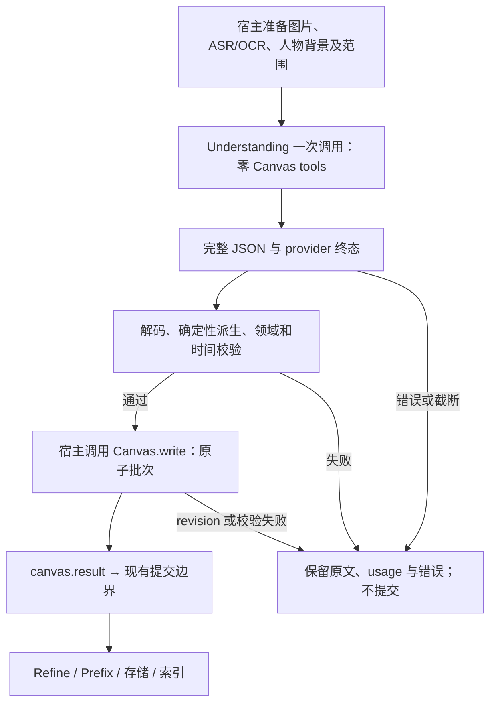

# 1. 问题与现状

2026-10-30 连续半集新增证据：[独立对照 TRD](parse-half-episode-ab-trd.md)、[结果报告](../../report/agent/video_parse_v2/parse-half-episode-ab-20261030.md)、[PR #19](https://github.com/owariband/Seekino/pull/19)。用户最新要求比较同一连续12分钟的当前完整体系与带真实前文的 Doubao non-thinking 串行方案。实际 A 无完整正文；B 连续前10分钟完整、7块严格通过，第11块超时，完整对照未完成且已停止新增调用。50项需求核查中36核心事实保留、6局部可用、6错误、2未定；发现跨块错人、跨人合并与时间错位。本次完整响应中位109.52秒，未复现30秒收益；不能用这些统计证明相对A更差或整体几乎不可用。下文旧日期决策/结果保留，最新执行边界以该报告为准。

**需求：视频解析耗时治理与 Understanding 输出协议验证。** 类型为 `perf`；协议接线属于实现手段，独立正确性修复按 `fix` 记录。更新：2026-10-30（Asia/Shanghai）。遵循 [TRD Principle](../common/trd-principle.md)。

已完成两轮各 8 次单 Chunk 协议实验。第二轮按用户意图取消人物名单并增加 SHOT，同字段精简 XML 的尝试耗时中位数比 JSON 高 21.97%（K3）/18.21%（豆包），未取得替换依据；豆包 JSON 仍有一次合同失败，全部结果仍错认已知画外音。用户已作出最终取舍：保留 Schema 精简，继续使用 JSON，不采用 XML；解析质量优先，不再追求单 Chunk 30 秒，以既有可靠并行解析策略满足当前效率需求。此次协议选型研究结束。2026-10-30 已在 dev 将正式 Understanding 改为直接 JSON、宿主原子导入 Canvas，并将默认及本机视觉主模型/fallback 输出预算改为 30,000；Refine 保留工具。精简字段/SHOT 合同仍未迁移，服务加载与新实模时延尚待验证。问题状态统一归入 [problems B07](../../dev/problems.md#b07视频解析成本高昂且耗时超过片长数倍)，阶段决策见 [初稿 devlog](../../dev/devlog.md#devlog-parse-performance-20261028)、[首轮实验 devlog](../../dev/devlog.md#devlog-parse-protocol-20261029)、[精简合同实验 devlog](../../dev/devlog.md#devlog-parse-compact-shot-20261029)、[最终取舍 devlog](../../dev/devlog.md#devlog-parse-protocol-decision-20261029)。本文维护设计、验收口径及证据边界，不另建任务看板。

## 1.1 用户问题与期望

用户导入影视素材后，需要尽快获得可检索、可回看和可供剪辑消费的剧本事件。历史上约 23 分 40 秒的 EP04，即使 4 并发，媒体、OCR 与 Understanding 仍曾耗时约 28 分钟；长等待和失败重算增加使用成本。只得到更短的摘要、少量对白或可解析的空洞结构，无法满足这个需求。

用户提出的排查维度包括：每 Chunk 的 FFmpeg 启动与 warm-up、模型承担过多工具职责、thinking、输出 Schema、ASR 与 OCR 选型。它们是需要分别验证的因素，不能把整份列表直接称为“已定位根因”。目标是建立**质量合格且可复现的性能基线，再减少无效工作**。60 秒 Chunk 理解约 30～40 秒是历史探索目标；2026-10-29 用户明确不再把单 Chunk 30 秒作为优化或验收目标，原因是需要保障解析质量，当前效率由既有并行策略承担。该取舍不倒改历史实验门槛或成绩。

## 1.2 当前实现及证据

| 环节 | 核对到的事实 | 对本次工作的约束 |
| --- | --- | --- |
| 媒体准备 | 已有整集批量抽帧、一次音轨提取和共享资产路径；见 [媒体 Service](../../../server/service/video_parse_media.py)、[历史交接 §2.2](handoff_to_new_pc.md) | 不从零重做，也不将 FFmpeg 常驻作为已证实解法 |
| Understanding | [workflow._understand](../../../agent/video_parse_v2/understanding/workflow.py) 建 Canvas 并登记观察，最终读取 `canvas.result`；[Service.understand_chunk](../../../server/service/video_parse.py) 直接生成 `VideoParseResult` JSON；宿主原子写入人物及事件 | Refine 继续用 Canvas tools 和 Deep Agents；旧提交边界不变 |
| 模型调用 | [Gateway factory](../../../gateway/model_factory.py) 的结构化生成入口预检 JSON Schema；[Ark adapter](../../../gateway/ark/multimodal.py) 有结构化输出约束；已有文本流入口不能直接等同于所需的多图文本生成 | 正式接入复用现有结构化 JSON 生成与终态校验，不接 XML；实验普通文本通道与此不同 |
| 领域与下游 | [VideoParseResult](../../../engine/parsev2/schemas.py)、[时间校验](../../../engine/parsev2/validation.py)、[ParseContextCanvas](../../../agent/video_parse_v2/timelineEvent_canvas.py) 已定义结果与提交约束 | 首轮 XML 可转换旧对象；第二轮 SHOT/删名单改变语义合同，暂存实验模型，不能直接承诺旧链路兼容 |
| 协议实验 | [首轮](../../report/agent/video_parse_v2/parse-protocol-20261029.md) 8 次有 6 份合同有效；[第二轮](../../report/agent/video_parse_v2/parse-compact-shot-20261029.md) 8 次有 7 份有效；相关测试合计 58 项通过 | 精简后 XML 未显示整体性能收益；两轮均未通过已知画外音目标，未验证生产端到端提速 |

2026-10-26 的 [XML v2 设计](parse-output-xml.md) 和 [交接记录](handoff_to_new_pc.md) 保留历史规则与数字。两轮实验曾采用用户提出的 `<event><dialogue>…</dialogue></event>` 方向，以下称“事件包装 XML”；最终决定不采用，保留为研究证据，不再作为后续默认候选。

## 1.3 本次边界与材料缺口

先验证单 Chunk 的直接 JSON 与事件包装 XML，再决定生产接入和扩大样本。首轮沿用七种 Event 和人物名单；2026-10-29 用户进一步确认第二轮删除逐事件 `participants`、`visible_persons`，增加独立 `SHOT`，具体候选见 §3.5。原文/译文、可靠 speaker、绝对毫秒和左闭右开边界继续保留。Refine、Prefix、声纹、数据库、索引的职责不在本次实验修改范围内；其耗时仍须进入整集诊断。

2026-10-29 已在 `assets/library/sources/mygo/` 恢复 EP04，SHA-256 为 `50e981e49a3d74e8c0aca7571ffae8265b88f6388f1d34849876b61ad8bf5814`，与旧记录相同；容器时长 1420.178345 s、1920×1080 H.264、AAC 音轨。旧 `outputs/verification` 输入与模型原文仍未恢复，旧数字仅为文档留存。本轮另建冻结目录，不将新转写、新 Prompt 或新模型结果冒充旧实验复现。数据库恢复另行核验，本轮不修改 Video、SQL 或 ES。

## 1.4 最终取舍：精简 Schema，继续 JSON，质量优先

2026-10-29 用户原始结论：

> 精简了schema，但是不换xml，因为收益不明显
>
> 同时为了解析质量认为没有必要盲目追求单chunk 30s的效率
>
> 我们虽然引入了更高的人力成本，可是我们提出了很可靠的并行解析策略，足够了。

据此确认当前方向：

- **输出协议采用 JSON，保留 Schema 精简与 SHOT 方向。** XML 的替换收益不足以支持新增接入和维护成本，本轮协议选型闭环，不继续默认追加 XML 对照。
- **质量优先。** 不为达到 30 秒而减少必要事实、削弱身份/时间判断或压缩必要推理；单块耗时保留为诊断数据，不是孤立的硬性目标。
- **沿用既有可靠并行解析策略。** 接受用户指出的更高人力成本，认为该策略足以满足当前效率需求；以整集到索引可见的墙钟、完成率、失败恢复、成本和内容质量评价实际表现，不用单块速度代替吞吐与交付。此处记录用户的工程取舍，不新增未经测量的并行加速比或人力成本数值。
- **实施状态分别记录。** 精简合同已完成实验，生产 Schema/SHOT、旧数据与下游兼容尚未迁移；2026-10-30 已先接入宿主直接 JSON 输出与 30k，沿用现有提交与恢复边界，未修改并发配置或重启服务。

此前提出的视觉输入裁剪实验不再作为自动续跑事项。用户随后要求以更长、更多元的片段补足质量证据，新增 §4.7 的分阶段计划；它不重开 XML 选型，也不以证明某供应商较差为目标。47 秒身份错误属于两模型共有的缺证场景，不能由此推定豆包 non-thinking 质量更低或串行无法 Refine。说话人/分段问题保留在原入口，补证机制与调度方式分别验证。用户进一步明确比较对象是“携带前文上下文的轻量串行 workflow”；此前实验只是独立请求按顺序执行，不能代表该基线。保留当前生产并行是现行选择，其额外复杂度是否优于这个串行方案仍未由本轮证明。

## 1.5 2026-10-29：Karpathy 正式任务未推进的独立故障

用户发现正式任务持续失败。8 集提交快照意外启用了独立 OCR，与用户要求关闭 OCR 不一致；前两集出现 OCR `finish_reason=length`、连接断开/超时，理解阶段累计 119 次成功 HTTP 返回却未提交 Chunk。Context Controller 在 provider 实报约 248K 后仍取约 422K 的通用图片估算上界，持续释放新读到的工具结果；恢复时还发现子任务等待已停止父任务的媒体文件，却继续给自己续租。原始快照及修复验证保存在 `outputs/verification/parse-failures-20261029/`，与上文协议实验分开解释。

# 2. 影响因素、假设与评价指标

## 2.1 因素与可证伪假设

以下保留两轮实验的因素拆解与可选诊断方法；最终执行优先级以 §1.4 为准，不把每一项可能对照转成新的默认任务。

| 因素 | 已有证据与未知部分 | 下一项对照及影响的决策 |
| --- | --- | --- |
| F1 媒体重复准备与冷启动 | 批量解码已实现；历史整集媒体准备 24.32 s，但整个流程反而变慢。没有“每块 FFmpeg 启动必浪费几秒”的独立测量 | 分别记录进程启动、探测、解码与复用时间；固定媒体输出比较重复准备/共享资产，再决定是否仍需改媒体路径 |
| F2 工具职责与上下文 | 改造前模型需读观察、写 Canvas、检查与完成；10-30 已去除此职责；旧 Canvas 和零工具实验的帧数、并发不同 | 同一输入比较 Canvas 与直接输出，统计请求轮次、工具读写、输入预算与质量；只在独立实验中改变工具条件 |
| F3 模型与 thinking | reasoning 和首正文等待可能很长；首正文前还混合上传、排队、预填充等 | 固定精确模型版本与实际出站 effort；同模型内做协议对照。不可观测的服务端阶段保持未知 |
| F4 输出协议与冗余字段 | 首轮 XML 对完整 JSON 的任务负担不同；名单遗漏不应在删除该需求后继续判为业务质量失败，但说话人/主体错误仍有业务影响 | 第二轮采用同字段精简 JSON/XML，均去掉人物名单并增加 SHOT；保持业务事实检查。新旧轮次包含多项共同任务变化，不能将差值全部归因于删除两个字段 |
| F5 视觉输入与缓存 | 180 张 720p 帧；旧 detail=low 减少输入 token，却出现单字化。新旧缓存命中不同 | 首轮固定图像字节、顺序和 detail；记录 cached tokens，交叉顺序复跑。后续单独调整 FPS/分辨率/detail，不混进协议结论 |
| F6 本地 ASR | 2026-10-29 本机 whisper.cpp + large-v3-turbo Q5 已完成一次转写；专名误识别和偏宽时间段仍存在，不能当真值 | 两协议共用同一份冻结观察；模型加载、ASR 与 Understanding 分开记录。量化影响和精确时间质量未做对照 |
| F7 OCR | 用户将首轮条件改为关闭独立 OCR，由 Understanding 直接读图；字幕不能自动变成独立画面文字事件 | 本轮只能比较无独立 OCR 条件下的协议。是否可长期省略 OCR，仍需后续字幕、小字、斜体、运动帧对照；PaddleOCR、DeepSeek-OCR-2 保留候选 |
| F8 重试、限流与 Refine 重算 | 旧专家分支触发 429、重复读图；B07 有 Refine 快照刷新记录 | 单块先禁隐式修复/fallback；保留失败调用。整集测调用和重算关键路径，不从并发累计时间直接扣墙钟 |

两轮已验证 F4：精简可减少正文负担，XML 未显示足够替换收益，且关键内容仍有错误。因此不采用 XML；F3/F5 保留为未来出现实际整集瓶颈时的诊断方向，本轮不继续压缩标签或自动开展输入裁剪。

## 2.2 指标、计时与预设门槛

| 指标 | 定义与统计口径 | 基线 | 目标或允许退化 | 测量与证据 |
| --- | --- | --- | --- | --- |
| 诊断：`T_understanding` | 观察和帧文件就绪后，从本地请求组装开始到完整响应解码、领域及范围校验结束，单位 s | 首轮原始尝试值见 §4.4，尚无质量合格的配对基线；旧成绩见 §4.1 | 原两轮以质量合格配对降低 ≥10% 为协议探索门槛；最终不采用 XML。单块 30 秒不作为当前验收要求 | monotonic 时间、每次调用原始记录；包含图像编码/上传，不含预先完成的 ASR/OCR/抽帧 |
| 结果：`T_pipeline` | 从媒体准备开始到目标成果可用；整集接入验收终点为索引可见，包含 Refine、失败重试及等待 | 同片同配置的新基线待测 | 质量优先，沿用现有并行策略满足整集交付效率；记录完成率、失败恢复和成本，不以单块 30 秒替代 | 阶段时间线和执行区间并集；预计算 ASR 的实验另列，不拼成新鲜端到端结果 |
| 诊断：首正文/正文/宿主 | 请求组装、发出请求、首个非 reasoning 正文、末正文、终态、校验结束分别记时 | 两轮阶段样本见 §4.4/4.6 | 定位收益来源，不单独作为验收 | 实际流事件与单调时钟；首事件不等于首正文；正文到终态的间隔单列 |
| 诊断：token、调用与资源 | input/cached/reasoning/output、调用/工具/重试次数、本机峰值内存及 ASR/OCR 加载时间 | 两轮 provider usage 已留存；本机峰值资源及精确加载耗时未测 | 不因性能制造不可解释的成本或资源增长；试点前固定可接受预算 | provider usage 与本机观测；缺失记 unknown，不能记 0；reasoning 若包含在 output 中不重复相加 |
| 护栏：结构与完整性 | completed 且未截断，解码、领域/范围校验均通过；失败数/全部尝试数 | 离线 58 项通过；两轮均 8/8 completed；首轮 JSON/XML 各 3/4，第二轮 3/4 与 4/4 合同有效 | 候选样本无截断、隐式修复、非法结果被提交；失败不删样本 | 原始响应、终态、校验错误和归一化结果分别留存 |
| 护栏：内容 | 逐条标注对白、speaker、动作主体、动作/情绪/场景/镜头及画面文字；首轮另验名单，第二轮已删名单不再计错；分别算关键事实命中/应有事实、错误事实/输出事实，原文字符错误率 | 已有事前视觉检查表和逐次非盲审，完整金标及独立盲审仍缺失 | 关键证据无新增漏项/幻觉/错误人物；相对 JSON 不退化，同时须满足独立金标，不能两组都差仍验收 | 先冻结人工检查表，确认实验再独立盲审；翻译语义单独评分，不拿译文与日文做字符比较 |
| 护栏：时间定位 | 按已匹配事件分别统计起止绝对误差，未匹配事件记漏检；跨块台词检查相邻两块 | 待人工音视频边界标注 | 范围合法率 100%；业务可接受的边界误差阈值在确认实验前冻结，目前待定 | 不能仅以 ASR 与输出一致当真值；不能以范围校验替代剪辑入出点质量 |

10% 保留为两轮协议实验的原始筛选门槛，未因最终决定而倒改为达标。当前不继续追求协议提速或单块 30 秒；生产接入仍需按业务冻结绝对内容覆盖、时间误差及可接受成本，现有探索数据不代替验收。

每组报告全部耗时、成功/失败数、样本量、日期窗口、并发和缓存条件。首轮每组 2 次，只报告原始值、范围和探索性中位数，不发布 p95/p99 或“稳定快多少”。扩大样本后再按实际数量报告经验分位数及其局限；不得用均值掩盖超时。失败耗时独立列出，同时计入全部尝试成本；重试条件下从首次开始到有效结果的时间另算。

## 2.3 正式运行故障的验证口径

本次固定 WhisperX large-v3、3 fps、720 高度与全部视觉帧，按用户要求关闭独立 OCR。诊断指标为新版本 OCR 请求数（应为 0）、provider 实报与压缩估算关系、停止父任务后媒体等待是否退出。结果指标为真实 Chunk 的内容/ASR 时间证据提交，随后检查 Refine 与索引；服务启动和 HTTP 200 不作为解析完成。基线为前两集 0 个提交 Chunk；整集完成率与耗时仍需完整运行观察。

# 3. 改造方案与建模

## 3.1 方案与取舍

| 方案 | 作用因素与预期收益 | 代价与当前选择 |
| --- | --- | --- |
| 保留 Canvas 工具流程 | 保持原有工具编辑能力 | 作为既有行为基线；不能解决本次职责过重问题 |
| 零工具直接完整 JSON | 移除 F2 工具回合，复用现有领域模型 | 作为协议对照；保留冗余字段，但实现风险较低 |
| 零工具事件包装 XML | 减少 F2/F4 的工具与重复表达，明确 speaker/正文边界 | 不采用；两轮实测未形成足够收益，保留历史代码和证据，停止协议扩跑 |
| 零工具精简 JSON | 与 XML 使用相同语义字段、默认值与校验 | 选定输出方向；第二轮已实测，仍需完善质量及完成生产接入 |
| 多专家拆分/降低视觉预算 | 影响 F3/F5/F8 | 旧结果有 429、重复图像输入和质量缺口；本轮不继续，以后仅针对具体业务瓶颈另作判断 |

已有研究可用于设计检查表：[OmniScript 调研](../../research/2026-10-24-omniscript.md) 提醒分别验收内容与时间、维护跨段身份。外部模型得分不是 Seekino 效果；更换模型、视觉压缩或 OCR 都需自己的对照。

## 3.2 事件包装 XML 的候选合同

**以下保留首轮合同与样例。第二轮模型输出采用 §3.5 的精简合同；本节原有名单要求不继续施加给新一轮。** 历史结果仍按当时合同记录，不倒改失败。

沿用用户提出的层次，修正为标准 XML 属性引号和语言标签。下例只演示语法，不是模型结果或对片段事实的认证：

```xml
<timeline>
<event start="60000" end="64200" participants="千早爱音,高松灯" visible="千早爱音">
<dialogue speaker="千早爱音" lang="zh-Hans">
你其实很想组乐队吧
<original lang="ja">本当はバンドやりたいんじゃないの？</original>
<description>千早爱音没有看着高松灯，抬头询问。</description>
</dialogue>
</event>
<event start="64200" end="66000" participants="高松灯" visible="高松灯">
<action>
高松灯低下头。
</action>
</event>
</timeline>
```

- 每个 `event` 有且只有一个主类型：`scene/dialogue/action/emotion/relation-change/screen-text/other`。时间放包装层，为原视频绝对整数毫秒；运行时传入允许范围，禁止硬编码第一块 `[0,60000)`。
- speaker 使用属性，台词正文不再重复姓名；未知 speaker 省略并映射为 null。`participants` 为完整语义参与者，已知 speaker 必须在其中；`visible` 独立记录可见人物，不能靠程序补人物关系来过校验。
- 任务级默认主语言、主角色、原文语言只声明一次；示例为 `zh-Hans/TRANSLATION/ja`。允许 `lang/role` 覆盖；`original` 可用默认原文语言，额外 `translation` 必须写 `lang`，禁止同 language+role 重复。没有译文证据就保留原文，不能为默认语言编造翻译。
- 对白 `description` 可选，只写额外观察；缺省由宿主用“speaker：台词”生成内部描述。非对白正文是描述，screen-text 正文是文字。`persons` 从明确名单和 speaker 汇总，类型从标签映射，时间由宿主稳定排序；这些都不要求模型反复生成。
- 换行和缩进不是语法分隔符：紧凑、分行、CRLF 均能解析。解码器只剥离正文边界空白，正文内部空格和换行保留；删除台词内部换行可能改变内容，不能无条件预清洗整个 XML。
- 属性必须带引号；`&`、`<` 等按 XML 转义。拒绝未知字段、DTD/entity 声明、非法时间、截断及重复补充字段；不补闭合标签、不用正则修复半份输出。流式接收完整后才校验提交，不逐事件提前写库。

上述规则已经落在实验 decoder，覆盖的是实验输入合同。最终字段语义仍由用户继续完善；任何改变须同步 Prompt、decoder、样例与质量检查表，再开始对照。旧 v2 原文保留供历史阅读，不能混用两版 Prompt。

## 3.3 接入职责与失败路径（2026-10-30 已实现直接 JSON）

本次按用户点名的两项先落地去工具与输出预算，沿用生产 `VideoParseResult`，不做字段或枚举迁移。第二轮新增 SHOT 后暂存独立 `CompactTimeline`，不能直接声称兼容旧 Canvas，也不通过将 SHOT 改写为 SCENE 来规避生产枚举。未来接入需同步领域枚举、名单消费/出镜条件、旧数据读取与索引合同，再沿用下面的宿主提交边界。



1. **Agent：** 新模式直接提供真实证据与输出合同，去除“先读 Canvas、写入、核验、complete”的旧 Prompt；模型只做人物、内容、时间与类型判断。保留 Canvas 作为宿主内部结构，其他 Agent 的工具仍按各自职责使用。
2. **Gateway：** 正式路径复用 `generate(result_type=VideoParseResult, tools=())`，各现有适配器按原结构化 JSON 通道处理和校验终态。Understanding 不进入 DeepAgents 工具循环；Refine 不变。模型 ID、thinking、detail 与输出预算继续由任务冻结绑定提供。
3. **宿主 Service / 领域边界：** 解码为 `VideoParseResult` 后调用现有 Canvas 的 Python 写入接口，`persons` 和全部 events 一次原子提交；保留 revision、batch 幂等和时间校验。`workflow` 最终消费 `canvas.result`，必须确认写入后有结果，避免“模型返回了但 Canvas 仍为空”。
4. **兼容与恢复：** 对外 API、数据库 Schema、Event 类型和毫秒语义不迁移；`speaker_source` 由实际宿主链路记录。Refine/Prefix/索引保持原合同，不能从内存往返测试推定数据库集成已通过。生产不得依赖 `evals/` 或 `outputs/verification/` 的代码。
5. **失败：** 探索轮不启用隐式模型修复或 fallback；所有错误保留。后续接入使用既有任务失败、重试、取消与版本机制，失败不提交部分 Timeline；若需额外修复调用，单列耗时/质量/成本后再决策。

`config.yaml` 与本机 `.env.local` 指定的 `config/local-dev-config.yaml` 的 `vision` / `vision_fallback` 均为 `max_output_tokens: 30000`；其他角色不统一改值。此前 30,000 只写在实验脚本里，正式 YAML 仍为 8,192。服务启动时加载配置；已有任务保留冻结预算，普通重试不覆盖。提高输出上限防止截断，不保证更快；本次不重启服务、不改已有任务快照。

## 3.4 模型与观察源约束

- **Kimi 3.0：** 2026-10-29 通过 Coding models 列表确认 `k3`，本轮请求及返回均为 `k3`、effort=low。2026-10-28 已查阅的 [Kimi K3 API 文档](https://platform.kimi.com/docs/guide/kimi-k3-quickstart) 与 [Coding 模型文档](https://www.kimi.com/help/kimi-code/models) 表明 K3 使用 thinking 档位；Coding 的 disabled 可能路由到其他模型。本轮不是 non-thinking，也未静默替换成 K3.1 或 K2.8。
- **Doubao 2.1 Pro：** 按 [Ark 参数支持文档](https://docs.volcengine.com/docs/ark/model-parameter-support?lang=zh) 核对精确版本与权限，用 `thinking={"type":"disabled"}`；当前配置中的 260628 与其他版本不能混记。跨模型成绩分别报告，同一模型的 JSON/XML 才构成协议对照。
- **ASR：** 用户最终指定 localhost Whisper，取代此前考虑的云端 ASR。本轮直接启动仅监听 `127.0.0.1:18842` 的 whisper.cpp server，使用官方 large-v3-turbo Q5 权重、Metal/Accelerate、日语、max_context=0、best_of=5、beam_size=5、6 threads；从原视频直接提取前 60 秒 16 kHz 单声道 PCM，两协议共享归一化转写。没有更改全局模型配置；正式服务接线仍可复用 [本地服务脚本](../../../scripts/local_whisper.py)。本轮未比较 Q5 与完整精度质量，也没有连续冷/热重复测试。
- **OCR：** 本轮按用户要求关闭独立 OCR，冻结 `ocr.json=null`，由 Understanding 读取相同图片中的字幕和文字。这是实验条件，不是 OCR 已可永久删除的结论。[DeepSeek-OCR-2](https://github.com/deepseek-ai/DeepSeek-OCR-2) 保留候选，其官方实现使用 CUDA 路径，尚无新 Mac 验证；[PaddleOCR](https://github.com/PaddlePaddle/PaddleOCR) 保留轻量对照。若后续引入字幕检测、跨帧去重与帧时间映射，仍由宿主管理；OCR 本身不提供可信对白时间真值。

## 3.5 第二轮：取消名单并分离镜头的精简合同

用户确认沿此方案复测。实验版本为 `compact-shot-v2`，代码见 [共享合同与解码器](../../../evals/parse_compact_protocol.py)。不把候选试验误写为生产 Schema 已升级。

| 内容 | 两种格式共同语义 |
| --- | --- |
| 事件公共字段 | start/end 为绝对整数毫秒，每条只有一个类型和正文；取消 participants、visible/visible_persons、根级 persons |
| 类型 | scene、**shot**、action、dialogue、emotion、relation-change、screen-text、other；shot 承载画面主体/景别/构图/角度/镜头运动，场景改变才写 scene，人物动作归 action |
| 对白 | 已知 speaker 填姓名，未知可省略或 JSON null；主正文只写台词。lang 默认 zh-Hans，role 默认 translation；original 默认 ja，可附带其他语言 translation；description 可选，不要求重述台词 |
| 语义主体 | 动作、关系和镜头正文写清已确认的人物；不会因名单被取消而取消主体正确性要求。画面人物仍不能自动等同 speaker |
| JSON 表达 | 根 `timeline`；事件含 start/end/type/text，dialogue 可增加 speaker/lang/role/original/translations/description；original、translations 的元素使用 lang/text |
| XML 表达 | 根 timeline；event 仅有 start/end，唯一主类型标签承载正文；dialogue 属性与 original/translation/description 子节点表达相同语义 |
| 校验与输出 | 两种格式归一化为同一个实验 `CompactTimeline`；拒绝旧名单字段、非法类型、时间、重复语言版本、未知字段、截断、DTD/entity；稳定排序，允许镜头与对白/动作重叠 |

两种 Prompt 的虚构样例已离线验证归一化相同；不再向 JSON 组附完整生产 JSON Schema。新合同测试 34 项、旧合同测试 24 项，合计 **58 passed**。旧 24 项中的 Canvas/Refine 往返只证明旧合同兼容，不能外推到 SHOT。实验解码器不自动猜人物、补名单或修复模型原文。

本轮的成功标准按业务事实而非已删字段重新冻结：对白与 speaker、动作主体、镜头/场景分类、爽世入场、SUNWAY/ESP、已确认的约 47 秒画外音以及合法范围；旧名单缺失不再计错。完整金标、独立盲审和精确音频边界仍缺失。相同字段下 XML 相对 JSON 达到 ≥10% 探索收益且无关键质量退化才考虑扩大试点；两次重复不足以决定生产推广。

## 3.6 正式调用与恢复修复

- 本机 `models.ocr` 绑定删除，令正式默认配置关闭独立 OCR。已提交任务的快照不可随 YAML 静默变化；通过既有 reparse 服务创建新版本，原视频和旧版本保留。
- reparse 支持已排队或已停止且全部执行租约已回收的任务。锁住父任务及 Interval/Chunk 行，拒绝任何残留执行租约；新版本建立时撤销旧非终态版本的 `accepted` 和容量占用，防止重复调度。运行中的任务仍须先停止并走正常租约回收。
- Gateway 使用最近一次 provider 输入 token 加后续消息变化量校准估算，允许校准向下；忽略 0/缺失用量。字符预算和其他上下文约束继续生效。
- 媒体文件尚未就绪时额外检查父任务版本、持有者、阶段和失败收尾状态。父任务已停止或换租约则退出等待；已发布媒体的现有硬链接复用保持原行为。

独立 OCR 的分批尝试已撤回：它不符合本批关闭 OCR 的目标。本次不降低视觉帧率、不切换 Understanding 模型，也不以故障修复代替精简 Schema 的生产接入。

# 4. 对照实验与结果分析

## 4.1 历史证据：支持继续研究，不支持直接替换

下表摘自 [旧 Mac 交接 §2](handoff_to_new_pc.md)，原始文件当前缺失，未在新机复跑。变化率统一为 `(方案－基线)/基线`，负值表示更短；不同实验行不能拼成同一优化曲线。

| 对照与条件 | 基线 | 方案 | 变化 | 质量与归因限制 |
| --- | ---: | ---: | ---: | --- |
| 整集，逐块媒体 vs 整集准备；媒体+OCR+Understanding | 1706.91 s | 2138.22 s | +25.27% | 24/24 完成，但模型阶段也变慢，媒体复用未证明整链加速 |
| Kimi low，单 Chunk 完整 JSON vs XML v1 | 152.45 s | 116.05 s | −23.88% | JSON 乱序；对白 18 vs 7，不能视为同质量 |
| Doubao disabled，JSON vs XML v1 完整复测 | 58.08 s | 30.35 s | −47.74% | 两者均有领域错误，不能计为合格提速 |
| Luna high，JSON vs XML v1 | 58.61 s | 68.82 s | +17.42% | XML 结构/领域失败；正文更短但首正文等待变长 |
| Doubao disabled，XML v1 vs v2 | 41.32 s | 31.34 s | −24.15% | 新输出可解码；缓存 0 → 91960/104052，ACTION/EMOTION 为 0，缺独立质量验收 |

旧 v1 输出阶段曾缩短：Kimi 71.10→23.70 s、豆包 53.64→25.14 s；旧 v2 的 Kimi 总耗时 129.90 s、首正文 89.38 s，说明输出并非唯一瓶颈。v2 三模型虽通过结构，仍出现参与人物缺失、事件错类、人物错认和画面文字误读。结论是**XML 值得做有质量约束的下一轮实验；尚无依据把约 31 秒宣传为整片目标达成**。

## 4.2 本轮已取得的证据

2026-10-28 事件包装 decoder 的 24 项离线测试通过，覆盖换行/缩进/CRLF、内部空白和转义、未知 speaker、语言覆盖、非法/越界/空区间、缺失参与者、重复字段、截断、JSON 重复键及排序、解码结果经 Canvas 原子写入后初始化 Refine。命令：

```bash
PYTHONDONTWRITEBYTECODE=1 .venv/bin/python -m pytest -q -p no:cacheprovider tests/evals/test_parse_output_protocol.py
```

2026-10-29 已重跑上述定向测试，24 项通过。它验证本地转换与 Canvas/Refine 内存往返，未覆盖持久化、Prefix、检索或服务端取消。生产代码、配置和数据库未切换。

## 4.3 首轮实验计划及预算

1. 原视频已恢复并核对 hash/时长/音轨，本轮使用 `[0,60000)`；新冻结目录为 `outputs/verification/parse-protocol-20261029/`。调用前已保存画面检查点：人物身份、低头/闭眼动作、爽世入场、购物袋 SUNWAY、关键字幕与分类。这是局部视觉检查表，不是穷尽剧情或精确音频边界的金标；无某类型时不强迫模型造该类型。
2. 固定 180 张 3 FPS、720p 帧及顺序、ASR/OCR、人物背景、可写区间、语言默认值。人物背景只提取事实，排除旧说明中的“相对秒制”或工具要求。每个文件保存 hash，不能只写“同一视频”。新视频不适合该采样时，先共同冻结新的参数。
3. 同模型同参数：A 为零工具完整 JSON，B 为零工具事件包装 XML，两组均普通文本、相同信息要求、相同图片和本地校验规则。稳定排序两边都做；JSON 保留原领域字段，因此本轮比较整个输出协议，不能隔离语法和字段压缩的贡献。
4. 首轮预算为 **2 个模型 × 2 个协议 × 2 次 = 8 次完整调用**，不并发跨组施压；每模型按 A→B、B→A 交叉顺序，每次独立会话。两次仅为方向诊断；需要更多重复或精简 JSON 消融时先据结果收敛问题，不无限扩跑。预检失败保留，但不自动补无限尝试。
5. [实验脚本](../../../evals/parse_protocol_benchmark.py) 直接调用 provider Responses API，绕开生产 Canvas 编排和强制 JSON Schema 通道；不创建任务、不写业务库。记录实际模型/endpoint（不含密钥）、代码 commit 与 dirty diff 标识、脚本/Schema/输入 hash、环境版本、开始时间、出站选项、usage、流事件、终态、原文、校验及质量检查。代码与证据保存在上述目录；每次总时限 600 s、SDK 重试为 0、无模型修复或 fallback。
6. 缓存无法控制时记录命中和顺序差异，不能称为严格冷启动对照。可用同条件样本分别比较；若样本不足则报告混杂并补证。若两协议均未达质量门槛，先改共同任务定义或模型设置，重新编号实验，不挑最短一次。

| 本轮指标 | JSON 基线 | 事件包装 XML | 变化量 | 当前判断 |
| --- | --- | --- | --- | --- |
| K3 low：全部尝试耗时中位数，n=2/组 | 103.22 s | 100.17 s | −2.96% | 未达 10% 探索门槛，内容也未达标；详细分段/token 见报告 |
| Doubao 2.1 Pro disabled：同上 | 98.73 s | 64.68 s | −34.49% | 各含一次失败；缓存与内容不同，不是有效结果提速 |
| completed / 最终领域通过率 | 4/4、3/4 | 4/4、3/4 | 相同 | 两组仍有内容缺口；时间范围通过不等于边界精度合格 |
| Canvas 与直接 JSON 的同条件工具消融 | 待测 | 不适用：独立对照 | 待计算 | 首轮 8 次不覆盖，旧耗时只能参考 |

## 4.4 2026-10-29 实际结果与取舍

完整方法、八次原始值、usage、检查表和复现入口见 [单 Chunk 报告](../../report/agent/video_parse_v2/parse-protocol-20261029.md)。本轮使用本地 Whisper、无独立 OCR、180 张相同图片；运行区间约 19:09–19:21。24 项定向测试通过，冻结源码/输入、流/terminal/raw 与校验结果的离线一致性核对 44/44 通过；这些不代替内容质量验收。

- **标准 XML 可解析，候选协议仍有失败。** 四份 XML 均语法合法、换行正常，其中豆包一份在同一个 event 放 action 和 dialogue，违反单主类型合同。另一次豆包 JSON 因 speaker 不在 participants 中失败。全部保留原文，没有自动修复或额外调用。
- **短正文未稳定变成更快的有效理解。** K3 正文时段中位数 33.48→24.29 s，但首正文 69.67→75.75 s，整体仅降 2.96%；最后一对都完整命中输入缓存时，XML 101.99 s、JSON 94.65 s。豆包 34.49% 原始降幅伴随失败、身份遗漏与长台词合并，不能据此替换。
- **可省略字段造成重要信息缺失。** K3 两份 XML 分别有 13/30、11/28 个空 participants，多为已命名人物的非对白事件；豆包首份 XML 全部 10 条 speaker 缺失、15 个 participants 为空。SUNWAY/ESP 分类覆盖、SCENE/ACTION 粒度也不稳定。复核中补查项目已有的 47～49 s 爽世画外音真值，八份原文均未正确归属；这是独立于格式合法性的质量缺口。
- **本轮没有证明可永久去掉 OCR。** 两协议能直接读字幕并纠正 ASR 专名，但画面文字覆盖不稳定。Whisper 就绪后的提取/转写/归一化约 5.33 s，其中提取 0.33 s；冷启动、量化精度与穷尽时间质量未测。
- **下一步先完善合同，再做有区分力的实验。** 身份字段需明确表达，不能因“可省略”而丢整批身份；跨说话人拆分、画面文字和类型检查独立验收。同字段精简 JSON 用于归因，视觉输入预算用于排查首正文等待。本轮约 22万～24万 input tokens，协议只减约 1%；上传/排队/预填充仍不可分别归因。继续研究，暂不扩大生产接入。

## 4.5 第二轮精简合同对照：执行口径

新增预算仍为 8 次：K3 low、豆包 2.1 Pro disabled 各按 JSON→XML→XML→JSON，独立会话、串行、30000 output tokens、600 s 截止、无重试/修复/fallback。冻结目录为 `outputs/verification/parse-protocol-compact-shot-20261029/`。180 张图片及帧清单、ASR、OCR=null、背景的 hash 与首轮完全一致；直接复用同一次 localhost Whisper 转写，不另算成一次新的 ASR 测量。

与首轮相比，共同改动包含取消名单、增加 SHOT、精简 JSON、镜头/动作分工和避免逐帧嘴部描述。因此新旧速度差只作方向参考，不是两个字段删除的独立消融。两协议本轮使用相同事实任务和默认值；缓存继续按 provider usage 原样记录，未控制的服务端阶段不作精确归因。原始响应、失败和质量记录独立保留，不覆盖首轮产物。

## 4.6 第二轮实际结果：精简有局部收益，XML 没有整体优势

完整原始值、质量记录与复现入口见 [第二轮报告](../../report/agent/video_parse_v2/parse-compact-shot-20261029.md)。运行约 19:50–20:02，8/8 completed，标准语法均合法；JSON 3/4、XML 4/4 通过实验合同，豆包 JSON 一次因三条 SHOT 多出 description 被拒绝，无修复或补跑。

| 全部尝试中位数，每组 n=2 | 精简 JSON | 精简 XML | 变化与边界 |
| --- | ---: | ---: | --- |
| K3 low 总耗时 | 118.52 s | 144.57 s | +21.97%；XML 两次为 201.36 / 87.78 s，reasoning 5277 / 296，波动很大 |
| K3 正文时段 | 15.28 s | 17.92 s | XML 正文 token 少 16.15%，未转成整体收益 |
| 豆包 disabled 总耗时 | 44.41 s | 52.50 s | +18.21%；JSON 包含一次失败，仅一次合同有效结果为 38.01 s |
| 豆包正文时段 | 26.97 s | 27.07 s | 几乎相同，XML 输出 token 反多 3.84% |

本地解码/校验仅约 0.16–1.53 ms；K3 的主要等待在首正文前，豆包的格式差异也主要出现在此阶段。相同高缓存命中仍可能出现大延迟，不能将不可见的上传、排队和预填充全部归为 thinking。相较首轮，精简 JSON 正文 token 减少约 50%（K3）/57%（豆包），但共同 Prompt/SHOT/字段和缓存也发生变化，不能当作删两个名单字段的独立消融。

内容上，八份均产生有主体的 SHOT，125 条原始对白均带姓名，动作事实仍可见于正文；名单缺失不再计错。但 47 秒爽世画外音仍为 0/8 正确，最快的豆包 JSON 还把该句并入爱音台词。SUNWAY、ESP 各仅在 3/8 份原文出现，均无独立 screen-text。没有满足绝对质量要求，不能因结构通过或字段减少而判为可上线。

58 项定向测试和 223/223 证据一致性核验通过；后者包含 180 张图片的 hash，不是质量通过项。8 次累计尝试约 720.00 s、total 1853036 tokens（含失败），未取得账单。决定保留精简字段/SHOT 方向与精简 JSON 候选，不为性能切换 XML；生产接入、代表片段、整集和恢复仍未验证。

## 4.7 多片段质量验证计划：分开模型能力、身份补证与调度

用户指出，已有 47 秒画外音目标对 K3 和豆包都是失败，而 Understanding 只有图像与无 speaker 的转写，不能据此判定豆包 non-thinking 质量低。该错误保留为当前输入链路的诊断 case，不能充当供应商优劣、thinking 因果或并行必要性的单一证据。协议继续采用精简 JSON；本节开展质量研究，不重开 XML 选型。

### 4.7.1 要分别回答的四个问题

| 问题 | 受控对照 | 不能混用的结论 |
| --- | --- | --- |
| 两个部署配置各自适合哪些内容？ | 精简 JSON、相同帧/转写/背景、相同可见历史，对比 K3 low 与豆包 disabled | 这是实际配置对比，模型与 thinking 同时不同，不能归因于 thinking 开关 |
| 声音/身份补证有没有效果？ | 固定一个模型、初始结果和 Refine 规则，对比无补证与加入同一份冻结音频证据；如分别测试分组和具名参考，分开设臂 | diarization/音色分组不自动给角色姓名；Refine 只有同一错误文本时不保证修正；不要求 VLM 自身承担全部音频能力 |
| non-thinking 是否影响质量？ | 若精确豆包版本支持，固定所有输入和参数，单独对比其 disabled 与明确的 thinking 档位 | 不能用 K3 vs 豆包代替此消融；支持性与实际出站值需预检，未实施 |
| 现有并行方案是否优于轻量串行 workflow？ | 同原视频、模型配置、原始观察与交付要求，比较 A：逐块携带实际生成的前文/人物记忆，无强制后置 Refine；B：现有并行理解及其实际 Refine/一致性处理 | 两者上下文依赖本来就不同，应比较完整策略；不能将 A 变成独立请求或强行给它加相同 Refine，以此抹掉其简单性优势 |

四项分阶段进行，不做所有因素的笛卡尔积，也不预设必须证明豆包较差或并行更准。

**架构比较对象纠正：** 串行 workflow 的前一块输出/记忆可以直接成为下一块输入，前向维护人物和剧情一致性；这可能让独立的跨块 Refine 不再必要。并行理解下的部分 Refine 职责可能在补偿前文尚未就绪或独立块之间的不一致，应把它的调用、重算和维护成本计入并行方案，而不能用“需要 Refine”循环论证并行必要。串行也可能传播早期错误或受上下文预算限制，但这些必须在真实序列里观察，不能预先强加后处理。

原始素材访问和业务验收保持一致；允许各方案按自身设计维护历史，并冻结记忆内容、压缩/截断规则及来源，禁止把测试答案注入串行历史。A 若不经 Refine 即达到质量和时长要求，简单性是明确收益；B 须以含全部后处理的端到端收益抵偿复杂度。固定历史/相同 Refine、只改并发度的实验只能回答调度机制问题，不能代替这项架构比较。

### 4.7.2 先扩展连续素材和场景，再决定单次输入长度

建议首批 **6 个新的连续 2 分钟片段**，覆盖至少 3 个作品/来源，优先选择 Seekino 目标素材；如真人/课程属于目标范围，再纳入对应来源。片段按题材和场景事先选定，不按模型失败位置挑选；EP04 前 60 秒保留为调试/回归 case，不计入新评测集。

| 主场景 | 主要检查 |
| --- | --- |
| 正面可见、轮次清楚的普通对白 | 基础转写/字幕覆盖、可见主体和说话轮次 |
| 画外音、多人接话、反应镜头 | 有证据与无证据时的身份行为、错误具名与保留未知 |
| 多人快速切镜、遮挡与构图变化 | 人数、主体、镜头属性、动作/镜头分类 |
| 少对白或无对白的动作段 | 主体—动作—对象、关键动作遗漏与编造 |
| 小字/招牌/道具文字与字幕并存 | 非对白文字覆盖、误读、字幕重复记为画面文字 |
| 人物再入场、跨边界对白/连续动作 | 跨 Chunk 重复/丢失、身份一致性、时间衔接 |

允许一个片段有多个标签，但须记录实际覆盖；六类各一个不是类别泛化证明。每段仍按两个相邻 60 秒 Chunk 运行，共 **6 个连续序列、12 个 Chunk**。模型能力筛查的两组读取同样冻结的上下文；架构比较则让串行组实际把前块输出/记忆传给后块，并行组按自身依赖和 Refine 运行。二者分开报告，不能将固定历史的单块能力对照冒充带历史串行 workflow。

“更长连续内容”与“更长单次 Chunk”分别处理。若进一步比较 60 秒与 120 秒请求，先确认两个模型的上下文/图像限制，再固定同一时间段、相同图像字节与证据总量；发生抽帧减少、分辨率变化或截断时明确增加了其他因素，不再声称只改变 Chunk 长度。当前不改生产 Chunk 配置。

### 4.7.3 金标、证据可得性与指标

模型调用前冻结样本路径/hash、时间窗、采样、ASR 原文和版本、背景、Prompt、模型与输出预算。标注分开保存原片真值和模型实际可得证据：原片有但采样漏掉的动作，属于输入覆盖缺口；音频能确认但图文输入不能确认的身份，不用于孤立判断视觉模型能力。不能把 ASR、另一个模型多数意见或旧数据库内容直接当金标。

人工核对主要对白/动作/镜头/文字及边界，身份目标需听音和可信参考；标注无法可靠确定的项为待定。测试目标的答案不能混入普通背景。声音参考若作为实验输入，使用目标短句之外的独立、已核验片段，记录其来源与标签质量；同名或高相似分数不是额外真值。评审隐藏模型/格式标签，打乱输出；关键分歧回原片复核。

| 指标层 | 记录方式 |
| --- | --- |
| 纯视觉事实 | 主体/人数/动作/镜头与实际给定帧一致性、应有事实覆盖及错误事实；事实保留和 enum 分类分别计 |
| 对白与时间 | 原文覆盖/错字、跨人合并、已匹配事件起止误差；跨块重复/遗漏另列，不用范围合法率代替精度 |
| 身份与不确定性 | 具名准确率、正确具名覆盖、错误归属、保留未知分别报告；按证据充分/不足分层，不能用全部 null 获得虚高成绩 |
| 补证效果 | 对冻结初始输出计算纠正数、新增错误、未解决数，连同音频/Refine 额外耗时和调用成本；避免把同一错误链重复计为独立案例 |
| 系统交付 | 最终可用事件/检索取片是否正确、整个序列/任务墙钟、成功与失败、重试/冲突、token 与资源；首正文等待和单块 TT 为诊断 |

逐序列和场景列出结果，再报告总体；重复调用不增加独立样本数。先冻结业务阈值及匹配/计数规则，至少要求已有关键错误不被悄悄接纳；绝对精度、时间容差及成本门槛待金标和目标确认，当前不能写达标。小样本不报告可靠 p95/p99。使用同一份可检索事件和固定问题检查业务影响，不仅比较描述读起来是否顺畅。

### 4.7.4 有界执行顺序与停止条件

1. **先做本地准备与标注。** 样本具体文件/窗口及独立金标尚未冻结，由本任务 Agent 整理候选，用户或指定评审确认关键声音身份。此阶段不新增付费模型调用。
2. **基础质量筛查建议 24 次：** 12 个 Chunk × K3 low / 豆包 disabled × 1 次，统一精简 JSON、输入和评审。一次用于找场景差异，不宣称延迟稳定或因果；缓存、请求顺序、错误和所有原文保留。预算是计划，不是已执行或额外自动重试授权。
3. **按问题追加独立消融。** 声音补证或同豆包 thinking 对照仅在事前选定的子集开展，新增预算和输入在执行前冻结；不只挑对某模型不利的结果，不无限修 Prompt 重测测试集。若证据相同条件下豆包满足质量门槛，应接受该结果。
4. **再比较完整架构。** 按 §4.7.1 的 A/B 运行足够长的连续序列：A 携带实际前文、不强制后置 Refine；B 使用现有并行与实际 Refine。记录历史增长、错误传播/纠正、全部调用与后处理成本、墙钟、限流、重算和最终交付质量。六段两分钟的基础筛查不能证明整集架构优劣；长序列与本阶段预算另行冻结。必要时再单独测同依赖下的纯并发效应，并发度 C 不预设理想线性加速。

输入/模型能力不兼容、金标关键分歧未解决、输出截断或预算耗尽时保留失败并停止相应实验；不通过降帧或补调用掩盖问题。每阶段可据证据停止，不以“证明原选择正确”为完成条件。

## 4.8 故障复现与定向回归

修复后 659 项定向测试通过，覆盖 Gateway 上下文/DeepAgents、Parse worker/媒体、UploadService 与 Queue。新增用例复现 198 张图片的估算高于实报时释放新证据的问题，验证生产者停止后等待退出，以及排队/停止任务采用新配置后旧版本不会再被领取；活动租约仍被拒绝。证据见 `outputs/verification/parse-failures-20261029/tests-final.log`。这组测试不证明模型内容质量。

## 4.9 直接 JSON 与 30k 正式接入回归（2026-10-30）

本次 dev 修改不再等待新的协议研究：证据随 Prompt 直接传入，模型返回完整 JSON，宿主校验时间与领域合同后原子导入人物/事件，再走原事务提交。完整 ASR 词对齐仍存证据，初始 Prompt 只投影 cue 文本、边界和匿名声源，Refine 可读取完整词对齐。

| 指标/护栏 | 修改前 | 修改后及验证 |
| --- | --- | --- |
| Understanding 模型工具职责 | 读证据、写 Canvas、回读、完成工具 | 无工具；正常成功路径一次生成，宿主完成校验与写入 |
| 默认/本机视觉输出上限 | 8,192 tokens | 30,000 tokens；包含 fallback，Refine 无独立绑定时复用 |
| 下游合同与失败 | Canvas 输出后提交 | 人物/全部事件一次写入；越界、非法结果不提交；清理和节点重试测试通过 |
| 正式时延/质量收益 | 未有同条件新基线 | 本轮未调用实模，不能给提速百分比 |

回归命令：`UV_CACHE_DIR=/tmp/seekino-uv-cache uv run --no-sync python -m pytest tests/agent/video_parse_v2 tests/server/test_video_parse_worker.py tests/server/test_parse_output_budget.py tests/gateway/test_config.py -q --tb=short`，**380 passed**。覆盖 Agent、Canvas、实际 Service/Repository 的隔离组件链路，Provider/ES 使用测试替身；不是线上或实模质量验收。日志：`outputs/verification/parse-direct-json-20261030/tests.log`。另配置相关三文件 409 passed；扩展 Gateway 回归发现 `test_fallback_media_is_checked_against_the_active_context_budget` 在已有上下文改动下失败（固定 1,024 预算、不读取此次 YAML），保留独立排查，不称全量测试通过。

# 5. 试点验证与方案取舍

两轮已由本任务 Agent 执行，XML 没有扩大试点的依据，用户已决定不采用。后续试点仅针对选定的精简 JSON 及宿主接入，须先完善上述合同与质量缺口；不要求先把单块压到 30 秒。接入时用至少三个事先选定的不同片段验证对白密集、动作/切镜、画面文字/画外音，并加入相邻 Chunk 边界；这些样本与调试片段区分。绝对质量阈值和调用预算在具体实施前冻结，本轮不自动启动。

再在隔离任务中接入宿主 Canvas 写入，验证 Refine、Prefix、持久化和检索回源；最后做一整集试点。保持同片、同版本、同观察配置与并发，记录到索引可见的墙钟、阶段关键路径、失败、成本与质量。生产沿用既有并行策略，保持其提交、版本和失败恢复边界；两轮协议脚本的串行请求仅为对照控制，不作为生产调度方案。不可把不同流水线或并发条件混成同一性能基线。

观察窗口至少覆盖完整任务、可检索回看和一次受控失败恢复。单次整集支持该片的试点结论，不证明长期稳定或 p99。扩大范围需看绝对内容/时间质量是否合格、整集交付与可靠性是否满足需求、错误率和成本是否可接受；采用 JSON，不再为单块速度安排 XML 推广。

若质量退化、错误结果被提交、取消后仍生成，或整集交付效率/成本出现不可接受退化，则停止扩大范围并回到相应因素；不以未达到单块 30 秒拒绝质量合格且整集表现可接受的结果。接入保留旧调用策略的可恢复路径，试点成果与旧版本隔离，不覆盖已验证内容；具体配置和恢复操作随接入设计落实。本文计划不构成服务重启、数据迁移或生产推广的操作授权。

## 5.1 Karpathy 运行试点

2026-10-29 23:44（Asia/Shanghai）恢复正式服务，8 集均采用 v2 快照，`ocr_enabled=false` 且 `models.ocr=null`，保持 60 秒 Chunk、3 fps、WhisperX large-v3 与本地 Qwen3 embedding。第一集作为真实推进观察点，其余按既有并发排队。新请求、提交证据与剩余问题以 [故障修复记录](../../dev/devlog.md#devlog-karpathy-parse-recovery-20261029) 和 `live-progress.json` 为依据；不得把新任务入队写成整集解析完成。

# 6. 结果验收与闭环

| 回到原问题 | 截至 2026-10-30 的证据与决定 | 仍需取得的证据 |
| --- | --- | --- |
| XML 是否可可靠解析、兼容旧 Canvas？ | 两轮八份 XML 均语法合法，首轮 3/4、第二轮 4/4 合同有效；可解析不构成选用理由，决定不采用 | 无 XML 接入事项；保留实验与旧合同内存兼容证据 |
| 是否值得替换直接 JSON？ | 协议选型已决定：精简 Schema、继续 JSON，不换 XML；本轮选型研究结束 | 精简 JSON 质量与生产接入仍待完成；按 §4.7 扩展多元质量验证，不重开 XML 或自动裁剪输入 |
| 是否消除 Understanding 对 Canvas tools 的依赖？ | dev 已接线直接 JSON，宿主校验并原子写 Canvas；380 项回归通过 | 服务加载、新实模业务质量与整体时延；精简字段/SHOT 仍另行迁移 |
| 如何处置单块时长与整体效率？ | 用户决定质量优先，不再盲目追求单块 30 秒；既有可靠并行策略足以承担当前效率需求 | 新合同接入时核验整集表现、成本与恢复；B07 的既有重算等未完成问题不因此自动关闭 |

本轮协议选型已结束：采用精简 JSON 方向，不换 XML，不继续单块 30 秒竞速或自动续跑视觉预算实验。后续由解析模块维护者完成所选合同的质量完善、宿主接入与下游兼容，沿用既有并行策略；2026-10-30 已完成直接 JSON 接线，精简合同仍待迁移，未将源码完成写成服务已部署。旧原文缺失、精确时间质量及新合同整集验证的限制仍保留，原始质量失败不改写。用户新增的多片段验证需求按 §4.7 分离模型、身份补证与调度因素，样本/金标及新增调用预算尚未冻结。

| 日期 | 原判断或方案 | 新证据 | 调整与影响 |
| --- | --- | --- | --- |
| 2026-10-30 | 去工具/30k 停留在实验 | 用户要求直接落地；正式 YAML 仍为 8,192，Understanding 仍做 Canvas 工具循环 | dev 接入直接 JSON 与 30k，保持现有 Schema；实模时延及运行服务加载另验 |
| 2026-10-28 | “每 Chunk 启 FFmpeg、未常驻”可能是主要浪费 | 整集复用已实现，历史媒体对照整体反而 +25.27% | 将重复解码与启动/warm-up 分开测，不能预先承诺常驻收益 |
| 2026-10-28 | 旧 v2 直接以类型作为事件标签，正文包含姓名 | 用户提出 event 包装、speaker 属性与 description；离线 decoder 可转换 | 以新候选复测，保留 v2 原稿；不预设包装一定更省 token |
| 2026-10-28 | 可直接沿用旧 EP04 输入比较 | 用户确认新机素材尚未下载，旧原始证据缺失 | 等文件建立新冻结基线，不补造旧模型输出或复跑结论 |
| 2026-10-28 | Kimi 3.0 与豆包都按 non-thinking 比较 | K3 thinking/endpoint 合同与豆包 disabled 不同 | 拟用 K3 low、豆包 disabled，分别做协议 A/B；精确版本与实际参数仍需执行预检 |
| 2026-10-29 | 新 XML 可省略属性，预期在不丢信息时缩短输出 | 实测有 speaker/participants 大量遗漏、跨人台词合并及单主类型违反；K3 整体只降 2.96% | 暂不替换；先修合同和共同质量问题，再做归因及输入预算对照 |
| 2026-10-29 | 首轮曾考虑云端 ASR 与独立 OCR | 用户明确改为 localhost Whisper、关闭独立 OCR；新观察已冻结 | 保持本轮两组可比，但不与旧 ASR/OCR 条件混作同一基线；是否永久省 OCR 仍待验证 |
| 2026-10-29 | 删名单、增加 SHOT 后，XML 可能进一步提速 | 新 8 次显示 XML 比同字段 JSON 中位耗时高 21.97%/18.21%；全部仍错认已知画外音，最快 JSON 还有跨人合并 | 保留精简合同方向，暂不换 XML；后续优先身份/分段质量和视觉预算，新旧差异不全归因于字段删除 |
| 2026-10-29 | 实验后仍拟继续输入预算与单块性能探索 | 用户最终决定：精简 Schema、不换 XML、质量优先；接受更高人力成本，既有可靠并行策略已足够 | 结束本轮协议选型，不再以单 Chunk 30 秒为目标；后续实施精简 JSON 时验质量和整集交付，不倒改旧实验失败 |
| 2026-10-29 | 47 秒错误被用于讨论快速模型质量与架构取舍 | 用户指出 K3 同样失败，原输入没有音频/说话人身份；一个片段重复不是独立样本 | 保留错误事实，收紧模型/thinking/调度归因；新增长序列多场景质量计划，先金标，再分阶段对照 |
| 2026-10-29 | 曾将串并行主要简化为相同证据/Refine 下的并发度差异 | 用户指出对方实际是前文传递的轻量串行 workflow，可能无需后置跨块 Refine | 修正架构基线为“带历史串行、无强制 Refine”对“现有并行及实际 Refine”；此前单块实验不证明并行必要，完整成本收益尚待测 |

协议选型研究在 B07 中记录为 DONE；精简合同生产实施及 B07 其他正确性、重算、兼容和恢复事项仍按各自证据保留 TODO。停止 XML 方案、接受现有并行策略，不等同于这些剩余问题已被修复。


## 6.1 2026-10-30：Understanding 节点重试与最终失败边界

- **问题与现状：** Consumer 曾在 Understanding 最终异常后重新排队整个 Chunk，成功但未提交的 ASR 因此可能重跑。hypnos 明确要求子图节点自行重试，最终异常只交给 Consumer 停止任务并通知前端。
- **因素与指标：** 验证理解节点尝试次数、ASR/抽帧次数、失败后新领取数量、失败内容提交次数，以及 API 错误是否可读。节点重试不能重置总执行截止时间或持久模型调用预算。
- **方案：** ASR、视觉准备、OCR、理解分别配置有限 RetryPolicy；超时/传输异常重试当前节点，配置/预算等不可恢复异常直接上抛。最终失败记录 `PARSE_NODE_FAILED`，停止该视频新派发、拒绝续租与迟到提交，通过既有任务通知/API/SSE 暴露阶段和错误原因。提交阶段不自动重放。
- **实验：** 离线故障注入覆盖理解超时恢复/耗尽，要求 ASR 和视觉准备各一次、只提交成功结果；Queue 用例覆盖同视频并行任务停止及安全错误消息。验证结果见 [本次记录](../../dev/devlog.md#devlog-node-retry-20261030)。
- **试点：** 本轮未重启服务、未调用真实模型、未修改真实任务数据。需要新进程加载代码后再验真实失败到前端的闭环；原生 ASR 阻塞推理只能在返回控制点后响应取消，不承诺立即释放内存。
- **验收：** 实现与离线验证不代表整集解析达标；崩溃租约恢复、Index/Refine 原有策略保持独立。手动暂停单视频/全部任务及只清理任务的入口不在本次实现范围，状态入口见 [B22](../../dev/problems.md#b22understanding-失败导致整块重跑与缺少任务停止控制)。
