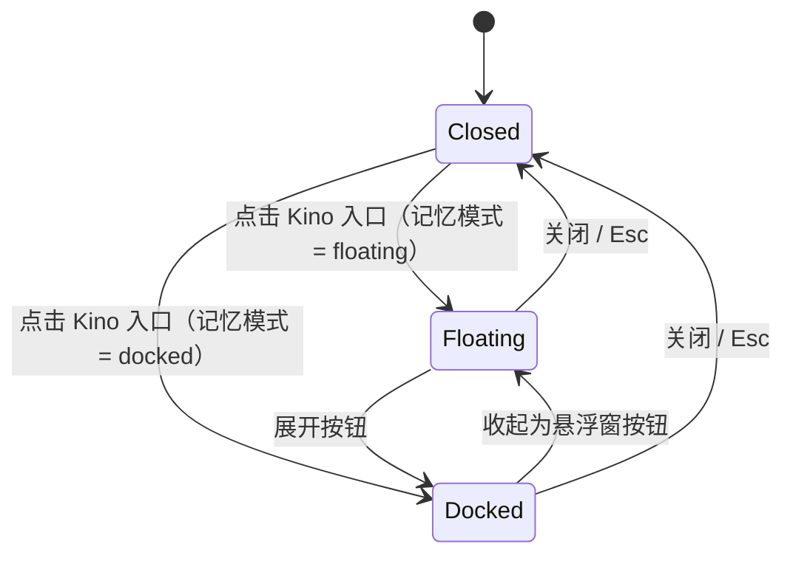

# 1. 问题与现状

- 需求：观看页 Kino 入口与悬浮陪看窗（Feature）
- 集成分支 `feat/watch-kino-panel`，目标 `dev`。预览工作树使用 `feat/kino-chat-entry`。[集成 PR #96](https://github.com/owariband/Seekino/pull/96)。
- 2026-11-07 的测量来自本地预览。2026-11-10 在生产网页用新的游客会话复核，打开观看侧栏后只有淡化时间与暂停播放设置，找不到浮窗切换入口。当时发布包未包含 11 月 7 日的预览实现。

**背景与触发场景。** 观看页的陪看对话目前只有一个入口：顶栏右侧的聊天气泡图标（`web/src/features/player/WatchPage.tsx` 的 `panelToggle`，网页全屏时退到播放器左上角）。点击后整列侧栏从右侧推入（`AppShell` 的 `data-watch-panel-open` 改变 Shell 网格），视频随之缩窄。

**实际与期望。** 入口是一个和上传、主题同排的通用图标，看视频的人不容易意识到“可以直接问这一段”；Kino 作为陪看伙伴只在对话空态里出现。参考产品（Deep-ML 学习页）用右下角像素方块里的吉祥物作为入口，悬停时它会变表情，点开是一个贴在右下角的悬浮对话窗。我们希望：

1. 入口是右下角的 Kino 方块，悬停时 Kino 转头看你，空闲久了会睡着，回答进行中会忙碌。
2. 快速提问时打开悬浮窗，不改变视频布局；需要长对话、看选集时一键停靠为现有侧栏。

**负面影响。** 入口辨识度低，陪看问答这一核心卖点被埋在顶栏图标里；每次提问都要推入整列侧栏，视频尺寸跳变，短问题的代价偏高。

**直接照搬参考的问题。** 参考页面是代码题，悬浮窗盖住文字代价小；观看页的悬浮窗会盖住画面右侧约三分之一，包括字幕和正在提问的位置。因此不能只做悬浮窗，要保留停靠模式。

**本次边界。**
- 做：Kino 入口；Kino 可拖动并吸附到左右边缘、位置记忆；悬浮 / 停靠两种模式及切换、模式记忆。
- 不做：`/search` 独立对话页的样式；对话和检索的业务逻辑。拖动 Kino 与窗口标题栏只调整观看页布局。
- 保持：停靠模式的宽度拖拽、选集页签、发送时暂停、Esc 关闭、Tab 在播放器和对话之间切换焦点、≤800px 的底部抽屉。

# 2. 影响因素、假设与评价指标

| 因素 | 现状 | 假设 | 验证 |
| --- | --- | --- | --- |
| 入口辨识度 | 顶栏通用图标 | Kino 方块在右下角固定可见，加上悬停反馈，更容易被发现 | 发布后看陪看对话开启次数（待测，暂无埋点，不作为本次验收门槛） |
| 布局跳变 | 每次打开都推入侧栏 | 悬浮模式下视频尺寸不变 | 截图对比打开前后的播放器宽度 |
| 遮挡 | — | 悬浮窗遮挡画面右下角，所以保留停靠作为长对话模式 | 人工检查；停靠后不遮挡 |

| 指标 | 口径 | 目标 | 测量 |
| --- | --- | --- | --- |
| 悬浮打开时播放器宽度变化 | 打开前后 `.viewer` 的宽度 | 0 px | Playwright 截图 + DOM 测量 |
| 模式切换 | 悬浮 ↔ 停靠，刷新后保留 | 两种模式都可用，刷新后记住 | 单元测试 + 手动验证 |
| 回归护栏 | 现有 `WatchPage` / `SearchPage` 测试，typecheck，build | 全部通过 | `npm --prefix web test`、`typecheck`、`build` |
| 主题 | 亮 / 暗 | 两种主题下边框和阴影都清晰可读 | 两种主题截图人工评审 |

# 3. 改造方案与建模

**已有基础。** `Kino` 组件已经有 `idle / look / sleep / loading` 等状态和 `dozeAfterMs`；`useAssistantBusy()` 提供回答进行中信号；嵌入式 `SearchPage` 已有对话记录、新对话、空态示例问题；侧栏通过 `#watch-side-panel-host` portal 挂在 Shell 网格的第二列。

**状态机。**

- Kino 可拖动：移动超过 4px 视为拖动（不触发打开），拖动中朝拖动方向原地奔跑（新增 `dashLeft` / `dashRight`，反向超过 6px 才转身），松手后吸附到最近的左右边缘、保留高度（夹在顶栏与底边之间），落地播放 `jump`；位置存于 `seekino-kino-entry-dock`。悬浮窗开在 Kino 所在一侧，保持完整高度，并尽量与 Kino 底边对齐。
- 模式存储在 `localStorage` 的 `seekino-watch-panel-mode`，默认为 `floating`。视口 ≤800px 时有效模式固定为 `docked`（即现有底部抽屉），隐藏切换按钮。
- 只有有效模式为 `docked` 时才向 `AppShell` 上报 `open: true`；悬浮模式下 Shell 网格不变，视频不缩窄。
- 悬浮窗尺寸参照 Deep-ML 学习页：宽 `clamp(320px, 25vw, 400px)`、高 `min(640px, 62% 视口高)`，开在 Kino 所在角落（1440×900 下为 360×558）；网页全屏时去掉顶栏占位，同样尺寸与位置。
- 输入框上方有一枚“能看到”提示：`能看到：EP 01 · 12:34`，即随问题一起发送的当前集与播放位置；位置每秒更新一次，由独立的小 store 订阅，不触发对话区重渲染。
- 悬浮窗闲置 8 秒（指针不在窗内、没有按键或点击、没有回答在生成）后淡到 12% 不透明度，让画面透出来；指针移入、点击或按键立即恢复。停靠模式不淡出。
- 悬浮窗与入口都留在 `#watch-side-panel-host` 中，使用 `position: fixed`（Shell 及 host 都没有 containment，网页全屏时仍可见）。
- 顶栏的聊天图标和全屏左上角的浮动按钮由 Kino 入口替代。

**视觉。** 复用现有设计，不另起风格：悬浮窗就是停靠侧栏本身（同一工具栏、页签与对话），只改为浮动定位，加 `--radius-medium` 圆角与 `--shadow` 阴影；入口只有 Kino 本身（3 倍、无底框，用柔和投影与背景区分），不另加方块；对话空态与 `/search` 一致，使用同尺寸的 Kino。

**实施边界。** 只修改 `web/`：`WatchPage.tsx`、`watch.module.css`、Kino 引擎（`dashLeft` / `dashRight`）、`SearchPage.tsx`（嵌入模式 Kino 尺寸与 `/search` 对齐）、i18n 文案，以及相应测试。不涉及后端、API 和数据。

# 4. 对照实验与结果分析

**2026-11-10 集成验证计划。** 基于当前 `dev` 移植既有实现，覆盖 Kino 打开、悬浮与停靠切换、已选模式刷新恢复、观看时间点和窄屏抽屉。用当前前端单测、类型检查和构建检查回归，再用 Chrome 通过观看页入口测量两种模式的播放器宽度。下表保留 11 月 7 日的预览测量，当前集成结果见第 6 节。

在同一视频（本地库 `Let's build GPT`）、1440×900、亮暗两种主题下，用 Playwright（系统 Chrome）截取基线与改造后的截图，并测量 `.viewer` 宽度；另在 390×844 下检查抽屉回退。

| 指标 | 基线实测 | 方案实测 | 验收标准 | 判断 |
| --- | --- | --- | --- | --- |
| 打开对话时播放器宽度 | 1440 → 1000 px（推入 440px 侧栏） | 悬浮 1440 → 1440 px；停靠仍为 1000 px | 悬浮模式下不变 | 达标 |
| 自动化测试 | — | web 30 个文件、589 个测试全部通过；typecheck、build 通过 | 全部通过 | 达标 |
| ≤800px | 底部抽屉 | 有效模式为 docked，切换按钮隐藏 | 保持现状 | 达标 |

# 5. 试点验证与方案取舍

纯前端交互改动，风险低。用本机开发服务器（后端为现有 19641 实例）做集成验证代替独立试点：在 Chrome 中实际操作悬停、打开、发送示例问题、切换停靠、刷新和网页全屏。未覆盖：移动端真机，以及发布后的入口使用率。

# 6. 结果验收与闭环

- 原问题：入口改为右下角 Kino 方块，悬停时 Kino 转头，空闲时睡着，回答中忙碌；悬浮模式不再缩窄视频，长对话可一键停靠。
- 调整记录：最初另做了一套“像素控制台”风格（直角、2px 青色描边、硬投影、等宽字体的中文），评审结论是难看且和产品其余部分割裂：暗色下硬投影是半透明浅色，叠在视频上发灰；等宽字体排中文间距失衡；空态里的 Kino 很小，框内大片留空。因此撤回，改为复用现有侧栏、表面与 `/search` 空态。首轮截图还显示入口与悬浮窗盖住了播放器控制栏（倍速、全屏），因此统一抬高到 `--kino-dock-bottom: 84px`；入口中的 Kino 由 1 倍放大到 2 倍，按实测精灵包围盒居中。
- 否决方案（2026-11-07）：曾把停靠改为底部面板（类似终端，默认高度取视频下方剩余空间）、选集移到右侧可收起侧栏、去掉对话面板的选集页签。实测竖向窗口 1280×1400 下视频保持主列满宽（940×529）；宽屏 1440×900 下面板只能取下限，画面同样被压缩。用户评审结论是整体观感比原布局更差，因此整组撤回，恢复右侧停靠与视频下方的“本系列选集”。
- 11 月 7 日的预览已实现、已本机验证；当日未部署。网页全屏下的入口位置只做了代码层面的推断（host 无 containment），尚未实际截图；入口使用率无埋点，未测。

**2026-11-10 集成验收。** [PR #96](https://github.com/owariband/Seekino/pull/96) 将预览移植到当前播放器。观看页和设置页共用淡化时间与暂停播放偏好；输入框上方按当前语言显示集数和播放位置。Kino 支持移动，桌面浮窗也可通过标题栏拖动。

全量前端 32 个文件、641 项测试通过，正式构建通过。[隔离浏览器用例](../../../web/tests/public-course-readiness.mjs) 用真实 Chrome、临时 SQLite、FastAPI 和 206 媒体响应走游客入口。在 1440×900 的窗口中，打开浮窗后播放器仍宽 1440 px；停靠后变窄，刷新能恢复停靠，切回浮窗后宽度恢复。网页全屏能打开 Kino 和输入框，390×844 回退到底部抽屉。原课程用例的八轮对话和逐集检索范围通过；模型、向量索引响应使用原用例的测试替身。线上发布与浏览器核验记录见合并 PR 对应的发布记录。
