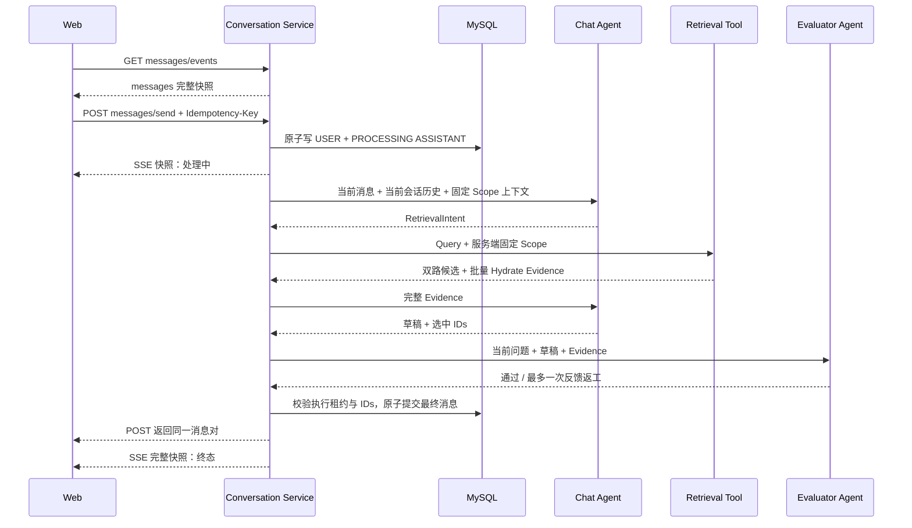

# Agent Chat：当前结构、模型与执行边界

日期：2026-09-18。三 Agent 与 HTTP / 前端代码已完成本地开发和仿真回归；真实模型 + MySQL / Qdrant + 浏览器回放尚待联调。最新执行契约见 [agent-chat-delivery-contract.md](agent-chat-delivery-contract.md)，参考源码见 [agent-loop-references.md](agent-loop-references.md)。本次已删除 Agent Session：当前资源关系为 Workspace → Conversation → Message。本文末尾保留早期 Session / 两 Agent、租约 / DEGRADED 草案作为历史，不属于当前 API 或数据库。

## 1. 当前执行方式

API → AgentChatService → AgentRuntime.kick → 最多 3 个 turn(Query SDK / Retrieve / Evaluator) → 事实性结论提交非空 `selected_video_ranges` → 获批后 Chat 在有 approved evidence 时首次 `tool_choice=required`，至少提交一个视频后恢复 `auto` → Output → Service 原子提交 → completed。继续审核必须有 advice；第三轮 continue 失败，零最终 Chat。Loop 为可复用 Graph；Kick 固定一个用户请求；Turn 固定一轮 Query / Evaluator，SDK 内部工具 Step 不算业务轮次。DeepSeek Harness / Codex 术语差异和本地源码链接保留在最新契约第 3.4 节。

## 2. 当前项目结构与职责

```text
server/
├── service/agent_chat.py       Conversation / Message、Workspace 归属、历史、事务、自有任务
├── agent/
│   ├── __init__.py
│   ├── runtime.py             Graph、kick / turn、预算与协作停止
│   ├── state.py               输入、共享内部 Schema、轮次、控制与异常
│   ├── query.py               原计划与完整历轮 context → SDK 工具循环 → 草稿
│   ├── evaluator.py           完整召回 / 草稿审核 → complete / continue + advice
│   ├── chat.py                当前获批材料 → 自主 Markdown / submit_video_item 块循环
│   ├── tools.py               全部 Agent Tool 的 Schema / 构造入口；固定 Scope、预算、记录 / 局部 Lock
│   └── output.py              真实召回 ID / Scope / 时间绑定、最终 SearchResult
├── api/agent.py               JSON / POST SSE、事件 DTO 白名单、GET 完整快照
├── router/agent.py            六个 Conversation / Message 公开路径
├── config/agent.py            历史 / TopK / 3 Turn / SDK calls / token / timeout / 并发
├── config/settings.py         Query / Evaluator / Chat 型号和配置加载
└── bootstrap.py                三角色、正式检索、Harness 与 Service 装配

gateway/
├── agent_model.py             LangChain SDK Query、文本 / 工具循环与 DeepSeek → Ark Lite fallback
├── models.py                  Evaluator 的 StructuredAgentModel 适配与跨 Provider fallback
├── sse_proxy.py               结构化响应聚合、终态 / 错误
└── usage.py                   Provider 调用 usage 采集

web/src/features/search/
├── useAgentConversation.ts    Workspace Conversation、逐消息 Scope、消息、流、快照
├── SearchPage.tsx             正式助手消息、完整 Markdown 和选中证据卡片
└── EvidencePlayer.tsx         原视频 metadata 后定位、范围终点暂停
```

旧 server/service/agent.py 和旧 Service 测试已迁移删除；没有兼容包装。Harness 不依赖 HTTP 或会话 Repository；SDK 适配复用 Gateway 协议，未复制 ReAct 循环或搭 Registry。VideoRetrievalService 和 Engine 的确定性算法继续复用，不修改解析身份体系。

## 3. 当前接口

以下六个路径是当前契约，Session create / list / get 已删除；send 保留同一路径的 SSE 协商。

| 方法 / 路径 | Query | Body | 返回 |
| --- | --- | --- | --- |
| POST `/api/agent/conversations/create` | 无 | `workspaceId, title` | `201 AgentConversationView` |
| GET `/api/agent/conversations/list` | `workspaceId, limit` | 无 | `AgentConversationView[]` |
| GET `/api/agent/conversations/get` | `conversationId, workspaceId` | 无 | `AgentConversationView` |
| GET `/api/agent/messages/list` | `conversationId, workspaceId, afterSequenceNo, limit` | 无 | `AgentMessageView[]` |
| POST `/api/agent/messages/send` | `conversationId` | `workspaceId, content, seriesIds?, topK` | `200 AgentMessageSendView` 或 SSE（Accept 协商） |
| GET `/api/agent/messages/events` | `conversationId, workspaceId` | 无 | `text/event-stream` |

创建 Conversation、发送消息均要求 `Idempotency-Key`。Conversation 创建幂等限定在 Workspace，消息发送幂等限定在 Conversation。网络重试保留原 Key 与原参数；创建 Conversation 无 Query 资源 ID，业务参数在 Body。

当前默认：workspace 为 `local-default`；Conversation 标题“新对话”；消息 TopK 为 8、Service 上限 20；Conversation 默认 limit 100，Message 默认 200，HTTP limit 上限 500。Message 游标 `afterSequenceNo` 默认为 -1。Conversation 目前没有分页游标。

send 在短事务提交 USER 与 PROCESSING ASSISTANT，再交 Service 自有 ThreadPoolExecutor 执行。默认 JSON 等待结果；Accept: text/event-stream 返回 answer.started / progress / evidence / block / delta / completed / failed，保持 200 而非 202。`answer.block` 保留 Chat 自主决定的 Markdown / video 逻辑顺序；`answer.delta` 是所有 Markdown 块的兼容汇总，不是 Provider token 流。只有循环、可信绑定和数据库完成写入全部成功后才发送最终事件。GET messages/events 是 event: messages 的数据库完整快照，不会再启动 Kick。断线 / 切换只结束消费；关闭自有服务才通知执行取消。每调用自有 Provider client 关闭，外部注入 client / Service 由调用方拥有。

seriesIds 省略或 [] 为当前 Workspace 全部 READY 动画，显式未 READY 返回 409，没有 READY 动画也返回 409。Service 启动任务前展开并冻结实际 Scope，USER / ASSISTANT 公开返回该 seriesIds。同 Key / 相同参数：PROCESSING 返回 409，终态返回原消息；改内容、有效 TopK 或规范化原请求 seriesIds 返回 409。原请求范围与展开结果分开保存，新增动画不改变旧“全部”请求的幂等重放。FAILED 后同 Key 不重跑，新尝试使用新 Key。

复用相关基础接口：`GET /api/series/list?workspaceId=...` 的 seriesId / name / status 提供动画多选；`POST /api/search` 做独立基础检索，`GET /api/videos/content?videoId=...&workspaceId=...` 播放原视频；Agent 内部使用对应 Service。已有上传、视频解析和 Job SSE 不属于本轮新增接口。


## 4. 当前持久化和内部模型

当前持久化仅有 AgentConversation / AgentMessage 两张 Agent 表，Conversation 直接保存 workspace_id，不保存 series_ids，无 Session 外键。创建唯一约束为 (workspace_id, idempotency_key)，消息约束仍限定在 Conversation；行锁与序号事务保留。未新增 Run 表、revision、executionVersion、leaseExpiresAt、executionDeadlineAt 或 DEGRADED。公开 DTO 仍用 camelCase，内部数据用 snake_case。create_schema 拒绝旧 Session 和 Conversation 固定 Scope / Message 缺 Scope 的结构，不能靠 create_all 自动改表。本次未对真实开发 / 生产库执行 DDL；完整迁移步骤见 [Agent API 第 8 节](agent-api.md#8-已有数据库升级)，先从 Conversation 回填每条消息实际 / 原请求范围，旧 USER requested 保存原显式固定范围，ASSISTANT 为 NULL，再删除 Conversation.series_ids；仍有 Session 时同时迁移 workspace / 唯一键并移除旧层，保留 Conversation ID 与全部消息。

| 模型 | 当前字段 / 语义 |
| --- | --- |
| AgentConversation | conversationId / workspaceId / title / nextMessageSequence / lastMessageAt / 时间；内部保存 Workspace 创建幂等 idempotencyKey |
| AgentMessage | messageId / conversationId / sequenceNo / role / status / content / 本次实际 seriesIds / modelName / replyToMessageId / retrievalQuery / searchResult / renderBlocks / lastError / 时间；内部 USER 保存 idempotencyKey / requestedTopK / requestedSeriesIds（[]为全部），ASSISTANT requested 为 NULL |
| QueryDraft | plan_context / message / selected_video_ranges；事实性结论必须非空 |
| EvalDecision | action: complete / continue；advice；continue 必须非空 |
| Chat delivery | 模型自主编排 Markdown；有 approved evidence 时首次 required 且至少提交一个 `video_chunk_id + claim`，成功后 auto；Server 拒绝重复/越权 ID，从获批 `selected_video_ranges` 绑定时间并补 URI / 标题等可信字段；最终产生有序 renderBlocks |
| RetrievalArguments | 模型仅填 query / top_k / channel_weights；workspace / series_ids 来自固定 Scope |
| RunInputs | Conversation / Assistant 身份、workspace / series_ids / series_context、user_message / history / requested_top_k |
| LoopTurn | number / status、plan_context、retrieval_calls、retrieval_result、evidence_source_turns、query_draft、draft_output、review，以及完整校验后的 Chat render draft |
| RunState | inputs / turns / control / final_output；每 Kick 独立，未持久化 |
| AgentFinalOutput | 内部扩展 VideoChunkSearchResult，保留 query / seriesIds / agentReply / 实际提交 hits，并增加有序 renderBlocks；独立 `/api/search` 不暴露该字段 |

ASSISTANT 仅 PROCESSING → COMPLETED / FAILED；COMPLETED 要求材料评审通过、Chat 自主循环正常结束且至少产生一个非空 Markdown 块、有 approved evidence 时至少提交一个视频块、所有已提交块都通过可信绑定，并且 content / searchResult（内含 renderBlocks）在一次完成写入中提交成功。最终 Chat 正文未再审核，不把材料 complete 与消息 completed 混同。Message.modelName 是最终 Chat 主模型，fallback 只记录 warning；Evidence.modelName 是原视频解析型号。

Query、Evaluator、Chat 默认统一使用 `config.yaml` 的 `agent_model.model`（DeepSeek Flash），
环境变量可分别覆盖；`video_parser.transcript_model`（Ark Doubao Lite）是默认 fallback。
Provider 请求或模型响应异常时，失败的单次模型调用在现有消息 / Tool 状态上原位切换 Provider；
已完成的业务 Tool 和 acknowledgement 不丢失、不重跑。业务 Tool 错误、取消 / deadline / 预算
等控制错误和本地输入校验错误不会触发模型降级。Chat 只公开 `submit_video_item({video_chunk_id, claim})`；
有 approved evidence 时首次 `tool_choice=required`，成功提交至少一个后恢复 `auto`。服务端校验
ID，从 Evaluator 已放行的 `selected_video_ranges` 绑定播放时间，并从 Evidence 填充可信 URI / 标题等字段，再返回 acknowledgement。范围集合不一致或越界是审批状态错误，不回退 canonical Chunk。Gateway 采集
每轮 usage，并校验完整响应与所有 tool arguments；Runtime 整体校验通过后才交付有序 blocks 和视频快照。

Query 第一轮实际调用 Retrieve；下一轮收到原计划、全部已完成轮次计划 / 完整调用 / 草稿 / review / advice，可重新检索或复用。检索按固定 Scope 直接调用正式 Service；同次重复 ID 拒绝、跨调用同 ID 取最新真实证据。选中 ID 必须来自实际调用，按选择顺序去重。公开 query 为选中顺序最后一项 hit 的真实 query（空选择为最后调用 query），所有多查询来源在内部记录保留。

## 5. Conversation 与事件隔离

Repository 直接按 Conversation.workspace_id 校验归属，消息只属于当前 Conversation；当前 Conversation 的历史限定为当前 USER 之前最近 12 条 COMPLETED 消息，并逐条携带 seriesIds，Query 可以辨认范围变化。不混其他 Conversation，不将旧消息证据冒充本次实际召回，不将本次 Kick 历轮记录误当永久聊天历史。一个 Conversation 同时最多一个 PROCESSING ASSISTANT；不同 Conversation 可并行执行。

Graph 共享规则，Kick 深复制输入并创建独立控制 / turns，每 Turn 工具闭包和局部锁独立。默认最多 4 个 Service 任务同时执行，排队未持久化。HTTP 订阅只接收当前 message 的公开白名单事件；sequence 是单订阅内存顺序，未用于跨 Worker replay。

前端 Conversation 身份按 Workspace 存储，直接创建与恢复 Conversation；动画选择独立，空选择代表全部 READY，切换选择不切换对话。active 实例、conversationId、messageId 和递增 sequence 拒绝旧回调；终态不被旧 PROCESSING 覆盖，处理中快照不擦除已收到的正文 / hits。列表分页和 GET 完整快照恢复持久化事实，订阅断线不重跑任务。

## 6. 预算、SSE 与范围播放

外层最多 3 Turn、Query 内部最多 6 次模型调用 / 4 次工具调用；默认 topK 8 / 上限 20，每次召回和最终去重选中数均不超过 min(请求 TopK, 配置上限)。Query context 显式传 selection_limit，联合多次检索超出最终预算在评审前失败，不事后截断获批选择。单次输出 max tokens 4096，总执行 deadline 180 秒，单次请求另有有限 timeout。SDK 模型前后、Retrieve 前后、每个 Chat 视频工具调用 / acknowledgement / 最终正文及 Output 检查协作取消 / deadline；不能硬终止阻塞网络。单次调用会采集 Provider usage，但还没有跨角色累计 token 账本。

AgentModelInvocationError 表示模型 / 审核 / 输出和预算错误。检索业务异常在 tools 包装成 AgentToolInvocationError 并保留 cause，穿过 SDK 和 Query 后由 Service 在 Kick 边界解包；默认 JSON 保持原 READY / Scope / 索引错误的 404 / 409 映射，不误变成 502。SSE 开始后由执行失败事件及数据库 FAILED 快照报告，不自动重试或降级。

Harness 在工具循环期间不发布成功 evidence / block / delta，只向 Service 返回完整校验后的同一交付快照。Service 先写占位并发 started；最终用一次完成写入提交 content / searchResult / renderBlocks，提交成功后才依次发 answer.evidence、有序 answer.block、唯一一条兼容 answer.delta 和 completed，错误则持久化 FAILED 后发 failed。evidence 公开服务端填充的可信 hits，block 表达交错顺序，delta 是 Markdown 块的兼容汇总；单个工具调用、acknowledgement、Provider token 和半截正文不对前端发布。每执行订阅队列 256；溢出发 `answer.interrupted(error.code=STREAM_INTERRUPTED)` 并停止缓存，任务继续提交。连接失败不能自行把数据库消息标 FAILED；GET 快照恢复终态。

解析每个 canonical VideoChunk 时生成首帧 keyframe，并以相对原视频起点的媒体偏移 `atMs` 登记；公开 Evidence 给出 `thumbnail` / `keyframes` HTTP 图片资源。候选卡只加载 ``，用户点击后才挂载 `<video preload="metadata">`。播放器使用 GET /api/videos/content?videoId=...&workspaceId=... 原视频 Range 端点，loadedmetadata 后 seek 到 startMs，timeupdate 到 endMs 暂停，同视频换片段及重播重新定位。chunkMediaRef 不等于已提供片段 HTTP 路由；没有 /api/video-chunks/content、动作级 Clip / anchor 或邻片工具。

## 7. 已验证与未验证

本次最终回归为后端 699 passed / 8 skipped / 3 warnings，前端 14 个文件 / 120 项
通过，typecheck / build 通过。8 个跳过项均来自未配置真实 MySQL 测试环境的
`tests/server/test_mysql_integration.py`。

正式测试命令见最新契约第 7 节。Harness 覆盖非空证据、三轮放行 / 拒绝、所有上下文、多次召回 / 复用、Scope / ID / 时间、事实性结论非空范围、approved evidence 至少一次视频工具调用、required → auto、重复 / 越权拒绝、可信字段绑定、有序 `renderBlocks`、最终 Markdown、调用 / 最终片段预算、并发 / 取消和失败无 Output。Service / API / SSE 是 SQLite / ASGI 仿真；Gateway 使用实际 SDK、HTTP MockTransport / 假 ChatModel 验证 DeepSeek 主调用、Ark Lite 原位 fallback、Tool 状态保留与最终文本；前端是 vitest / jsdom 仿真。前端 typecheck 和 build 已通过。

本次 Service 回归验证默认全部 Scope 在 Turn 之间新增素材时仍冻结，素材状态变化后原
幂等 Key 仍返回原范围，下一次新 Kick 才获取最新 READY 集合；同 Conversation 可以发送
不同显式 Scope，历史逐条携带原范围，旧证据不计入新 Kick 的实际召回记录。

尚未完成真实三模型 + 当前 MySQL / Qdrant + 浏览器媒体回放联调；没有跨 Worker live delta replay、持久化 Agent checkpoint / lease / reaper、崩溃 PROCESSING 恢复或自动基础候选降级。进程硬退出可能永久留下 PROCESSING，视频 ParseJob 的可靠执行体系不能替代聊天恢复。

## 8. 下一步

先验证真实模型选择质量、当前数据库 Schema、Scope / 来源与 Range 回放；再按新需求设计聊天崩溃恢复、跨 Worker 交接与标识明确的降级。历史 proposal 仅用于评估，不默认实施新增表字段或 DEGRADED，不绕过第三轮 continue 失败。

---

## 历史存档：早期结构、旧两 Agent 基线与恢复提案

以下原稿保存于 2026-09-15 开发前。原稿里的 Agent Session 表、接口和字段已在本次删除，不可据此创建 Session 或发送 sessionId。原稿中的“当前源码”“本轮”“尚未实现”均指开发前时点，不代表上文已完成的实现；旧 service/agent.py、RetrievalIntent / ChatAnswer / approved / corrected_query、一次返工、只有快照 SSE 均已被替代。lease / DEGRADED / 恢复扫描依然只是未实施提案。MDV generation 与既有业务模型列举保持历史原貌。

# Agent Chat 结构、契约与恢复设计草案

日期：2026-09-15。范围：继续 `transfer.md` 中的 Agent Chat 工作，先完成设计。本文中的“新增”和“建议”尚未实现。

最新 Loop 和视频交付契约见 [agent-chat-delivery-contract.md](agent-chat-delivery-contract.md)：用户已确定三个 Agent，Query / Evaluator 最多 3 轮，Evaluator 仅 complete / continue + advice；事实性结论必须具有非空 `selected_video_ranges`。放行后，有 approved evidence 时 Chat 首次 `tool_choice=required`，至少提交一个 `submit_video_item({video_chunk_id, claim})` 后恢复 `auto`；服务端拒绝重复/越权 ID，从获批 `selected_video_ranges` 原样绑定播放范围，并补齐可信 URI / 标题等字段。整体校验和完成写入通过后才发送有序 answer.block 及兼容 delta，确定性 Output Node 绑定已放行的视频证据。三个业务层级是 Loop 定义规则、一次 kick() 启动一次用户请求、内部 turn() 执行一轮 Query / Evaluator；执行状态对应独立 RunState 与各轮 LoopTurn。该契约替代本文此前两 Agent、强制批量视频工具、Evaluator 指定 correctedQuery 和直接交付草稿的目标设计；本文相应描述仅用于理解当前源码和早期提案。源码参考见 [agent-loop-references.md](agent-loop-references.md)，本地 DeepSeek Harness 的 kick / turn 差异见最新契约第 3.4 节。

## 1. 设计基线

当前源码已实现 Session / Conversation / Message 持久化、两个模型角色与一个确定性 Retrieval Tool，以及完整消息快照 SSE。`messages/send` 当前同步执行整个图；它不是后台任务提交接口。

源码基线：`server/router/agent.py`、`server/api/agent.py`、`server/api/schema.py`、`server/service/agent.py`、`server/repository/agent.py`、`server/model/agent.py` 和 `server/schema.py`。

技术方案 MDV 已通过 CLI 同时读取 Reference / Document：generation 63。Reference 已描述 Chat / Evaluator，但 Document 第 11 节仍是旧版 M1 Agent 边界。架构 JSON 中的 Conversation Service / Retrieval & Evidence Service 仍可复用，其 Verify、IndexVersion 等标签不能直接当成当前实现事实。本轮以交接文件和上述源码确定已实现部分，后续再同步技术方案。

本轮设计需要补的能力：非空证据回归、真实模型联调、过期执行终止与崩溃恢复、REST / SSE 乱序保护，以及有明确状态的基础候选降级。

根据本轮讨论收紧字段方案：P0 过期后将原消息置 FAILED，重试产生新消息；只建议新增内部 leaseExpiresAt。revision、executionVersion、executionDeadlineAt 暂不增加，适用条件见下文。Chat / Evaluator 的循环由图状态与条件边表达，不依赖这几项数据库字段。

## 2. 项目结构与职责

```text
web/src/
├── api/client.ts                     HTTP 客户端，复用 AgentMessageView
└── features/search/                  对话选择、消息状态、订阅、证据播放

server/
├── router/agent.py                   路径、方法、响应类型
├── api/agent.py                      HTTP DTO、协议处理、快照 SSE 与增量流（补完）
├── api/schema.py                     HTTP / SSE request、view
├── api/app.py                        装配恢复扫描的启动与周期任务（新增行为）
├── service/agent_chat.py           Session / Conversation / Message 业务与事务（迁移）
├── agent/                           底层 Harness 逻辑模块（新增，独立于 HTTP）
│   ├── runtime.py                   Loop / kick / turn、路由、预算与执行收尾
│   ├── state.py                     RunInputs / RunState / LoopTurn 与内部数据契约
│   ├── query.py                     Query Agent 的 SDK 配置、工作上下文与 draft
│   ├── evaluator.py                 Evaluator Agent 的 complete / continue + advice
│   ├── chat.py                      获批后最终 Chat 的自主 Markdown / 视频提交块循环
│   ├── tools.py                     统一 Agent Tool Schema / 构造入口；绑定当前 Scope / 状态
│   └── output.py                    草稿绑定、证据校验、最终结果封装
├── repository/agent.py               归属查询、幂等、行锁、序号、条件回写
├── model/agent.py                    三张 Agent 表
├── config/agent.py                   历史、TopK、租约、总执行预算（补配置）
├── config/sse.py                     快照轮询与保活
├── service/video_retrieval.py        READY / Scope、检索与批量 Hydrate
├── repository/video.py              MySQL 完整事实及索引 revision 校验
├── storage/qdrant.py                 Qdrant 协议与环境 Collection
└── mq/worker.py                      现有视频 ParseWorker

engine/
├── parse/                           现有视频解析链
└── retrieval/video_retrieval.py      检索文档、双路融合、确定性 RRF

gateway/
├── models.py                        Provider 适配、generate 与 stream_text（新增契约）
└── sse_proxy.py                     结构化聚合与直接文本流、终态 / 错误校验（补完）
```

保持 API / Service / Repository 的既有业务分层，AgentChatService 作为会话应用层依赖 server/agent 的底层 Harness。API 负责 HTTP / SSE 协议；AgentChatService 负责会话归属、固定 Scope、历史准备、消息状态与事务；Repository 负责行锁、幂等与持久化；Runtime 负责一次 Kick 的执行与停止。Harness 接收普通输入和注入依赖，可由 HTTP、CLI 或测试调用，不依赖 FastAPI 或 AgentChatService。Agent 模块负责各自的模型调用与上下文，不访问会话 Repository。

2026-09-15 用户修正了此前“service/agent.py 保留会话业务，另提取一个 agent_runtime.py”的结构：Conversation 业务、Runtime 与三个 Agent 实现需要明确分开。目标为 service/agent_chat.py + server/agent/，旧 service/agent.py 的内容按职责迁移并更新全部导入，不保留堆叠所有逻辑的 agent.py，也不增加仅转发的兼容层。上述是待实现结构，当前源码仍在 service/agent.py。

Runtime 构建 Graph 并调用 Query / Evaluator / Chat，具体 Prompt 与 SDK 配置在角色模块中；state.py 是各模块共同使用的数据契约，不导入角色实现，避免循环依赖。tools.py 统一定义 Retrieval / Chat Tool 的 Schema 和构造器；其中 Retrieve Tool 通过注入的 VideoRetrievalService 做正式召回，固定 workspace / Series Scope 来自 RunInputs，不请求本服务的 /api/search。Gateway 只处理模型协议，不决定 Conversation Scope。

Runtime 形成完整 evidence / 有序 blocks / 兼容 delta / final_output；AgentChatService 缓冲成功事件，并在数据库写入完成且 commit 成功后才原子释放 evidence、`answer.block`、delta 与 completed，API 再编码为 HTTP SSE。public agent API 路径和 router/agent.py、api/agent.py 的分组沿用现状。数据库 model/agent.py 与 repository/agent.py 表达已有会话数据，首批可以复用；它们不承载 Agent Prompt 或运行逻辑。完整依赖和职责见最新交付契约第 3.5 节。

## 3. 开发与对接接口

以下九个路径已经存在，后续补完其可靠性和对接行为。

| 方法 / 路径 | Query | Body | 返回 |
| --- | --- | --- | --- |
| POST `/api/agent/sessions/create` | 无 | `workspaceId, name` | `201 AgentSessionView` |
| GET `/api/agent/sessions/list` | `workspaceId, limit` | 无 | `AgentSessionView[]` |
| GET `/api/agent/sessions/get` | `sessionId, workspaceId` | 无 | `AgentSessionView` |
| POST `/api/agent/conversations/create` | `sessionId` | `workspaceId, title, seriesIds` | `201 AgentConversationView` |
| GET `/api/agent/conversations/list` | `sessionId, workspaceId, limit` | 无 | `AgentConversationView[]` |
| GET `/api/agent/conversations/get` | `conversationId, workspaceId` | 无 | `AgentConversationView` |
| GET `/api/agent/messages/list` | `conversationId, workspaceId, afterSequenceNo, limit` | 无 | `AgentMessageView[]` |
| POST `/api/agent/messages/send` | `conversationId` | `workspaceId, content, topK` | `200 AgentMessageSendView` |
| GET `/api/agent/messages/events` | `conversationId, workspaceId` | 无 | `text/event-stream` |

创建 Session、创建 Conversation、发送消息均要求 `Idempotency-Key`。网络重试保留原 Key 与原参数；资源 ID 在 Query，业务参数在 Body。

当前默认：workspace 为 `local-default`；Session 名称“画面札记”，Conversation 标题“新对话”；消息 TopK 为 8、Service 上限 20；Session / Conversation 默认 limit 100，Message 默认 200，HTTP limit 上限 500。Message 游标 `afterSequenceNo` 默认为 -1。Session / Conversation 目前没有分页游标。

早期基线中的 `messages/send` 只有同步 JSON；当前同一路径已通过 `Accept: text/event-stream` 支持 SSE。Service 在最终消息写入和数据库 commit 成功后，才原子释放 evidence、有序 `answer.block`、兼容 delta 与 completed；GET 消息快照 SSE 用于恢复状态，不再次启动图。后续若改为立即返回 202，必须同时设计持久化领取、独立执行器、重试与新响应语义；仅把图塞进内存 BackgroundTask 无法满足崩溃恢复。

复用相关基础接口：`POST /api/search` 做独立基础检索，`GET /api/videos/content?videoId=...&workspaceId=...` 播放原视频；Agent 内部使用对应 Service。已有上传、视频解析和 Job SSE 不属于本轮新增接口。

## 4. 持久化模型与返回字段

Python 使用 snake_case，HTTP / SSE 使用 camelCase。下面以工程 API 风格列字段；“内部”字段不进入 MessageView。`?` 表示可空。

### 4.1 AgentSession

表：`agent_session`。表示工作区内一组 Conversation 的组织容器，不承担共享聊天记忆。

| 字段 | 类型 | 语义 |
| --- | --- | --- |
| sessionId | UUID string | 主键 |
| workspaceId | string | 数据归属 |
| name | string | 展示名称 |
| idempotencyKey | string，内部 | 创建幂等 |
| createdAt / updatedAt | UnixTimeMs | 创建 / 修改的 Unix epoch 毫秒 |
| conversationCount | int，仅查询结果 | 聚合计算，不另存一列 |

唯一约束：`(workspaceId, idempotencyKey)`。

### 4.2 AgentConversation

表：`agent_conversation`。独立的连续对话与检索边界。

| 字段 | 类型 | 语义 |
| --- | --- | --- |
| conversationId | UUID string | 主键 |
| sessionId | UUID string | 父 Session 外键 |
| title | string | 展示标题 |
| seriesIds | UUID string[] | 创建时固定的非空 Scope |
| idempotencyKey | string，内部 | 创建幂等 |
| nextMessageSequence | int，内部 | 在事务内分配消息顺序 |
| lastMessageAt | UnixTimeMs? | 最近消息变化的 Unix epoch 毫秒 |
| createdAt / updatedAt | UnixTimeMs | 创建 / 修改的 Unix epoch 毫秒 |
| workspaceId | string，仅查询结果 | Join Session 获得 |
| messageCount | int，仅查询结果 | 聚合计算 |

唯一约束：`(sessionId, idempotencyKey)`。切换 Series Scope 创建新 Conversation；没有修改既有 Scope 的接口。

### 4.3 AgentMessage

表：`agent_message`。用户消息、助手执行占位与最终交付的事实。

| 字段 | 类型 | 语义 |
| --- | --- | --- |
| messageId | UUID string | 主键 |
| conversationId | UUID string | 父 Conversation 外键 |
| sequenceNo | int | 会话内固定顺序，状态更新不改变它 |
| role | USER / ASSISTANT | 消息角色 |
| status | PROCESSING / COMPLETED / FAILED | 当前已有状态；下文建议增加 DEGRADED |
| content | string? | 用户正文、已审核答案、失败或降级提示 |
| modelName | string? | USER 为 null；ASSISTANT 记录本轮实际使用的 Chat 模型 |
| idempotencyKey | string?，内部 | USER 保存发送幂等键 |
| requestedTopK | int?，内部 | USER 保存归一后的请求 TopK |
| replyToMessageId | UUID string? | ASSISTANT 对应的 USER，唯一 |
| retrievalQuery | string? | 本轮最终使用的检索 Query |
| searchResult | VideoChunkSearchResult? | 最终交付的完整候选与证据快照 |
| lastError | string? | 可展示的简洁错误；不包含上游原始载荷 |
| createdAt / updatedAt | UnixTimeMs | 创建 / 修改的 Unix epoch 毫秒 |
| leaseExpiresAt | UnixTimeMs?，新增、内部 | 可续约执行租约的 Unix epoch 毫秒期限 |

leaseExpiresAt 只对 ASSISTANT 有效，不进入 HTTP / SSE View。其作用是区分仍存活的慢调用与已失去 Heartbeat 的执行；Chat 返工不会创建另一个执行所有者。

此前考虑的三项字段本轮暂不增加：

| 字段 | 实际适用条件 | 当前处理 |
| --- | --- | --- |
| revision | 同一 Message 可编辑、终态可更新，或并发数据通道需要区分多次内容更新 | 当前仅占位到不可变终态；前端按 messageId 合并，禁止终态被旧 PROCESSING 覆盖 |
| executionVersion | 原 Message 仍处 PROCESSING，但新执行器接管，旧执行也可能迟到 | P0 不接管同一 Message；过期转 FAILED，现有状态校验拒绝旧执行回写 |
| executionDeadlineAt | 跨进程续跑时必须保留原总耗时预算 | 当前单次 invoke 使用配置中的循环上限、模型 timeout 与运行总预算 |

现有唯一约束：`(conversationId, sequenceNo)`、`(conversationId, idempotencyKey)`、`replyToMessageId`。同一 Conversation 最多一个 PROCESSING ASSISTANT，由锁住目标 Conversation 的短事务保证。

建议状态语义：

```text
USER:       COMPLETED
ASSISTANT:  PROCESSING → COMPLETED   Evaluator 通过并完成证据校验
                      → FAILED      审核拒绝、无有效候选降级、崩溃过期等
                      → DEGRADED    仅交付未审核的正式基础检索候选（新增）
```

`COMPLETED` 保持“已审核答案”的现有含义。DEGRADED 是独立终态，UI 展示基础候选和固定提示，不把它当作 Chat 答案；`modelName` 即使记录了尝试调用的 Chat 模型，也不表示降级提示由该模型生成。该枚举扩展必须同时更新 ORM 约束、DTO、API 文档和消费端。

### 4.4 HTTP / SSE 包装模型

| 模型 | 字段 |
| --- | --- |
| AgentSessionCreateRequest | `workspaceId, name` |
| AgentConversationCreateRequest | `workspaceId, title, seriesIds` |
| AgentMessageSendRequest | `workspaceId, content, topK?` |
| AgentSessionView | 上述公开 Session 字段及 `conversationCount` |
| AgentConversationView | 上述公开 Conversation 字段及 `workspaceId, messageCount` |
| AgentMessageView | 上述公开 Message 字段，保持当前字段集合 |
| AgentMessageSendView | `userMessage: AgentMessageView, assistantMessage: AgentMessageView` |
| AgentMessageEventView | `conversationId, messages: AgentMessageView[]` |

List、Send 和 SSE 复用同一个 MessageView。没有单独的 token / 草稿 Message 类型。

## 5. Agent 输出和召回结果模型

### 5.1 两个模型角色的结构化输出

| 模型 | 字段 | 所属职责 |
| --- | --- | --- |
| RetrievalIntent | `retrieval_query: string, top_k: int` | Chat 将当前问题与历史改写成 Query；不能决定 Scope |
| ChatAnswer | `message: string, selected_video_chunk_ids: string[]` | Chat 生成待审核草稿与候选选择 |
| EvaluatorDecision | `approved: bool, feedback: string, corrected_query: string?` | Evaluator 放行，或反馈一次返工 |
| SceneRetrievalArguments | `query, workspace_id, series_ids, top_k` | 确定性 Tool 的调用参数；Scope 来自 Service |

当前这些内部模型使用 snake_case，不是 HTTP DTO。Chat 的意图改写与草稿回答属于同一个模型角色；Evaluator 可以选用相同或不同模型。模型配置来自 `ANIVAG_AGENT_CHAT_MODEL`、`ANIVAG_AGENT_EVALUATOR_MODEL` 和 Gateway 配置，不在 UI 写死。

当前 AgentGraphState 字段为：`workspace_id, user_message, history, series_context, series_ids, requested_top_k, retrieval_query, retrieval_top_k, search_result, evaluator_feedback, review_action, retry_count, answer`。这些运行数据每次 invoke 独立创建，不保存在共享 Service 的可变属性上。降级分支如需知道是否出现过显式审核拒绝，应在本轮执行上下文记录这个事实。

### 5.2 Chat / Evaluator 的循环

```text
Chat 改写 Query → Retrieval → Chat 草稿 → Evaluator
                              ↑             │
                              └── feedback ─┘
```

Evaluator approved=true 进入 END；反馈仅针对回答时返回 Chat 草稿节点；需要 correctedQuery 时返回 Retrieval 后再生成草稿。每次 Evaluator 读取最新 answer，每次 Chat 读取最新 feedback。

当前源码已用 add_conditional_edges 实现回边，并将 retry_count >= 1 设为拒绝后停止条件。最多一次返工是当前业务上限；LangGraph 本身支持多轮循环。后续可将返工上限移入 AgentServiceConfig，保持当前默认值，另设 graph recursion_limit 作为异常兜底；框架步数不等于审核轮数。[LangGraph Evaluator-optimizer 示例](https://docs.langchain.com/oss/python/langgraph/workflows-agents#evaluator-optimizer)

当前回答节点提示词包含 Evidence 与 evaluator_feedback，但没有上一版 answer。为支持“重新组织这份回答”，建议返工输入明确包含：当前问题、Evidence、上一版 Draft、Evaluator feedback。上一版草稿已有在图 state.answer 中，传入提示词即可；草稿仍留在本轮图状态，最终审核通过才更新持久化助手消息。

### 5.3 查询结果契约

| 模型 | 字段 |
| --- | --- |
| VideoChunkCandidate | `videoChunkId, fusedRank, fusedScore, textRank?, textScore?, visionRank?, visionScore?` |
| MatchedEvidence | `kind: TRANSCRIPT / VISUAL_EVENT / CONTEXT, text, startMs?, endMs?` |
| SelectionReason | `summary, matchedEvidence: MatchedEvidence[], limitations: string[]` |
| VideoChunkSearchHit | `candidate, selectionReason, evidence: VideoChunkEvidence` |
| AgentReply | `message, resultCount` |
| VideoChunkSearchResult | `query, seriesIds, agentReply, hits: VideoChunkSearchHit[]` |

`resultCount == hits.length`，且每个 `candidate.videoChunkId == evidence.videoChunkId`。Chat 最终选择只能来自最后一次候选集，按选择顺序去重。当前 selectionReason 是确定性摘要，尚不是 Query 相关的模型解释。

VideoChunkEvidence 复用现有完整契约，按字段来源分组：

| 来源 | 字段 |
| --- | --- |
| Series | `seriesId, workspaceId, seriesName, seriesDescription?, seriesStatus, importantExtraData?, characterBible` |
| Video | `videoId, episodeOrder, originalFilename, originalSourceUri, inferenceProxyUri?, contentHash, durationMs, uploadStatus, parseStatus` |
| VideoChunk | `videoChunkId, sequenceNo, startMs, endMs, analysisWindowStartMs, analysisWindowEndMs, chunkMediaRef, analysisWindowMediaRef, transcript, baselineVisualCaption?, keyframeUris` |
| 解析与检索 | `allTimeEvents, allTimeEventText, retrievalText, videoCompact, contextBeforeCompact, contextAfterCompact, windowSummary` |
| 来源信息 | `modelProvider?, modelName?, pipelineVersion, isFallback, parseProvenance?, parsedAt` |

TranscriptCueView 为 `speaker?, text, startMs, endMs`。Evidence 不返回原始向量。播放使用同一 Evidence 的 `videoId + [startMs, endMs)`；没有实现事件级 Clip 字段时，不能声称当前已收紧到精确动作范围。

## 6. Conversation 隔离

| 边界 | 规则 |
| --- | --- |
| Workspace | 查询 Session 时约束 workspace；Conversation / Message 沿父关系 Join 校验。不能仅凭一个 UUID 读写资源 |
| Conversation | 消息、幂等键、顺序和 PROCESSING 门禁都按 conversationId 约束；Session 只组织对话，不拼接兄弟 Conversation 历史 |
| 模型上下文 | 只读当前 Conversation、当前 USER sequence 之前最近 12 条已完成消息的 role/content；不带 PROCESSING / FAILED 草稿。新增 DEGRADED 助手提示不作为已审核回答传入历史 |
| 检索 Scope | 创建时固定 seriesIds；改写、返工、correctedQuery 再召回及基础降级全部复用服务端 Scope |
| 索引和回源 | READY 门禁；Qdrant 在每路 TopK 内过滤 Series；按候选 ID 一次批量 Hydrate，并校验 workspace / Series / revision |
| 运行状态 | 共享编译图和模型适配器，每次 invoke 使用独立状态；候选、feedback、retry_count 不跨 Conversation 复用 |
| 前端 | 缓存键使用 `(workspaceId, conversationId)`；每次切换递增订阅代次；旧 REST、POST 和 SSE 回调只能更新其所属缓存 |

在同一 Conversation 内串行处理消息；不同 Conversation 可以同时调用模型。锁不覆盖模型或 Qdrant 网络调用。行锁目标应是 Conversation，避免归属 Join 的 FOR UPDATE 顺带锁住整个 Session。

所有写入统一按 `Conversation → Message` 顺序加锁。当前 start 与 complete 路径的锁顺序不同，补租约时应一起收敛，防止发送与完成交错造成死锁。

M1 的 workspaceId 是数据分区标识，当前没有正式用户身份鉴权。未来多用户必须由认证身份决定允许访问的 workspace，不能将客户端传入的 workspaceId 当成权限凭证。环境隔离使用不同数据库、Artifact 根目录和 Qdrant Collection；不用每个 Conversation 一套索引。

## 7. SSE 交接与恢复

### 7.1 模型、审核、持久化与前端之间的交接



图中的 POST 回包与最终 SSE 到达 UI 的先后顺序没有保证；两者读取同一持久化事实，必须使用相同合并规则。

Gateway 的 Provider SSE 在 Gateway 内聚合并验证 JSON、终态和 Schema，然后才交给 Agent 图。未审核 token、半截 JSON 和草稿不会直接进入客户端 SSE；Evaluator 是交付前的审核关口。当前 UI 只能得到处理中与终态，不能展示源码未提供的逐节点百分比。

### 7.2 事件协议

保留当前命名事件、完整快照包装及 Message 字段：

```text
event: messages
data: {"conversationId":"conv-A","messages":[{"messageId":"msg-B","conversationId":"conv-A","sequenceNo":1,"role":"ASSISTANT","status":"PROCESSING","content":null,"modelName":"实际模型名","replyToMessageId":"msg-A","retrievalQuery":null,"searchResult":null,"lastError":null,"createdAt":"2026-09-15T10:00:00","updatedAt":"2026-09-15T10:00:00"}]}

```

上例只展示一个助手消息以说明字段；实际事件包含该 Conversation 的全部消息。首次连接包含空数组；之后公开事实变化发送新快照。默认每秒检查一次，每 15 秒空闲发送 `: keep-alive`。纯续租不生成可见消息更新。

使用 `addEventListener("messages", ...)`。浏览器 EventSource 支持连接重建与命名事件；可靠状态恢复由本系统的 MySQL 快照保证。[HTML SSE 规范](https://html.spec.whatwg.org/multipage/server-sent-events.html)

### 7.3 REST / SSE / 切换页面的交接规则

1. 选定 Conversation 后创建订阅，加载消息列表；发送前尽量已建立订阅。初始 REST 与 SSE 可交错返回。
2. 所有响应先校验目标 workspace / conversation 和请求捕获的页面代次。A → B → A 时，第一轮 A 的旧回调也不能写入新的页面状态。
3. 每条消息按 messageId 合并，随后按 sequenceNo 排序。当前终态不可变：缓存已为 COMPLETED / FAILED / DEGRADED 时，旧 PROCESSING 不覆盖它；重复终态不追加。终态不可变规则仅适用于当前消息契约。
4. 当前没有消息删除；完整快照可以逐条合并，不用较晚抵达的 REST 结果整体替换数组。未来增加删除，需要另行设计 tombstone / 快照版本。
5. POST 与 SSE 不重复新增同一个助手气泡。发送期间可显示本地“发送中”状态，持久化消息由服务器 ID 确认；不按正文匹配消息。
6. 切换 Conversation 关闭旧 EventSource 并递增页面代次。关闭订阅不取消已经持久化的执行；原 Conversation 的结果仍可在返回页面时恢复。
7. SSE 重连首帧重新读 MySQL 全部消息。REST 超过 500 条继续分页；已有 PROCESSING 消息变终态不会改变 sequenceNo，不能只用 afterSequenceNo 拉新消息来恢复它。
8. POST 超时或断网先恢复消息快照。原 Key + 相同请求：PROCESSING 返回 409；终态返回原消息对；同 Key 改内容或有效 TopK 返回 409。即使收到 HTTP 200，也检查 assistant.status。

当前草稿循环不对外更新 Message 内容，P0 可以使用上述状态合并规则。以后若支持编辑同一消息、多次内容更新或修改终态，需要再增加 revision 等版本协议。updatedAt 用于展示，不作为并发排序令牌。

当前快照流不生成持久化 eventId，也不承诺 Last-Event-ID 逐事件补发。长对话后续可以改为完整首帧 + 增量更新；届时需要独立的会话事件序号、保留策略和缺口恢复。当前每轮重读全会话，容量限制应在长对话联调中测量。

## 8. PROCESSING 崩溃恢复

P0 恢复目标是“原执行失败可见、Conversation 可继续”，不承诺从模型调用中间继续。

1. start_message 锁住目标 Conversation，在同一事务中检查幂等 / PROCESSING、分配两个 sequence，并创建带 leaseExpiresAt 的 ASSISTANT。USER 与 ASSISTANT 一起提交。
2. 模型调用在事务外运行。独立 Heartbeat 使用自己的短数据库 Session 续租；不能只在 LangGraph 节点之间续租，因为单次模型调用也可能超过租约。
3. Heartbeat、complete、fail 和基础降级回写均条件匹配 `messageId + PROCESSING + 未过期租约`。失去租约后停止后续调用，已经发出的外部调用即使迟到也不能提交。P0 不把同一 Message 重新交给另一个执行器，状态门禁已能拒绝迟到回写。
4. API lifespan 启动时和运行期间定期扫描过期 PROCESSING。恢复事务按相同锁顺序重新检查期限，将其置 FAILED 并保存固定失败提示。多个 API 进程并行扫描也不能重复改变终态。
5. 有效续租不因别的 API 进程启动而失效。当前执行的循环次数和模型调用 timeout 都有上限，运行总预算到期后停止续租和后续调用；总预算先放配置与本轮运行上下文。
6. 原消息对保持原 ID，不重新创建 USER；SSE 读取 FAILED 更新。用户确认重试时使用新 Key 发送新消息；同 Key 返回原 FAILED 对。

租约初值可取 60 秒、续约 15 秒、扫描 5 秒；这些是建议值，集中进 AgentServiceConfig。总预算与模型 timeout 要按实际 Agent 模型及配置的循环上限确定；当前最多一次返工对应最多五次模型调用、两次检索。执行进程硬退出后，最晚在租约到期后的下一次扫描解锁；不能宣称重启瞬间已恢复所有 PROCESSING。

迁移需要明确增加列和修改状态约束，create_all 不会升级既有表。旧 PROCESSING 行没有租约时，须停旧执行器并确认无存活执行后再受控标记失败；不能启动新版本就假设每条旧行已过期。

后续若需要“同一消息自动续跑”，再增加 executionVersion 等接管令牌、持久化图 checkpoint、模型配置快照和重试 / 耗时预算事实。恢复不能重置 retry_count 使有界返工变成无限循环；每次接管都重新校验 Scope / READY / 索引 revision，并用新的执行代次提交。图 checkpoint 可按 assistantMessageId 隔离本轮执行，聊天历史仍来自 Conversation 的消息表。仅 builder.compile() 或内存 checkpointer 不提供跨进程恢复。[LangGraph 持久化文档](https://docs.langchain.com/oss/python/langgraph/persistence)

## 9. 基础候选降级边界

目前代码尚未自动降级。建议仅在模型通信超时、限流或服务不可用时尝试正式基础检索：

| 情况 | 处理 |
| --- | --- |
| 意图改写调用不可用，尚无检索结果 | 使用原用户输入，在当前固定 Scope 调正式检索；多轮指代无法可靠展开时展示限制 |
| 已完成正式检索，Chat / Evaluator 调用不可用 | 校验事实与当前索引仍一致后复用基础结果；事实变化时重新走正式检索 |
| 基础检索成功 | DEGRADED，固定未审核提示 + 完整 Evidence；零命中时如实提示零命中 |
| 检索依赖不可用或事实不一致 | FAILED，不拼装伪候选 |
| 显式审核拒绝、越界 ID 或结构化输出不合法 | FAILED，不走自动降级；出现过拒绝的本轮执行不借后续调用异常绕过门禁 |

DEGRADED 不保存或返回被拒绝草稿。降级提示由确定性模板生成，不调用第三个 Agent。所有查询和最终回写保持 workspace、Scope、READY、索引一致性与租约校验。`isFallback` 继续只表示视频解析来源的降级质量，不能用它表示消息未经审核。

当前 AgentModelInvocationError 同时承载服务异常和审核拒绝；实现降级前必须区分上游通信不可用、审核拒绝、输出 / Evidence 违规等内部错误类型。异常降级不能靠捕获任意 Exception 决定。

## 10. 开发顺序与验收

1. 先补非空证据回归：首轮通过、只重写、correctedQuery 再检索、二次拒绝、越界 ID、重复 ID 与选择顺序。断言 content / searchResult / 播放 ID 一致。
2. 补 Chat 返工时的上一版草稿输入；前端统一三种返回通道的消息合并，验证初始 REST 晚到、POST / SSE 重复、旧 PROCESSING 晚到、A → B → A、超过 500 条消息和同 sequence 终态更新。
3. 补租约、统一锁顺序与恢复扫描；验证并发发送、不同 Conversation 并行、处理中杀进程后到期恢复、有效租约不被误回收、迟到 complete / fail / DEGRADED 均被拒绝。
4. 增加明确的错误分类和 DEGRADED 终态，同步消费端；验证模型调用异常可以给出基础候选，审核拒绝、Scope 越界和索引异常始终不放行。
5. 真模型 + 真实非空 MySQL / Qdrant 联调：白话 / 对白、视觉动作、人物歧义、多轮指代、无证据各至少一例。当前 Evaluator 只读文本，人物身份独立视觉核验仍是后续能力。

本轮仅交付设计及现状核对，未宣称上述新增能力完成。真实数据库旧 Schema 迁移状态、模型质量及长对话容量需要单独验收。

## 附录：复用的既有业务模型字段

以下字段来自当前 ORM；字段列举不表示本轮要重建这些模型。Series、Video、VideoChunk、VideoChunkEmbedding、UploadSession、SeriesParseJob、IndexSyncIntent 继承公共 `createdAt / updatedAt`。

| 模型 | 字段 |
| --- | --- |
| Series | `seriesId, workspaceId, name, description?, status, importantExtraData?, characterBible` |
| Video | `videoId, seriesId, episodeOrder, uploadSequence, originalFilename, originalSourceUri, inferenceProxyUri?, contentHash, totalBytes, durationMs, uploadStatus, parseStatus, uploadProgress, parseProgress` |
| VideoChunk | `videoChunkId, videoId, sequenceNo, startMs, endMs, analysisWindowStartMs, analysisWindowEndMs, chunkMediaRef, analysisWindowMediaRef, transcript, baselineVisualCaption?, keyframeUris` |
| VideoChunkInfo | `videoChunkId, allTimeEvents, allTimeEventText, videoCompact, contextBeforeCompact, contextAfterCompact, windowSummary, modelProvider?, modelName?, pipelineVersion, isFallback, parseProvenance?, parsedAt` |
| ContextSnapshot | `snapshotId, engineSnapshotId, seriesId, videoId, afterChunkSequenceNo, compactText, structuredState, createdFromVideoChunkId, createdAt` |
| VideoChunkEmbedding | `videoChunkId, textInput, textVector?, visionVector?, textEmbeddingMetadata?, visionEmbeddingMetadata?` |
| UploadSession | `uploadSessionId, workspaceId, seriesId, episodeOrder, uploadSequence, originalFilename, mediaType, totalSizeBytes, preferredSegmentSizeBytes, totalSegments, status, idempotencyKey, activeSlotKey?, completionToken?, completionStartedAt?, expiresAt, completedAt?, videoId?, lastError?` |
| UploadSegment | `uploadSessionId, segmentNumber, startByte, endByteExclusive, actualSizeBytes, checksumSha256, artifactUri, createdAt` |
| SeriesParseJob | `jobId, seriesId, videoId, pipelineVersion, status, stage, progress, attemptCount, maxAttempts, availableAt, leaseOwner?, leaseVersion, leaseExpiresAt?, heartbeatAt?, startedAt?, completedAt?, lastError?` |
| VideoChunkCheckpoint | `jobId, sequenceNo, videoChunkId, stage, chunkMediaUri?, analysisWindowMediaUri?, parseArtifactUri?, textEmbeddingArtifactUri?, visionEmbeddingArtifactUri?, lastError?, updatedAt` |
| IndexSyncIntent | `videoChunkId, operation, sourceRevision, generation, status, attemptCount, availableAt, lastError?, syncedAt?` |

当前 SeriesParseJobRecord 每条引用一个 videoId，这是源码事实，不能照旧 MDV 的 targetVideoIds 字段扩一套任务。剧情顺序保留在 Video.episodeOrder；不增加 Episode 表。VideoChunkInfo、Embedding 与检索文档均依附同一 videoChunkId；解析 ContextSnapshot 与聊天历史不是同一种上下文。
