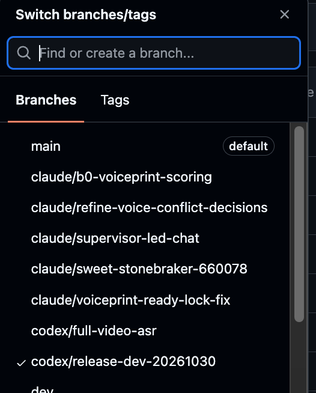

Seekino 的功能、修复、重构和性能优化往往涉及多个因素。TRD 要说清问题、影响结果的因素、方案、对照实验和试点，最后回到原问题验收。本规范适用于所有编写和维护 TRD 的 Agent。

即使由同一人开发，多项需求混在同一个分支里，也难以确认各项改动是否真正接入、依赖什么、交付到哪里。每项能够形成 TRD 的需求都要用独立分支和 PR 跟踪，PR 的首个提交只包含 TRD 初稿。

**编写和修订 TRD 时必须使用 [humanizer-zh](../../../.agents/skills/humanizer-zh/SKILL.md)。** 先阅读技能说明，写出初稿或更新内容后，再用它校订中文正文。删去空泛的铺垫，合并意思相同的句子，把条件、动作和验证方法写清楚。改完对照原稿，核对事实、术语、范围、证据强度和验收口径，保留已有标题、代码、链接及引用锚点。

# 一个需求：拿到问题后你该如何处理？

1. **Identify the problem.**
2. **Break down the problem across multiple dimensions**, identifying the factors that influence it and the metrics used to evaluate outcomes.
3. **Develop changes targeting those factors.** Build on existing research to innovate or explore alternative approaches, avoiding unnecessary reinvention.
4. **Run experiments with and without the proposed changes**, using the metrics to compare results across different approaches.
5. **Validate the effects through a pilot**, weigh the benefits and trade-offs, and decide whether to roll out at scale.
6. **Resolve the problem and close the loop.**

每项关键改动都要能追溯到原问题、作用因素和验证方法。完成结论要注明证据及其适用范围，分别说明实现、测试、效果和运行稳定性。

工作分支使用 `<type>/<short-description>`。前缀按改动选用 `feat`、`fix`、`refactor`、`perf`、`docs` 或 `chore` 等类型，描述写具体需求。`claude/`、`codex/` 等 Agent 名称不作分支前缀。下图保留了旧的错误命名 `claude/xxxxx`。



提交标题采用 `<type>: <summary>`，与正文之间留一空行。正文至少写明问题和方案摘要，其他细节按需补充。

```text
feat: <summary>

- problem: <发生的问题>
- solution abstract: <方案摘要>
- <其他需要说明的细节>
```

创建 PR 时，根据实际参与的 Agent 在正文末尾署名一次，例如 `— Prepared by Codex` 或 `— Prepared by Claude`。

```text
xxxx
xxx
— Prepared by Codex
```

## 1. 问题与现状

先让读者知道问题发生在哪里、影响谁、为什么值得解决，再讨论用什么技术。

1. 交代谁在什么条件下遇到问题，以及流程现在怎么走。
2. 说明实际和期望行为的差距。新功能也要交代现在如何完成这件事，以及还缺什么。
3. 写清对体验、正确性、效率、成本、稳定性或维护造成的具体影响。
4. 链接可核对的代码、日志、复现步骤、案例或测量记录。给推断标出依据和确定程度。
5. 划定这次要解决的问题、延后处理的事项，以及应保留的既有行为。

现状和影响有证据、目标明确后，再进入设计。有缺口时，先完成必要的调查或测量。

## 2. 影响因素、假设与评价指标

### 因素与假设

从直接影响结果的因素入手。按问题选择数据、算法、模型、调用链、并发、资源、交互或运维条件。每项关键因素都要回答三个问题。

- 目前有哪些证据？哪些关系仍是假设？
- 它怎样影响结果？准备改什么？
- 怎样验证或推翻这项假设？结果会改变哪个决策？

先找出一旦不成立就必须改方向的假设，再用成本最低且有效的实验验证。实验得到新证据后，可以回到因素分析或方案设计。

### 指标与验收标准

结果指标用来判断原问题有没有改善。诊断指标解释变化原因。护栏指标定义可接受的代价和退化范围。关键指标至少写清下表各项。

| 指标 | 定义与统计口径 | 基线 | 目标或允许退化范围 | 测量方法与条件 | 证据入口 |
| --- | --- | --- | --- | --- | --- |
| 按实际需求填写 | 对象、单位、计算方法 | 实测值，或待测及补测安排 | 标准及其依据 | 数据、环境、负载与采样方式 | 报告、日志或结果文件 |

在比较结果前确定成功标准和护栏。基线或阈值还不清楚时，可以先做探索性测量，并注明它用于什么决策。验收结论要用确定口径后的证据支撑。

| 需求类型 | 验证重点 |
| --- | --- |
| Feature | 目标场景能否完成，任务效果及异常、边界行为是否符合预期 |
| Fix | 原问题能否复现，修改后是否消失，相关行为是否回归 |
| Refactor | 行为与契约是否保持，原有结构或维护问题是否得到改善 |
| Performance | 相同口径下的性能变化，以及质量、成本和稳定性代价 |

延迟等分布指标按需报告 p50、p95、p99，注明计时起止点、样本量、时间窗口、负载，以及超时和失败请求如何计入。用相应分位数判断尾部表现，用足量样本判断整体表现。样本不足时说明能支持什么结论。

检索、解析和生成类需求要交代评测集、样本代表性、标注或评分规则和失败案例。用模型评分时，写清评分模型和校验方法。分别记录调试样本与最终验收样本，报告后者的整体情况。

能验证因素和结果的关系，且指标足以判断成功、失败和不可接受的代价时，再选方案。

## 3. 改造方案与建模

1. 列出已有实现、研究和成熟方案中可复用的部分，说明适用条件和差距。引用外部成果时，写明实际借鉴了什么，以及哪些效果要在 Seekino 上复验。
2. 说明推荐方案改变哪个因素、预期改善哪个指标。有实质性的备选方案时，比较维持现状、最小改造或其他可行方案的收益、成本和风险。
3. 用合适的模型交代行为、数据和职责。交互顺序可用时序图，任务生命周期可用状态机，跨层职责可用架构图。关键失败路径也要写清楚。
4. 标出涉及的模块、接口、数据和配置，列出继续适用的契约和迁移、兼容、恢复要求。
5. 排定验证和实现的顺序，写清什么结果会改变方案或让它中止。若需要较多探索，给出时间、成本或实验轮次预算。

完整实施前，先用证据确认方案针对关键因素，以及决定方向的假设是否成立。证据不足时，先做范围明确的原型或实验。

## 4. 对照实验与结果分析

初稿写计划，实验后补上结果和证据。对照时沿用第 2 节的指标，用下面的信息判断改动有没有效果、效果可能来自哪里。

- 记录基线和改造方案。需要时加入备选方案或消融对照。小修复可用同一用例比较修改前后。
- 保持数据集、输入、环境、资源、并发和缓存状态可比。记录无法控制的差异。多个因素一起变化时，写清证据能支持的归因。各因素的影响无法分辨时，报告综合变化。
- 留下代码版本或变更标识、模型和配置、数据版本或样本清单、执行命令、运行时间及原始结果入口，方便其他 Agent 复核。
- 报告主指标、护栏、样本量、必要的重复测量和波动情况。保留失败、无收益和退化结果，说明哪些是观察，哪些是对原因的推断。
- 对照预设标准决定继续、调整、补证或放弃，说明结论适用范围。证据不足的结论标为待验证。

定量结果用表格对照，注明单位、条件和变化量的算法。

| 指标 | 基线实测 | 方案实测 | 变化量 | 验收标准 | 判断与证据 |
| --- | --- | --- | --- | --- | --- |
| 按实际需求填写 | 待测 | 待测 | 待计算 | 引用预设标准 | 未验证 |

看变化趋势时用时间曲线，比分布时用分布图。标注坐标、单位、样本和来源，并保留可复核的原始记录。结论限于证据覆盖的范围。

实验支持预期收益且关键护栏达标时，可以进入试点。有明确证据支持受控试点时，也可以在试点中验证剩下的不确定性。

## 5. 试点验证与方案取舍

在接近实际使用的条件下试点，确认是否扩大使用范围。注明覆盖场景、真实数据或流量、观察时间、监测指标和执行者。提前写清何时扩大、停下或回退。涉及原有行为或试点数据时，说明怎样恢复或处理。

比较效果、耗时、成本、稳定性、兼容性和维护成本。离线实验的结论限于其验证环境，短期试点的稳定性结论限于观察窗口。

试点规模按风险确定。低风险内部改动可用有代表性的集成验证，说明选择依据与未覆盖范围。缺少环境、数据或权限时，记下缺口、下一步和恢复验证的条件，状态保持待验证。

TRD 记录试点和推广计划。执行按该任务已有的授权和项目变更约定，阶段推进沿用现有审批要求。

证据覆盖预期使用范围后，再决定推广、继续观察、调整或停止。

## 6. 结果验收与闭环

回到最初的问题，逐项对照目标和护栏，给出结果、证据和未满足项。记录采用、推广、继续观察、调整、否决或延期的决定及理由。核对 TRD 与当前实现，交代哪些工作已实现、已验证、已部署或已推广，哪些仍在计划中。

列出已知限制、风险、未完成验证、下一步和负责人。负责人未知时标为待确定。

达到原问题的验收标准并完成关键验证后，才能标记“问题已解决”。实现或测试的完成结论限于各自阶段。候选方案被证据否决时，保留结果以免重复尝试，并说明放弃或延期后怎样处理原问题。

# 根据现状，发散起一个对上述流程的预演，定trd初稿

## 初稿与后续验证的衔接

- TRD 第一行必须是 `# 1. 问题与现状`。在该节交代现状、影响、需求名称、状态和更新时间。
- 六个流程各有对应章节。默认沿用本文的六阶段名称，也可按需求调整标题和层级。
- 初稿用现有证据预演六个流程，先写问题、方向和验证方法。新证据出现后再调整实施细节。先验证会改变方向的假设，减少大范围返工。
- 未取得的数据和结论标为待测、假设或预期，写出验证方法。
- 验证规模与需求影响、风险和不确定性相称。简化实验或试点时，说明理由、替代证据和结论边界。流程不适用时，说明标为 `N/A` 的理由。
- 按需使用时序图、状态机、架构图、用例图、数据表或曲线。用图表解释关键行为或指标变化。

# 开发过程中，不断动态调整trd

## 同步内容与调整记录

初稿记下方向和验证计划，实施中补充证据和调整，完成时写实测结果与决定。持续核对 TRD 与项目现状，六个流程要始终能在文档中找到。

每次阶段性交付都补充当前阶段、关键证据、剩余问题、下一项可执行的最小动作及阻塞条件。长期探索也要写清本轮确认了什么。

设计、接口、数据契约、验收标准或结论发生实质变化时，在同一批工作中更新对应章节，注明哪些已实施、哪些待执行。普通实现细节按需记录。影响方向、范围或验收的调整，应留下简短的决策记录。

| 日期 | 原判断或方案 | 新证据 | 调整与原因 | 对目标、验收及后续工作的影响 |
| --- | --- | --- | --- | --- |
| 按实际变化填写 | 保留关键旧判断 | 可定位的证据 | 当前决定 | 需要补测、重验或重新选择的内容 |

设计章节写现行方案。在决策记录保留被替代的关键方案和决定性失败结果。原始目标和旧验收标准须可追溯，方便复核调整原因和当前验收结果。

## 交付前自检

在评审、阶段性交付和最终验收时核对以下各项。证据缺口要留在文档里，结论按实际验证进度填写。

- 能否从问题追溯到影响因素、改动、验证和最终决定？
- 事实、假设、预期和实测是否写清楚？关键结论能否找到相应证据？
- 对照条件和指标口径是否一致？收益、代价和失败结果是否完整？
- 是否准确标注了待验证、待部署或待推广的事项？
- TRD 是否反映项目现状？下一步或最终处置是否明确？
