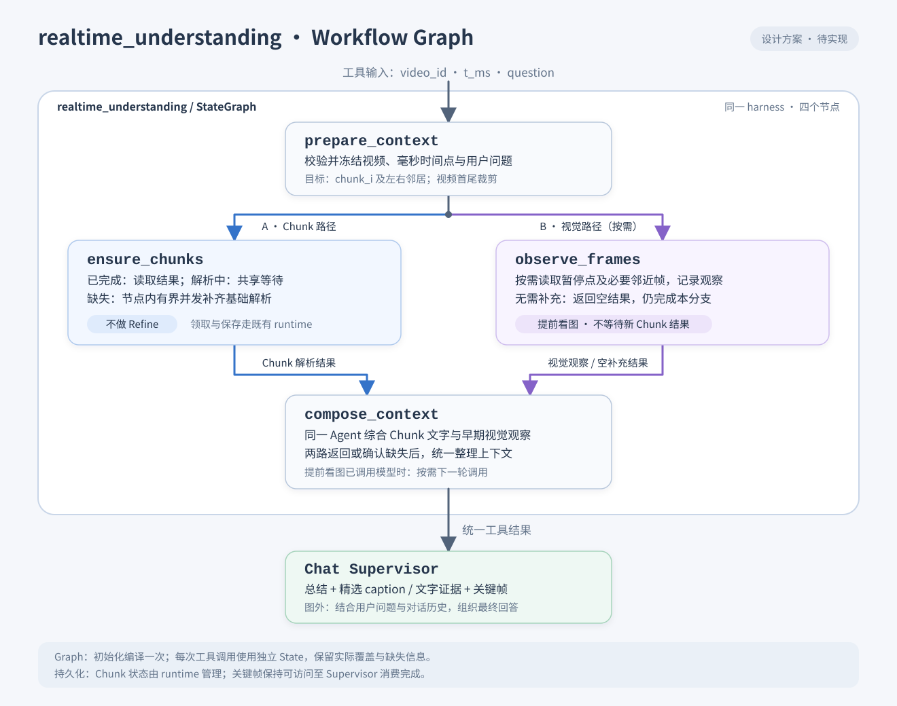

由于我们理应可以复用当前chunk parse的结果，以及避免相邻时间段重复解析（例如差一秒但是没有缓存结果，导致让user又等一段时间）
所以我们应当是对于当前time-point识别其所在chunk-list
例如：假设t ms的时候，我们发现其在 chunk_i，于是不管怎么样，我们默认为以所在chunk为中点，左右多parse一个chunk

首先是先检查当前chunk target区间的parse状态，如果发现已parse的chunk则不进行；如果没有parse的chunk则才进行

值得一提的是这个时候的refine可以关闭，不进行refine等后续正儿八经解析的时候再根据当前状态补也行

这个是对实时parse的整体要求

我们realtime_understanding不仅要提供精炼的文字解析结果给agent,还要给出关键帧抽取给agent校验🤔
这个和解析存储结果应该是不一样的
因为关键在于我们要让当前agent理解画面(如果不支持vision识别的supervisor,我们就让它通过文字schema作答,像你这总好agent可以看vision图片,就看图片综合作答)

## trd-gpt ver

### 1. 目标与范围

`realtime_understanding` 是接入 Chat Supervisor 的 tool sub-agent，用于回答用户观看视频时提出的即时问题。前端暂停视频后，本轮工具调用使用当前视频、冻结的播放时间点和用户问题；内部统一使用毫秒。

本轮采用固定 Chunk 窗口：定位 `t_ms` 所在的 `chunk_i`，目标为 `[chunk_i-1, chunk_i, chunk_i+1]`，视频首尾按实际存在的 Chunk 裁剪。该方案替代最初的时间点前后 3 分钟窗口，避免相差一秒就产生新的解析区间。

核心是复用已有 Chunk 事实，再整理当前时间点相关的文字与画面证据给 Supervisor。实时请求补齐基础理解即可，不主动触发 Refine 或索引构建；后续完整解析根据已有状态补齐。

本文记录设计约定；首版实现与离线验收记录见第 9 节。

### 2. 职责分工与数据流

多个 Chunk 的原始解析结果、画面描述和可用 caption，先交给 `realtime_understanding`。它整理视频上下文后，将总结、相关 caption 和关键帧返回给 Supervisor。

| 组件 | 输入与职责 | 输出 |
| --- | --- | --- |
| 公共 Chunk 理解组件 | 复用 ASR、视觉理解及必要的 OCR，完成单个 Chunk 的基础识别与时间校验 | 现有 `VideoParseResult` |
| `realtime_understanding` | 并行复用或补齐目标 Chunk，并按需提前看图；两路汇合后综合文字与视觉证据 | 精炼上下文、相关文字证据与 caption、关键帧、实际覆盖情况 |
| Chat Supervisor | 结合上述证据、用户问题和对话历史，组织解释；支持视觉输入时可进一步查看原图 | 面向用户的最终回答 |
| Server 宿主 / runtime | 提供数据库查询、任务领取、结果提交和资源访问能力 | 沿用现有解析状态与持久化机制 |

```text
前端冻结视频与播放时间，用户提出问题
    ↓
Chat Supervisor 调用 realtime_understanding
    │
    ├─ Chunk 路径
    │   并行检查三个固定 Chunk，复用或补齐基础解析，不做 Refine
    │   得到文字、视觉时间线等解析结果
    │
    └─ 视觉路径（按需）
        提取暂停点附近的关键帧
        Vision Agent 先结合用户问题看图，形成视觉观察
    │
    ↓ 两路结果就绪
同一个 Agent 综合 Chunk 解析结果与视觉观察，整理上下文
    ↓ 当前内容总结 + 相关 caption / 文字证据 + 关键帧
Chat Supervisor 结合问题与对话历史组织回答
    ↓
用户
```

`realtime_understanding` 本身就是负责理解与整理的 Agent，沿用已有 harness。这里的 Vision Agent 指它内部负责看图与综合的阶段，不再嵌套一个独立的理解 sub-agent。它提供的总结是答疑上下文；最终解释由 Supervisor 完成。

#### Workflow Graph 设计



Graph 固定包含以下四个节点；`prepare_context` 完成后，`ensure_chunks` 与 `observe_frames` 并行执行，`compose_context` 等待两路都返回结果后再执行。三 Chunk 的有界并发只发生在 `ensure_chunks` 节点内部，不为每个 Chunk 新增 Graph 节点。

| 节点 | 职责 | 本轮输出 |
| --- | --- | --- |
| `prepare_context` | 校验并冻结视频、毫秒时间点、用户问题及解析任务 / 版本，定位目标三个 Chunk | 本轮输入快照与目标 Chunk 列表 |
| `ensure_chunks` | 有界并发检查目标 Chunk，复用已完成结果、等待已有任务或通过 runtime 原子领取并补齐；不执行 Refine / 索引 | Chunk 解析证据、内容版本及实际覆盖情况 |
| `observe_frames` | 节点固定执行；按需读取暂停点附近原图并形成视觉观察，不需额外看图时返回空补充结果 | 精选帧引用与时间、视觉观察或空补充结果 |
| `compose_context` | 汇合两路结果，综合 Chunk 文字与视觉观察，保留缺失信息并组织一份工具结果 | 综合上下文、精选 caption / 文字证据、关键帧及覆盖情况 |

Graph State 只保存本轮输入与取得的证据快照，包括目标 Chunk、视觉观察和帧引用；不承担持久化 Chunk 状态。数据库状态查询、任务领取、结果保存和恢复继续由既有 runtime 提供。

Graph 在 Agent 初始化时构建并 compile 一次，每次 tool call 使用独立 State。`observe_frames` 即使无需额外视觉调用也会正常返回，使汇合节点保持固定等待两路的语义；部分失败或缺失通过证据与覆盖结果传递。最终统一工具结果交给 Supervisor 组织答疑。

### 3. 公共组件复用

将 `video_parse_v2` 中单 Chunk 基础理解的公共逻辑抽到 `agent/common/chunk_understanding.py`，由完整解析和实时理解各自的 harness 调用。实时子 Agent 建议放在 `agent/chat/realtime_understanding/`，Supervisor 工具入口可命名为 `understand_current_video`。

公共组件负责识别与返回 `VideoParseResult`。Chunk 状态判断、任务领取和保存由各 harness 配合既有 Server 宿主完成；实时证据筛选、总结与返回组织留在 `realtime_understanding`。公共组件不反向依赖 `video_parse_v2` 的业务宿主，也不承担 Supervisor 的响应裁剪。

保留当前顶层 `agent/` 和 `server/` 结构。Agent 执行需要数据库能力，由现有 runtime / 宿主提供，不因本次功能迁移整个 Agent 目录。

### 4. Chunk 状态与执行规则

1. 根据本轮视频、解析任务 / 版本及 `t_ms`，取得固定 Chunk 列表并选择目标窗口，对目标 Chunk 并行检查状态并复用或补齐。
2. 已解析且结果有效的 Chunk 直接读取，不重新执行。
3. 正在解析的 Chunk 共享既有任务并等待结果，不重复领取。
4. 未解析的 Chunk 原子领取后调用公共组件；失败、租约失效等情况沿用现有恢复规则。
5. 每个 Chunk 完成后保存基础解析结果，供当前请求及后续完整解析复用。
6. 汇总已取得的证据，并保留实际覆盖和缺失情况；不因窗口解析完成而将整片标记为完成。

共享解析工作的身份基于解析任务 / 版本和 `chunk_id`，不基于原始时间点或用户问题。相邻请求即使窗口部分重叠，也应复用公共 Chunk；单个等待者取消不应取消其他请求仍需要的解析。

实时阶段跳过 Refine。完整解析继续处理同一批基础结果，并按真实状态补齐剩余 Chunk、Refine 和索引。实时总结或补充看图所得的观察不静默覆盖正式解析结果。

### 5. 理解阶段与返回内容

两边都会读取 caption，但读取范围和目的不同：`realtime_understanding` 读取多 Chunk 原始证据以理解视频上下文，Supervisor 读取整理后的证据以回答当前问题。

采用“两路并行，汇合后整理”的时序：

1. **Chunk 路径**：并行检查和补齐目标三个 Chunk。已完成的直接读取，解析中的共享等待，缺失的才执行；不做 Refine。
2. **视觉路径**：根据用户问题和已有解析状态判断需要补充画面信息时，与 Chunk 路径同时启动。提取暂停点及必要邻近帧，同一个 Agent 先结合用户问题读取原图，记录公式、指向位置等可见事实与不确定项；这一步不等待新 Chunk 的解析结果。
3. **汇合整理**：两路返回结果或确认缺失后，将 Chunk 结果交给同一个 Agent，结合语音讲解、前后定义和早期视觉观察完成对齐与消歧，输出答疑上下文。若部分输入缺失，保留实际覆盖和缺口。

Chunk parse 本身已有视觉理解。已有解析足够时可以跳过额外看图；需要跨段梳理或补充画面细节时，再按需调用总结 / 视觉模型。提前看图聚焦当前暂停点及必要邻近帧。

如果提前看图已经发起一次模型调用，收到 Chunk 结果后的综合通常需要同一个 Agent 的下一轮模型调用。实现和延迟评估应计入两轮调用，汇合阶段以已返回的视觉观察和 Chunk 结果作为输入。

Supervisor 最终接收一份整理好的工具结果：Agent 的综合上下文，以及支撑它的精选 caption、文字证据和关键帧。多 Chunk 原始结果在 `realtime_understanding` 内消化，相关证据随总结一起返回供解释和核对。

给 Supervisor 的运行时结果应包含：

- 视频身份与暂停时间点，便于确认本轮回答的对象。
- 当前内容总结，以及前后 Chunk 提供的必要背景。
- 与问题相关的文字证据、caption / OCR / 画面观察，保留来源 Chunk 和原视频时间。
- 关键帧原图引用、原视频时间戳及来源 Chunk；caption 作为辅助，原图保留供视觉模型核对。
- 实际覆盖范围、未完成 Chunk 和观察缺口。

这里的 caption 指画面文字描述这一逻辑产物，不假定现有存储已有独立 caption 字段。可复用已有视觉时间线；将某条描述作为特定帧的 caption 时，需要确认对应关系，不能把整段描述当作该帧已经核验的细节。

回答聚焦暂停位置。暂停后的证据可以提供补充背景，但须标明来自后续内容，避免误述为用户此刻已经看到或听到的内容。

例如用户问“老师这里的 λ 是什么意思”，`realtime_understanding` 提供当前公式与画面、当前讲解及前一个 Chunk 的定义和对应时间；Supervisor 据此解释 λ，并结合此前对话调整表达。

正式解析存储继续使用 `VideoParseResult`；面向本轮答疑的总结、caption 选择和关键帧组合是运行时响应，两者分别组织。

### 6. 视觉输入与资源生命周期

- 支持视觉的 Supervisor：适配层将选中的关键帧加载为实际图片输入，与文字证据一起交给模型。
- 仅支持文字的 Supervisor：使用完整可用的文字上下文、caption、OCR 和画面观察作答，并保留信息不足的说明。

图片路径或 URL 出现在 JSON 中，不等于模型已经看到图片。视觉能力需要模型和工具结果到模型输入的适配通道同时支持。

返回的帧资源应至少保持可访问到 Supervisor 消费完成，不能依赖已随 Chunk 解析结束而清理的临时工作区。关键帧保存在既有文件 / Artifact 资源通道中，响应或缓存保存其引用。

### 7. 缓存与并发复用

持久化 Chunk 结果作为基础复用机制，用于避免邻近时间点重复解析。Redis 不作为首版前置依赖；按产物成本决定是否增加派生缓存。

| 产物 | 策略 |
| --- | --- |
| Chunk 基础解析结果 | 使用现有持久化结果和状态机制 |
| 已有证据的筛选、拼接和格式整理 | 直接计算，通常无需缓存 |
| 额外模型生成的固定窗口事实总结、特定帧 caption | 缓存并复用；相同计算的并发请求合并 |
| 与问题相关的上下文整理 | 若缓存，必须包含问题、暂停位置及实际使用的对话上下文等依赖 |
| 最终用户回答 | 首版由 Supervisor 每次组织 |

所有派生缓存均绑定实际输入与配置依赖；若 caption 或问题相关摘要还使用 Chunk 正文、ASR 或其他摘要，应同时包含对应内容版本或输入身份。

提前看图所得的视觉观察若受当前问题影响，其缓存也需包含问题依赖；汇合后的综合结果还需包含实际使用的视觉观察与 Chunk 内容版本。

固定窗口事实总结应独立于具体问题，其缓存键包含解析任务 / 版本、三个 Chunk 的身份与内容版本、总结模型 / 提示词版本，以及实际影响输出的配置。若使用帧作为输入，键中还需包含实际帧集合。相同窗口的通用总结不按原始 `t_ms` 分裂缓存。

特定帧 caption 按媒体 / 帧身份、实际取帧时间及模型 / 提示词版本等依赖复用。需要精确暂停帧时，不能因为命中了同一窗口总结，就把邻近时刻的帧当成当前画面。

Refine 改变 Chunk 内容后，内容版本变化使旧派生总结不再命中；TTL 用于限制缓存生命周期，不代替依赖失效。首版若增加额外模型调用，可先采用有容量上限的进程缓存；多进程 / 多实例需要共享派生产物时，再接入 Redis。

### 8. 接入待办与验收

- 公共组件抽取：完整解析与实时理解复用单 Chunk 识别，保持既有结果格式及保存逻辑。
- Server / 调度接入：确认固定 Chunk 状态、原子领取与并发复用；实时完成基础解析后不自动触发 Refine / 索引，正式流程可继续补齐。
- Supervisor 接入：注册实时理解工具，传递冻结的视频与毫秒时间点，消费证据后生成最终回答。
- 多模态适配：接通真实图片输入及资源访问生命周期；文字模型可消费同一结果中的文字证据。
- 并行编排：视觉补充需要执行时，与 Chunk 路径同时启动；汇合时将两路实际结果交给同一个 Agent，按需两轮模型调用，返回统一工具结果。
- 验收：同一 Chunk 内相差一秒的提问不重复解析；跨 Chunk 的重叠窗口只补缺失部分；视频首尾正确裁剪；已解析、解析中和部分失败都有明确行为；提前看图不等待新 Chunk 结果，汇合整理使用两路证据；已有结果足够时跳过额外看图；后续完整解析复用基础结果并补齐 Refine；支持视觉与仅文字两条回答路径均可工作。

### 9. 首版实现记录（2026-10-10）

四节点 Graph 已接入 Supervisor 的 `understand_current_video` 工具。Graph 初始化时 compile，一轮调用独立持有输入与证据；工具重复调用复用本轮结果。前端现有 `extra_context.playback.positionSeconds` 实际存放整数毫秒，直接使用，不再乘以 1000。身份校验沿用仓库当前 `tenant_id` 契约；当前播放视频须属于有效访问范围，尚未 READY 的播放视频可取得基础证据，但不会进入普通系列检索范围。

公共 `agent/common/chunk_understanding.py` 同时被正式解析与实时宿主的 Chunk worker 复用。按需任务保持 `accepted=false / realtime_only=true`，只建立固定拓扑并领取缺失基础 Chunk；正常全量队列、Refine、Prefix 与索引不会因该任务自动启动。实际领取使用原有数据库租约、并发限额及内容提交。共享基础工作由 Server 持有，某个 Chat 等待者取消不取消该工作。

后续正式解析接受同一任务时，保留任务身份、内容版本和已有 ready mask；失败的按需子任务恢复到正式重试入口。复用必须使用冻结的解析配置，不将另一套配置混入已有结果。准备拓扑中途退出后，后续请求可重新领取过期的 PREPARING 租约，完成原拓扑的接续。

首版额外视觉输入是一张精确暂停帧，保存到受管 Artifact 后再看图；汇合阶段读取本轮 Chunk 证据与早期视觉观察，生成答疑上下文。**仅凭已有 Chunk 的 ACTION / SCENE 描述，不判定暂停画面细节已经充分。** 相同帧、问题、提示词、模型、配置和内容版本的成功观察命中缓存时，跳过重复模型调用。综合上下文也使用有容量上限的进程缓存；并发相同计算共享执行，异常不进入缓存，Refine 改变内容版本后不命中旧结果。没有引入 Redis。

Supervisor 收到精炼上下文、暂停点相关的精选证据、实际缺失范围及原图 Artifact。证据筛选优先保留覆盖暂停点的事件，并标记暂停之后的补充内容。OpenAI / Ark 使用实际 `image_url` 输入；Codex 使用原生 `inputImage`；Claude 使用 MCP image 内容块。图像旁保留原视频时间和描述，图片二进制与工具文字预算分别管理。

原图输入由主 Supervisor 模型的 `models.agent.supports_vision_input` 显式启用，默认 `false`。只有确认该模型支持图片时才设为 `true`；文字模型继续使用视觉观察、caption 与解析文字。备用模型独立配置 `models.agent.fallback.supports_vision_input`，文字备用会移除图片并保留文字；主模型为文字时，首版不会因备用支持视觉而升级工具的图片路径。现有配置无需修改即可使用文字答疑。

抽帧使用本轮剩余 deadline 限制 ffmpeg；Graph 和派生模型沿用 Chat 的取消与超时控制。这里的实时指按需取得当前播放窗口证据，不承诺固定秒数：首轮冷解析仍取决于基础识别和模型延迟，命中持久化结果与派生缓存后可省去对应工作。尚未进行真实视频、真实模型的端到端延迟测量。

本次实现范围如下；用户及其他并发工作已有的身份、DTO、模型配置等修改保留，不计作本功能的独立改造。

```text
Seekino/
├── agent/
│   ├── common/
│   │   ├── [A] __init__.py                 ← 公共组件入口
│   │   └── [A] chunk_understanding.py      ← 单 Chunk 并行识别与结果校验
│   ├── chat/
│   │   ├── common/
│   │   │   ├── [M] tool.py                ← 工具文字与原图 artifact 分别传递
│   │   │   └── [M] tool_result.py         ← 保持文字合同并携带可选图像
│   │   ├── realtime_understanding/
│   │   │   ├── [A] __init__.py            ← 实时 Agent 入口
│   │   │   ├── [A] state.py               ← 请求、证据、覆盖和宿主合同
│   │   │   └── [A] runtime.py             ← 四节点 Graph 与毫秒窗口
│   │   ├── [M] supervisor.py              ← 工具注册与最终解释
│   │   └── design/
│   │       └── [M] 实时parse_trd.md         ← 实施记录与验收边界
│   └── video_parse_v2/
│       ├── [M] prompts.py                 ← 复用公共基础理解提示词
│       └── understanding/
│           └── [M] workflow.py            ← 正式流程调用公共组件
├── engine/common/
│   └── [M] frame_sampler.py               ← 可选整批抽帧超时
├── gateway/
│   ├── agent_model/
│   │   ├── [M] contracts.py               ← 主模型视觉能力合同
│   │   ├── [M] factory.py                 ← 主模型与备用能力配置
│   │   ├── [M] context.py                 ← 图片上下文预算
│   │   └── [M] tool_loop.py               ← 完整工具批次后追加真实图片
│   ├── ark/
│   │   └── [M] agent.py                   ← Ark 原图与文字备用
│   ├── openai/
│   │   └── [M] agent.py                   ← OpenAI 原图与文字备用
│   ├── codex/
│   │   └── [M] protocol.py                ← 原生 inputImage 与时间说明
│   ├── claude_code/
│   │   └── [M] tools.py                   ← 原生 MCP image 与时间说明
│   ├── [M] config.py                      ← 可选 supports_vision_input
│   └── [M] media.py                       ← 有界图像 artifact 与文字降级
├── server/
│   ├── [M] bootstrap.py                   ← 装配实时宿主并按序关闭
│   ├── mq/
│   │   └── [M] video_parse_queue.py        ← 精确领取与全量接受门禁
│   ├── repository/
│   │   ├── [M] video_parse.py             ← 固定状态、按需任务与基础聚合
│   │   └── [M] upload.py                  ← 正式解析原地接受已有基础成果
│   └── service/
│       ├── [A] realtime_understanding.py  ← 共享工作、原图与派生缓存
│       ├── [M] video_parse.py             ← 公共基础 worker 与有界派生模型调用
│       └── [M] agent_chat.py              ← 校验播放身份及 READY 检索范围
└── tests/
    ├── agent/
    │   ├── chat/
    │   │   ├── [A] test_realtime_understanding.py ← Graph、窗口和取消
    │   │   └── [M] test_supervisor.py             ← 工具、原图和组合回答
    │   └── video_parse_v2/
    │       └── [M] test_framework.py             ← 公共组件并行与清理
    ├── engine/
    │   └── [A] test_frame_sampler.py              ← 超时终止与整批预算
    ├── gateway/
    │   └── [A] test_tool_images.py                ← 原生图片与备用降级
    └── server/
        ├── [A] test_realtime_understanding.py     ← 数据库复用、恢复与缓存
        ├── [M] test_agent_chat_service.py         ← 播放校验与检索范围
        └── [M] test_bootstrap.py                  ← 共享工作先于依赖关闭
```

合计 37 个范围文件：28 个生产逻辑文件、8 个测试文件、1 个设计文档；新增 10 个、修改 27 个。相较初始预计树，额外调整既有 `gateway/media.py`、`server/repository/upload.py` 和 `engine/common/frame_sampler.py`，分别承担原图传输、任务原地接受及抽帧超时；对应测试直接保护这些行为。无新增数据库 Schema 或迁移，无前端改动，无新增外部接口。未执行 commit、push、服务重启或真实模型调用。

设计目录沿用仓库的 `**/design/` 忽略规则；本文和已有 SVG 保存在本地，默认 Git diff 不会展示它们。

#### 离线验证与改动统计

Graph 与数据库宿主的定向验收为 **51 passed**，包括固定窗口、两路并行与汇合、跨请求 State 隔离、毫秒冻结、缺失证据、租约恢复、共享工作取消隔离、正式接续及派生缓存失效。抽帧超时测试使用本地受控子进程，不依赖真实模型。

综合回归覆盖 `tests/agent/chat`、`tests/agent/video_parse_v2`、离线 Gateway、Server 实时宿主 / Queue / Repository / Worker / Upload / Bootstrap / AgentChat，以及抽帧与旧解析媒体兼容用例，共 **1027 项**。首轮 **1023 passed、1 skipped、3 failed**；三项失败均为并行新增 Auth 初始化后既有 Bootstrap 测试替身缺少依赖。补齐测试替身后，仅复跑受影响的 Bootstrap 组，**37 passed**。所选回归集合最终为 **1026 项已通过、1 项跳过**；没有将重叠复跑用例再次计数。外部模型和 Langfuse 联机测试明确排除，未执行真实 MySQL 并发锁压测。

检查时，范围内 26 个已跟踪代码 / 测试文件的 `git diff --numstat` 为 **+1448 / -300**；这份相对 HEAD 的统计包含共享文件上的既有与并发改动，不能认作本功能独占的增删量。10 个新增未跟踪文件共 **1926 行**，其中生产逻辑 **822 行**、测试 **1104 行**；设计文档因忽略规则单独记录。没有 staged 改动。职责内跟踪代码的差异检查通过；共享 AgentChat 测试末尾的外部空行保留。

下一步人工验收使用真实视频暂停提问，检查原图内容、答疑准确性以及冷启动 / 缓存命中时的耗时。该测量需要实际模型调用，当前记录不把离线通过等同于已完成线上延迟验收。
