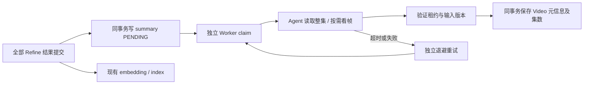

# Video Summarize 技术设计

## 目标与边界

在单个 Video 的全部 Refine 结果提交后，独立生成本集的官方标题、简短简介、推荐封面和有明确证据的真实集数。它是 `agent/video_summarize/` 下的独立 Agent，与 Parse、Refine、Prefix 并列，不属于 Chat Agent。

Summarize 与 embedding/index 并行，不加入解析完成条件，不等待 Prefix。失败、超时或重试只影响本次摘要；父解析任务 COMPLETE 后摘要仍可执行。现有 Prefix 保留。未取得可靠证据的标题、集数或封面保持原值，不根据文件名、当前排序或剧情推断官方集数。

## 职责分配

| 层 | 位置 | 职责 |
|---|---|---|
| Agent | `agent/video_summarize/` | 输入 Canvas、提示词、三个工具及结果校验，不访问数据库 |
| Host | `server/service/video_summarize.py` | 模型调用、独立预算、真实视频取帧、封面文件发布、取消与用量 |
| Phase service | `server/service/video_parse_summarize.py` | 就绪判断、状态与租约、输入版本校验、发布编排 |
| Persistence service | `server/service/video_parse_persistence.py` | Session/事务边界、Refine 提交后同事务排队 |
| SQL repositories | 现有 `video_parse_task.py`、`video_parse_interval.py`、`video_parse_chunk.py` | 现有表读写与有界候选查询 |
| Library | 现有 `repository/library.py`、`service/library.py` | Video 元信息写入、集数和 Upload 槽位更新、Prefix 兼容处理 |
| Media | 现有 `service/media.py`、`utils/media.py` | 封面图片 ID、权限、丢失时回退关键帧 |
| Worker | `server/mq/video_parse_consumer.py` | 独立 summary 并发槽，不挤占 Parse/Refine/Index 槽位 |

不新增 summarize repository、ORM model 或任务表。事务方法读取最新 DTO，合并 detail 后显式保存，保留 model_calls、Prefix 等并行写入的状态。

## 输入与工具

输入包含 Video ID、毫秒时长、当前组织集数、Series 背景，以及按顺序排列的全部已提交 Chunk 内容。每个 Chunk 带任务 ID、序号和内容版本。当前组织集数仅用于定位，不作为真实集数证据。

| 工具 | 行为 |
|---|---|
| `get_context_canvas` | 只读背景和本 Video 的 Chunk；支持现有批量及字符分段协议，提交前检查所有 Chunk 的完整阅读覆盖 |
| `inspect_video_frames` | 复用 `agent/utils/video_frames.py`，由宿主绑定当前 Video 原始源、合法时间范围及预算；返回真实图片与时间戳/hash 回执 |
| `submit_video_summary` | 验证字段、来源引用、已读覆盖与真实帧回执，提交内存结果；不直接写数据库 |

仅成功调用提交工具才算完成；模型直接输出 `completed=true` 不算完成。封面只能选择已经成功返回给模型的真实帧，不能提交任意 URL、路径或图片 ID。

输出包括：

- `title`：可空，最多 255 字符；必须是明确的本集标题卡文字。
- `description`：必填，本集的简短事实简介，附 Chunk 或帧证据。
- `episode_order`：可空，明确的正整数编号；引用必须含无歧义的编号标记，支持中文数字及全角数字。
- `cover`：可空，已登记的 `inspection_id + frame_index`。
- `evidence`：每个输出字段的来源引用与原文/画面观察。
- 程序组装的 `frame_receipts` 和实际封面图片字节；回执与模型提交内容分开保存。

标题、集数的文本证据只接受正式 `ON_SCREEN_TEXT`；对匹配事件的完整文本和描述检查明确的次回/下集预告标记，不能截断 quote 绕过。帧证据的本集归属仍由视觉模型结合前后时序判断；有冲突时应放弃该字段。

## 调度与状态



执行状态放在现有 `VideoParseTask.detail._worker_runtime_v2.summarize`：

- `status`：PENDING / RUNNING / RETRY_WAIT / COMPLETE / FAILED / CANCELLED。
- `lease_owner`、单调递增的 `lease_version`、`lease_expire_time_ms`。
- `retry_count`、`next_execute_time_ms`、`last_error`。
- `source_fingerprint`：任务版本、Video 源/时长/原集数、背景和全部 Chunk 内容版本及内容的摘要。
- 首次领取冻结的 `config_snapshot`：模型绑定及独立执行预算；不保存凭据。
- 成功后的 `result`、`frame_receipts`、实际应用集数及集数冲突原因。

仅扫描显式排队的摘要，查询有界；不隐式为全部历史视频补跑。最后一个 Refine 提交会检查完整拓扑及所有 Refine 提交凭据，再排队。重解析的新版本会使旧摘要失效；删除或手动重试也会撤销旧租约，不要求等待摘要执行结束。

## 并发与发布

模型和媒体 IO 全部在数据库事务外进行。每次领取、读取和提交都核对当前解析版本与独立租约，最终写回重新核对来源指纹。已删除、已被新 parse 替换、已被人工改号或内容/背景已变化的结果不得覆盖现状。

Summary 独立事务在 MySQL 使用 READ COMMITTED，避免候选扫描或 Library 普通查询提前建立旧读视图。Refine 的同事务排队通过当前读取得子任务及结果。发布锁定 Series 背景以稳定最后一次校验。

自动改号复用 Library 的 Upload → Video 顺序和现有占号检查。其后访问 Prefix/父任务使用非等待锁；索引正在持有父任务时，摘要回滚并稍后重试，不持有 Video 等待索引。现有人工改号调用仍采用原逻辑。

集数变更、Prefix 失效、元信息和摘要完成状态在同一事务内提交。整个发布过程处于同一 savepoint；验证失败时连同临时改号一起回滚。若集数槽被其他 Video/Upload 占用，或活跃 Prefix 不允许改号，回滚该次改号，保留原顺序并保存其余元信息及冲突原因，不覆盖或交换其他视频。

## 数据与展示

`video` 表新增三个可空字段：

| 字段 | 类型 | 用途 |
|---|---|---|
| `display_name` | VARCHAR(255) | 本集展示标题 |
| `description` | LONGTEXT | 本集简介 |
| `cover_uri` | LONGTEXT | 已发布推荐封面的位置 |

迁移脚本：`docs/migrations/20261021_video_metadata.sql`。已有数据保持空值。部署新代码前需要对已有 MySQL 库执行这份增列迁移；本次开发未执行该迁移。

Library API 增加可空 `displayName`、`description`；图片继续走 `thumbnail`，不向前端暴露 `cover_uri`。推荐封面缺失或不可读时回退原关键帧；独立的 `video_cover` 图片 ID 不改变原关键帧序号与权限规则。

观看页只消费标题、简介和 thumbnail，缺省时沿用 Episode N 和原关键帧。Chat 保留请求原始 extra_context 用于幂等重放，在实际构造 Agent 输入时重新读取当前 Video 集数，从而兼容旧页面在自动改号后继续提问。

## 配置与运行

在 `config.yaml` 配置视觉模型角色 `models.summarize`，独立运行参数来自 `VideoSummarizeConfig` 和 `ANIVAG_SUMMARIZE_*` 环境变量。只有角色存在且开关开启时才装配 handler；旧配置缺少该角色时不会执行。

默认并发 1、最多 2 次失败重试、总超时 600 秒。Summarize 不设置模型轮次、工具调用次数或看帧次数上限；保留执行超时、取消、租约及单次读取/媒体大小约束。旧任务快照中的三个次数配置不再生效。`ANIVAG_SUMMARIZE_ENABLED=false` 可关闭自动执行。

标题定位优先追踪前几个 Chunk 的 SCENE、ON_SCREEN_TEXT 中“标题、片头、OP、作品标识”等线索，依据事件时间检查 OP 结束到正片开始的过渡及相邻 Chunk，并在候选窗口局部取帧核验。作品 logo 只提供定位线索；本集标题和集数仍需直接画面文字证据，支持 `#N` 集号，排除 ED、下集预告及推断。未命中时缩窄或平移候选窗口，避免反复全片稀疏采样。

用量仍归属原 VideoParseTask，通过 `stage=summarize` 区分。取消和超时会取消 provider；后台线程实际退出前保留占用的租约/调用句柄，避免并发重复执行。

第一版不提供历史批量补跑界面或摘要专用管理页面；历史 Video 不自动补跑，已有解析结果可由受控内部调用 `mark_summary_ready` 排队。

## 验证

离线测试覆盖三个工具与完整阅读、非法证据、预告排除、标题长度、真帧与图片字节一致性、独立预算和取消、索引并行、Refine 完成触发、租约回收、配置冻结、旧结果拒绝、占号降级、改号及状态原子写回、Prefix 兼容、Upload 撤销和 Chat 幂等。

```sh
PYTHONDONTWRITEBYTECODE=1 .venv/bin/python -m pytest -q -p no:cacheprovider \
  tests/agent/video_summarize \
  tests/server/test_video_summarize_service.py \
  tests/server/test_video_summarize_persistence.py \
  tests/server/test_video_parse_model_calls.py
```

Web 使用 `format.test.ts`、`WatchPage.test.tsx` 和 TypeScript typecheck。真实 MySQL 并发和真实模型质量需在配置测试数据库/模型后验证；SQLite 回归不能替代 MySQL 锁行为验证。本次开发未对线上/开发服务发起真实摘要调用。

## 本次实际修改范围

实际涉及 52 个文件：生产 34 个、测试 16 个、文档/迁移 2 个；新增 14 个、修改 38 个，无删除或重命名。

与预计树相比，新增了两个必要的兼容调整：`repository/video_parse_interval.py` 支持 Refine 凭据当前读；`service/video_parse_prefix.py` 支持摘要发布非等待取锁。原计划的 `tests/server/test_parse_usage.py` 无需改动，使用既有测试与摘要宿主测试验证用量归属。

```text
AniVAG/
├── agent/
│   └── video_summarize/
│       ├── [A] __init__.py  ← 导出 Agent 合同
│       ├── [A] agent.py  ← Agent 执行及提交完成条件
│       ├── [A] prompts.py  ← 本集总结和证据约束提示词
│       ├── [A] state.py  ← 输入、输出、证据和阅读覆盖状态
│       └── [A] tools.py  ← 三个工具及来源校验
├── docs/
│   ├── migrations/
│   │   └── [A] 20261021_video_metadata.sql  ← 新增 Video 元信息列的受控迁移
│   └── [A] video-summarize-trd.md  ← 职责、合同、调度、验证和交付说明
├── server/
│   ├── api/
│   │   └── [M] library.py  ← 投影标题与简介
│   ├── config/
│   │   ├── [M] settings.py  ← 加载摘要配置
│   │   └── [A] video_summarize.py  ← 独立执行参数与环境变量
│   ├── model/
│   │   ├── dto/
│   │   │   ├── [M] jobDTO.py  ← 摘要执行租约 DTO
│   │   │   └── [M] libraryDTO.py  ← Library 元信息 DTO
│   │   ├── vo/
│   │   │   └── [M] libraryVO.py  ← 公开标题与简介字段
│   │   └── [M] video.py  ← 三个可空元信息字段
│   ├── mq/
│   │   └── [M] video_parse_consumer.py  ← 独立摘要并发与失败隔离
│   ├── repository/
│   │   ├── [M] library.py  ← 同事务写入 Video 元信息
│   │   ├── [M] upload.py  ← 重试、重解析、删除撤销旧摘要
│   │   ├── [M] video_parse_interval.py  ← 读取 Refine 提交凭据时可使用当前读
│   │   └── [M] video_parse_task.py  ← 有界查询待执行摘要
│   ├── service/
│   │   ├── [M] agent_chat.py  ← 保留幂等请求并读取当前集数
│   │   ├── [M] library.py  ← 复用同事务改号及 Prefix 处理
│   │   ├── [M] media.py  ← 推荐封面及旧关键帧回退
│   │   ├── [M] parse_usage.py  ← 接收摘要租约并沿用用量归属
│   │   ├── [M] video_parse_model_calls.py  ← 摘要调用登记与租约校验
│   │   ├── [M] video_parse_persistence.py  ← 事务接口和 Refine 完成排队
│   │   ├── [M] video_parse_prefix.py  ← 摘要发布可非等待获取 Prefix 父锁
│   │   ├── [A] video_parse_summarize.py  ← 摘要租约、状态和发布编排
│   │   ├── [M] video_parse_task.py  ← 复用完整拓扑判断
│   │   └── [A] video_summarize.py  ← 模型、媒体、用量和取消宿主
│   ├── utils/
│   │   └── [M] media.py  ← 独立 video_cover 图片 ID
│   ├── [M] bootstrap.py  ← 装配独立摘要服务
│   └── [M] database.py  ← 校验新增 Video 列
├── tests/
│   ├── agent/
│   │   └── video_summarize/
│   │       ├── [A] test_agent.py  ← 完成条件与输入合同回归
│   │       └── [A] test_tools.py  ← 阅读、证据、预告和真帧校验回归
│   └── server/
│       ├── [M] test_agent_chat_service.py  ← 改号后的 Chat 幂等与上下文回归
│       ├── [M] test_bootstrap.py  ← 有无模型角色的装配回归
│       ├── [M] test_cloud_library_access.py  ← 云端封面权限回归
│       ├── [M] test_config.py  ← 摘要配置加载和预算回归
│       ├── [M] test_database.py  ← 迁移列与兼容性回归
│       ├── [M] test_library_views.py  ← 元信息投影及事务回归
│       ├── [M] test_media_views.py  ← 封面回退及旧图片 ID 回归
│       ├── [M] test_upload_service.py  ← 真实撤销流程回归
│       ├── [M] test_video_parse_model_calls.py  ← 真实摘要租约与调用登记回归
│       ├── [M] test_video_parse_worker.py  ← 摘要不阻塞索引回归
│       ├── [A] test_video_summarize_persistence.py  ← 调度、租约、原子发布及冲突回归
│       └── [A] test_video_summarize_service.py  ← 宿主、取消、预算和端到端回归
├── web/
│   └── src/
│       ├── api/
│       │   └── [M] contracts.ts  ← Video 元信息响应类型
│       ├── features/
│       │   └── player/
│       │       ├── [M] WatchPage.test.tsx  ← 元信息展示与导航测试
│       │       └── [M] WatchPage.tsx  ← 观看页消费标题和简介
│       └── shared/
│           ├── [M] format.test.ts  ← 标题缺省回退测试
│           └── [M] format.ts  ← 优先展示本集标题
└── [M] config.yaml  ← summarize 视觉模型角色
```

工作区同时有其他会话的 OCR、检索和前端改动。上树仅列本功能实际触及路径；共享文件中原有和并行改动均保留，不把整份工作区 diff 归为本次新增。未执行 commit、push、迁移或服务重启。

### 本轮验证记录

- Agent 工具、宿主、持久化专项 **50 passed**，包含完整的离线 Agent → LangChain tools → Host → SQL 用例；Gateway 为假模型，不依赖真实 provider。
- 扩大回归结果：**1312 passed、1 skipped、3 failed**。三项失败均来自并行 OCR 默认配置变化影响的旧 Worker 测试：`test_worker_runs_real_agent_repository_and_stage_commits` 的模型替身不处理 OCR；`test_uploaded_v2_pipeline_recovers_indexing_searches_receipt_and_reconciles_delete` 的两个窗口参数仍断言 OCR 调用为零。
- 为核对归因，仅在独立测试进程通过 `/private/tmp` 插件还原这三个用例原先的 OCR 关闭默认，三项均通过。未修改其生产配置或旧测试断言；常规回归里的三项失败仍待 OCR 变更对应修复。
- Web：`format.test.ts` 和 `WatchPage.test.tsx` 共 **36 passed**，`npm run typecheck` 通过。
- Upload 整份回归 **105 passed**；覆盖摘要运行时重解析、删除、解析重试和索引重试。
- 审查并修复了标题长度、全角数字、下集预告证据、真实整集的模型调用预算、MySQL 旧快照校验、Video/Task 等待锁和 SQLite savepoint 回滚边界。未运行真实 MySQL 并发测试（当前未配置 `ANIVAG_TEST_DATABASE_URL`）或真实模型质量评测。

实际 8 个新增生产文件共 1052 行。上述 38 个既有路径的当前 `git diff --numstat` 汇总为新增 916 行、删除 100 行；这包含共享文件中保留的其他会话改动，不能视为本次净增量。14 个新增文件另行计数；staged 为空，未创建提交。
