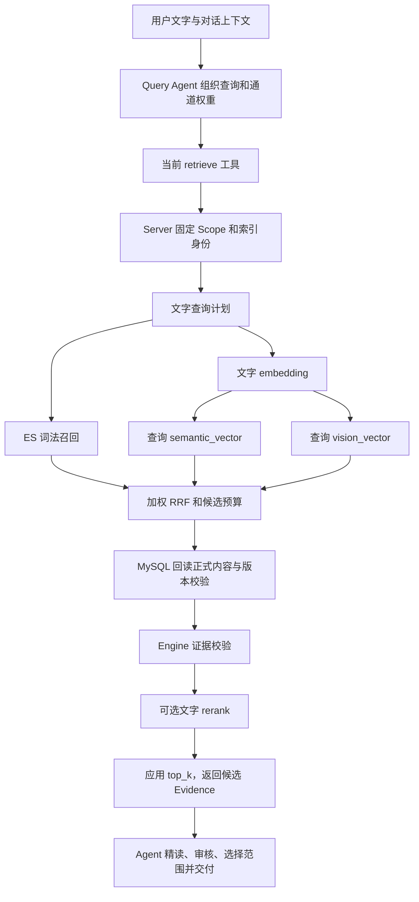
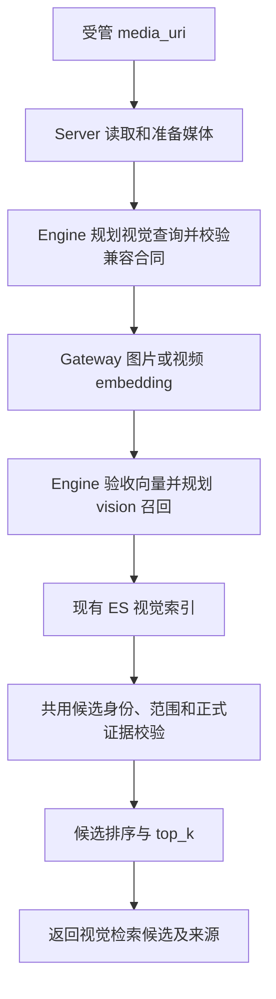

# 视觉媒体检索 TRD

日期：2026-10-15。状态：设计基线，待实现。本文的工具名、附件输入和视觉查询流程均为目标设计，不代表当前 Chat 已支持图片、GIF 或 MP4 查询。

本文是文字／视觉查询分工和视觉媒体接入的主设计文档。需求与研究来源见 [RAG 研究记录](../../engine/design/multimodel-retrieve-trd.md)，历史效果及记录边界见 [MyGO Chat 实测](../../engine/design/mygo-chat-eval-20261015.md)。实现时以实际代码和版本化合同为准，不将旧实测结论写成新链路验收。

2026-10-16 补充：构图、空间关系、主体姿势、运镜、分镜组织的需求及当前缺口记录在 [目标 Query Set](../../engine/design/multimodel-retrieve-trd.md)。近期先接通静态图片输入并验证普通图片找出处，再用真实漏例决定专项视觉能力；接口研究见本文第 9 节。

2026-10-17 增补：[Event 细粒度检索 TRD](event-retrieval-trd.md) 增加文字输入下的 Event 池搜索，与本文的媒体输入分工正交。该方案待实现，不要求先落地视觉媒体输入，也不依赖更换 embedding 模型。

## 1. 目标与职责边界

按查询输入区分以下两个媒体检索工具；Event 粒度工具另见下述补充：

- `retrieve_text`：接收文字查询，执行已有词法、文字语义及文字到视频的跨模态召回。
- `retrieve_visual`：接收图片、GIF 或 MP4 的受管媒体 URI，直接编码媒体并查询视觉索引。

当前文字工具名为 `retrieve`。`retrieve_text` 是本方案的目标命名；本次文档不重命名生产工具。实施时须同步工具注册、提示词、首轮调用要求及调用记录，避免长期维护两套同义入口。

隔离的是输入合同、编码执行和查询来源，不是复制两套 Scope、数据库、索引身份、证据校验或 Agent Runtime。文字输入仍可召回视觉索引中的视频，视觉输入不被强制转换为文字查询。

`retrieve_visual` 的核心路径不依赖生成式 VLM、图片描述生成或 Agent 多轮推理。媒体读取、解码、采样、格式转换和 embedding 属于检索执行；生成式理解、任务拆解、跨片段解释与最终答案属于上层模型编排。多模态 embedding 本身仍是学习得到的视觉语义表示，不能将其描述为完全不含模型理解的像素检索。

上层模型可以看图、理解用户意图、独立调用 `retrieve_text`，也可以对视觉候选做多模态复核。`retrieve_text` 本身只负责检索，不负责替代 VLM 看图或综合理解。视觉匹配不能只靠一段生成描述来证明。

Event 补充：业务工具 `search_video_events`（工作名）接收文字、可选事件类型及 Chunk 子范围，直接搜索 Event 池；Agent 自由选择直接细搜或粗搜后细搜。首版采用类型过滤与词法匹配，现有 Chunk 综合向量与视觉链路保留。Event 候选回查完整 Chunk 后继续使用既有证据和画面核验流程；本文不重复维护 Event 的存储、身份与索引合同。

## 2. 当前文字链路：代码事实

### 2.1 文档侧索引

已发布的视频 Chunk 按可用内容具有以下检索表示：

- 词法字段：事件描述、人物名、原语／翻译对白、画面文字，以及可用的摘要、关键词和问题线索。
- `semantic_vector`：正式事件、人物、对白、画面文字及可用摘要组成的文字投影非空时，经文字 embedding 编码生成。
- `vision_vector`：对应视频片段经视频 embedding 编码。

关键词和生成问题只提供召回线索，不能升级成原片事件证据。语义文字投影见 [projection.py](../../engine/rag/indexing/projection.py)，索引编码编排见 [video_parse_index_coordinator.py](../../server/service/video_parse_index_coordinator.py)。

### 2.2 查询与候选返回



实际执行顺序：

1. Query Agent 根据用户问题、系列背景、历史和已有反馈，组织 `query / top_k / channel_weights`。实体规范化和查询扩展属于 Agent，不是底层检索 Service 中隐藏的一次生成模型调用。
2. 工具注入本次固定的 Tenant／Series Scope；Service 从 MySQL 解析可检索任务，核对模型、编码合同、内容版本和索引代际。
3. Engine 按启用通道规划查询。词法通道使用原查询执行 ES 文字匹配；dense 通道请求文字 embedding。
4. 当前 semantic、vision 两通道使用相同兼容的查询 encoder 时，同一次文字编码可同时供两路查询使用。目标分别是文字向量和视频向量；不是两次必需的文字 embedding，也不是跨请求缓存。
5. ES 各通道返回候选；Engine 验证候选身份并按加权 RRF 合并、去重和截取候选预算。
6. Server 从 MySQL 回读候选正式内容，Engine 核对身份、范围和证据。可选 scorer 只在启用并装配且模态兼容时执行；没有 scorer 或评分失败时沿用 RRF 排序，最后应用 `top_k`。
7. Agent 收到候选后，再读取具体事件、对白和前后文，完成草稿、审核、范围选择和视频提交。此过程属于检索工具外的 Agent 任务执行。

可选 sparse 通道有独立的文字编码计划；是否启用由既有配置决定。示意图省略该可选分支，不将其当成默认已执行。

代码依据：[工具](../../agent/chat/video_search/tools/retrieval.py)、[Service](../../server/service/video_retrieval.py)、[文字计划](../../engine/rag/nlp/query.py)、[召回与融合](../../engine/rag/retrieval/pipeline.py)、[候选审核与重排](../../engine/rag/retrieval/rerank.py)、[ES 执行](../../server/storage/elasticsearch.py)。

### 2.3 对效果的解释边界

“文字输入”不等于只搜字幕；当前文字链路同时利用视觉事件的文字化描述和 text-to-video 向量检索。模型用已知歌名扩展查询可以帮助找到候选，也可能偏向先想到的内容。推荐足够数量的好例子和比较全剧后找最优、找全，是不同的停止条件，不能用前者完成证明后者。

本方案保留现有文字能力，不因工具分名而移除文字查询的 vision 通道，也不把 Agent 查询扩展、审核效果算成视觉媒体检索本身的收益。

## 3. 目标工具与附件输入

以下是核心参数示意；`media://` 仅表示受管逻辑 URI，不在本文冻结具体 URI scheme。

```text
retrieve_text(query, top_k, channel_weights)
retrieve_visual(media_uri, top_k)
```

两者保留既有分页方式。视觉工具不要求图片描述、文字 query 或另一组文字通道权重；当前只查询 vision 的路径无需新增无关权重配置。Scope 由 Server 固定注入，Agent 不通过媒体 URI 扩大权限或素材范围。

附件执行合同：

- 前端上传后获得受管 URI；消息持久化附件引用，并展示缩略图或预览。上传聊天参考媒体不创建视频资料库解析任务。
- Server 解析 URI、核对归属和可读性，通过文件实际内容识别媒体类型；模型不传任意本地路径或自行拼接下载凭据。
- Server 提供实际字节及预处理 manifest，Engine 只接收可验证输入合同和编码结果；同一个 URI 对应的实际媒体必须可核对。
- 模型上下文获得附件目录，需要看图或看视频时通过媒体读取工具取得真正的多模态内容。附件只有索引文字不等于模型已经看过媒体。
- 后续轮次“继续用刚才那张图”从持久化消息重建授权附件引用，不依赖浏览器内存或上一轮临时工具对象。
- 既有 `reference` 表示历史回答的视频 Evidence，继续保留该含义。附件元数据不包含大体积 Base64；具体消息字段和上传端点在实现接口设计时按项目惯例确定。

当前 [消息 DTO](../../server/model/dto/agentDTO.py) 尚无正式媒体附件合同；`extra_context` 是有限大小的 JSON。不要把它当前存在误写成附件功能已经接通。

## 4. 独立视觉检索链路



该路径无需先生成 caption、OCR 文本、人物剧情判断或文字搜索。若原媒体不可读、不支持或编码失败，应报告实际失败；零命中应返回零命中，不能在内部悄悄改为文字检索并仍宣称 visual 命中。

视觉向量与库内视频向量必须有明确兼容依据，检查实际模型、encoder revision、维度、归一化、输出合同和索引代际。仅向量长度相同不足以证明兼容。沿用 [QueryEncoderBinding](../../engine/rag/retrieval/contracts.py) 和 [视觉查询计划](../../engine/rag/vision/query.py)，不另造一套跳过校验的 ES 查询。

只有 vision 一路时可复用候选排序、身份和证据框架，无需重复建设 RRF 或存储。现有 `StructuredTextReranker` 只支持文字查询，视觉路径应显式不启用它；不能等到不兼容的 rerank 规划抛错后再当普通评分失败回退。

模型层如需把图片理解为“向下跳跃”“同样的表情”，可独立生成文字并调用 `retrieve_text`。两次检索结果可以进入同一 Canvas 去重、精读和选择，分别保留查询来源；本设计不在 `retrieve_visual` 内自动混入文字召回，也不把视觉工具扩成一个新的生成 Agent。

## 5. 图片、GIF 与 MP4 的执行约束

| 输入 | 目标执行 | 当前基础与缺口 |
| --- | --- | --- |
| 静态图片 | 读取准备后的图像，`embed_image`，查询兼容视觉索引 | Gateway 和 Lazy Query Embedder 已有图片编码；Engine 有 ImageQueryInput；Chat 工具和 Service 实际分支未接通 |
| GIF | 保留帧顺序、相对时间和时长，编码完整有序片段 | Engine 已有 GifQueryInput 和有序帧合同；没有可直接执行的 embed_gif，当前 embed_image 只支持静态图 |
| MP4 | 视频预处理后编码，查询兼容视觉索引 | Gateway 已有 embed_video 供视频编码；Engine 查询 union、query modality 和 Lazy Query Embedder 尚未接视频查询 |

GIF 的目标适配方式是按原时间轴准备为视频编码器可接收的有序视频表示，并记录源帧时刻、准备后时刻和内容摘要；MP4 使用视频编码路径。具体预处理合同、Engine 视频查询输入及查询执行器必须一起落地和验收。不得通过取 GIF 首帧或随意平均独立帧向量，就宣称已支持动态查询。

统一记录媒体种类、原始及准备后内容哈希、预处理版本、采样规则、实际送入编码器的帧／时间范围和截断信息。时长、体积、采样及并发限制由所属配置统一解析和下发，不在 UI、工具、Service、Gateway 分别藏一组默认值。

“保留时序输入”与“模型确实区分动作方向”分别验收。需测试正放／倒放及相同帧集合不同顺序；未通过时只能声明已验证的相似场景能力，不能承诺向上／向下等动作过程匹配。MP4 作为视觉查询输入不自动获得音频检索能力。

当前能力依据：[图片／视频编码](../../gateway/ark/embedding.py)、[Lazy Query Embedder](../../server/common/retrieval.py)、[查询入口](../../engine/rag/query_pipeline.py)、[媒体查询合同](../../engine/rag/retrieval/contracts.py)。模型输入能力参考 [官方多模态向量化 API](https://docs.volcengine.com/docs/ark/multimodal-vectorization-api?lang=zh)，实际适配以当前所选模型版本与编码合同为准。

## 6. 返回结果与画面溯源

视觉工具返回可复用的候选视频身份、原视频范围、排序信号、来源及其定位粒度，沿用正式 Evidence 和 Canvas。新增视觉查询元数据的具体字段在实现时扩展既有合同，不把 URI 伪装成文字 query，也不另建一套不兼容的候选模型。

当前视觉索引以视频 Chunk 为候选单位。返回 Chunk 区间表示候选范围；封面或预览帧不自动等于命中帧，不能据此填出精确匹配时间。

| 用户目标 | 验收重点 |
| --- | --- |
| “这个表情包出自哪一集？” | 同源原画面及集数，覆盖裁剪、加字等变体；确认出处时提供实际比较的原帧与原视频位置 |
| “找类似这个姿势的画面” | 允许人物、服装和背景不同，核对肢体位置、朝向与可见度，避免只匹配背景 |
| “找类似向下跳跃的片段” | 核对同一主体的动作阶段、方向和连续时间；包含相似外观但相反动作的负例 |

精确原帧定位可以先在召回的候选内做独立局部视觉比较，记录实际抽帧时间／PTS、预处理和比较结果；若目标 Chunk 无法进入候选池，再依据漏例评估帧级索引。局部比较仍属于明确的视觉定位步骤，不要求生成式 VLM 综合理解。

VLM 可在上层解释匹配和复核候选，但模型解释不能补写检索或局部定位没有产生的原帧证据。未定位到原帧时保留“候选片段”粒度，不把高相似度直接表示为已确认出处。

## 7. 模块归属与配置来源

| 模块 | 职责 |
| --- | --- |
| Web／Chat API | 附件上传入口、消息引用、预览及历史恢复 |
| Server 媒体服务 | 受管媒体解析、归属、实际字节和预处理产物 |
| Agent | 看图／视频理解任务、选择两个检索工具、读取候选、组合解释与提交 |
| Server 检索 Service | 固定 Scope、选择查询执行路径、调用 Gateway、回读正式证据 |
| Gateway | 统一模型连接、图片／视频编码、用量与取消 |
| Engine | 输入及 encoder 合同、纯查询计划、召回请求、融合和证据校验 |
| ES／MySQL | 复用现有视觉索引和业务事实，不另存一套来源身份 |

编码模型与连接沿用已有模型配置；查询策略沿用所属 RetrievalConfig 和有效工具参数；媒体预处理参数归媒体配置。实现时明确每项配置唯一有效来源和覆盖规则，新增配置不复制在业务文件。不同入口共享上述能力，不各自创建模型客户端。

现有需要衔接的位置还包括：附件读取不能被“先有视频审核结果”拦截；内层 Query 也应获得附件目录；首轮调用要求应接受本次选择的检索工具，不能固定要求先调用文字工具。仅修改工具名字或追加 URI 字段不足以完成链路。

## 8. 可观测性与验收

每次调用关联消息／运行 ID、工具名、实际输入模态、媒体引用及哈希、有效 Scope、encoder 与预处理版本、实际执行通道、候选顺序／分数和索引身份。Agent 扩展的文字查询与视觉原媒体查询分别记录，保留多次检索的来源；日志不打印媒体 Base64、凭据或原始大载荷。

第一阶段验收独立静态图片路径；第二阶段补齐 GIF／MP4 的合同与执行；精确帧定位和上层任务效果分别验收。分阶段仅表示交付顺序，不缩小本文对动态查询和来源核验的目标。

| 验收项 | 必须观察到的结果 |
| --- | --- |
| 文字回归 | 原有词法、semantic、text-to-video 通道及 Agent 选片继续可用 |
| 纯图片检索 | 不调用生成式 VLM／Agent 仍可执行媒体读取、图片编码、视觉召回和候选返回 |
| 查询隔离 | 视觉调用实际只走视觉召回；模型另发文字检索有独立调用与来源记录 |
| 模型兼容 | 不兼容 encoder、预处理或索引身份明确拒绝，不能只检查向量维度 |
| GIF／MP4 时序 | 输入顺序与时间确实送到编码器；完成正反向、乱序和相似静态帧负例测试 |
| 定位粒度 | Chunk 命中、局部帧定位和经模型复核的结论可以区分；预览不冒充命中帧 |
| 表情包出处 | 原图、裁剪、加字样本和相似但不同原帧均有核验；精确位置来自原视频 |
| 附件恢复 | 刷新和后续轮次仍可读取已授权附件，跨范围引用不能扩大素材 Scope |
| 配置与异常 | 有效配置可追溯；不支持媒体、编码失败及零命中不隐藏转换为文字检索 |
| 效果归因 | 分开记录候选召回、时间定位和 Agent 最终回答效果；加入陌生素材，控制作品先验影响 |

<a id="static-image-entry"></a>

## 9. 首轮静态图片接入：接口研究与验证方案（2026-10-16）

执行边界（2026-10-16）：分为后端、前端、用户主导算法设计三个批次。后端统一负责数据库／ORM、消息合同与持久化、上传与受管存储；前端另批接入；Agent 媒体输入、视觉检索、预处理与效果评测由算法批设计。首轮产品目标仍为“上传一张静态图片，并问这个表情包出自哪一集”，后端承载完成不代表已经具备真实图片召回能力。GIF／MP4 按第 5 节后续推进。

### 9.1 接入前断点与职责

| 位置 | 当前事实 | 首轮需要补齐 |
| --- | --- | --- |
| 前端输入与请求 | SearchPage、useAgentConversation、普通／SSE client 只有文字和历史视频 reference | 图片选择／粘贴、上传与预览、消息附件引用、失败重试时冻结同一请求 |
| 图片上传 | 系列背景图已有 raw body 上传、实际图片解码、原图／模型图保存 | 新增属于当前会话的附件入口；未知出处图片无需先归属某个 Series |
| 消息合同与持久化 | AgentMessageSendRequest 无 attachments；AgentMessage 已有 detail JSON | 显式附件字段、规范化引用持久化、幂等比较与消息 State／VO 投影 |
| 历史与模型输入 | extra_context 虽入库，但消息 VO、历史 RunInputs、内层 project_inputs 均未恢复通用附件 | 从持久化消息重建当前／历史附件目录，支持刷新和追问 |
| 模型看图 | ToolImageArtifact 已能输出实际图片；首次搜索前的 Canvas 读取受 review_reader 限制 | 附件可在视频检索前读取，复用实际图像传输机制 |
| 图片检索执行 | Engine 已有 ImageQueryInput 和纯 vision 查询计划；Gateway／LazyQueryEmbedder 已有 embed_image | 新增 retrieve_visual 与 Server 视觉执行分支，实际传入已校验的图片 |
| 结果与 trace | VideoChunkSearchResult.query、RetrievalTraceEntry.query、RetrievalCall.query 目前绑定文字 | 视觉调用记录带类型的查询身份与媒体来源，不用 URI 冒充文字 query |

代码依据：[前端输入](../../web/src/features/search/SearchPage.tsx)、[客户端](../../web/src/api/client.ts)、[消息 DTO](../../server/model/dto/agentDTO.py)、[消息存储](../../server/repository/agent.py)、[历史构建](../../server/service/agent_chat.py)、[内层输入投影](../../agent/chat/video_search/context.py)、[系列图片上传范例](../../server/api/library.py)、[检索 Service](../../server/service/video_retrieval.py)。

### 9.2 上传与消息接口

后端接口沿用现有图片上传的 raw body 方式，不把媒体字节放进消息 JSON：

```http
POST /api/agent/attachments/upload?tenantId=...&conversationId=...
Content-Type: image/png

<图片字节>
```

上传返回的必要信息：

```json
{
  "mediaUri": "<服务端生成的受管附件引用>",
  "mediaType": "image/png",
  "sizeBytes": 123456,
  "previewUrl": "<带会话访问校验的预览地址>"
}
```

既有 `POST /api/agent/messages/send?conversationId=...` 增加可选附件引用；现有 `Idempotency-Key` 和 JSON／SSE 协商方式沿用：

```json
{
  "tenantId": "local-default",
  "content": "这个表情包出自哪一集？",
  "seriesIds": ["<允许检索的作品 ID>"],
  "attachments": [
    {"mediaUri": "<上传返回的受管附件引用>"}
  ]
}
```

- 上传前先创建或选定会话；附件归属会话及其 owner，与被检索的 `sourceTenantId / seriesIds` 分开。上传、预览、消息引用和工具读取均核对会话访问权；不能凭一个 URI 扩大访问范围。
- 请求只携带受管引用。文件类型、内容哈希、实际尺寸、准备版本等事实由 Server 解码和存储产物确定，不信任客户端重传，也不接受任意本地路径或远程 URL。
- 上传阶段不可变保存原始文件及实际 MIME／哈希／字节数／尺寸／manifest 版本；即使尚未发送消息或服务进程重启，也能从受管存储恢复。消息只引用该产物。附件预览使用会话的 tenant／owner，不复用检索证据投影中的 sourceTenant。
- 静态图片验证复用 JPEG／PNG／WebP 真实解码和像素限制；动画输入明确拒绝，不静默取首帧。上传不缩图、转码或改写原文件；模型与 embedding 所需的方向归一、尺寸、采样等准备规则由算法批定义。
- 规范、有序附件引用只存入独立 `agent_message.attachments JSON NULL` 列，对外使用正式 `attachments` 字段，不复制到 `detail`、`extraContext` 或历史视频 `reference`。已有消息的 SQL NULL 读取为 `[]`；迁移不回填旧行，不改变历史更新时间。首版无独立资源表，会话归属以 MySQL 为准，manifest 只保存媒体事实。
- 幂等比较纳入规范附件引用；同一个 key 配不同附件应冲突。预览 URL 等展示信息由引用派生，不参与请求身份，避免刷新地址引起重复执行。
- 用户消息 VO 在历史列表和现有 SSE 消息快照中返回附件展示信息，前端据此恢复预览；无需新增一种附件流式事件。本轮输入是“图片＋明确文字问题”，不顺带改变纯图片无文字发送规则。
- 上传字节／像素限制使用注入的同一份 `ServerSettings.images`，沿用 `ANIVAG_MAX_IMAGE_UPLOAD_SIZE_BYTES` 和 `ANIVAG_MAX_IMAGE_PIXELS`。背景图缩放参数及模型工具图像预算不作为 Chat 上传约束；后续算法消费限制单独设计。

附件内容通过 `GET /api/agent/attachments/content?tenantId=...&conversationId=...&mediaUri=...` 鉴权读取。上传响应使用非空的 MIME、字节数和预览 URL；历史消息若 manifest 丢失，仍返回 `mediaUri`，其他三个字段为 `null` 并记录异常，避免整页历史消失。原件丢失而 manifest 尚在时保留描述，内容读取返回媒体丢失错误。

附件目录为 `media/conversations/<conversationId>/attachments/<sha256>/`，原件不可变，manifest 最后发布作为完成标志。长解码在锁外，最终发布与会话删除共用数据库会话行锁。未发送资源也保留到会话删除；前端移除草稿不触发文件删除。删除 SQL 成功后撤销访问并清理独占目录；失败记录并由启动恢复重试，DB 查询失败不能当成会话不存在。首批不引入跨会话共享、单附件独立删除或 TTL。

算法尚未接入时，真实 `messages/send` 对新的非空附件或含附件历史返回 HTTP 409、`ATTACHMENT_INPUT_UNAVAILABLE`，在创建消息／排队／模型调用前结束；SSE 同样在建流前返回错误 JSON。既有终态幂等重放仍可恢复，不重跑模型。本批用持久化和接口回归验收消息承载，不增加延迟执行参数或额外消息状态。后续算法交付当前／历史附件消费后，在这一入口完成接线。

### 9.3 Agent 与检索执行（后续算法批）

```text
图片上传 → 受管附件引用 → 用户消息持久化
  → 当前／历史附件目录传给 Supervisor 和 Query
  → retrieve_visual(media_uri, top_k)
  → Server 解析已授权图片 + Engine ImageQueryInput
  → Gateway embed_image → 现有 vision_vector 召回
  → 共用正式证据回读、身份校验和候选输出
  → 按需查看候选原帧 → 回答集数及可证明的范围
```

附件目录只说明“有什么媒体”。模型真正查看参考图时，需通过现有 ToolImageArtifact 通道得到图片；附件读取应独立于已有视频检索结果。当前与历史目录都从持久化消息恢复，再投影给内层角色，不依赖上一轮临时对象。

`retrieve_visual` 消费原媒体，不强制先由 VLM 生成描述。需要补充文字查询时，由上层模型独立调用既有文字工具并分别记录来源；纯图片候选召回与 Agent 综合回答分开验收。

Server 执行视觉分支时使用有兼容依据的 `query_modality=image` 绑定，核对实际编码返回模态及向量合同，再走现有 vision 召回；不能把 text binding 原样复用成 image binding。视觉路径显式绕过只支持文字的 scorer。Engine 图片计划、Gateway 图片编码、ES 向量查询已有实现，首轮以接线和合同补齐为主，无需先改视频解析或全库重建索引。

检索结果复用现有 Evidence／hits／Scope；视觉结果、调用记录和 Canvas 查询来源需要明确媒体种类、引用与输入内容身份，并保留文字分支兼容。工具执行结果的“实际查询与请求一致”校验同步覆盖媒体身份。Query／Evaluator 的首轮调用约束需允许本轮选择 `retrieve_visual`，不能继续要求图片查询必须先调用文字检索。

当前视觉索引返回 Chunk 范围。已有 [原视频抽帧工具](../../agent/chat/video_search/tools/frames.py) 和 [VideoFrameReader](../../server/service/video_frame_reader.py) 可用于候选核验，不依赖旧任务预先登记关键帧；其时间戳是请求 seek 位置，不是实测 frame PTS，也不等于已自动定位到参考图对应帧。候选未核实则按候选表述。

### 9.4 首轮测试与后续决策

| 验证层 | 样例／操作 | 单独记录的结果 |
| --- | --- | --- |
| 接口与恢复 | 上传图片、发送、刷新、继续问“刚才那张图”；重放同一幂等请求；校验会话归属 | 引用、预览及模型可读媒体保持一致；不重复执行或跨会话越权 |
| 普通图片召回 | 从当前可检索视频准备少量已知出处原帧，实际调用 image embedding 与 vision recall | 正确集数 Top-1、正确 Chunk Top-k、候选名次；记录本次实际 top_k 与样本数 |
| 表情包变体 | 分别提供裁剪、加字／贴纸、压缩等参考图 | 按变体报告命中与漏例，不能用整帧表现代替变体效果 |
| 负例与重复出现 | 库外图片、相似但不同原帧、同一镜头在回忆中重复出现 | 区分最近邻候选与确认出处；“最早／全部”没有覆盖证据时不声称完成 |
| 最终回答 | 固定文字“这个表情包出自哪一集”，结合参考图和召回原片核验 | 集数正确性、原画面核验、时间定位粒度、证据支持与未确认项 |

样例出处保存在独立核验记录中，不通过图片文件名、URI、附件说明或文字问题泄露给 Agent；参考媒体 URI 使用不包含来源集数的附件标识。原帧的来源位置以正式原视频信息核对，不能把历史相对抽帧文件名当绝对时间。

测试时保留输入哈希、准备版本、索引身份、实际编码模型、候选和最终证据的 trace。已有 Engine／Gateway 模拟测试只能验证合同与调用分支，真实图库效果需在接口接通后另跑。若目标视频未进入候选池，先检查编码、索引覆盖和候选粒度；若候选已有而无法确认原画面，再研究局部定位。构图、主体姿势、运镜等专项能力根据对应 query set 的实际失败样例另行设计。

2026-10-16 基础验证：执行 `PYTHONDONTWRITEBYTECODE=1 PYTEST_DISABLE_PLUGIN_AUTOLOAD=1 .venv/bin/python -m pytest -q -p no:cacheprovider tests/engine/test_visual_query.py tests/gateway/test_video_embedding.py`，69 项通过，用时 3.23 秒。这两组使用模拟向量／模型客户端，不连接真实模型、数据库或 ES；结果仅说明现有底层合同与图片请求封装通过测试，不代表前端附件或真实找出处链路已接通。

本次文档变更不实施上传接口、工具重命名、视觉 Service、索引扩展或数据库迁移，也不触发模型调用和服务重启。


### 9.5 后端批次交付记录（2026-10-16）

已完成数据库／ORM、消息合同与持久化、会话附件上传与存储；前端与算法实现仍属于后续批次。新增代码未主动重启运行中的服务。

- 配置：沿用 `ServerSettings.images`；API 和原图校验消费同一实例，不新增图片缩放、模型图片数或累计调用预算。
- 分层：静态图校验在 `server/utils/images.py`；共享附件合同在 DTO／VO；会话权限、引用解析和生命周期在 `AgentAttachmentService`；文件发布在既有 `ArtifactStore`。
- 验证：8 个直接受影响后端测试文件合计 **511 passed、1 skipped**；跳过项是原有的可选 MySQL 计时用例，未配置它的测试连接。另在本次创建的隔离 MySQL 库运行附件迁移与会话发布锁用例，**2 passed**，临时库已清理。未运行真实模型或视觉召回评测。
- 审查：已修复 SQL 删除完成后清理失败导致接口误报失败，以及会话删除与 SSE 附件投影竞争导致流异常的边界；无额外重构。
- 本机开发库已执行 `20261016_agent_message_attachments.sql`，并重复执行核验。迁移时 31 个会话、72 条消息；原字段逐项相同，72 条旧消息附件均为 SQL NULL，新 ORM 可读取。
- 数据备份和迁移校验记录位于 `outputs/server/backups/agent-attachments-20261016T122903Z/`，包含可恢复 SQL、原字段 JSON 快照及 `migration-result.json`；未输出消息正文或数据库凭证。
- 后续接入点：前端消费上传／内容读取／消息附件合同；算法批实现当前及历史附件输入与授权媒体读取，再接通非空附件回答。当前 `ATTACHMENT_INPUT_UNAVAILABLE` 明确表达尚未接入，不会将 URI 伪装成已读取的图像。
