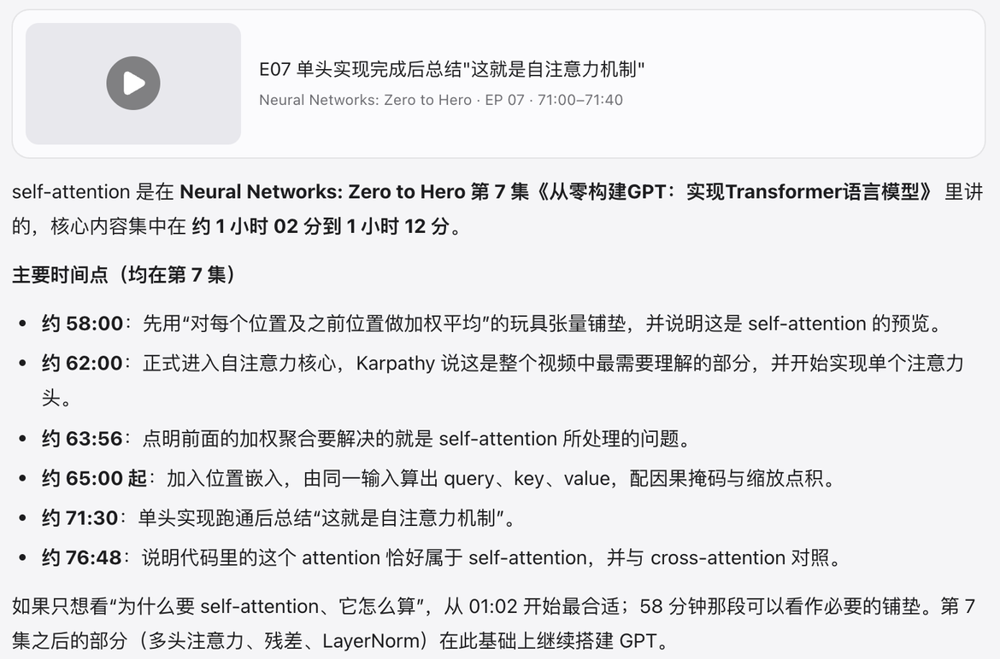

# 41 hours of lectures. You only need one part.

Seekino turns videos into a library you can search. Describe a scene you remember or a concept you want to understand, and it takes you straight to that second in the original video.

> Think about the last time you looked for one scene in a long video. How long did you drag the progress bar?

## Try it in three steps

1. **Say what you're looking for**

   Press ⌘K (Ctrl+K on Windows) and describe it the way you'd ask a friend. You don't need the exact words or the episode number.

2. **Click the time and watch**

   Every result comes with its source video and a time range down to the second. One click and playback starts right there, with no more scrubbing.

3. **Lost? Just ask**

   While watching, open the assistant beside the player and ask "what was that part about?". It knows where you are, and every clip in its answer links back to the source.

### Real screenshot from Cloud · 2026-11-10

Asked “self-attention 是在哪一集哪一分钟讲的 (which episode and minute covers self-attention?)”

Across 8 episodes and 14.6 hours, the answer lands on exact time points in episode 7, with source clips you can open. You can ask the same question on Cloud right now.

### Or ask things like

- “which episode covers the chain rule in backprop” · Lectures
- “the part where Karpathy says the tokenizer causes a lot of problems” · Lectures
- “someone waiting at the door in the rain” · Anime

## Why not just watch at 3×?

A 116-minute lecture at 3× still takes nearly 40 minutes, and you have to keep watching so you don't miss the part you need. Seekino parses a video once; after that, every search works like Ctrl+F in a document: you land on the part you need.

## Next

- [How Cloud differs from Local](./versions.md)
- [Run it on your computer](./self-host.md)
