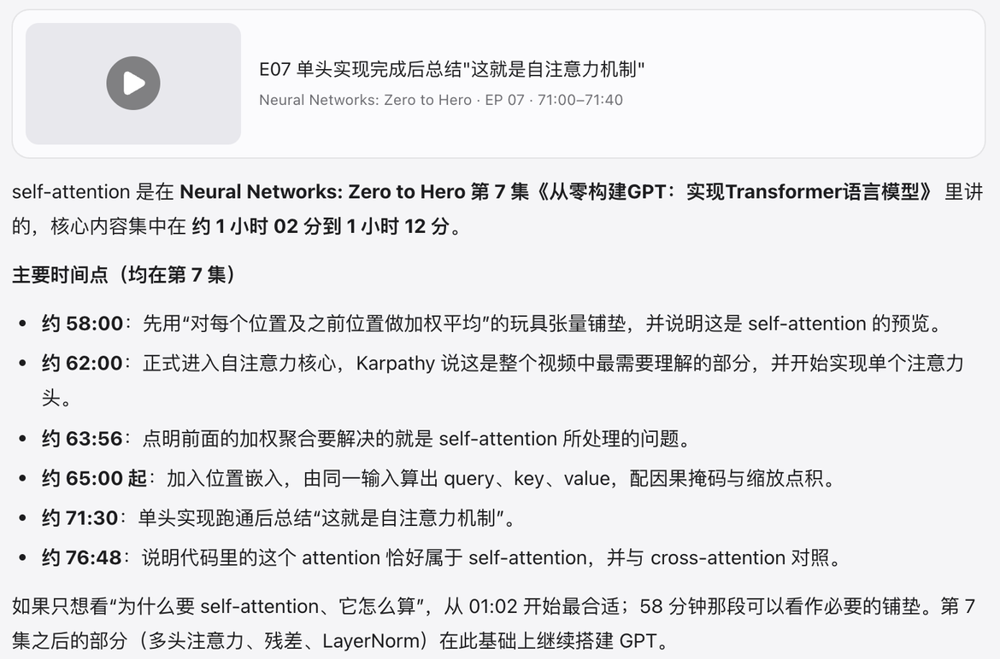

# 41 小时的课，你要的只是其中一段

Seekino 把视频变成可以搜索的素材库。说出你记得的画面或想弄懂的概念，它把你直接送到原片里的那一秒。

> 想想上一次，你在一段长视频里找某个画面，拖了多久进度条？

## 三步试一次

1. **说出你要找的**

   按 ⌘K（Windows 上是 Ctrl+K），像问朋友一样描述。不用记得原话，也不用知道在第几集。

2. **点开时间，直接看**

   每条结果都带着原片和精确到秒的时间范围。点一下，视频从那一秒开始播放，不用再前后拖。

3. **看不懂，就接着问**

   播放时打开右侧的助手，问“刚才这段在讲什么”。它知道你看到了哪里，回答里的每个片段都能点开核对。

### Cloud 上的真实截图 · 2026-11-10

问 “self-attention 是在哪一集哪一分钟讲的”

8 集、14.6 小时的课，回答落在第 7 集的具体时间点，附带可以点开的原片片段。在 Cloud 上问同一句，就能自己核对。

### 也可以这样问

- “反向传播的链式法则是在哪一集讲的” · 课程
- “Karpathy 说 tokenizer 是很多问题根源的那一段” · 课程
- “下雨天有人在门口等待的画面” · 动画

## 为什么不直接倍速看？

一节 116 分钟的课，开 3 倍速也要将近 40 分钟，而且你得一直盯着，生怕错过要找的那一段。Seekino 只需把视频解析一次，之后每次查找都像在文档里按 Ctrl+F，直接跳到那一段。

## 接下来

- [Cloud 和本地版有什么不同](./versions.md)
- [在自己电脑上部署](./self-host.md)
