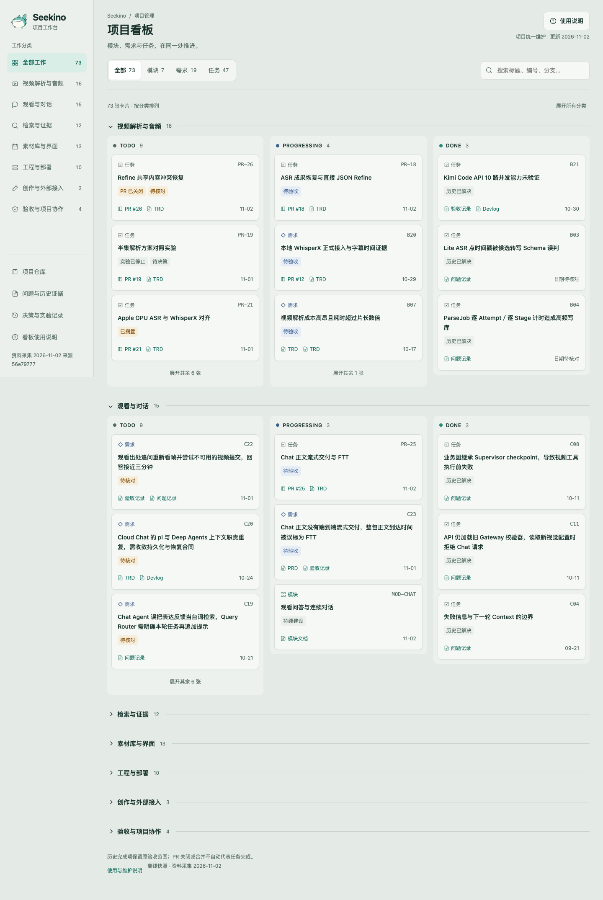

# 单文件项目看板：设计与验收记录

日期：2026-11-02（Asia/Shanghai）。需求 PM-01，分支 `feat/project-kanban`，[PR #27](https://github.com/owariband/Seekino/pull/27)，目标 `dev`。本记录是本次交付快照；最新工作状态以 [看板](../../../../dev/kanban.html) 为准。[主 TRD](../../../../design/03-product-reassessment/project-kanban-trd.md) 的初稿在首提交 `06845112` 中独立提交。

## 实际交付

一个项目共用的 HTML，分类下面固定 TODO / PROGRESSING / DONE，模块 / 需求 / 任务可分别筛选。支持搜索、折叠、详情与关联卡片跳转，数据由 Agent 在仓库统一维护；页面只读文件内的 JSON。Logo、样式、脚本和数据都包含在文件内，打开页面不需要网络或服务。

2026-11-02 交互复核后，移除“保存 HTML”、新增/编辑、拖动修改状态、导入/导出和浏览器草稿。它们会把项目共用入口变成个人副本管理，偏离本次目标。原 `6bdc6ff0` 版本与测试记录通过 Git 保留。

卡片显示 PR/TRD，详情保留内容范围、下一步、验证边界、工作分支及来源版本；已有分析和 devlog 继续保存完整证据。当前状态从 problems 两大分区交给看板，历史正文不迁移、不删减，不补造旧需求或 TRD。

## 数据核对

导入来源和逐项编号见 [product-facts](product-facts.md) 与 [import-manifest](import-manifest.json)。73 张卡包含 7 模块、19 需求、47 任务；其中 dev 问题 56 条，QA 分支新增问题 3 条，其余为六个 PR 交付、七个模块和本次 PM-01。交付快照为 TODO 38 / PROGRESSING 12 / DONE 23；不同粒度不能用于计算总完成率。

#19 的实验已停止，因此保留 TODO / 待决策；#21 搁置；#26 已关闭未合并，保留待核对。原 20 条 DONE 沿用历史验收范围。PM-01 的完成范围为本地看板交付，仍注明 PR 待合并。未从开放 PR、分支存在或局部测试推断业务完成。

44 个 GitHub 文件目标已核对：40 个通过本地 Git 对象或本分支文件，四个通过 GitHub 按 PR head 读取；已有本地来源的标题锚点和问题行号也已核对。problems 从首个原问题起的正文及 devlog 原记录逐字相同，见 [来源与完整性校验](source-check.json)。未逐条在浏览器点击所有外部链接。

## 浏览器与设计验证

当前仓库统一维护版：Chrome 156.0.8078.79，1440×900 / 375×812，实测 [readonly-results.json](readonly-results.json) 的 30 项检查通过。验证三种类型的完整数量、分类/搜索/折叠、PR/TRD 和上下游跳转、只读状态、维护说明及移动端；注入 revision 更高的旧浏览器草稿仍显示仓库数据；在临时文件模拟 Agent 更新后，刷新显示新记录。没有删除旧草稿，浏览操作不修改卡片数据。系统设为深色时仍保持浅色主题；零页面脚本错误、零加载网络请求，无页面水平溢出。

以下 36 项是初版 `6bdc6ff0` 的历史验证，见 [results.json](results.json)。其中编辑、导出、导入和草稿行为已经退役，不代表当前页面能力：

- 三列、分类/类型/文字筛选、折叠、空结果恢复、详情、关联 PR 与上游卡片跳转。
- 新增和编辑卡片，原生拖放、状态下拉、Esc 关闭详情；HTML 字符作为文本呈现。
- 浏览器草稿恢复；真实下载完整 HTML，在全新浏览器上下文离线打开后保留标题、详情和 DONE 状态。
- 导入重复编号、危险链接、悬空关联会拒绝；导入 HTML 只读取 JSON，不执行其中脚本。
- 页面无横向溢出；手机三列在泳道内滑动；可操作控件满足 44px 目标；零 JS 页面错误，打开看板零网络请求。

初版原生系统文件选择器未实际操作，写入分支用显式测试替身覆盖；真实下载和独立重开经过实测。当前版本已移除整个保存流程。只测试 Chrome，未宣称 Safari / Firefox 或浏览器在线协作通过。

按 [huashu-design](https://github.com/alchaincyf/huashu-design/blob/master/SKILL.md) 做一版设计，[方向依据](direction-approved.md)、[品牌依据](brand-spec.md) 均已记录。初版的 Python CLI 缺少 Python Playwright，因此用现有 Node Playwright 执行原始 `COLLECT_JS`，再交给原始 `judge()`；[design-check.json](design-check.json) 保存当时两种宽度无红灯的结果。当前版本沿用字号与颜色，移除写入相关控件；下方为更新后的浏览器截图。



[手机完整截图](mobile.png) · [卡片详情截图](detail.png)

## 复现与限制

安装项目 web 依赖、提供本机 Chrome 后，可执行：

```bash
node docs/report/docs/dev/kanban/browser-check.cjs /tmp/seekino-kanban-check
```

隔离 worktree 无依赖时，可用 `KANBAN_PLAYWRIGHT_PATH` 指向已有 Playwright 安装。本次复用主工作区 web 依赖，未修改 lockfile。脚本只向指定临时输出目录写入文件更新测试副本和截图，仓库看板不会被 UI 测试修改。测试固定本次 73 卡基线，不是持续验收所有历史业务的工具。

本次没有模型调用、业务服务重启、数据库变更或线上部署；没有测量管理效率或 OKR 收益。旧问题、PR 与模块能力没有重新执行业务验收。项目资料由 Agent 随工作更新到仓库，通过 PR 集成；分支尚未集成的更新不会自动出现在其他分支，合并时按卡片 ID 保留双方变更。
