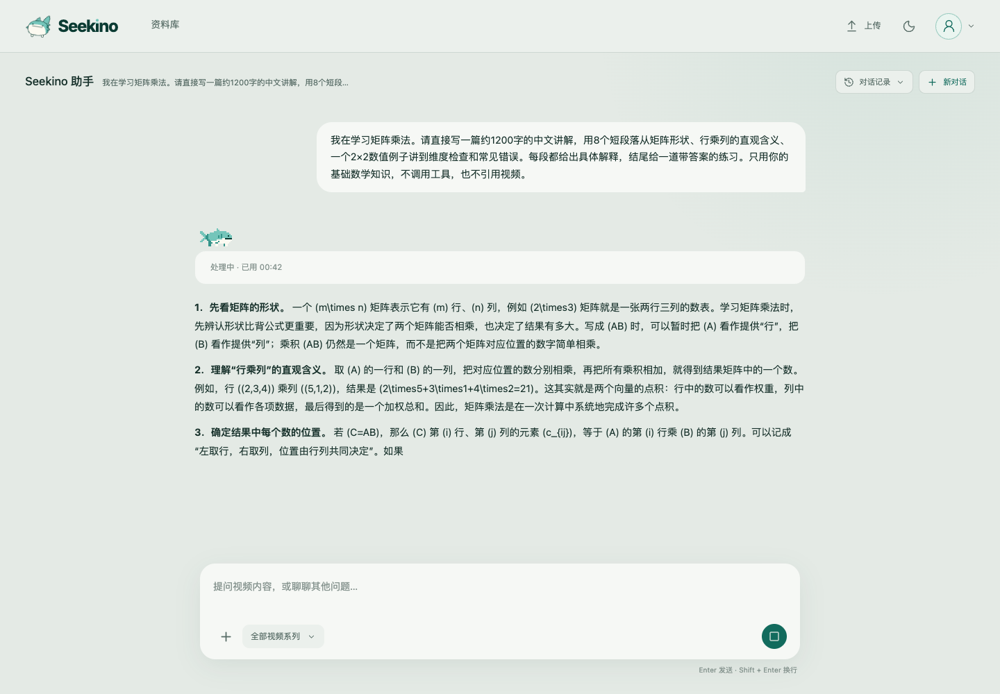

# Chat stream=true 真实运行：2026-11-02

**首轮 Kimi 测试确认正文能在模型完成前显示，但仍有较长的首次等待和成批输出。** 本轮从 [PR #25](https://github.com/owariband/Seekino/pull/25) 的 worktree 启动真实 API/Web，以 Chrome 提交两条问题，没有模拟模型或 HTTP。需求见 [TRD](../../design/03-product-reassessment/chat-streaming-trd.md)。

## 运行条件

运行时代码 `10da2dca28d668a7d8022f83d15cd8d3587b81be`，分支 `fix/chat-streaming-ftt`；Deep Agents / Kimi `k3.1-pro`。五次实际供应商请求均为 `stream=true`。配置复制自本机既有模型配置，SHA256 为 `74cc763706fad8909d4a5285c8f91b3e75db24f26848963963ef980365858a89`。

API `http://127.0.0.1:19625`，Web `http://127.0.0.1:15175/search`。复用已有测试 MySQL/ES 进程，单独新建 `seekino_chat_streaming_20261102_test` 数据库及同名前缀的 Chunk/Event `_test` 索引；媒体目录独立且为空。没有连接开发/生产业务库，也没有重启原服务。API/Web 在交付时继续运行。

Chrome 真实页面使用 1440×1000 视口，两条请求在同一新会话顺序发送。测试窗口约 15:32–15:36（Asia/Shanghai），不是此前课程 Q02/Q03 的同条件复测；同一台机器还运行上游测试服务，未控制外部负载。每题仅一个样本，不计算分位数或前后提速比例。

## 实际效果

| 用例 | 首个模型正文到客户端 | 页面首次显示 | 整轮完成 TT | 观察 |
| --- | ---: | ---: | ---: | --- |
| 矩阵乘法长解释，要求八段并给例题 | 27.211 s | 27.227 s | 61.594 s | 最初是 Markdown 前缀 `**`；第一段可读文字在 32.811 s 记录到。模型完成前有 15 次可见字数增长，最终正文 2030 字符 |
| 先说明计划，再搜索 Python 官方文档并解释 | 13.234 s | 13.248 s | 145.758 s | 首段是“我会……”进度说明；四次模型调用、三次搜索之后才完成实质回答 |

现有核验器对两条样本均返回 `valid=true`：请求、原始正文 delta、服务端发送与浏览器完成前展示可以关联。但它不区分 Markdown 格式前缀和可读文字，因此长回答的 27.211 s 只能按**首个正文 token（含格式符）**解释，不能说用户此时已经看到讲解。工具样本也不能用进度提示时间代替实质答案时间。

长回答的持续增长核验为 true；工具样本首轮只有一次完成前展示，`continuous_growth_verified=false`。该样本证明 session 在提示、工具、后续推理之间继续运行，不能单独证明平滑逐字输出。



## 仍然存在的等待

长回答在 Gateway 接收到的原始正文 delta 中有七段超过一秒的空档，分别约为 5.548、5.312、3.878、4.168、4.897、6.259、3.528 秒。页面相应成批增长。这些空档已存在于 SDK 解码后的接收记录，不能归因于 Server 的 50 ms 合并；本轮没有进一步区分供应商、网络代理、压缩或 SDK 缓冲。

工具场景第一次搜索耗时 12.037 s，成功返回空列表；第二次 2.133 s，返回五个结果；第三次 7.091 s，返回 `WEB_SEARCH_FAILED`。Agent 保留过程说明并继续完成回答。最后一次模型调用耗时 73.014 s，正文直到该调用的 72.793 s 才开始到达，随后约 0.220 s 内收完；stream=true 在这个短输出上仍表现为接近整段出现。

配置 `reasoning_effort=none` 不代表本次没有推理生成：长回答用量中仍记录 638 reasoning tokens。记录不足以把首次等待全部归因于推理，也不能证明改流式会缩短模型计算或工具耗时。

## 内容、持久化与成本

长回答最终持久正文与供应商完整正文逐字一致，矩阵例题抽查计算正确；两轮刷新后均能恢复。浏览器 pageerror 为 0。页面仍把 LaTeX 数学表示作为普通文字显示，这属于既有展示限制，本轮没有修改数学渲染。

五次模型调用共记录 input 25,343、output 4,328、total 29,671 tokens；reasoning 是 output 的子集，不另加总。三次真实搜索中的空结果和错误保留在证据中。没有进行价格换算或成本改善比较。

## 复核入口与结论边界

脱敏 [summary.json](evidence/chat-streaming-20261102/summary.json) 包含运行来源、每次调用、用量、工具结果、浏览器增长时间及原始 trace 哈希；[长回答浏览器事件](evidence/chat-streaming-20261102/long-answer-browser.json)和[工具场景浏览器事件](evidence/chat-streaming-20261102/tool-loop-browser.json)保留原始计时。

完整输入、配置、供应商事件、消息、截图和启动/浏览器脚本只保留在本 worktree 的 `outputs/verification/chat-streaming-live-20261102/`，不提交密钥或完整模型上下文。复跑核验：

```bash
python scripts/verify_chat_streaming_trace.py \
  outputs/verification/chat-streaming-live-20261102/long-answer/browser.json \
  outputs/verification/chat-streaming-live-20261102/model-trace/7fe67092-96f4-4d64-99c5-abe3b70f74e5/events.jsonl
```

本轮确认真实长回答已去除上层整包交付等待，MySQL 持久快照和真实页面都已接入。普通 Chat 首轮试跑通过；课程观看页、Q02/Q03 同条件重复、原片依据质量与性能目标仍未验收，C23 保持 TODO，PR 保持 Draft。下一步先明确格式前缀与可读正文的计量展示，再核对接收端成批到达的原因，继续课程样本验证。

<a id="kimi-low-20261102"></a>
## 后续：none 映射 low 与 reasoning 内容复核

原始 `reasoning_content` 已实际复核：矩阵样本主要在安排八段/1200 字、计算两组矩阵、检查段落和公式排版；工具样本在搜索空结果后调整关键词，随后补查 time.sleep。最慢的最后一轮主要权衡是否重试、是否能引用未搜索到的 URL、现有来源是否充分，以及三点回答的组织。完整英文按调用拼接为本地 `outputs/verification/chat-streaming-live-20261102/kimi-reasoning.txt`，不提交原始 reasoning。

按本次明确调整，Kimi Chat/Agent 的请求 profile 将配置 `none` 映射为显式 `low`，不再省略参数；`low/high/max` 保留。已重启本任务的独立 API，未重启上游服务。通用视觉入口原本不支持该设置，本轮保持其合同。

| 同一道长解释，每档一个新会话样本 | 旧 none（请求省略 effort） | none → low（请求已核对） |
| --- | ---: | ---: |
| 首正文 token 接收 | 27.211 s | 23.248 s |
| 首次可读文字展示 | 32.811 s | 23.312 s |
| 整轮 TT | 61.594 s | 52.186 s |
| reasoning tokens | 638 | 513 |
| input / output tokens | 3441 / 1800 | 3442 / 1754 |

low 样本仍有 reasoning，最终正文一致，模型完成前持续展示，浏览器无 pageerror。415 项相关回归通过，覆盖 Agent/Structured 各档位与真实 SDK 请求映射。本轮还补齐了流式诊断新增事件对应的旧测试断言。没有同时间多轮对照，输入 token 与负载也不完全相同；只能确认实际参数生效和本次测量，不能宣称稳定提速。源码指纹、计时、用量及核验结果见 [验证记录](evidence/chat-streaming-20261102/kimi-low-validation.json)，[JUnit](evidence/chat-streaming-20261102/kimi-low-backend.xml)。PR #18 后续更新造成的集成冲突及课程验收仍待处理。

<a id="deepseek-20261102"></a>
## 后续：DeepSeek 的速度与回答准确性

Kimi 额度耗尽后，在同一独立实例改用 `deepseek-flash`，分别测试 `low` 与关闭推理。型号、开关与价格依据 [DeepSeek 模型页](https://api-docs.deepseek.com/quick_start/pricing/)及[推理文档](https://api-docs.deepseek.com/guides/thinking_mode/)。代码仍为 `75bfa116`；仅生成隔离配置，原先绑定 Kimi 的模型角色改指 DeepSeek，并从该进程环境移除 Kimi key，未修改主工作区配置。本轮只执行普通 Chat，未验证 Parse / Rerank 等角色。

每档各一个新会话，依次提交与 Kimi 相同的矩阵题和工具题。长题实际 messages 和 tools 与 Kimi low 完全相同；工具题含各自生成的上一轮回答，历史不同。采样配置、缓存、运行时间与外部负载未控制，因此以下是试跑观察，不是严格 A/B 或稳定性能结论。

| 用例与档位 | 首正文 token 接收 | 首次页面文字 | 整轮 TT | 模型 / 搜索调用数 |
| --- | ---: | ---: | ---: | ---: |
| 矩阵题，Kimi low（前次） | 23.248 s | 23.312 s 可读文字 | 52.186 s | 1 / 0 |
| 矩阵题，DeepSeek low | 4.758 s | 4.844 s | 14.569 s | 1 / 0 |
| 矩阵题，DeepSeek 关闭推理 | 0.769 s | 0.880 s | 7.989 s | 1 / 0 |
| 工具题，DeepSeek low | 1.105 s | 1.132 s | 27.262 s | 4 / 4 |
| 工具题，DeepSeek 关闭推理 | 0.777 s | 0.798 s | 14.101 s | 2 / 2 |

工具题首段只是查找计划，不能当作实质答案。八次供应商请求均确认 `stream=true`；low 为 `thinking=enabled, reasoning_effort=low`，关闭推理为 `thinking=disabled`。四次浏览器请求全部完成，现有 FTT 核验器均返回有效且完成前持续增长。两道长回答分别在首模型完成前增长 128 / 105 次，正文与模型逐字一致；两组刷新后正文一致（忽略一次性的完成通知），pageerror 均为 0。

DeepSeek low 长题有 640 reasoning tokens，首次 reasoning 在模型请求后 0.802 s、首正文 4.465 s；前次 Kimi low 为 513 reasoning tokens、首正文 23.007 s。DeepSeek 两档长题的最大正文片段间隔分别为 0.827 / 0.620 s，本次没有复现 Kimi 的数秒空档。这里只能比较接收记录，不能确定供应商内部耗时原因。

**准确性没有全通过。** 独立 Python 复算确认两组矩阵例题、反向乘法、练习及维度判断正确。low 正文含 1181 个汉字（不含公式与英文），但八节之外又单列练习；关闭推理含 896 个汉字，内容更短。两者都不是严格八个短段落。页面仍显示原始 LaTeX，属于既有展示限制。

工具题两档都正确解释了当前 Task 与事件循环线程的区别，但都把必须 `await` 说得过于绝对。关闭推理还写出“只能在 async def 使用”和“官方保证至少睡够指定时间”。实际执行 `asyncio.run(asyncio.sleep(0))` 即可反驳前者；[官方协程文档](https://docs.python.org/3/library/asyncio-task.html#coroutines)列出多种执行方式，[sleep 条目](https://docs.python.org/3/library/asyncio-task.html#asyncio.sleep)没有后者所称的时长下界保证。

引用还有独立缺陷：low 已检索到函数原文，但模型省略 URL 的 `?highlight=sleep`，且现有 `_URL` 正则把中文右括号也纳入 URL；严格匹配最终留下 3 处“未核实链接”。关闭推理引用了未出现在本次结果中的 asyncio-task 子页面，另给 time 页加 anchor，留下 2 处标记。它们分别涉及证据约束与链接提取，不能把链接过滤后的完成状态算成引用验收通过。本轮记录问题，未扩大修改链接策略。

两档分别用量 input/output **32,746/4,062**、**15,799/2,212** tokens，reasoning 分别 1,205/0（已包含在 output）。按官方高峰单价及实际缓存命中估算约 **$0.00823 / $0.00544**，合计 **$0.01366**；不是账单核验，不包含现有 `search_web` 的外部成本。

独立 API 最终保留 DeepSeek low，页面仍为 `http://127.0.0.1:15175/search`；该选择基于本轮较少的事实性问题，不能外推总体准确率。参数、调用身份、计时、用量、原始文件哈希与质量核对见 [deepseek-validation.json](evidence/chat-streaming-20261102/deepseek-validation.json)。完整配置、请求、reasoning、正文和浏览器证据在本 worktree 的 `outputs/verification/chat-streaming-deepseek-{low,none}-20261102/`，不提交原始上下文。课程观看页及 Q02/Q03 尚未验证，C23 / PR 状态保持不变。
