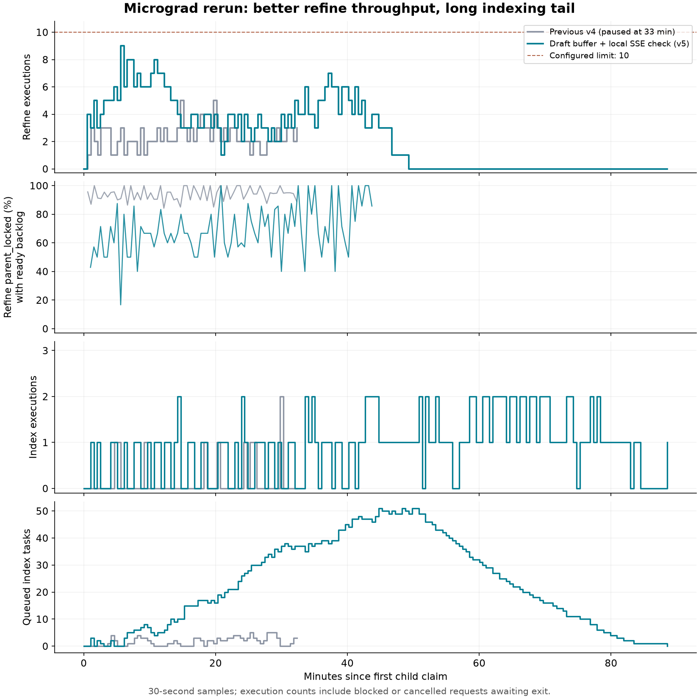

# Parse 模型正文草稿与 SSE 续租解耦验证

日期：2026-11-07。基线 `dev` / `416abffa`；工作分支 `feat/parse-output-drafts`；[PR #64](https://github.com/owariband/Seekino/pull/64)；[主设计](../../../design/03-product-reassessment/parse-output-drafts-trd.md)。当前执行状态只在[管理工作台](../../../dev/workbench.html)维护。

## 改善与实际接入

正文原来只在 Gateway 内存中收集。本次由 `bootstrap → ParseUsageService.capture_video → ParseOutputDraftService` 接入，观察 HTTP Chat Completions / Responses 正文，按调用 UUID 独立累积并保存 `parse_model_output_draft`。新增未保存正文达到 1,024 UTF-8 字节时写累计快照，调用退出时保存余量和终态；非流式响应只能在收到完整正文后保存。没有新增计时器，reasoning、工具参数、prompt 不混入正文。

模型生成入口的 `check_control` 从 `manager.check_active` 改为 `manager.raise_if_cancelled`。原前者会沿 `_require_*_active → queue._heartbeat_child` 锁父行并更新子任务租约；后者只检查本地取消。调用接纳、独立周期心跳、工具边界以及正式结果提交继续使用原持久检查。新增草稿表没有父任务外键，保存只访问草稿表。

草稿按 Server 固定的 tenant/task/actor 归属接收，拒绝模型上下文覆盖身份；重试和 refine generation 有独立调用 ID 与相关元数据。数据库保存失败保留正式模型调用，并停止本次调用的中途写入重试，退出时最多再试一次。草稿 `completed` 不能当作整个 Parse 已通过业务校验或已提交。

## 对照实验

测试 `test_real_sse_checks_draft_thresholds_and_lease_access_counts` 使用真实 OpenAI SDK、HTTP MockTransport、隔离 SQLite 和正式 Server 草稿作用域，喂入 65 段正文（64 × 32 字节 ASCII + 3 字节中文）。两组都启用同一草稿实现，只替换旧/新控制回调，隔离回调对租约访问次数的影响。

| 指标 | 旧持久检查回调 | 新本地取消回调 |
| --- | ---: | ---: |
| 模型接收路径额外持久检查 | 69 | 0 |
| 调用接纳检查 | 1 | 1 |
| 显式模拟周期心跳检查 | 1 | 1 |
| 总持久检查 | 71 | 2 |
| 草稿保存快照（字节） | 1,024 / 2,048 / 2,051 | 1,024 / 2,048 / 2,051 |
| 正式收集到的正文 | 相同 2,051 字节 | 相同 2,051 字节 |

69 包括逐 SSE 事件检查和接收器入口/退出检查；不能把它直接写成 69 个 token。该实验测量函数引发的持久检查次数，不是线上 SQL 延迟、持锁时长或吞吐基准。草稿保存三次中，前两次状态为 `streaming`，最后一次为 `completed`；未满阈值时数据库没有提前出现新前缀。

## 验证结果与复跑

使用仓库已有 Python 3.12 虚拟环境。最终 **941 passed，64 warnings，25.68 秒**；告警来自已有 SQLite expression index reflection 和 Starlette/AnyIO 弃用提示。原始日志在实施 worktree 的 `outputs/verification/parse-output-drafts-20261107/pytest.txt`，未将运行输出提交 Git。

推送时 `dev` 已前进至 `c3a79cbe`，整合后保留双方设计、devlog、问题和工作台卡片；冲突仅发生在这些追加文档，Parse 实现无冲突。上游另有认证修复，因此追加运行 `tests/server/test_auth.py tests/server/test_bootstrap.py -m 'not live_agent' -q`：**150 passed、7 skipped、16.80 秒**，日志为同目录 `integrated-dev-pytest.txt`；跳过项不计为通过。

```bash
python -m pytest \
  tests/server/test_parse_output_draft.py tests/server/test_parse_model_streaming.py \
  tests/server/test_video_parse_model_calls.py tests/server/test_database.py \
  tests/server/test_base_model.py tests/gateway/test_sse_proxy.py \
  tests/gateway/test_model_streaming.py tests/gateway/test_model_events.py \
  tests/gateway/test_kimi_streaming.py tests/agent/chat/test_streaming_delivery.py \
  tests/server/test_chat_streaming_trace.py tests/server/test_parse_usage.py \
  tests/server/test_video_parse_worker.py tests/server/test_video_summarize_service.py \
  tests/server/test_video_summarize_persistence.py tests/server/test_bootstrap.py \
  -m 'not live_agent' -q
```

覆盖 1,023/1,024 字节边界、中文跨阈值、超大单增量、空正文、退出余量、失败/取消前缀、持久失败后不逐 token 重试、并行线程调用、嵌套作用域及租户/任务归属、不可回退或替换前缀、独立表 SQL、重复建表和 MySQL LONGTEXT/no-FK DDL。Gateway 测试覆盖流式、非流式、仅终态正文以及断流/不完整响应；Server worker 和 Summary 回归覆盖既有取消、租约、提交与失败恢复行为。

首次回归发现非流式新增观察会被 Chat 当成实时增量。修复位于 `SupervisorRuntime.accept_text_delta`：`before_completion=false` 走原有完整正文交付，不生成伪实时来源；两条既有非流式/回退用例保持原断言并通过，未将失败测试改成新行为。初版新测试还有 JSON 字节预期和 Summary fixture 错误，已按真实输出修正后重新执行。

## 部署与验证边界

初次交付通过隔离 SQLite 和 MySQL DDL 验证。当时新增表由 `init-db` 显式创建，原任务仍处于暂停状态。后来分别做了草稿版整集重跑和合并版短回放，所用版本和实测结果见下文。

未暴露通用正文事件的 SDK/CLI 路径不支持中途草稿，工具参数与 reasoning 不在本功能范围。硬杀进程只保留最后成功快照；新增草稿不用于自动续写或正式结果恢复。本轮没有新增 UI/API 展示入口或自动清理任务；每次写入会重写该调用累计正文，其单调用写入放大需在真实负载中测量。

## 与 #70 合入 dev 时的 MySQL 验证

2026-11-07，使用独立 MySQL 8.4.13。初版首次创建草稿表成功，第二次执行 `init-db` 的 schema 检查报 `parse_model_output_draft.text.type`。MySQL 实际列和 SQLAlchemy 反射对象都是 `LONGTEXT`，后者没有继承通用的 `Text` 类型。原检查要求两个类型同时匹配。修复后按数据库方言选择预期类型。真实 MySQL 用例覆盖重复初始化成功、普通 `TEXT` 仍会被拒绝。两条 PR 的联合回归为 1,548 项通过，另有 31 项真实 MySQL 用例通过。

升级试验从已合入的 [PR #70](https://github.com/owariband/Seekino/pull/70) 创建一条测试任务，用含 #64 的代码连续初始化两次。既有任务可领取。把已录制的第 3 集两个请求经 SDK、解析控制回调与草稿服务回放，任务、租约、用量和草稿都写入独立 MySQL。

| 请求 | SSE 事件 | 取流期间父行加锁 / 续租更新 | 草稿中途保存 + 结束保存 | 最终 UTF-8 字节 |
| --- | ---: | ---: | ---: | ---: |
| understand | 2,249 | 0 / 0 | 7 + 1 | 7,833 |
| refine | 6,822 | 0 / 0 | 23 + 1 | 23,699 |

每次中途保存前均至少新增 1,024 字节。两个终态草稿均与对应原始输出的 SHA-256 匹配，并与同一次调用的用量记录关联。此处验证合入后的数据库和流处理行为，整集耗时仍需在加载合并版本的服务上测量。

<a id="micrograd-v5"></a>
## 11 月 7 日的 micrograd 整集重跑

隔离实例保留了暂停的 v4，用同一部 `01 - Building Micrograd.mp4` 创建 v5。原片长 145 分 51.876 秒，任务 ID 为 `68602d50-8da7-4d68-982e-0550ce7f8e6c`。两次解析配置的 SHA-256 相同。理解、细化、索引上限各为 10。理解和细化通过 Responses SSE 调用 DeepSeek Flash，索引用本机 Qwen3-Embedding 0.6B 的 1,024 维向量。重跑复用了全片语音识别和说话人缓存。[配置指纹、阶段耗时与数据库终态](parse-output-drafts-live-20261107/summary.json)

| 里程碑 | 从任务开始算起 | 核对结果 |
| --- | ---: | --- |
| 全部理解完成 | 22 分 47.118 秒 | 146/146 块 |
| 全部细化完成 | 50 分 59.793 秒 | 144/144 个窗口 |
| 父任务完成 | **90 分 04.884 秒** | 146/146 块索引为当前版本，子租约全部释放，摘要已完成 |

新加坡时间 01:04:25.270 开始，02:34:30.154 完成。各阶段并行，最后一个细化窗口完成后又过了 39 分 05.091 秒。整集计时取父任务的起止时间，最后一条索引执行记录比父任务晚写入约 1.7 秒。接口另记了 81 分 43.617 秒的有效处理时间，当时 `processingTimingComplete=false`。

### 草稿保存和细化并发

326 份正常完成的草稿共 4,017,136 字节，88 份取消草稿保留了共 824,146 字节的正文。414 份都能关联到同一次调用的 `model_usage`。结束时没有遗留的 `streaming` 草稿或保存失败告警。采样期内，隔离库共写入或更新草稿 4,932 次，约每秒 0.916 次。上面的流回放另行检查了每次中途保存时新增的字节数。

| 有任务待领取时的采样 | v4（约 33 分钟后暂停） | v5 |
| --- | ---: | ---: |
| 约 33 分 36 秒时已完成的细化窗口 | 71 | 116 |
| 有细化积压时，因父行锁跳过的领取比例 | 94.11% | 70.27% |
| 正在执行的细化数，按时间加权 | 2.30 | 4.42 |
| 正在执行的细化数，峰值 | 5 | 9 |
| 有索引积压时，因父行锁跳过的领取比例 | 94.30% | 86.70% |
| 每轮回收过期租约的平均耗时 | 281 ms | 1,901 ms |

14 次随后取消的细化执行各占用槽位约 600 秒，合计 140 分 02 秒，占细化槽位总用时约 68%。等待网络退出的时间也在其中。v5 运行时还有其他聊天请求，后台仍在扫描 v4 暂停后留下的约 48 MB 数据。更早的 v2 用了 155 分 16 秒，当时索引上限为 1。这些负载有差异，此次没有同条件的质量、费用或长期吞吐对照。



### 索引收尾的 39 分钟

在这次运行的版本上，`reap_expired` 汇总状态时持有父行锁。整行读取和深拷贝带进了 146 个块的 104,550,235 字节详情，其中向量缓存占 101,877,643 字节。队列还扫描了 5 个已暂停的旧任务。索引收尾的一段五分钟里，592 次采样有 507 次看见父行锁仍由事务持有。任务结束后交替读取同一批 146 行，完整读取的三轮中位数为 1.549 秒，只读状态所需字段为 5.16 毫秒。该对照只计读取步骤。全程 4,520 次 embedding 调用累计 191.423 秒，每次完整索引执行则平均 31.64 秒。现有采样无法把 39 分钟逐项分摊到数据库、ES 和模型。[三轮读取对照](parse-output-drafts-live-20261107/aggregation-read-benchmark.json)

三条长请求在一秒内收到首段正文，后来在相邻窗口提交的同一秒停止收到新内容。原始日志缺少逐次取消开始、读线程退出和槽位释放的对应时间。用真实 SDK 和本地 HTTP、HTTPS 服务另做了 8 项对照，把请求总超时设为 2 秒。先关闭流再中断读取时，取消返回后读线程约 1.847 秒才退出。先中断套接字时，读线程在 0.112–0.296 毫秒内退出。真实任务另记了 81 次 `refine_request_superseded`，这个计数只含已排空的请求。88 份取消草稿按模型调用计数，14 次长占用按细化执行计数。[取消实验回执](parse-output-drafts-live-20261107/cancel-repro-summary.json)

### 这次使用的调度探针

隔离实例运行 `50c0f621`，另外加载了本地 `perf/parse-claim-diagnostics` 的 `fe1fe70f`，并为心跳事务加了持锁计时。探针记录任务未被领取的原因，每 30 秒汇总事件循环延迟、执行器压力和父行锁等待。这个提交记录了关掉探针时 446 项定向测试通过、打开时 328 项通过。装入草稿版后另跑了 361 项，追加心跳观察后跑了 138 项，两组有重叠。后来的调度改动已在 [PR #70](https://github.com/owariband/Seekino/pull/70) 合入。本报告的并发和锁读数来自上述隔离实例。[运行提交与诊断补丁指纹](parse-output-drafts-live-20261107/diagnostic-source.json)

原始任务、执行账本、采样日志和复现命令保存在本机 `outputs/verification/parse-output-drafts-live-20261107/`。当时首个 SSE 的限制为 100 秒。流中断后，草稿保留已收到的正文，恢复时从已提交的输入重新执行该窗口。此次整集重跑未达到稳定 10 路或 60 分钟的目标。
