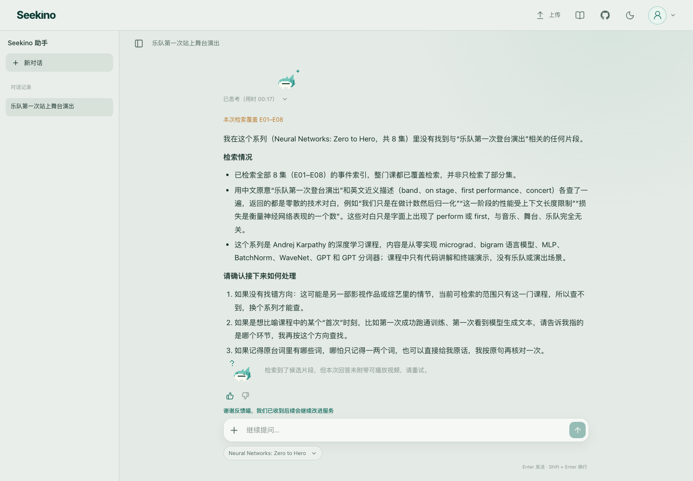
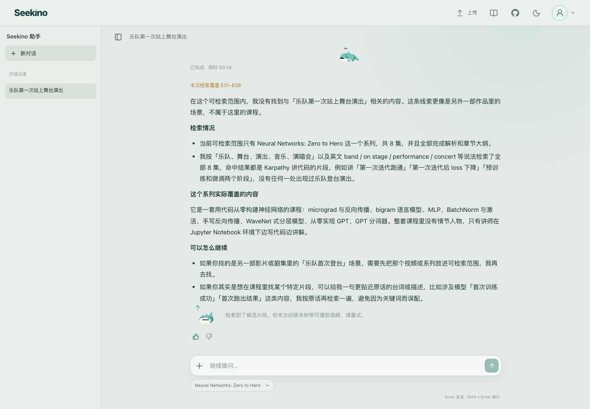

# 消息级用户反馈：CPU 服务器上线记录（2026-11-15）

关联 [TRD](../../../design/03-product-reassessment/message-feedback-trd.md) 与
[PR #175](https://github.com/owariband/Seekino/pull/175)。本记录只覆盖本次发布与生产
冒烟；真实流量试点结论不在此处提前给出。

## 1. 发布内容

| 项目 | 值 |
| --- | --- |
| 源码提交 | `74cb3c96101ea20ff122f74838a9266313e618c1` |
| API 镜像 | `seekino-api:message-feedback-74cb3c96`（`sha256:a47bf7b3fc84e8844be8bb759213eeb2d267d6409218b99ffe9943592bab4117`） |
| Web 镜像 | `seekino-web:message-feedback-74cb3c96-20261115`（`sha256:dca306b67be316ee94e3456cbc64b56f89583d36a537e5db152dddc80d4f5a6f`） |
| 基础镜像 | API `seekino-api:jev-realtime-7b990dd8`；Web `seekino-web:main-d0844554` |
| 发布时间 | 2026-11-15 10:29:43（Asia/Shanghai） |
| 回退 | `/home/ubuntu/seekino-cloud-runtime/releases/message-feedback-74cb3c96-20261115/rollback` |

API 只叠加本次变更的 8 个 Python 文件；这些文件在基础镜像中的 SHA-256 与
`80cd796b` 完全一致，发布文件与本地提交逐项校验一致。Web 从 `origin/main`（`d0844554`）
加上本功能的运行时改动重新构建，避免把 dev 上尚未发布的页面一起带上生产。

## 2. 数据库迁移

- 先备份 `seekino_production` 到
  `/home/ubuntu/seekino-cloud-runtime/backups/seekino_production-before-message-feedback-20261115.sql.gz`
  （398 MB，`gzip -t` 通过；备份时 `agent_message` 190 行）。
- 在 MySQL 8.4 测试库上先执行迁移，核对建表结果与重复执行保护。
- 生产库执行 `docs/migrations/20261115_agent_message_feedback.sql`：新增
  `agent_message_feedback`，16 列、0 行；迁移后 `SHOW CREATE TABLE` 与 ORM DDL 一致。

## 3. 生产验证

环境：`https://seekino.hypn0s.cloud`，游客身份，真实模型调用。

| 验证项 | 结果 | 证据 |
| --- | --- | --- |
| 公共页面与资源 | 首页 200，新构建的 `SearchPage-7CqMlbB0.js` 200 且包含反馈文案 | HTTPS 请求与静态资源检查 |
| 未认证接口 | `PUT /api/agent/messages/feedback` 返回 `401 AUTH_REQUIRED`，不是 404 | 路由已装载 |
| 真实回答 | 游客提问后 17.9 秒出现 👍/👎 | 未构造消息 |
| 正向反馈 | `PUT` 返回 200：`{"rating":"UP","reasons":[],"comment":null,...}` | API 响应 |
| 数据库留存 | 表内 1 行；`message_version=13`、`model=deepseek-flash`、`message_status=COMPLETED`、`phase=RESPONDING` | MySQL 查询 |
| 致谢时效 | 致谢出现，4.8 秒后不可见 | 截图与 DOM 检查 |
| 刷新回显 | 页面刷新后 `aria-pressed=true` | 第二轮回读 |
| 撤销 | `DELETE` 204，`aria-pressed=false`，表内 0 行 | API 响应与 MySQL |
| 发布完整性 | API/Web 健康，其余 4 个容器 ID、镜像、启动时间未变；`/healthz` 200；10 分钟日志无错误 | 发布脚本 `activation.json` |
| 测试数据清理 | 两轮游客对话及其消息已删除，反馈表 0 行 | MySQL 计数 |

说明：示例问题命中了游客当前选择的 Karpathy 课程范围，回答明确说明没有找到乐队片段；
这里验证的是反馈入口、持久化与清除，不评价该次回答质量。

## 4. 未验证与后续

- 本次只做了 1 条正向反馈冒烟；负向原因、失败回答「报告这个问题」在生产的真实路径未点击。
- 反馈写入 p95、真实覆盖率、失败反馈数、聊天延迟对照均未测，需按 TRD 观察两周。
- 生产目前运行的是热发布镜像；`main` 尚未包含本功能，需要按发布流程补 main release PR。
