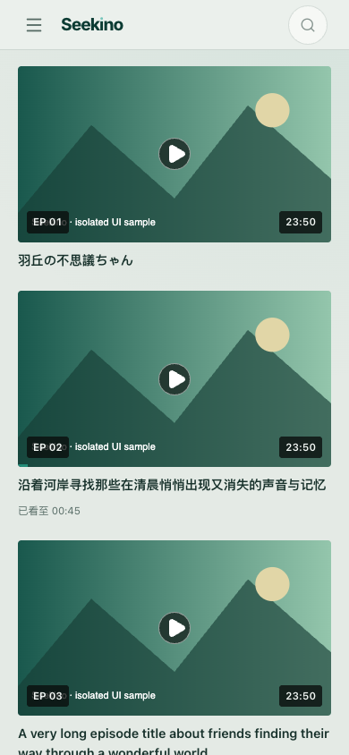
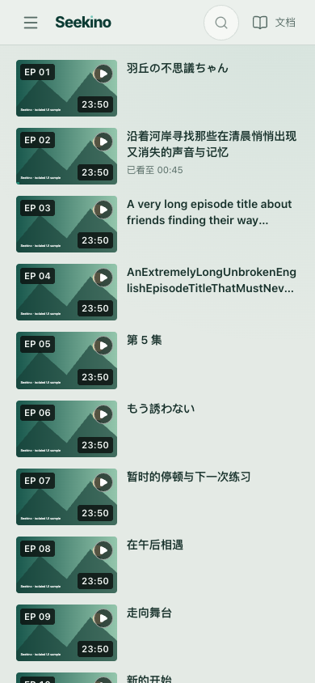

# 移动端文档入口与选集密度：2026-11-12 验收

[PR #129](https://github.com/owariband/Seekino/pull/129) · [TRD](../../../design/03-product-reassessment/mobile-docs-episodes-trd.md) · [工作台](../../../dev/workbench.html) `MOBILE-UI-01`。

当前方案：手机顶栏只显示书本图标，展开的导航内显示“使用文档”；侧栏240ms滑入、180ms滑出，遮罩同步淡变。系列选集在760px及以下使用左图右文紧凑行，761px以上沿用原网格。保留青瓷色板、Hero、排序、原播放链接、观看位置与不可播放状态；`SeriesPage.tsx`、API、持久化和媒体时间合同没有修改。

<a id="icon-and-drawer-motion"></a>
## 第二轮：纯图标入口与导航抽屉运动（当前方案）

本地预览后，反馈明确顶栏不需要“文档”短文字，文字只保留在展开导航内；此前的外显短标签方案撤销。导航抽屉原来没有进出过渡，关闭又立即卸载内容，直接加滑出CSS会出现空白面板，因此本轮同时处理视觉与内容生命周期。

再次请求OpenRouter `anthropic/claude-opus-5.5`，返回模型精确匹配，完整设计见[顾问原始输出](opus-motion-design.md)，[调用元数据](opus-motion.json)记录23,772 tokens、$0.222。采用240ms、`var(--ease-out)`的左侧进入和180ms、`cubic-bezier(.4,0,1,1)`的退出；遮罩透明度0↔0.35同步变化，不对每个菜单项另加动画。原生dialog配合`@starting-style`和`display`/`overlay`离散过渡保留退出期间的top layer，这与[Chrome官方dialog动效指导](https://developer.chrome.com/docs/modern-web-guidance/guides/ui-behaviors/animate-to-from-top-layer)一致。

实际实现采用一个`drawerMounted`标志保留退出内容，关闭时根据真实transform CSS transition的`Animation.finished`清理；没有过渡或减少动态效果时立即清理，取消也会收敛。旧回调检查dialog仍关闭且没有新的transform过渡，避免快速重开时卸载新内容。手机账号区不再输出桌面专属固定ID，原生焦点、Esc、背景与路由关闭、会话查询启用条件保持不变。顶栏移除短标签及闲置翻译，保留原`aria-label`/`title`和44×44点击区域。

| 本轮检查 | 实际结果 | 证据 |
| --- | --- | --- |
| 顶栏文档 | 仅图标，44×44px；文本为空，可访问名称和title保留；抽屉内显示文字 | 320/390px回归；[9场景布局原始记录](icon-only.json) |
| 进入中间帧 | 240ms，320px宽面板在半程采样时X=-21.0893px，遮罩alpha=0.325，内容存在 | [动画帧记录](motion-results.json) |
| 退出中间帧 | 180ms，采样时X=-103.941px，遮罩alpha=0.235；关闭状态仍保留内容，结束后卸载 | 同上 |
| 原有功能与重开 | Esc/遮罩/关闭按钮/路由/历史切换、焦点与草稿、桌面账号ID唯一、退出中途重开均通过 | 12项浏览器回归 |
| reduced-motion | 面板与backdrop时长均为0s，无运行动画；关闭后内容卸载 | 专项浏览器用例 |
| 选集与桌面护栏 | 原9场景结果保持，390px每集70.19px，13集1080.44px；桌面网格不变 | [本轮布局记录](icon-only.json) |

验证使用production build与本机Chrome。76项相关单测、typecheck与build通过；定向浏览器12 passed、0 flaky。新动画用例最初在页面尚未稳定时用`evaluate`程序化点击失败；改为等待可观察的首屏数据和Playwright locator点击，再暂停真实过渡采样，原有半程/内容/重开断言全部保留。失败trace与完整原始报告留在`outputs/verification/mobile-docs-episodes-20261112/`，[摘要](motion-results.json)保留实际帧值和12项结果。

最终合入最新dev `55d81fb3`，保留#131选定的新版深色配色与#132的Hero衔接修复，保留全部上游卡片和文档。76项单测、类型/构建、12项浏览器回归与9场景再次通过；运动采样及几何记录逐项相同，本轮深色截图已按最新配色刷新。

本机[4190预览](http://127.0.0.1:4190/watch)已提供本轮构建，用户可刷新检查。尚未验证Safari、Firefox或iOS/Android真机；不支持这些CSS能力时的浏览器行为也未实测，不声明全部浏览器均有动画效果。未部署Cloud或合并PR。


下方为首轮短文字方案及其原始证据，保留历史，不作为当前顶栏外观。

## 同条件结果

基线为 `ec17a0fc` 的 production build，首个 TRD 提交 `16ac35bc` 未改源码；方案为本分支的 production build。两者使用同一份 13 集隔离样本、Chrome 157.0.8103.51、844px 视口高度和同一组字体。样本包含中文、日文、英文长标题、无空格英文长标题、无正式标题、一个已看位置与一集无封面且不可播放的条目。全部 API 经过浏览器拦截，无真实数据库、模型或业务服务请求。缩略图是明确的测试插图，不是实际片源效果。

| 390px 中文浅色指标 | 基线 | 修复后 | 结论 |
| --- | --- | --- | --- |
| 顶栏文档可见性 | 隐藏，需先展开菜单 | 文字和图标直接可见，点击进入 `/docs` | 达到预设目标 |
| 文档点击区域 | 不可见 | 69.52 × 44 CSS px | 达到 44 × 44 下限 |
| 单集高度 | 227.48–254.33 CSS px | 70.19 CSS px | 达到 ≤100px 目标 |
| 13 集列表总高 | 3342.20 CSS px | 1080.44 CSS px | 减少 67.67%，超过预设 50% |
| 600px 列表窗口完整条目 | 2 集 | 7 集 | 超过预设至少 5 集 |
| 缩略图 | 350 × 196.88 CSS px | 124.80 × 70.19 CSS px | 保留 16:9 |

“600px 列表窗口”从首行顶边计算，不含全站顶栏、剧集标题、Hero 或浏览器工具栏；不是对真机首屏整页可见数量的承诺。总高减少量计算为 `1 - 1080.4375 / 3342.203125`。

共 9 个场景：320、390、430、760、761、1280px 的中文浅色；390px 英文深色、中文深色、英文浅色。手机行高为 63–72px，文档入口可直接导航，中文短标签与英文 Docs 均可见；所有场景无横向页面溢出、JS 异常或意外 API。761px 仍为 3 列，1280px 仍为 4 列，两个桌面样本的列表总高与每行尺寸逐项等于基线。原始测量见 [baseline.json](baseline.json)、[fixed.json](fixed.json)。

| 基线：390px，测试插图 | 修复：390px，测试插图 |
| --- | --- |
|  |  |

[英文深色截图](after-390-en-dark.png)。完整宽度截图保留在本工作树 `outputs/verification/mobile-docs-episodes-20261112/`。

## Claude mini 源码指导与采用范围

以下代码为首轮历史方案；本轮已删除`docsLabel`及短翻译，当前图标入口与CSS运动设计见上方第二轮和[顾问输出](opus-motion-design.md)。

按请求使用 OpenRouter `anthropic/claude-opus-5.5`，两次响应的返回模型都精确匹配，没有切换模型。首轮输入为六张用户截图与 `AppShell.tsx`、顶栏 CSS、`SeriesPage.tsx`、选集 CSS；答复在代码段达到输出上限。第二轮只发送必要 CSS 和已选方案，低 effort 补齐 mini patch。两次共 66,938 tokens（含图片与推理），OpenRouter 报告费用合计 $0.42644；这不是产品运行成本。原始调用元数据见 [首轮](opus-initial.json)、[补全](opus-mini.json)。

采用的核心指导是复用现有 DOM、单独表达文档可见策略，并只在手机断点横向化选集：

```tsx
<NavLink className={clsx(styles.iconButton, styles.docsLink)} to="/docs"
  aria-label={t("使用文档")} title={t("使用文档")}>
  <BookOpen size={20} strokeWidth={1.7} aria-hidden="true" />
  <span className={styles.docsLabel}>{t("文档")}</span>
</NavLink>
```

```css
/* 默认仅视觉隐藏 docsLabel；在手机通用隐藏规则之后恢复这一入口。 */
@media (max-width: 760px) {
  .headerActions > .docsLink {
    display: inline-flex; width: auto; min-width: 44px;
    height: 44px; min-height: 44px; padding-inline: 8px; flex-shrink: 0;
  }
  .docsLink .docsLabel {
    position: static; width: auto; height: auto; padding: 0; margin: 0;
    overflow: visible; clip-path: none; font-size: .8rem; white-space: nowrap;
  }
}
/* 下列规则位于选集 CSS；完整实现以对应文件为准。 */
@media (max-width: 760px) {
  .episodeGrid { grid-template-columns: minmax(0, 1fr); gap: 14px; }
  .episode {
    grid-template-columns: clamp(112px, 32vw, 128px) minmax(0, 1fr);
    grid-template-rows: min-content 1fr; gap: 4px 12px;
  }
  .preview { grid-column: 1; grid-row: 1 / span 2; width: 100%; }
  .episode > strong { grid-column: 2; grid-row: 1; min-width: 0; font-size: .88rem; line-height: 1.4; }
  .episode > small { grid-column: 2; grid-row: 2; align-self: start; min-width: 0; overflow-wrap: anywhere; }
}
```

源码复核后的调整：已有 `"使用文档": "Docs"` 满足英文可见名称，中文可见“文档”也包含在“使用文档”中，因此保留原 `aria-label`，只增加 `"文档": "Docs"` 短标签。顾问提出的 `.64rem` 角标未采用，保留 `.72rem`；EP 放左上、时长放右下、24px 播放圆标放右上，避免碰撞。相同特异性的手机显示规则置于隐藏规则之后，再以两类选择器覆盖后置 container query 的单类按钮尺寸。没有使用顾问示例中的假设翻译路径或重建选集组件。

DS Flash 通过官方 DSH 的 `deepseek-flash` / max 路由只读取证并实施；主 Agent 复核关键源码、最终 diff、实际截图与下述检查。DSH 保存后端未更改。首次因沙箱写会话目录失败、随后发现启动进程缺少凭证；最终仅向任务进程注入项目现有 DeepSeek 凭证，未写入仓库或全局模型配置。

## 验证与复跑

- `npm --prefix web run typecheck`：通过。
- `npm --prefix web test -- src/app/App.test.tsx src/features/player/SeriesPage.test.tsx src/app/i18n.test.tsx`：3 files / 76 tests passed。
- `npm --prefix web run build`：通过，包含 `tsc -b`。
- `mobile-navigation.spec.ts` 的 6 项新增回归与 2 项原有导航回归：8 passed，包括默认首页、助手导航、抽屉焦点、草稿保留、44px 文档入口、紧凑行与桌面网格。
- 独立同条件浏览器对照：基线 9 个场景、方案 9 个场景，方案断言全部通过；桌面尺寸另逐项与基线核对。
- `git diff --check`、本次新增的相对文件链接、TRD 六流程、工作台 JSON 与本次改动范围：复核通过；历史材料中的既有归档链接未扩大到本次修复。

交付前合入最新 `dev`（`924415f7`，包含片内视觉与智能查找），保留上游全部工作台卡片与设计/devlog/问题记录；只需解决索引追加和更新时间两处文档冲突。上述76项单测、类型/构建、8项浏览器回归与9场景尺寸检查已重跑通过，尺寸原始记录与合入前逐项相同，保留的390px中浅/英深截图字节也相同。当前PR没有自动GitHub检查；仓库CI为面向main的手动流程，本地通过未记为CI通过。

本机 Playwright 缺少绑定版本的 Chromium 包，未下载安装；测试使用已安装的系统 Chrome，临时配置只覆盖 `channel`、preview 端口和输出目录，项目 Playwright 配置未改。定向回归可在本机安装匹配浏览器后按原配置运行：

```bash
npm --prefix web run build
npm --prefix web run test:e2e -- mobile-navigation.spec.ts \
  --grep 'docs entry|13 episodes|original four-column|keeps focus in the drawer|keeps watch as the home'
```

同条件尺寸脚本为 [verify.mjs](verify.mjs)，参数依次为仓库绝对路径、已构建的 dist 绝对路径、输出目录和 `baseline` / `fixed`；脚本自建仅回环静态服务，全部 API 使用隔离样本。`fixed` 模式检查预设验收条件，`baseline` 模式仅记录现状。使用相同脚本分别加载基线与方案构建即可复跑。

## 证据边界

已完成源码实施、类型/相关单测/构建、隔离浏览器与截图复核。未执行全量前端单测或全量 Playwright；没有连接真实 Cloud、验证实际视频播放或进行 iOS 内嵌浏览器、Safari、Android 真机测试。主观外观由用户结合截图评审。未合并、未创建 `main` 发布 PR、未重启或部署服务；线上变化需要后续发布验证，当前状态见工作台。
