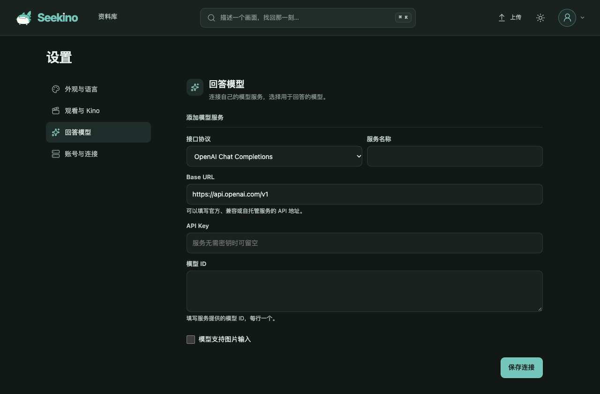
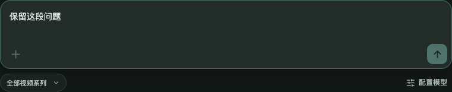
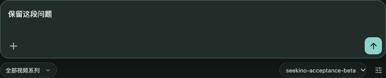

# 个人模型服务的设置与聊天验收

2026-11-07 在本机 5188 网页、19641 API 和隔离的 MySQL 测试库验证。入口在「设置 → 回答模型」。空配置直接展示接口协议、服务名称、Base URL、API Key、模型 ID 和图片能力。界面样式使用 DeepSeek Flash max 生成的 CSS，表单、路由、协议执行和验收由 Codex 完成。[设计](../../design/03-product-reassessment/personal-model-connections-trd.md) · [PR #74](https://github.com/owariband/Seekino/pull/74)

| 验收项 | 结果 |
| --- | --- |
| 浏览器正常入口 | Chrome 从无个人连接开始，切换协议时 URL 示例随之更新；填写自定义地址、虚构密钥与两个任意模型 ID。保存、刷新、编辑、选择第二个模型测试连接、选择第一个模型发消息和删除均成功。添加及选模共创建 0 个聊天，首次发送后创建 1 个聊天 |
| 会话执行 | 对四种协议分别通过真实 API 创建测试聊天、发送消息。回环服务核对对应认证、模型和工具声明，四个聊天均以对应模型名持久化回复并完成。测试连接也分别命中同一端点。验收会话及连接均已清理 |
| 协议合同 | Chat Completions 走 /chat/completions，Responses 走 /responses，Anthropic 走 /v1/messages，Gemini 走 /models/{model}:generateContent。逐协议覆盖工具声明、模型发起调用、带调用 ID 或名称回传工具结果和最终文本；兼容测试另覆盖旧 Chat Completions 令牌字段 |
| 数据与归属 | 个人默认只用于新聊天。两个所有者隔离，过期修改返回冲突，修改凭据目的地要求重新输入或清除密钥。读取设置和历史回复均不回显凭据。删除连接后已完成消息仍支持幂等重放 |
| 布局及回归 | 浏览器验证桌面 1280px、手机 320px；手机无横向溢出。独立前端 612 项单测、17 项相关 Chrome 用例及生产构建通过。Kino 联合工作树 620 项前端单测通过。服务及网关相关回归 412 项通过、1 项跳过 |

供应商验证使用本机可控的 HTTP 服务和测试密钥。未对四家厂商逐一使用付费账户验收。自定义回答模型在收到每次模型调用的完整输出后展示文本。

## 聊天框的个人候选与首次发送

原聊天菜单把部署 YAML 的选项合并进用户候选，导致空账户也看见豆包和 Kimi。修订后，聊天框和会话设置共用按个人连接分组的选择器。Chatbox 对自定义供应商检查其保存的模型，Chatbox AI 自营目录有独立来源。发送判定在缺少模型时返回 block。[供应商过滤](https://github.com/chatboxai/chatbox/blob/d17455c5ca8fd3ff44385c6d4d2118599e4c970f/src/renderer/hooks/useProviders.ts#L20-L52) · [自营目录](https://github.com/chatboxai/chatbox/blob/d17455c5ca8fd3ff44385c6d4d2118599e4c970f/src/renderer/components/ModelSelectorV2/index.tsx#L128-L167) · [发送判断](https://github.com/chatboxai/chatbox/blob/d17455c5ca8fd3ff44385c6d4d2118599e4c970f/src/renderer/components/InputBox/submitAction.ts#L58-L72)

本机 5188 的 Chrome 验收使用此前未保存个人连接的账号。在草稿输入文字后按 Enter，创建会话和消息请求均为 0。点「配置模型」后添加自己的服务和两个模型 ID，选第二个并关闭设置，原文字仍在。显式发送后创建 1 个会话、提交 1 条消息。本机 HTTP 接收器核对了凭据与所选模型，回答在聊天正文显示。新草稿继承该模型，另设个人默认后，新草稿采用新的默认值，已发送会话仍保存原选择。验收数据已清理。

修订后的独立前端 613 项单测通过，含原播放器改动的 kino-entry 621 项通过，构建及 18 项浏览器回归通过。相关服务端回归 397 项通过、1 项跳过。网页外的调用也不能在个人模型模式下使用旧部署 ID 发起新回答。

## 本机 YAML 连接的自动识别与凭据掩码

先前仅将数据库中的个人连接作为候选，本地配置文件里已可工作的 Supervisor 和备选模型在设置页面消失。现在本机账号读取 Gateway 已加载的绑定，按 YAML 的服务来源分组，同时保留网页添加的个人连接。YAML 连接直接复用它的 Supervisor runtime 和参数。个人显式默认和最近使用的有效选择优先，本机没有这两项时直接选用 YAML 默认。云端个人账号不会继承机器的密钥。

在实际 5188 网页和 19641 API 核对了三组来自 YAML 的服务。三组的凭据状态均为已配置，设置卡片显示固定八个圆点。全新浏览器配置下聊天框默认选中 `deepseek-flash`；另两个选项是 `doubao-seed-2-0-lite-260428`、`k3.1-pro`。切换草稿模型，再从聊天返回设置可以看到相同的会话选择。390px 移动视图无横向溢出。浏览器验收的聊天写请求数为 0，未调用付费厂商。

使用合成凭据和模型的测试覆盖以下情况：新增任意名称的生成绑定、重复角色合并、排除重排模型、缺失密钥、未复制密钥到个人数据库、不同所有者及云端隔离、历史引用归一、使用 YAML 原生运行时回答、编辑个人连接时掩码不会写回为密钥。YAML 连接由文件管理，设置页的密钥状态只取自服务端返回的布尔值。

独立前端 616 个、kino-entry 联合前端 624 个单测通过，生产构建和 18 个浏览器用例通过。本轮涉及的服务端与模型配置回归合计 516 项通过，1 项跳过。另有 3 个既有默认配置断言失败，均在改动前的 `6ab9d622` 复现，涉及历史配置等价和仓库默认 Supervisor 类型。

## YAML 写回与 cloud 权限

2026-11-08。隔离测试通过现有 API 改名、增删四种协议的连接、切换新会话默认并重载文件。模拟另一个编辑器保存后，旧修订返回 409。已有环境变量凭证在普通保存时保留，测试密钥经轮换后出现在下一轮的受控目标中，设置响应和 YAML 均不含明文。旧数据库记录通过所有者校验继续供历史聊天读取。

cloud 集成测试使用真实的游客会话和 CSRF，验证模型列表、保存、删除、默认和探测全部返回 403，未认证请求返回 401。管理员可保存。游客正常发送及 SSE 均可完成，历史和流中没有服务的实际模型名。前端测试断言游客输入后可发送，且不会请求模型连接。
