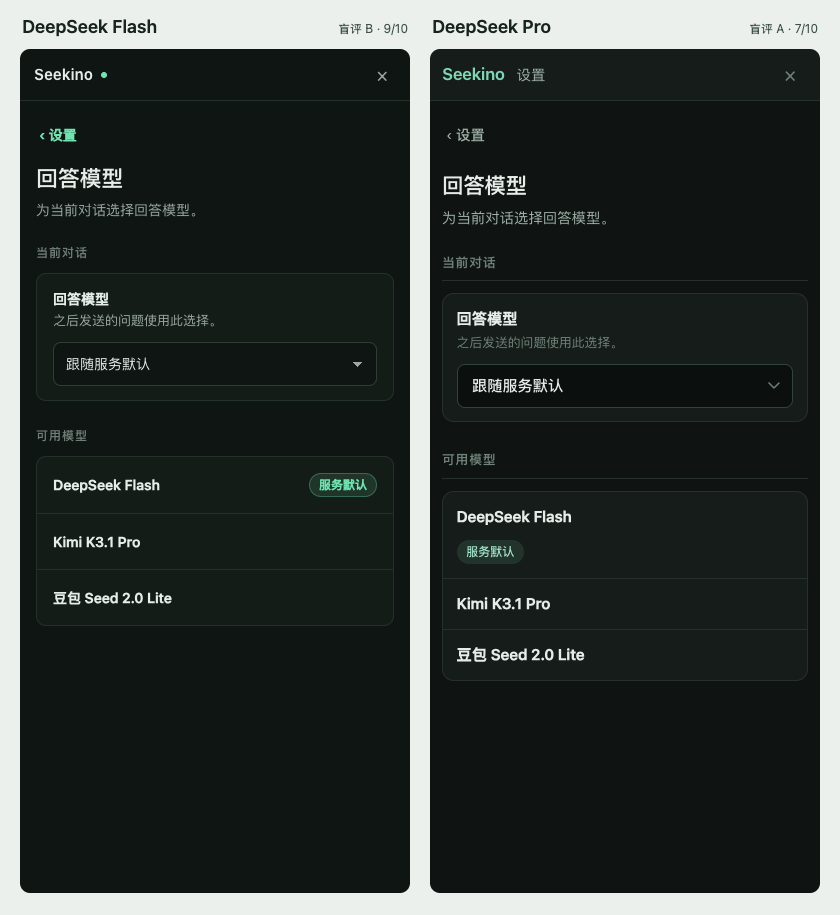

# 设置工作区与 DeepSeek 前端样稿对照

2026-11-07。产品实现基于会话模型 [#68](https://github.com/owariband/Seekino/pull/68)，本轮 [#72](https://github.com/owariband/Seekino/pull/72) 的范围见[设置工作区设计](../../design/03-product-reassessment/settings-workspace-trd.md)。借鉴的设置路由、继承和表单保存方式见[Chatbox 源码对照](../../research/2026-11-07-chatbox-settings-integration.md)。

## 产品验收

Flash 以 OpenCode 受限 worker 的 `deepseek/deepseek-flash#max` 完成设置主体，输入包括已裁去私人历史的 Seekino 欢迎区截图。worker 在 20 分钟时限内写入页面、样式与翻译，未返回最终状态报告。Codex 接入路由和实际偏好，修正了收起设置时 Chrome 重置文字选区的问题，并复核了主题控件的点击范围和真实服务返回的模型。

| 场景 | 核对方式与结果 |
| --- | --- |
| 聊天打开设置再返回 | 5188 草稿中选中文字，进入模型设置选 Kimi，切换到观看设置后关闭。原文字和焦点保留，选区仍为 1–4，聊天菜单仍为 Kimi。全过程聊天写请求 0 次 |
| 设置的生效范围 | 直接访问模型页读取当前服务的候选。从聊天打开时，单选控件调用当前会话的保存方法。普通或无配置权限的用户不读取管理员设置 |
| 设备偏好 | 全局设置保存淡化 1.5 秒并关闭发问暂停。切换到观看页，原浮窗设置读到相同的值。两处沿用旧的浏览器存储键 |
| 响应式与权限 | 桌面支持并排分类和详情。320px 手机下列表及详情可往返且无横向溢出。可配置的 Debug 管理员才能进入 Agent 运行，冲突后保留表单输入，并提示重新读取 |
| 自动化 | 独立分支 611 项前端单测通过，本地 Kino 联合版本 619 项通过。生产构建通过。18 项与聊天、设置、语言及移动导航相关的 Chrome 用例通过 |

在 5188 联合版本的完整 Chrome 套件中，18 项通过，两项游客公开目录用例仍失败。这两项已在上游变更前复现，见[上游基线记录](chat-composer-models-20261107.md)。

服务端模型连接、凭据和绑定继续使用已有 YAML。本轮运行参数修改走原有 revision 接口。对话模型测试覆盖选择与持久化合同，本轮线上调用用于设计对照和读图试验。

## 审美对照

采用同一份中文模型设置内容及 HTML，两款模型各生成一份 CSS。两者收到相同的文字输入，包含桌面侧栏范围、颜色、可读性与手机触控要求。由同一版 Chrome 渲染 1280×800、390×844 和 320×680。亮暗主题切换后等待动画结束。评分前用随机 A/B 标签隐藏模型身份。

最初高推理输出经过严格 CSS 校验时未保存完整原稿。再次保留原稿时，Flash 在 12,000 token 上限内没有交付最终 CSS。最终评分采用两者共同关闭思考、温度 0、同一 7,000 token 上限的完整结果。该选项仅用于这次对照，产品实现使用 Flash max。

| 等权项目，每项 0–2 分 | A · DeepSeek V4 Pro | B · DeepSeek Flash |
| --- | ---: | ---: |
| 信息层级 | 2 | 2 |
| 节奏与对齐 | 1 | 2 |
| 文字可读性 | 1 | 2 |
| 品牌与克制 | 2 | 1 |
| 手机可用性 | 1 | 2 |
| **合计，由 Codex 盲评** | **7/10** | **9/10** |

Pro 的品牌字和独立侧栏让桌面分区更清楚。手机上其“服务默认”标签落到第二行，列表节奏断开。Flash 保住了同一行，品牌旁的小圆点并没有交代额外信息。两份在 320px 下都没有横向溢出。实测说明文字在暗色下的对比度分别为 4.25:1 与 7.02:1，亮色下为 3.45:1 与 6.31:1。手机上实测按钮和选择框的最小边分别为 36px 与 44px。

本题选 Flash。样本是一份相同界面、各一份完成稿、一个评分者，结果仅支持本次设置界面的选择。

## 独立读图题

向同一官方 API 的两个模型发送相同的合成 PNG，图中有随机生成的数字和颜色。提示词不包含答案，要求读出中间四位数和右侧圆形颜色。两次调用均为 high 推理，并返回 HTTP 200。Flash 给出 `5581 / blue`，两项均对。Pro 给出两个 null。这里测的是这张图片及本次接入路径，审美评分使用的输入始终只有文字和固定 HTML。

本机原始 CSS、逐视口截图、合成图及读图回答、盲评分和最终模型映射位于 `outputs/verification/settings-workspace/20261107/`。两份正式评分稿分别用 3,557 和 3,373 个总 token，耗时 22.9 秒和 10.9 秒。这是单次观测值。
