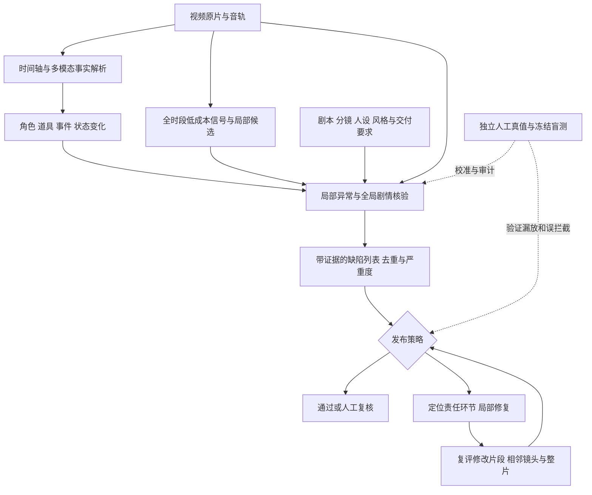

# Seekino 视频解析评测与 AIGC 短剧质量闭环研究

研究日期：2026-10-20。范围：当前工作区源码、用户提供的汽车 AIGC Video_QM 材料，以及联网核验的一手论文/项目。本文是研究和搭建建议；没有运行新的模型质量实验，没有实现评测平台。用户材料中未展示的飞书架构图、错误明细和 infra 图不在可核验范围，文中的架构是建议方案。

**建议先把 Seekino 的“事实解析评测”做扎实，再把它扩展为短剧的“事实—约束—缺陷—修复”闭环。** 最先投入的是独立标注、事件匹配和阶段对照；模型和 Agent 的复杂度由错误分析决定。评测对象至少有四种：解析器、生成视频、质量 Judge、修复策略，四者需要各自的真值和指标。

## 1. 当前项目能复用什么，缺什么

以下是当前工作区的实现事实；它们证明能力入口存在，不证明模型质量已经达标。

| 实现事实 | 证据 | 评测含义 |
| --- | --- | --- |
| V2 统一输出 persons 和 SCENE/ACTION/DIALOGUE/EMOTION/RELATION_CHANGE/ON_SCREEN_TEXT/OTHER 七类稀疏事件；区分 participants 与 visible_persons | [schemas.py](../../engine/parsev2/schemas.py)，30–53、66–153 行 | 可以评“谁在做什么、谁可见、谁说话”，而不是只给整体摘要打分 |
| 对白有 speaker/null、原文/译文、语言、speaker_source；事件时间是绝对整数毫秒，字段名仍为 start_seconds/end_seconds | [schemas.py](../../engine/parsev2/schemas.py)，30–46、74–111 行 | 单独测人物归属、拒答覆盖、台词准确、时间定位；评测适配器必须显式处理单位 |
| Understanding 保存原始 ASR/OCR 证据；Refine 获取成员内容、版本、原始证据与指纹 | [workflow.py](../../agent/video_parse_v2/understanding/workflow.py)，59–81、108–115 行；[video_parse.py](../../server/service/video_parse.py)，1027–1045、1090–1140 行 | 能对照模型结论与证据，也能测不同阶段的净收益；阶段快照需要在实验时单独冻结 |
| 模型、输入模式、FPS、预算等随任务冻结 | [input.py](../../agent/video_parse_v2/input.py)，20–26、105–115、162–178 行 | 可做输入、模型、Refine/声纹开关实验；还需记录代码、Prompt 与评测协议版本 |
| 已有模型调用用量和阶段上下文 | [parse_usage.py](../../server/service/parse_usage.py)，32–42、95–160 行 | 复用成本、阶段、重试信息，不必先新建完整可观测平台 |
| `evals/recall` 使用 parsev1 数据结构，计算 Hit@K 和 MRR，范围止于双路召回与 RRF | [recall_eval.py](../../evals/recall/recall_eval.py)，1–6、21–33、722–788 行 | 它不是 V2 事件抽取 Recall，也不是最终问答质量评测 |
| 检索 smoke 是 EP07 的 12 条查询、60 秒 Chunk，没有负例 | [ep07.recall-smoke.md](../../evals/recall/ep07.recall-smoke.md)，5–11、19–41 行 | 能找回一分钟不能证明事件边界正确；历史样本内调参结果不能充当盲测 |
| 声纹脚本明确区分一致率与准确率；参考标签来源仍可能共同出错 | [voiceprint_algorithm_comparison.py](../../evals/speaker/voiceprint_algorithm_comparison.py)，419–430、456、465–468 行 | 已有导出待标注样本，可作为难例开发集；需要独立人工身份真值 |
| Chat latency 中的 hit 是关键词子串命中 | [chat_latency.py](../../evals/latency/chat_latency.py)，35–64 行 | 时延和关键字出现不能替代回答事实正确、证据充分和时间定位 |

一个已有的面试案例：EP07 的记录中，“乐奈回答演奏经历”的台词存在，但人物归属错为高松灯，对应 Chunk 在两路检索中都排到第 8。它说明上游人物解析会影响下游检索；这是历史个案分析，不能推出整个系统的损失比例。[项目记录](../../evals/recall/ep07.recall-smoke.md)，77–88 行。

当前通用事件 Schema 没有 bbox、轨迹、物理状态、缺陷严重度和经校准的概率。这些是短剧质量检测可能需要的新产物，不能说现有 Parser 已经具备。新增评测时先在离线适配层表达这些信息，等用途验证后再决定是否进入生产合同。

## 2. 评测体系的层次与优先级

| 层面 | 要回答的问题 | 主要指标 | 优先级 |
| --- | --- | --- | --- |
| 输入与证据 | 模型是否有机会看到/听到关键瞬间？ | 关键事件输入覆盖率、音轨/字幕可用性、抽帧/时间映射正确率 | 第一批 |
| 原子事实 | 人物、台词、动作、物体与文字是否解析对？ | 事件 P/R/F1、台词 CER/WER、人物/说话人归属、无证据事实率 | 第一批 |
| 时间与跨片段 | 事件何时发生、先后如何、是否重复或断裂？ | tIoU、边界误差、顺序准确率、跨 Chunk 遗漏/重复、身份漂移 | 第一批 |
| 剧情与长上下文 | 人物关系、意图、因果、伏笔是否有证据？ | 关键剧情点覆盖、关系与因果边准确率、证据支持率、未知拒答 | 第二批 |
| 检索与回答 | 已解析信息是否被找到并正确用于回答？ | Hit@K、真正的 Recall@K、MRR/nDCG、引用正确率、无答案题表现 | 保留并升级 |
| 生成视频质量 | 画面、动作、声音、剧本实现、叙事是否可接受？ | 分类型缺陷 P/R、严重缺陷漏检、误拦截、偏好胜率 | 短剧扩展 |
| Judge 质量 | 评测器是否可靠、稳定、会拒判？ | 对人工真值的 P/R、校准、重复运行稳定性、风险—覆盖曲线 | 与 Judge 同时建设 |
| 修复与发布 | 修复是否有效，是否值得继续生成？ | 原缺陷修复率、新缺陷引入率、整片人工通过率、单位成片成本 | 闭环阶段 |
| 工程运行 | 实验是否可回放、系统能否稳定执行？ | 完成率、重试率、p50/p95、每视频分钟费用、版本可追溯 | 全程 |

事实抽取要按任务定义“必须覆盖的关键事件”。稀疏事件解析没有必要枚举每一帧的所有细节；先冻结标注边界，再计算 Recall。主观情绪、表演自然度和“是否精彩”应有评分锚点与多人意见，不强行作为唯一客观真值。

## 3. 视频解析优先测什么

**第一组是“台词—说话人—可见人物—时间”的联合正确性。** 建议覆盖反打镜头、画外音、电话、多人插话、歌声、短台词、别名与稀有人物。ASR 的匿名 speaker1 不天然跨片段对应同一人；画面中的人也不必然是说话者。独立标注原文、可归因人物、可见人物与起止时间。报告所有可归因台词上的正确归属率、归因覆盖率、已归因集合准确率、null 比例及人物宏平均，防止用大量拒答换取漂亮准确率。若还要评 ASR 分段/聚类，另测 DER 等指标并冻结重叠语音、边界容差等协议；不要把聚类分数当角色命名准确率。

**第二组是关键事件与幻觉。** 标注“人物 A 将物体交给 B”等原子事实，允许同义改写，要求主体、动作/关系和时间一致。人物动作直接观察、台词声称、上下文推断、不可确定应分开。对白说“我杀了他”不能自动变成画面发生杀人。推断可合理但必须有证据，未知不能填成确定。

对生成视频还要加入“反常但真实出现在画面中的事实”。物体无故消失时，解析器应忠实记录可见变化，不能按常识补成“放进了口袋”。VideoHallu 专门以违反物理/常识的合成视频做负对照，说明自然视频理解表现不能直接代表异常生成视频理解能力。[VideoHallu 论文 v4](https://arxiv.org/abs/2505.01481v4)

**第三组是时间与连续性。** 对持续事件用 tIoU（预测与真值区间交集长度 / 并集长度），同时报起止误差；对极短/瞬时事件用预先约定的时间容差；对跨镜头矛盾保存两个或多个不连续证据区间。先看事件是否对，再看定位是否准。边界误差只对成功匹配事件计算，因此必须与漏检数同时报告。长区间覆盖整个视频不能算精确定位。

事件级建议规则：类别/语义相容、主体匹配、时间满足类别阈值后，做最大匹配的一对一分配。每个 GT 最多贡献一个 TP。在预先声明的完整金标覆盖范围内、且标签已裁定时，未匹配预测记 FP，未匹配 GT 记 FN；覆盖范围外或待决报警先人工复核。同一真实问题拆成十个报警不能拿十个 TP。跨 Chunk 的一个事件先按固定规则归并或分段对齐，再评分；原始重复率另报。初期可并列 tIoU=0.3/0.5/0.7 观察敏感性，最终阈值在开发集确定，不能在盲测集选最好数字。

**第四组是阶段净收益。** 对同一份独立 GT 冻结 Understanding、Refine 后和 Prefix 后的结果，配对比较：

```text
修正收益 = 原来错误、后来正确的事实数
误改损失 = 原来正确、后来错误的事实数
共同事实集合上的修正净收益 = 修正收益 - 误改损失
```

遗漏或删除原有正确事实也计为损失；新增正确事实、新增幻觉另行统计，并报告重复事件、时间定位和成本。上述纠错净收益不等于整个阶段的总质量收益。不能把被覆盖后的数据库当前值当成全部阶段历史。总 F1 上升也可能掩盖稀有人物或关键剧情回退。

**第五组是采样是否真的保留了时序证据。** 比较固定低 FPS、提高 FPS、边界重叠、候选窗口加密、原生视频与帧序列，在固定预算和不固定预算两种条件下画质量—成本关系。请求中的 FPS/帧数不等于供应商实际看完所有帧，能记录实际输入清单时要保留。短动作要单列时长分桶，统计采样是否覆盖了足够的前后状态。

仅字幕、单帧、乱序、去音轨是诊断对照。只有依赖相应模态/顺序的问题才应随移除或打乱而退化；不要要求所有任务都下降。帧乱序后原始时间戳、字幕顺序也可能泄露答案，需控制这些旁路；变换可能改变标签，要人工核验变换后的正确答案。TVBench 的重要启发是测试题本身也要验证是否能被单帧、语言先验绕过。[TVBench 作者项目](https://daniel-cores.github.io/tvbench/)

## 4. 汽车 Video_QM 方案可以借鉴什么

可以迁移：按错误类型建设数据；用低成本信号提出候选时间窗；到局部窗口复看高密度画面和音频；用主体与时间合并报警；保留排除理由；让人工仲裁结果进入后续开发集。

需要针对短剧调整：

| 汽车方案经验 | 短剧中的迁移 | 必须控制的混淆 |
| --- | --- | --- |
| 部件结构、车门开合 | 人物肢体、手与道具接触、穿模 | 遮挡、镜头裁切、夸张动画风格 |
| 车辆漂移/消失 | 人物位置、道具持有、服装与伤势连续性 | 合法切镜、时间跳跃、梦境/闪回 |
| 上车—入座—下车行为链 | 拿起—递出—接住、拔刀—接触—受伤等交互链 | 不可见的中间步骤不能自动判违规 |
| Logo/品牌核验 | 人脸/角色造型、屏幕文字、指定服装道具 | 压缩与缩放、视角变化、参考素材是否授权且明确 |
| 声音/配音漏检 | 台词、音色、口型、声画事件同步、音乐遮盖对白 | 旁白、内心独白、画外音、离屏角色 |
| 长链叙事漏检 | 人物知情状态、动机、因果、伏笔、关系变化 | 剧本未提供与明确违背剧本是两种情况 |

全时段覆盖不意味着每个大模型每帧处理。便宜的解码/亮度/重复帧/音频信号可以广覆盖；昂贵的跟踪、分割与 VLM 根据实验选择帧率、窗口和触发条件。像素突变、轨迹断裂是候选证据，并不自行证明缺陷；反过来，没有像素突变的错台词、身份错配和剧情矛盾，需要独立语义通道。

“画面没看见安全带，所以没系”在短剧中对应“画面没看见手，所以手残缺”。标注和 Judge 输出都应支持 `confirmed / rejected / insufficient_evidence / not_applicable`；证据不足进入复核或补证，不能默认为通过。

TransNetV2、光流、检测、跟踪、分割等是候选实验组件，不是本次推荐全量部署的清单。轨迹 ID 与角色身份是不同层信息；需要跨镜头身份评测后才能把二者可靠关联。音频能量/VAD/ASR也不能代替口型同步与表演评测。SyncNet 的作者实现支持音画延迟与说话人相关分析，可作专项候选；对动画、侧脸、遮嘴、旁白需单独验证适用性。[SyncNet 作者仓库](https://github.com/joonson/syncnet_python)

## 5. 材料中的指标口径需要修正

**Precision 的分母是模型报警，不是真实错误全集。**

```text
Precision = 真实且正确定位的报警 / 所有报警
Recall = 被正确检出的真实错误 / 范围内全部真实错误
```

159 条人工错误若不是完整 GT，不能把“未匹配这 159 条”的报警直接当 FP；也不能声称这是全视频 Recall。此时可以：

1. 对所有模型报警独立复核，或对报警做已知抽样概率的复核并加权估计 Precision。
2. 对抽样视频/完整时间窗在预定义错误范围内做双标与仲裁，以估计 Recall；另报“已知 159 条的回归检出率”。
3. 从未报警区域和正常视频中随机审计，发现盲点；不能只靠模型出题、模型给候选来造 GT。

上述区分直接来自指标定义，参见 [scikit-learn 官方 Precision/Recall 说明](https://scikit-learn.org/stable/modules/model_evaluation.html#precision-recall-f-measure-metrics)。时间事件一对一匹配、重复预测不重复计 TP 的可执行参考是 [ActivityNet 官方检测评估器](https://github.com/activitynet/ActivityNet/blob/master/Evaluation/eval_detection.py)；其中的动作检测阈值不应机械迁移到所有质量缺陷。

负例不是 Precision 公式里的 TN，但正常片与困难正常片是测误拦截、误报负担和真实流量适用性的必要数据。缺陷富集集上的 Precision 不直接等于真实生成流量上的 Precision。

103 条若是待决报警，先仲裁，不直接记 FP，也不静默剔除。若 T 条确认正确、F 条确认错误、U 条未决，则当前全量报警 Precision 的保守上下界为 `T/(T+F+U)` 到 `(T+U)/(T+F+U)`；这只是未知标签边界，不是置信区间。模型输出数 / 人工记录数也不是标准误报倍数，因为其中混有漏标、重复和类型差异。

如果候选是后续 Judge 的唯一入口，按同一事件集合定义：

```text
总召回 = P(候选覆盖 | 真实缺陷)
       × P(Judge 判对 | 已覆盖的真实缺陷)
       × P(最终输出保留 | 已覆盖且已判对)
```

这是条件概率链，不需要独立性假设。示例：候选覆盖 90%、覆盖后的判别召回 90%，即使输出零损失也只有 81%。因此同时评候选事件覆盖率、送审时长占比、条件判别召回、最终事件 Recall；有多条旁路时按候选并集与实际路由重新定义，不能直接套单通道乘法。

发布至少报告三个有明确分母的量：

- 严重缺陷片漏放率：含严重缺陷却被自动放行的视频 / 全部含严重缺陷的视频。
- 放行污染率：自动放行且实际不合格的视频 / 全部自动放行视频。
- 正常片误拦截率：被错误拦截的合格视频 / 全部合格视频。

再报自动放行率、人工复核率和每分钟误报数，防止全部送人工导致表面高质量。已检出严重缺陷可以作为硬门禁，但“未检出”不是无严重缺陷的证明。P0 的定义应固定为业务严重度，与“优先解决的问题 P0”分开。

29.82%、34%、35%→65%、80% 都来自用户给出的其他团队材料，未在本项目复现；“3 周提升”应作为假设目标而非承诺。资源口径也需拆清：若 4 周按 20 个工作日算，6 人全职是 120 人天，4 名算法是 80 人天，不能把两种口径混写。

## 6. 短剧质量 Agent 的建议架构



这是概念架构，可以从固定工作流实现；并不要求每个方框都成为自主 Agent。

三个输入要保留各自身份：

- **Observed：**原片实际显示/发出的内容与原始证据；由 Parser 提供，可含未知和异常。
- **Expected：**剧本、分镜、人设、角色参考、制作约束；约束要带来源与版本。
- **Judgment：**Observed 是否违反 Expected 或适用的质量标准，是否有充分证据，以及严重度。

若把剧本直接当作解析事实，Judge 可能永远看不到“剧本要求 A，实际生成 B”的失败。可以做观察优先与带参考辅助两条实验，身份消歧能利用角色表，但每条观察仍需原片支持。质量 Judge 不能只看 Parser 摘要，重要判定必须能回读原片、原音与前后语境；对未报警段保留随机人工审计。

缺陷输出建议先作为离线协议，最小字段包括：

```json
{
  "issue_id": "example-001",
  "video_version": "content-hash",
  "category": "prop_continuity",
  "entity_refs": ["character_A", "cup_1"],
  "evidence_spans_ms": [[12640, 13920]],
  "observed": "连续可见镜头内，杯子从手中消失",
  "expected_basis": "该段为连续动作；未设置物体消失效果",
  "checked_alternatives": ["镜头切换", "遮挡", "离开画面", "放置动作"],
  "verdict": "confirmed",
  "severity": "major",
  "repair_scope": "对应镜头及两侧衔接"
}
```

此例是说明字段用途的假设案例。证据片段需实际支持排除项；不能只因为输出写了“已排除遮挡”就认为排除了。模型原始分数与校准后的正确概率应区分，没有做校准就不要把 anomaly score=0.91 解读成 91% 正确率。

质量维度分开治理：结构、连续性、台词和剧本约束可做可核验缺陷；美感、表演、节奏、感染力采用明确锚点或成对偏好；交付编码等使用确定性检查。某项硬性严重缺陷不应被美观高分平均抵消。发布要求可接入独立规则，但具体规则与阈值需由目标业务确定。

## 7. GT、数据集与评测 infra 怎么搭

首期建议采用“少量完整标注 + 难例专题 + 正常流量抽样”，不要把三者混成一个总分：

| 数据池 | 用途 | 关键规则 |
| --- | --- | --- |
| 开发集 | 定义分类、调 Prompt、选阈值、做消融 | 允许反复看；已知失败案例放这里 |
| 冻结盲测集 | 比较版本、判断是否达标 | 独立保管标签；按片源/剧集/生成模板分组隔离，避免相邻片段泄漏 |
| 挑战集 | 画外音、遮挡、快动作、切镜、反常物理、长链叙事 | 报类别表现，不能冒充真实分布 |
| 真实流量审计集 | 测发布误拦、漏放、复核负担与漂移 | 概率抽样，保留抽样率；覆盖报警和未报警区域 |

若当前只有 MyGO 素材，首轮只能证明同系列跨集表现，不能声称具备真人短剧泛化。可先选 60–100 个短时间窗和 10–20 段连续场景进行试标；数量是规划起点，不是达到某置信度的样本量结论。先测每分钟标注耗时和分歧率，再扩容。当前声纹脚本已导出的 60 条难例可快速用于开发和错误分类；因为其按分歧/低 gap 选取，不能直接用其准确率代表全量。

这些短窗和场景支持解析与局部 Judge 试标。第 4 周若报告整片放行风险，需要另外对随机抽取的完整视频做人工审计；没有足够完整视频样本时，该指标标为尚不能验证，不能从局部缺陷 Recall 推算。

每条标注最少保留：原片 hash/版本、绝对毫秒、事件或缺陷类别、主体、可观察事实、证据区间、正常/异常/不可判、严重度及理由、标注者与仲裁状态。叙事关系记录多个证据跨度和“明确/推断/未知”；不确定事件不强迫填确定标签。事实集与质量缺陷集分开，原视频本身的异常仍应在事实集中被正确描述。

独立标注先于展示模型报警，减少锚定；两人分开标，高严重度和分歧由第三人仲裁。记录原始分歧与仲裁后标签，不能只公布仲裁后的 100% 一致。开放缺陷发现需按事件匹配看标注者覆盖差异；对类别/严重度可用一致率或适当一致性统计，但罕见类别要列样本数。

工程上先做一个离线 runner：固定输入快照 → 跑指定配置 → 保存阶段产物 → 确定性匹配/评分 → 输出逐样本差异和汇总报告。语义匹配需要模型辅助时，固定 matcher 版本，在人工核验子集上评它；把 matcher 的错误与 Parser 的错误分开。JSONL + 现有视频播放器 + 标注表/简单标注工具足以启动，不必先造新平台。

每次运行记录 dataset/label/rubric/matcher 版本、代码版本及工作区 diff 标识、模型实际身份与参数、Prompt、采样与时间单位、seed（可控制时）、各阶段输出、失败/拒答/回退、耗时与费用。缺失供应商用量的费用单列未知，估算与真实计费分开。失败样本不得从分母静默消失。

统计同时报 micro、类别 macro、严重度切片、人数/镜头数/时长分桶及样本量。视频内多帧、多事件相关，版本差异建议按视频或剧集配对 bootstrap；不要把一段视频的几千帧当几千独立样本。极低频严重缺陷需要额外样本或更宽不确定区间，小试验零漏检不等于风险为零。

例如假设样本独立，100 个真实事件检出 80 个，其 Recall 点值是 80%，Wilson 双侧 95% 区间约为 71.1%–86.7%；P0 样本只有 20 个、检出 17 个时，85% 的区间约为 64.0%–94.8%。这些是公式计算示例，不是项目实测；有视频内聚类时不能直接当独立二项样本。[NIST 区间方法](https://www.itl.nist.gov/div898/handbook/prc/section2/prc241.htm)

## 8. 最小实验与 4 周路线

这是一份建议排期，需按实际素材、标注人员和模型时延校准；第一轮目标是可信测量和定位瓶颈。

| 阶段 | 交付物 | 完成条件 |
| --- | --- | --- |
| 第 1 周 | 事实/缺陷定义、标注规范、试标、分组数据划分 | 人能按同一规则判；确认哪些问题不可判；锁定首轮 GT |
| 第 2 周 | V2 离线适配与评分、当前配置基线、阶段快照 | 事件 P/R/定位、人物归属、成本和失败样本可复算 |
| 第 3 周 | 采样、Refine、声纹、候选通道的少量对照实验 | 同一开发集上解释收益来源，给出误改与成本；选定一个候选方案 |
| 第 4 周 | 冻结盲测、真实流量 shadow 审计、短剧缺陷示例闭环 | 报完整分母/不确定性；明确自动处理、人工复核和下一轮补数范围 |

第一轮避免把所有开关做笛卡尔积。先分三个实验：

1. **人物归属：**固定原始音画与 GT，对比 Understanding、Refine、Refine+声纹。重点看画外音与稀有人物，并在同一覆盖率比较错误率。
2. **时间与动作：**固定解析模型，对比现有采样、局部加密、边界重叠；看短事件覆盖、联合事件 F1、时间误差与每分钟费用。
3. **短剧 Judge：**固定正常/异常/不可判标注，对比稀疏帧判断、候选窗口+上下文、额外全局剧情巡检；看最终 P/R、正常片误拦和人工复核时间。

下游做两个诊断对照：固定检索器比较人工 GT 解析与预测解析；固定解析比较检索器版本。前者帮助估计解析缺陷的影响，但人工文本分布本身也不同，不应把全部差值都解释成某单一字段的因果效应。

## 9. 从检测闭环到生成优化

对每个问题返回能执行的修复范围与约束：错字优先改字幕/文字层，错配音优先改音轨，身份与道具连续性问题修对应镜头及衔接，剧本遗漏回到分镜规划。具体可编辑范围依赖生成工具能力，Judge 不应承诺生成器不存在的局部编辑能力。

冻结原版、修改版和生成配置，比较原缺陷消失率、新缺陷引入率、未修改部分保持程度、相邻镜头连续性、整片人工通过率、总成本/时间。整片成本包含失败尝试、复核和评测费用，不能只算最后一次成功生成。

候选排序的第一步可用相同分镜下的 Best-of-N；局部修复、整片重生成和自动发布分别做实验，不能由排序有效直接推出修复有效。偏好盲评随机交换候选展示顺序并隐藏模型身份；对主观评分保留分歧和“相当”选项。

每轮生成与局部修复使用有界预算；证据不足、连续无收益、修复引入严重退化时转人工。排序用的偏好模型、迭代诊断 Judge、发布审计应尽量解耦，并用独立人工锚点验证。仅让同一个模型反复生成再给自己打分，可能放大共享盲点。

LLM Judge 的位置、冗长、自我偏好等问题已有文本任务研究；代理奖励过度优化也有机制研究。它们支持设计独立审计的动机，但不能当作本项目视频 Judge 偏差大小的实证。[MT-Bench 原论文](https://arxiv.org/abs/2306.05685)、[Reward Model Overoptimization 原论文](https://arxiv.org/abs/2210.10760)

Judge 的持续更新流程：新错误/分歧/未报警审计 → 人工确认 → 开发集与挑战集 → 新 Judge 候选 → 固定盲测与新时间段 shadow → 达标后版本替换。模型自产标签只能先作候选或弱标签；训练数据与最终验收标签隔离。反复查看固定盲测会逐渐泄漏，需保留新片源和新生成模型的时间外评测。

“生成模型增强，静态 Judge 一定失效”过于绝对。更准确的工作假设是：分布、缺陷类型和生成器对 Judge 的适应可能使性能下降，需要监测并按证据更新；稳定、边界明确的专项检查可以长期复用。

## 10. 面试时可以讲出的主线

> 我会先验证多模态解析是否忠实记录视频，再验证质量 Judge 是否判得对，最后验证修复是否让成片真的变好。解析层输出带时间与主体的事实和证据；Judge 对照剧本、人设及质量规则产生可定位缺陷。局部候选控制成本，全局语义巡检覆盖剧情问题，发布靠独立人工校准的门禁。我的项目已有事件时间轴、原始证据和 Refine 链路，接下来会用独立标注测人物归属、事件召回、时间定位和 Refine 误改率，把已有解析能力转为可证明的质量能力。

适合进一步讨论的具体问题：

- 团队最昂贵的是严重缺陷漏放、正常片误拦，还是无效重生成？
- 一次问题的标注单位是帧、镜头、连续事件还是整集？是否已有可播放证据与完整 GT？
- 目前 Judge 读原始音画、Parser 摘要，还是同时读剧本？如何区分“应当发生”和“实际发生”？
- 正常剪辑、画外音、风格化表达如何避免误伤？无法判断的比例是多少？
- 自动修复后如何确认原问题已消失、相邻镜头没坏、整体剧情仍连贯？

本次仅新增这份研究文档；未修改生产代码、配置、测试和数据库，未运行新质量评测，未提交、推送或重启服务。已有工作区修改保持原状。相邻观察：部分旧文档与当前 V2 实现存在差异，本研究的核心现状以源码为准，文档修订不属于本次范围。


## 11. 外部一手证据：从模型能力榜单走向可诊断的短剧评测

**核心判断：需要同时评测解析器、内容质量裁判、生成系统三个对象。** “视频生成质量分高”“裁判能检出错误”“这条视频可发布”是三个不同结论。下面的研究可贡献维度、标注范式、指标和候选组件，但都需要业务数据校准，不能直接把论文榜单分数当成发布阈值。

### 1. VBench / VBench++：把质量拆成可定位的能力维度

VBench 将视频生成质量拆为 16 个维度，涵盖主体与背景一致性、时序闪烁、运动平滑、动态程度、成像与审美，以及动作、对象和语义对齐；每个维度有对应提示词、评估方法与人工偏好核验。VBench++ 扩展到图生视频、长视频和可信性。官方明确说明标准模式用于在同一提示词集合上比较生成模型；自定义视频模式只支持特定维度。[官方仓库与维度说明](https://github.com/Vchitect/VBench/blob/master/README.md)、[VBench 原论文](https://arxiv.org/abs/2311.17982)、[VBench++ 原论文](https://arxiv.org/abs/2411.13503)

**迁移建议：** 给 Seekino 建立维度级错误账本，而非只给“解析质量 82 分”；给生成短剧分别记录身份、动作、声音、叙事、视听制作质量。比较生成模型可以参考 VBench；放行单条短剧还需事件级缺陷与严重度判断。主体相似度高并不证明说话人正确，也不证明剧情因果成立。这些是由任务边界作出的工程推论。

### 2. VBench-2.0：视觉好看之外，还要判断人体、物理与常识

VBench-2.0 在人体保真、可控性、创造性、物理和常识五类下设置 18 个细分维度，组合通用 VLM/LLM 与专项方法。官方自定义输入目前明确支持人体解剖、身份、服饰、多样性、多视角一致性等部分维度；多样性要求同一提示词至少 20 条视频。这进一步说明某些指标评价的是生成系统的输出分布。[原论文](https://arxiv.org/abs/2503.21755)、[官方使用说明](https://github.com/Vchitect/VBench/blob/master/VBench-2.0/README.md)

**迁移建议：** 汽车案例的“车辆结构错误”在短剧中对应人体、服饰与道具结构；“上车行为链”对应拿取、交接、转身、落座、回应等状态变化。质量检查应允许各维度使用不同证据和算法，并先判断规则是否适用。玄幻瞬移、梦境、蒙太奇等创作设定需要作为参考条件输入；通用物理分不能替代导演意图。

### 3. VideoScore / VideoScore2：人工偏好可以学习，评分理由仍需核验

VideoScore 用人工多维评分数据训练评估模型，面向视觉质量、时序一致性、动态程度、文本对齐与事实一致性。VideoScore2 聚焦视觉、文本对齐、物理/常识三个维度，结合评分与诊断说明进行训练，并展示 Best-of-N 候选选择实验。需要注意：其长诊断文本由人工简短评论经 LLM 流程扩充，不能视为全部由人逐字标注；候选选择实验也不等于自动修复或发布门禁实验。[VideoScore 原论文](https://aclanthology.org/2024.emnlp-main.127/)、[VideoScore2 原论文，尤其 §3、§4.5](https://arxiv.org/html/2509.22799v1)

**迁移建议：** 第一阶段把裁判用于“同一分镜的几个候选选哪个”，比直接给它发布权限更容易验证。优先训练和保存错误类型、时间范围、可复核证据、简短判断理由和不确定状态。应单独测“理由是否被视频支持”；解释通顺不等于判定正确。质量排序相关性、偏好胜率和严重缺陷召回率必须各自报告。

### 4. MovieBench：整片—场景—镜头层级与角色资产库

MovieBench 提供电影、场景、镜头三个层次的标注，并包含人物姓名、图像和音频等角色资料。其角色一致性指标根据每个镜头预期人物集与识别到的人物集计算 Precision_ID、Recall_ID、F1_ID，识别步骤使用 DeepFace。论文也评估描述标注的完整性和幻觉。[CVPR 2025 正式论文页面](https://openaccess.thecvf.com/content/CVPR2025/html/Wu_MovieBench_A_Hierarchical_Movie_Level_Dataset_for_Long_Video_Generation_CVPR_2025_paper.html)、[原论文 §3.5 与附录](https://arxiv.org/html/2411.15262v2)、[作者项目](https://weijiawu.github.io/MovieBench/)

**迁移建议：** 同时保留“剧本要求出现谁”“视频实际出现谁”“解析器认为出现谁”三份记录。比较前两者评生成，比较后两者评解析。角色识别器出错会污染自动一致性分，因此动画风格、背影、遮挡、换装、侧脸必须有人标对照；人物集合正确也无法覆盖对白归属、道具交接和人物状态连续性。

### 5. SeriesBench：最贴近短剧解析的任务分类参考

SeriesBench 是 CVPR 2025 的连续剧理解基准，包含 105 个系列、1,072 个视频和 28 类任务，覆盖画面、剧本、音频、后期增强与综合理解。其细项包括伏笔与回收、冲突反转、高潮铺垫、人物动机、对白归属及代词指向，要求跨较长叙事范围标注事件与人物。[CVPR 2025 正式页面](https://openaccess.thecvf.com/content/CVPR2025/html/Zhang_SeriesBench_A_Benchmark_for_Narrative-Driven_Drama_Series_Understanding_CVPR_2025_paper.html)、[原论文任务定义](https://arxiv.org/html/2504.21435v1)

**迁移建议：** 用它设计 Seekino 的金标问题，比直接问“总结这一集”更可诊断。例如“谁把钥匙给了谁”“这一句是画外旁白还是角色对白”“角色此时已经知道秘密吗”“第三集的反转对应第一集哪段伏笔”。必须要求证据时间范围，并明确允许使用的前文；在第 1 集在线解析测试中提供后续剧情，会使未来信息泄漏。该基准主要评理解，不直接证明模型能检测生成视频瑕疵。

### 6. MTAVG-Bench 2.0：从口型同步扩展到表演、氛围和镜头语言

2026-05-27 提交的 MTAVG-Bench 2.0 预印本面向多人对白与短剧场景，把高层错误组织为表演、氛围、电影语言三类，包含情绪、对话身份、人物互动、声景、镜头内运动与镜头间连续性，并设置时间定位任务。其数据构建明确只保留具有清晰可验证错误的视频/时间段。[原论文 §3.1–§3.4](https://arxiv.org/html/2605.28035v1)、[作者代码仓库](https://github.com/ChinChilla-HTL/MTAVG-Bench2)

**迁移建议：** 可用其分类设计“能否找到哪种错误、在哪个时间段”的裁判考试；发布业务还必须补正常样本、合法遮挡、正常剪辑和有意风格化等难负例。只在精选错误片段上测得的能力不能估计真实流量误报率。还要避免把电影语言习惯机械做成硬规则：有意越轴、情绪反差配乐或非线性剪辑需要结合创作要求判断。本次未复现其实验，不据此宣称任何模型已经适合上线。

### 7. DirectorBench：按制作环节诊断，并显式区分要求和偏好

2026-05-28 提交的 DirectorBench 预印本以结构化制作要求与用户偏好为输入，在剧本、画面、音频、跨模态与稳定性五维上设置检查点，强调镜头之间的衔接。作者明确把其系统定位为诊断，并承认视觉、ASR、镜头检测等工具错误会传播到裁判；自动干预和修复仍是后续方向。[原论文 §2、§4 局限](https://arxiv.org/html/2605.30090v1)

**迁移建议：** 保留剧本、人物设定、分镜和音频要求作为质量参照，把“必须说对台词”和“希望更有张力”分开。前者可形成硬约束，后者适合成对偏好。实际 Agent 架构应根据证据需求分工；论文出现多个 Agent 不代表我们的首版必须复制同等数量。最先实现的是可复现、可复核的检查合同与工具输入输出。

### 8. QVHighlights：定位和排序要分别评测

QVHighlights 为自然语言查询标注一个或多个相关时间片段，同时标注片段显著程度；其官方代码提供独立的 moment retrieval 与 highlight detection 评估。这种标注设计避免把“找到了某处”和“找到最值得剪的一处”混为一谈。[原论文](https://arxiv.org/abs/2107.09609)、[作者实现与评测代码](https://github.com/jayleicn/moment_detr)

**迁移建议：** 对 Seekino 分开测事件检索召回、时间定位和精彩片段排序。时间定位可以借用 tIoU、Recall@K 与 mAP 的任务设计，但应由我们的短事件时长和剪辑要求确定容忍度；极短的台词或动作还需要开始/结束时间误差，不能仅靠固定 tIoU。公开视频类型与动漫/短剧不同，不能直接把其分数设成项目 SLA。

### 对本项目最有价值的组合方式

以下为综合上述资料提出的工程设计，不是任何一篇论文已经证明的完整方案。

| 需要解决的问题 | 可借鉴的来源 | 本地必须补的证据 |
| --- | --- | --- |
| “解析到了什么”是否真实、完整、定位准确 | SeriesBench、MovieBench、QVHighlights | 本项目视频的事件、对白、角色、时间段金标；跨 chunk、跨集测试 |
| “发现质量问题”的裁判是否可靠 | MTAVG-Bench 2.0、VBench-2.0 | 错误实例、难负例、严重度、人工仲裁、逐类漏检和误报 |
| 同一分镜多个候选怎么选 | VideoScore / VideoScore2 | 相同任务下的盲评偏好与一致性；候选集合中的严重缺陷 |
| 短剧整体可否交付 | MovieBench、DirectorBench | 创作要求、人物状态、对白与音轨、镜头间衔接、人工发布决定 |
| 换生成模型或解析模型是否更好 | VBench 系列及各任务基准的实验范式 | 冻结样本、配置快照、同预算对照、置信区间与线上漂移监测 |

由这些资料得到的最重要设计约束是：**不要把生成器的预期内容当作视频已经出现的事实，也不要把解析器输出当作裁判的黄金真值。** 解析评测应以原视频和人工证据为准；生成评测同时需要原视频与创作要求；裁判评测需要独立的人类质量标注。三者共享素材和时间轴，但真值来源与分母必须明确。

同样需要分别考虑“帧内、同镜头时序、相邻镜头、整段情节、跨集状态”。一个人物从某个采样帧消失，可能是遮挡、镜头切换、采样遗漏，也可能是生成错误。必须先识别证据缺口与上下文条件，才能进入质量判断。工程上适合让廉价信号提名候选窗口，再用更多帧、音频和上下文复核，并保留“证据不足”状态。

自动优化的验收应增加独立的“修复后人类通过率、原问题修复率、新问题引入率、每条通过视频总成本”。如果只让生成器反复最大化同一个裁判分数，分数提升本身不足以证明作品改善。Best-of-N、局部重生成与自动发布应分阶段验证，每阶段使用隔离的留出样本。
