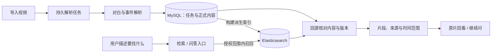

# BettaFish 宣传主张核对与 Seekino 面试定位

检索日期：2026-10-29。用途：为明天的面试梳理“业务问题—实现—效果—亮点”的证据，不改 Seekino 当前 README，不裁剪旧闭环代码。

BettaFish 审计版本固定为 [`b67928ff1ce515dd7672408221fb1e9500d0972d`](https://github.com/666ghj/BettaFish/commit/b67928ff1ce515dd7672408221fb1e9500d0972d)。通过 GitHub 连接器读取该版本的 README、完整目录树以及本文所列调用链源码。未部署 BettaFish，未调用模型、搜索服务或爬虫，未执行其测试；因此下文区分源码实现、主流程接通、实际效果和比较优势。

## 1. 先给结论

BettaFish 有真实的采集、检索、研究循环和报告生成工程，不能因为部分宣传过强就说项目没有做事。但 README 把“已经编写的模块”“需要二次开发的扩展点”“预期效果”和“相对优势”放在了同一层。尤其平台覆盖数字、持续监控、短视频深度理解、安全私库接入、集体智能改善，不能仅凭模块命名和示例报告确认。

更适合借鉴的是它的表达顺序：先给目标用户和输出物，再描述使用过程，最后解释支撑能力。对 Seekino 而言，值得迁移的是这条叙述顺序，而不是强效果形容词或 Agent 数量。

本文使用四档证据：

| 档位 | 可证明的事情 | 不能越级推导 |
|---|---|---|
| 实现存在 | 有可定位的代码、输入输出和调用点 | 不代表配置齐全、服务可用 |
| 链路接通 | 主入口真的消费能力并交付结果 | 不代表结果正确或稳定 |
| 效果验证 | 指定数据与环境下完成用户任务 | 不代表其他数据上同样有效 |
| 比较优势 | 同一任务、资源与评价口径下优于合理替代方案 | 不可由“用了更多模块”替代 |

## 2. 数据覆盖与 7×24 监控

README 同时使用“30+”社媒、“10+”关键平台和百万评论口径。当前源码能直接核对的是两种不同能力：

- 热榜入口：`get_today_news.py` 的 `SOURCE_NAMES` 为 **12 个来源**，通过 NewsNow 获取热榜，包含新闻网站、社区和 GitHub，并不全是社交媒体评论源。[新闻源映射与获取入口](https://github.com/666ghj/BettaFish/blob/b67928ff1ce515dd7672408221fb1e9500d0972d/MindSpider/BroadTopicExtraction/get_today_news.py#L26-L43)
- 深度采集：`PlatformCrawler.supported_platforms` 明确是 **7 个平台**：小红书、抖音、快手、Bilibili、微博、贴吧、知乎；CLI 也只接受这 7 个。[采集平台定义](https://github.com/666ghj/BettaFish/blob/b67928ff1ce515dd7672408221fb1e9500d0972d/MindSpider/DeepSentimentCrawling/platform_crawler.py#L27-L34)、[CLI 约束](https://github.com/666ghj/BettaFish/blob/b67928ff1ce515dd7672408221fb1e9500d0972d/MindSpider/main.py#L448-L499)
- 实际爬虫复用了 `NanmiCoder/MediaCrawler` 子模块；根仓库锁定的子模块 commit 为 `4de2a325a9cd4f7de7dfb58204b154fc2bb86e40`。这不损害集成价值，但不能把整个采集底座称为完全从零独立实现。[子模块来源](https://github.com/666ghj/BettaFish/blob/b67928ff1ce515dd7672408221fb1e9500d0972d/.gitmodules)

12 个热榜来源、7 个深爬平台、网页搜索服务的覆盖面是不同统计口径，存在重叠，不能相加后称作独立的社媒评论采集覆盖。源码也不能证明实际部署里已积累百万条、这些评论可被当前任务使用，或采样代表全部用户。

`MindSpider/main.py` 的正式入口执行一次话题提取，再执行一次深爬；深爬管理器按平台顺序调用子进程。默认 Docker 入口为 `app.py`，该应用初始化 MindSpider 数据库后启动 Streamlit 与其他分析组件。本次检查的入口、Compose、Dockerfile 与 MindSpider 文档未见持续爬虫调度或 7×24 可用率证据。外部运营方当然可以另加定时调度，但那需要额外部署证据。[单次流程](https://github.com/666ghj/BettaFish/blob/b67928ff1ce515dd7672408221fb1e9500d0972d/MindSpider/main.py#L363-L393)、[按平台执行](https://github.com/666ghj/BettaFish/blob/b67928ff1ce515dd7672408221fb1e9500d0972d/MindSpider/DeepSentimentCrawling/platform_crawler.py#L405-L420)、[应用启动](https://github.com/666ghj/BettaFish/blob/b67928ff1ce515dd7672408221fb1e9500d0972d/app.py#L269-L292)、[Docker 入口](https://github.com/666ghj/BettaFish/blob/b67928ff1ce515dd7672408221fb1e9500d0972d/Dockerfile#L76-L77)

**为什么可能有价值：**做舆情分析时，新闻标题与用户评论承担不同证据职责。接通多种来源并形成统一查询工具，能够降低人工搜集成本。要进一步称为“全面、实时、可靠”，需测平台覆盖、采集成功率、数据延迟、重复比例和漏采，而非只展示支持列表。

## 3. 复合分析确有代码，但要追到成品是否使用

InsightEngine 的数据库检索可以按主题、日期、平台查内容与评论，并用点赞、评论、转发等固定权重计算热度。它也确实有 MiniLM 编码加 KMeans 聚类抽样：默认启用，结果超过 50 条时分组取代表项，异常时退回前 50 条。这些是统计和表征处理，存在明确的实际执行路径。[查询与热度](https://github.com/666ghj/BettaFish/blob/b67928ff1ce515dd7672408221fb1e9500d0972d/InsightEngine/tools/search.py#L63-L185)、[聚类开关](https://github.com/666ghj/BettaFish/blob/b67928ff1ce515dd7672408221fb1e9500d0972d/InsightEngine/agent.py#L36-L38)、[聚类抽样与降级](https://github.com/666ghj/BettaFish/blob/b67928ff1ce515dd7672408221fb1e9500d0972d/InsightEngine/agent.py#L95-L188)

情感分析也并非空接口：搜索结果会传给分类器，产出标签分布和置信度。当前集成工具默认加载第三方 `tabularisai/multilingual-sentiment-analysis`，本地无模型时下载缓存；仓库包含其他微调训练/推理脚本，不代表这些模型都被当前主流程协同调用。[集成调用](https://github.com/666ghj/BettaFish/blob/b67928ff1ce515dd7672408221fb1e9500d0972d/InsightEngine/agent.py#L359-L430)、[模型选择与加载](https://github.com/666ghj/BettaFish/blob/b67928ff1ce515dd7672408221fb1e9500d0972d/InsightEngine/tools/sentiment_analyzer.py)

这里还有一个不能跳过的消费边界：情感统计写入 `DBResponse.parameters["sentiment_analysis"]`；所审查的初搜和反思主路径随后只从 `response.results` 构造摘要输入，没有显式把该统计字段传给总结节点。对应 Streamlit 入口调用的也是这组方法。因此可以确认“分类计算存在”，不能据此确认“统计结果已经稳定影响最终报告”。具体成品是否通过其他日志或上下文间接获益，尚未端到端验证。[统计写入位置](https://github.com/666ghj/BettaFish/blob/b67928ff1ce515dd7672408221fb1e9500d0972d/InsightEngine/agent.py#L359-L368)、[摘要输入构造](https://github.com/666ghj/BettaFish/blob/b67928ff1ce515dd7672408221fb1e9500d0972d/InsightEngine/agent.py#L670-L731)、[Web 入口调用](https://github.com/666ghj/BettaFish/blob/b67928ff1ce515dd7672408221fb1e9500d0972d/SingleEngineApp/insight_engine_streamlit_app.py#L142-L176)

**为什么可能有价值：**LLM 不适合靠阅读大量评论自行心算分布；确定性统计和分类工具可以提供可检查的中间证据，聚类可以控制上下文体积。代价是分类误差和抽样偏差。证明更准确需要标注集、样本选择说明和取消这些模块的对照实验；模型数量本身不构成效果证据。

## 4. 多模态搜索适配不等于短视频理解闭环

MediaEngine 的 Bocha 适配器确实定义、解析三种独立结果：`webpages`、`images` 和 `modal_cards`；结构化查询工具也存在。它们依赖外部搜索接口返回的内容，而非本地抽帧或音视频解析。[结构定义与解析](https://github.com/666ghj/BettaFish/blob/b67928ff1ce515dd7672408221fb1e9500d0972d/MediaEngine/tools/search.py#L50-L180)、[结构化查询工具](https://github.com/666ghj/BettaFish/blob/b67928ff1ce515dd7672408221fb1e9500d0972d/MediaEngine/tools/search.py#L238-L250)

核对主路径后发现：

1. Bocha 解析器把 webpage 的 `snippet` 原样存入网页项；图片和卡片分支独立保存，没有在适配层合并到 snippet。
2. Media Agent 的初搜和每轮反思只遍历 `search_response.webpages`，把 snippet 构造成 `search_results`，再送入摘要节点。独立的图片和卡片字段未在这条路径传入。
3. LLM 客户端收到 system/user 字符串消息，所审入口没有原片、视频帧或 image_url 多模态消息。Streamlit 界面实际调用同一组研究方法。

证据：[初搜消费字段](https://github.com/666ghj/BettaFish/blob/b67928ff1ce515dd7672408221fb1e9500d0972d/MediaEngine/agent.py#L239-L286)、[反思消费字段](https://github.com/666ghj/BettaFish/blob/b67928ff1ce515dd7672408221fb1e9500d0972d/MediaEngine/agent.py#L322-L369)、[LLM 消息构造](https://github.com/666ghj/BettaFish/blob/b67928ff1ce515dd7672408221fb1e9500d0972d/MediaEngine/llms/base.py#L61-L83)、[Web 调用](https://github.com/666ghj/BettaFish/blob/b67928ff1ce515dd7672408221fb1e9500d0972d/SingleEngineApp/media_engine_streamlit_app.py#L173-L202)。

因此，本次源码证据支持“接入提供多类结果的搜索 API”，不足以支撑“当前成品已深度理解抖音/快手原视频”，甚至需补验结构化卡片是否真正进入最终研究结果。这个判断限定在已审查的本地调用链；没有审计搜索供应商内部如何产生摘要，不能推断供应商完全不理解图片或视频。

**为什么可能有价值：**用户问题若依赖画面、声音、图表，而正文与标题没有这些事实，真正消费多模态证据才会扩大可回答范围。可展示的验收应当是一道“只看标题/文字摘要答不对、看原视频能答对”的题，并能回指媒体中的证据。文件名含 Media、模型支持视觉、API 能返回图片，都不能替代这个验收。

## 5. 私有数据集成是真实扩展点，通用安全接入未获证明

InsightEngine 当前数据库工具绑定了 `bilibili_video`、`douyin_aweme`、`weibo_note` 等 MediaCrawler 业务表，以固定查询模板读取内容。它能分析部署者自己的这套舆情库；这与任意公司内部业务数据库零改造接入是两个层次。[表与字段映射](https://github.com/666ghj/BettaFish/blob/b67928ff1ce515dd7672408221fb1e9500d0972d/InsightEngine/tools/search.py#L193-L232)

README 的自定义业务库接入章节明确要求新增连接配置、编写 `CustomBusinessDBTool`、再集成到 Agent；其中两个核心查询方法仍为示意性的 `pass`。这是二次开发指导，不是已经完成的通用业务连接器。[自定义业务库示例](https://github.com/666ghj/BettaFish/blob/b67928ff1ce515dd7672408221fb1e9500d0972d/README.md#L633-L686)

`fetch_all` 的注释称为只读查询，但实现是建立连接并执行传入 SQL，单凭这段封装不能证明数据库账户权限、行列授权、租户隔离、敏感数据外发控制或安全审计。本次未做安全测试，也不据此断言部署必然不安全。[数据库执行封装](https://github.com/666ghj/BettaFish/blob/b67928ff1ce515dd7672408221fb1e9500d0972d/InsightEngine/utils/db.py#L93-L114)

**为什么可能有价值：**公开舆情能说明大家在讨论什么，内部客服/销售数据能帮助判断问题是否影响自己的用户和业务。共同分析可能改善决策，但需要打通实体、时间窗口、权限和口径；仅把两种文本塞进上下文不等于完成业务验证。更准确的现阶段说法是“提供私有舆情库工具及业务扩展入口”。

## 6. 轻量、无框架与一键部署要看用户成本

当前固定版本 README 正文使用的是 Python 模块化和 Docker 部署表述，未发现原文把“完全不使用任何外部框架”或 “Long term agent” 作为上述六项中的独立主张。**同日追问后补查：GitHub 仓库 About / API description 确实写着“从0实现，不依赖任何框架”。** 前次只搜索 README 正文的范围过窄，不能据此说作者没有公开宣称；该主张仍须按实际依赖限定含义。[仓库元数据](https://api.github.com/repos/666ghj/BettaFish)

依赖文件明确包含 Flask、Streamlit、SQLAlchemy、Playwright、PyTorch、Transformers 等；有真实 Dockerfile 与 Compose。可以讨论“未依赖某个 Agent 编排框架”，不能把它改写成没有外部框架或依赖。容器化也并不自动消除模型/搜索 API 密钥、数据库及平台登录配置。[依赖清单](https://github.com/666ghj/BettaFish/blob/b67928ff1ce515dd7672408221fb1e9500d0972d/requirements.txt)、[Compose](https://github.com/666ghj/BettaFish/blob/b67928ff1ce515dd7672408221fb1e9500d0972d/docker-compose.yml)、[爬虫登录前提](https://github.com/666ghj/BettaFish/blob/b67928ff1ce515dd7672408221fb1e9500d0972d/MindSpider/README.md#L516-L521)

**为什么可能有价值：**如果目标使用者是想检查流程、定制工具或私有部署的开发者，自编排可以减少对特定抽象的依赖，也可能更好调试。它同时需要自己维护状态、恢复、并发和工具合同。只有说明“已有框架在哪个业务约束下不合适、自实现改善了什么、付出了什么代价”，才是工程取舍；单说不用框架，既不能证明创新，也不能证明更轻。

## 7. 尚不能从项目材料确认的强效果

| 主张类型 | 当前能够确认 | 还需要什么 |
|---|---|---|
| 比传统方法更准确、更深入 | 有独立研究模块、工具与报告样例 | 同一问题集的人工标注、基线、错误归因、成本和时延对照 |
| 评论代表大众真实观点 | 能查询抓取到的内容与评论 | 平台/时间/关键词采样边界，去重与偏差说明 |
| 可预测未来 | README 引到另外的 MiroFish 项目 | BettaFish 内部预测流程、时间外留出集、回测口径；另一个项目的宣传不能直接作为本项目验收 |
| 可扩展到所有业务 | 有模型接口、工具和模板扩展入口 | 至少一个其他业务中完成数据接入、方法适配与结果验收的完整案例 |
| 六项能力都是相对优势 | 大部分都有相应模块或扩展思路 | 先明确和谁比、用户完成何种任务、资源限制是什么 |

例如仓库的测试说明关注论坛日志格式解析；其他测试文件涉及路由、取消、导出与报告净化。这是工程保障的证据，不能替代内容质量、预测有效性或竞品优势评测。[测试说明](https://github.com/666ghj/BettaFish/blob/b67928ff1ce515dd7672408221fb1e9500d0972d/tests/README.md)、[测试目录](https://github.com/666ghj/BettaFish/tree/b67928ff1ce515dd7672408221fb1e9500d0972d/tests)

审计范围仅支持“本次查阅材料未提供足够证明”，不是宣称整个项目不存在其他未公开实验。对项目最公允的评价应是：有具体集成与交付价值，但需分别验证能力接通、业务有效和比较优势。

## 8. Forum、多轮研究与报告交付的实际价值

### Forum 确实有反馈回路

Forum 监控三个研究引擎的摘要日志，每积累 5 条发言调用主持模型，并将建议写入 `forum.log`。三个引擎的总结节点读取最新 HOST 发言，新的总结又进入下一次反思搜索，因此中间发现可以影响后续研究。这不是仅在 README 中命名的模块。[监控与触发](https://github.com/666ghj/BettaFish/blob/b67928ff1ce515dd7672408221fb1e9500d0972d/ForumEngine/monitor.py#L524)、[主持人](https://github.com/666ghj/BettaFish/blob/b67928ff1ce515dd7672408221fb1e9500d0972d/ForumEngine/llm_host.py#L57)、[HOST 读取](https://github.com/666ghj/BettaFish/blob/b67928ff1ce515dd7672408221fb1e9500d0972d/utils/forum_reader.py#L11)、[总结注入](https://github.com/666ghj/BettaFish/blob/b67928ff1ce515dd7672408221fb1e9500d0972d/QueryEngine/nodes/summary_node.py#L228)

其背景价值是：三个研究器如果只在结尾拼接答案，中途出现的矛盾与线索就无法及时补查。但当前实现属于异步共享研究提示，没有要求每一轮所有角色都发言，也没有由主持人调用检索工具重新核实事实。共享建议既可能补齐遗漏，也可能传播错误或导致趋同；“避免同质化”和“提高决策质量”需要另测。

一个合理的验证方案是固定问题集、数据、模型和总预算，比较单 Agent、独立多 Agent、带 Forum 的多 Agent 三组，盲评事实错误、重要观点覆盖、引用支持率与矛盾处理，同时记录时间和成本。本次没有执行该实验。

### 多轮研究不自动等于长期自主 Agent

当前 Query 主入口是生成报告结构、逐章搜索与总结、汇总报告、保存结果；每章首次搜索后按 `MAX_REFLECTIONS` 继续反思，默认值为 2。已有搜索历史与 JSON save/load，但正常 `research()` 入口仍先生成结构，不能仅由序列化接口推出可靠恢复或跨任务长期记忆。Forum 新会话还会清空日志并重置缓冲区。[主流程](https://github.com/666ghj/BettaFish/blob/b67928ff1ce515dd7672408221fb1e9500d0972d/QueryEngine/agent.py#L141)、[反思循环](https://github.com/666ghj/BettaFish/blob/b67928ff1ce515dd7672408221fb1e9500d0972d/QueryEngine/agent.py#L307)、[默认配置](https://github.com/666ghj/BettaFish/blob/b67928ff1ce515dd7672408221fb1e9500d0972d/QueryEngine/utils/config.py#L40)、[新会话重置](https://github.com/666ghj/BettaFish/blob/b67928ff1ce515dd7672408221fb1e9500d0972d/ForumEngine/monitor.py#L615)

如果用户所说的 long term 指一次任务经过多步研究，这里有实现；若指跨天维护目标、可靠续跑、跨任务积累记忆，所审材料不足以证明。当前 README 也没有找到该原句，不能把读者转述直接作为作者承诺批判。

### 数据分析的意义，要落实到使用者的下一步

以下是业务价值分析，不是 BettaFish 已通过的效果验收。以品牌争议调查为例，好的产物应让使用者知道发生了什么、哪些说法有来源支持、分歧在哪里、还有什么需要核查，并减少资料整理工作。评论情感比例只能描述采样到的评论，不能自动代表所有消费者；从相关讨论写出原因解释，也不等于识别出业务因果；趋势描述与未来预测应分别验证。

BettaFish 更容易确认的交付能力是 ReportEngine：选模板、切章节、规划布局与篇幅、生成章节 JSON、校验与修复、组装 Document IR、渲染 HTML，并提供 PDF/Markdown 导出。它回应的是“研究文字还需要手工整理才能分享、开会、存档”的问题。[报告主流程](https://github.com/666ghj/BettaFish/blob/b67928ff1ce515dd7672408221fb1e9500d0972d/ReportEngine/agent.py#L405)、[渲染与保存](https://github.com/666ghj/BettaFish/blob/b67928ff1ce515dd7672408221fb1e9500d0972d/ReportEngine/agent.py#L745)、[导出接口](https://github.com/666ghj/BettaFish/blob/b67928ff1ce515dd7672408221fb1e9500d0972d/ReportEngine/flask_interface.py#L1227)

这部分有明确的产品价值，但 IR 校验检查的是字段、块类型和表格等结构，不是结论真假。验收要同时看资料是否可信、是否有新增信息、人工整理时间是否减少；页面漂亮只说明其中一个维度。[IR 校验器](https://github.com/666ghj/BettaFish/blob/b67928ff1ce515dd7672408221fb1e9500d0972d/ReportEngine/ir/validator.py#L21)

## 9. 同类产品按用户任务选择

同类应尽量具有相同用户、输入、目标与交付物。仅仅“都使用 Agent”不足以构成公平比较；同一项目也可能同时处在几个相邻品类。以下是第一方公开能力对照，未运行竞品，不能视为效果排名。

| 对照对象 | 对应用户任务 | 官方公开能力与判断 |
|---|---|---|
| Brandwatch Consumer Research | 公关/市场人员监测舆情、分析变化并报告 | 官方已有跨源监测、情感分类、图像分析、私有文本导入、报告和告警。因此这些功能名不是 BettaFish 独有；可进一步比较流程控制、接入成本、目标数据源与具体交付。[官方功能页](https://www.brandwatch.com/products/consumer-research/features/) |
| TrendRadar | 个人/小团队持续筛选热点并接收提醒 | 官方 README 有热榜聚合、RSS、关键词/AI 筛选及推送。它更接近持续关注任务，热榜聚合不能等同于评论采集；用户若只需提醒，不必为了“能力更多”引入长报告流程。[固定版本 README](https://github.com/sansan0/TrendRadar/blob/68c8916c450f8c8dd36cb88a189f7c2e46681ab5/README.md#L1019) |
| GPT Researcher | 围绕研究问题收集材料、审阅并生成报告 | 官方有规划、研究、审阅、修订与发布的多 Agent 工作流，以及本地文档和 Web 混合研究。多 Agent、反思和私有资料融合并非 BettaFish 独有；应检验社媒数据和 Forum 带来多少实际增益。[多 Agent 工作流](https://github.com/assafelovic/gpt-researcher/blob/3582a6841fe7dc801e2a34e34ee408641aea9bce/multi_agents/README.md#L16)、[混合研究](https://docs.gptr.dev/docs/examples/hybrid_research) |

比较指标也应跟着任务变化：持续监测看发现延迟、漏报、误报与重复通知；专题调查看采样口径、信息覆盖、事实错误和引用支持；报告交付看可核查程度、修改成本、人工操作时间与调用成本。不把不同用户目标压成一张“功能越多分越高”的表。

GPT Researcher 的上述官方多 Agent 示例明确使用 LangGraph，也说明引入框架与完成研究工作流并不矛盾。是否自写编排，应该通过具体限制和维护代价解释。

Seekino 至少有两类直接参照：

| 对照对象 | 已公开的相近能力 | 对 Seekino 定位的影响 |
|---|---|---|
| TwelveLabs | 自然语言/图片检索视频片段，支持视觉、音频、转写选择；示例返回 `video_id`、`start`、`end` | 多模态视频搜索和时间定位属于品类已有能力，不能单独称为首创。[官方搜索文档](https://docs.twelvelabs.io/docs/guides/search) |
| HKUDS VideoRAG / Vimo | 作者论文讨论跨视频知识与多模态上下文检索；官方项目提供视频导入、对话与多视频分析 | “长视频 RAG”“和视频聊天”已有研究与产品实现，Seekino 需按素材、语言、查询类型和交付要求说明自身范围。[作者论文](https://arxiv.org/abs/2502.01549)、[固定版本仓库](https://github.com/HKUDS/VideoRAG/blob/c412a093a820ef7a0e0dda31076ed871136198b3/README.md#L41) |

本轮竞品版本：TrendRadar `68c8916`（2026-10-20）、GPT Researcher `3582a68`（2026-10-10）、HKUDS VideoRAG `c412a09`（2026-03-18）；在线文档按本次检索日期理解。

## 10. 迁移到 Seekino：产品特色、工程亮点与比较优势分开讲

用户提出的面试框架保留：团队希望找到能可靠解决业务问题的人，通过实际经历与追问考察个人思维、执行配合和管理程度；表达要先帮助听者建立业务轮廓，再进入技术选择。

其中“亮点等于解决别人没有解决的问题”可以放宽：

- **产品特色**回答用户能完成什么任务，可以有用而不独创。
- **工程亮点**回答你在实际约束下怎样诊断、取舍、协作和验证；常见问题也能体现个人能力。
- **比较优势**回答在相同条件下比什么方案改善多少，必须有对照证据。

我们不需要为了证明亮点给每个模块补一个“创新”标签。一次并发死锁的完整诊断和验证，比“独创五层多 Agent 架构”更能承受面试追问。采用 AI 协作时，也应准确说明自己的问题定义、证据搜集、决策、审查与验收职责，不把其他人的实现归为个人手写。

### 可用于 README / 开场介绍的候选稿

以下是候选口径，没有替换现有 README。代码实现、历史成功样例与明天本机可演示状态仍要分别确认。

> Seekino 将一批长视频整理成可检索、可回看的素材库。用户可以用记得的台词、动作或情节描述寻找片段，打开对应原视频和时间范围核对上下文，并继续进行观看问答或导出解析资料。
>
> 项目围绕“找到目标内容并交付可核查来源”建设视频解析、事件检索和持久任务链路，重点处理检索粒度、解析与索引版本一致性，以及长任务失败恢复等实际问题。当前已有成功案例和固定评测，复杂查询与内容理解仍在改进。

适合放在首页的三个能力点是：按内容寻找素材、打开来源核对、在已有片段上继续使用（问答/导出）。每一项紧跟一个实机例子；实现细节放到架构和开发说明。自托管是部署形态，不自动表示所有模型处理都在本机，现有 README 的远程模型数据传输与费用说明应保留。[现有 README](../../README.md)

当前 README 的开头实际上已经采用“素材库＋出处”的方向，主要需要增强的是用例证据、能力边界，以及架构图与当前源码的一致性。免责声明若后续调整，应围绕真实的数据流、素材使用范围和未验证能力书写；本次不复制其他项目条款，也没有进行法律效力判断。

### 用一条业务链路解释架构

下面是业务数据流示意，不是部署拓扑，也不意味着所有检索入口使用完全相同的 Agent 路径。

再按面试官追问解释为什么需要相应结构：

| 业务困难 | 当前结构的理由 | 证据与边界 |
|---|---|---|
| 记得原话或大概场面，不知道在哪 | Event 表示局部事实；词法、语义、视觉分别产生候选，RRF 融合 | [Event 融合与验证](../../engine/rag/retrieval/events.py)。不是全库高准确率的证明；HTTP 搜索、Chat 与 MCP 的入口策略有差别。 |
| 修改解析后，旧索引仍可能命中 | MySQL 保存正式内容，ES 为派生投影，候选需要核对来源与版本 | [Event Service](../../server/service/video_event_retrieval.py)。保证来源一致，不保证人物识别、转写或理解语义正确。 |
| 模型调用长，旧执行可能在超时重领后返回 | 持久任务保存恢复事实，提交检查当前执行资格 | [内容提交](../../server/service/video_parse_content.py)、[任务领取](../../server/mq/video_parse_queue.py)。状态与执行代次承担不同职责，不是每张表的 version 都天然必要。 |
| 答案流畅但用户无法确认 | 结果附原视频、时间范围与播放器跳转 | [Web 观看功能](../../web/src/features/player/WatchPage.tsx)、[媒体接口](../../server/api/media.py)。业务验收需要真的点开对应内容核对。 |

当前 Query 实际运行图是 `query → validate_evidence → report`，Supervisor 使用其证据报告组织最终答复。根 README 和 Server README 仍有旧的 Query/Evaluator/Chat 描述，应在后续明确修改任务中核正；本次记录差异，不直接修改宣传与架构文档。[当前运行图](../../agent/chat/video_search/runtime.py)

### 最适合面试展开的两条主线

1. **检索为什么没有交付正确片段。** 沿词法/语义原始排名、融合、截断、来源检查、Agent 使用逐层诊断。C14 的一轮受控复跑是目标词法第 1、语义第 17、融合第 13，被 `top_k=8` 截掉；这是特定诊断记录，不是全库准确率。[原始问题记录](../dev/problems.md#c14台词检索存在假设偏移chunk-级语义表征与融合截取缺口)
2. **有状态机为什么还需要执行身份。** 任务超时回收后再次处于 RUNNING，迟到旧执行不能仅凭 RUNNING 提交。或者两份消息都在 PROCESSING，旧快照不能覆盖更新卡片。用实际竞争场景解释字段，再指出替代设计与保护边界。[提交与租约测试](../../tests/server/test_video_parse_repository.py)、[前端拒绝旧版本](../../web/src/features/search/useAgentConversation.ts)

如面试官偏后端，可把并发上传收尾死锁作为完整问题解决案例：媒体上传成功，事务提交失败；定位父 Series 锁升级等待环；调整同 Series 收尾加锁顺序，在隔离数据库复现与回归。具体历史验证和取舍见 [问题记录](../dev/problems.md)，不要把历史回归通过直接当作当前环境部署完成。

### 效果边界必须保留

2026-10-26 的固定查询覆盖集里，默认 Deep Agents 请求完成 12/13，任务与证据通过 5/13，综合通过 4/13。已有台词检索成功样例，也存在复杂查询、归属和超时问题。请求返回、工程测试通过、任务完成分别统计；这些数字是该小型评测集的历史结果，不是普遍准确率。[评测口径与结果](../../evals/benchmark/reports/chat-harness-kimi-20261026.md)

明天的旧闭环演示应选一个在当前环境预检成功的“提问→片段→原片核对”，再用真实失败案例进入技术追问。本次研究没有运行这个预检，不能承诺现场环境已经恢复。新的 Anon 一分钟 SVG／Three.js 创作、NPC 蒸馏和社区平台均不能在此处借用为已完成能力；相关旧模块按用户要求保留，不开展裁剪。

## 11. 本轮交付与验证范围

本轮只新增本研究稿。核对了固定版本的外部源码、第一方竞品资料及 Seekino 当前源码和既有评测；未改业务代码、README 或服务配置，未启动/重启服务、运行爬虫或调用模型，未进行任何竞品效果排名。

文档交付检查仅覆盖本稿的本地链接、结构与改动范围；外部链接是本次读取资料的入口，在线网页可能随后变化，源码链接尽量固定提交。研究结论不改变项目问题状态，不新建独立维护的任务看板。

## 12. 用户追问：7×24 是否就是长期运行

2026-10-29 补充。用户这里指的是持续自动执行，不是跨会话长期记忆。按这个含义，README 的 7×24 确实承诺了长期持续作业；前述长期记忆辨析没有直接回应这个关注点。

独立复核后可更明确地说：**公开默认链路实现了单次 AI 辅助采集，没有接成所宣称的 7×24 持续采集服务。** `run_complete_workflow()` 执行一次热点提取和深爬后返回，CLI 随后结束；多平台采集是依次启动平台子进程。可以在外部另接调度，但本次没有作者该项部署证据。[单次流程](https://github.com/666ghj/BettaFish/blob/b67928ff1ce515dd7672408221fb1e9500d0972d/MindSpider/main.py#L363)、[CLI](https://github.com/666ghj/BettaFish/blob/b67928ff1ce515dd7672408221fb1e9500d0972d/MindSpider/main.py#L481)

特意检查了三个可能反驳该判断的实现：Compose 的 `restart: unless-stopped` 保活的是 `app.py` Web 应用；Forum 常驻线程监听研究日志；GitHub Actions 的 cron 更新 Star 历史。它们都没有承担持续采集新社媒数据的职责。有限请求重试也不等于采集任务的长期调度与恢复。[Compose](https://github.com/666ghj/BettaFish/blob/b67928ff1ce515dd7672408221fb1e9500d0972d/docker-compose.yml#L9)、[Forum 循环](https://github.com/666ghj/BettaFish/blob/b67928ff1ce515dd7672408221fb1e9500d0972d/ForumEngine/monitor.py#L584)、[Star 定时任务](https://github.com/666ghj/BettaFish/blob/b67928ff1ce515dd7672408221fb1e9500d0972d/.github/workflows/update-star-history.yml#L4)

Python 与模块化本身是实现方式，通常不足以构成突出的工程亮点。若要成立，应展示替换模型需要多少配置、增加数据源涉及哪些改动、干净环境部署有哪些前提、相比替代方案减少了多少维护工作。可以推介便利性，但不能用语言和目录结构替代收益证据。

## 13. 项目先后、传播时间与“为什么火”

仓库创建时间采用 GitHub API UTC；它不等于公开发布日或今天这套产品形态完成的日期。

| 项目 | 仓库创建 | 可核对的产品发布节点 |
|---|---|---|
| GPT Researcher | 2023-05-12 | 2023-07-09 Initial Alpha `v1.0.0`。[元数据](https://api.github.com/repos/assafelovic/gpt-researcher)、[Release](https://github.com/assafelovic/gpt-researcher/releases/tag/v1.0.0) |
| BettaFish | 2024-07-01 | 2025-09-01 16:49 UTC 发布微舆 v1.0，北京时间为 9 月 2 日。[元数据](https://api.github.com/repos/666ghj/BettaFish)、[Release](https://github.com/666ghj/BettaFish/releases/tag/v1.0.0) |
| TrendRadar | 2025-04-28 | README 记录 2025-06-16 v1.0；本次 Releases 列表为空。[元数据](https://api.github.com/repos/sansan0/TrendRadar)、[发布记录](https://github.com/sansan0/TrendRadar/blob/68c8916c450f8c8dd36cb88a189f7c2e46681ab5/README.md#L963) |

所以按仓库创建为 GPT Researcher → BettaFish → TrendRadar；按两者的 v1.0 发布记录，TrendRadar 又早于 BettaFish。不能用单一创建日期回答所有“谁先做”的问题。

BettaFish 官方仓库的 Star 历史文件记录：2025-10-31 为 2,082，11-04 为 10,802，11-07 为 20,511，11-15 为 26,219，支持其关注度在 **2025 年 11 月上旬明显爆发**。但历史部分是 2026-07-20 根据当时仍保留 Star 的账户时间重建（`current_stargazers_starred_at`），会漏掉已取消 Star 的账户，不是当日总量的精确快照。[官方历史数据](https://github.com/666ghj/BettaFish/blob/b67928ff1ce515dd7672408221fb1e9500d0972d/.github/star-history/history.json)

TrendRadar README 的 2025-06-09 记录 100 Star，06-18 记录 200 Star，并提及公众号点赞、分享和推荐；致谢也列出社区与周刊推荐渠道。可以确认社区传播参与了增长，不能据此归因为“只是炒作”。本次未用一手历史曲线定位其首次爆发日。[早期记录](https://github.com/sansan0/TrendRadar/blob/68c8916c450f8c8dd36cb88a189f7c2e46681ab5/README.md#L956)、[渠道致谢](https://github.com/sansan0/TrendRadar/blob/68c8916c450f8c8dd36cb88a189f7c2e46681ab5/README.md#L99)

GPT Researcher 在 2023 年 7 月已公开发布，2023-09-22 官方博客已介绍研究计划、并行查资料与报告交付，明显早于 BettaFish 仓库创建。本次没有一手 Star 曲线可确定它的首次爆火日，发布日期不冒充爆火日期。[官方早期复盘](https://docs.gptr.dev/blog/building-gpt-researcher)

对增长原因的以下判断属于分析：功能领域重合，不代表触发方式、目标用户和交付形式完全相同；手机热点通知、通用研究报告、舆情专题报告各有不同使用情境。长 README 可能不是用户的主要入口，推荐文章、截图、样例也能传递用途。社区传播、上手成本、时机和实际价值可能共同作用；缺少留存、活跃使用与渠道转化数据时，不能分配因果权重。Contributor 数量也不能直接替代某个任务的完成效果。

## 14. Seekino 的可见交付与课程 CC 场景

用户确认 **CC 指课程字幕（closed captions），不是 Claude Code**。用户最新判断是“要有惊艳的闭环可交付产物”。本次建议将其落实为可直接感知、核查并使用的成果：吸引注意的展示效果与持续使用价值分别考虑。PDF 是一种直观载体，视频定位与回放也可以构成完整任务结果，不必以文件格式判断有没有闭环。

课程场景的价值可以依次拆成：字幕帮助听懂、检索帮助找到、来源时间点帮助核查与复习。字幕本身未必形成差异化；更清楚的最小演示候选是“一节课程中的真实知识点 → 检索相关讲解 → 打开原片 → 同步英文字幕核对 → 基于该片段继续追问”。带时间引用的复习笔记可作为后续可带走成果，但尚未确认现成产品链路，不把 JSONL 导出称为学习报告。

本轮源码与文件清单核对：

- 本地已有 CS231N、Karpathy 课程目录和部分文件，其中还存在独立媒体流及下载中间文件；没有检测媒体完整性、音轨或入库状态，不能据文件名认定可演示。
- ASR 有带时间的原语言转写，Timeline 的 DIALOGUE 有原文/译文表示与整数毫秒边界，具备一部分字幕数据基础。[转写合同](../../engine/common/transcription.py)、[Timeline Schema](../../engine/parsev2/schemas.py)
- 当前播放器没有字幕轨道与 CC 控件；检索弹窗中的 Captions 图标用于 Debug 文字证据，并非同步字幕。[播放器](../../web/src/features/player/VideoPlayer.tsx)、[证据弹窗](../../web/src/features/search/EvidencePlayer.tsx)
- 当前导出是带来源与时间的 JSONL，不是 SRT/VTT。[导出接口](../../server/api/media.py)
- 正式 DIALOGUE 是经过理解的事件记录，不能自动保证逐句转写完整、字幕断句合适或精确同步；有 `TRANSLATION` 字段也不等于自动生成了可靠中文字幕。[解析约束](../../agent/video_parse_v2/prompts.py)
- 所审既有报告未找到这些课程的真实解析、检索与 CC 验收记录。本轮未上传、解析课程，也未实现字幕。

课程可作为素材库能力的另一个验收场景，不应因为演示焦虑就同时扩张成新的完整学习平台。用户长期想要的 SVG／Three.js 成片仍是另一种交付目标；当前面试优先保护旧链路，选定一个能实际验收的任务，再决定补哪一项能力。
