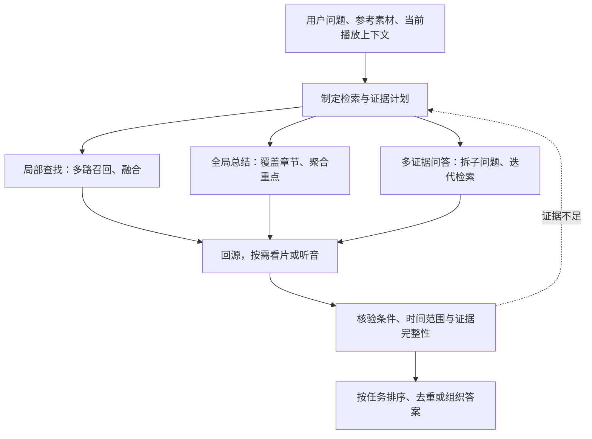

> **解析任务设计入口（2026-10-14）**：后续解析工程的任务模型、表结构、并发与中断恢复，以
> [Parse V2 TRD 的当前设计基线](../../agent/video_parse_v2/design/trd.md) 为准。
> 已确认采用现有 Chunk 任务演进为 `ChunkTask + phase + status`，合并 Parse 与 Index；Interval 仅承担 Refine，
> 不新增独立 Index 表。Video 3 路、每 Video 三阶段各 10 路由配置和 MySQL 原子领取保证。
> 该合同取代旧版 Interval 承担 Index 的规则及独立 Index 表提案；目标设计已确认，代码与数据迁移尚待实施。
> 本文以下保留 RAG 研究记录；Prefix 是否阻塞首次 COMPLETE 仍是解析 TRD 中单独列出的待定项。

> **视觉媒体检索设计入口（2026-10-15）**：[视觉媒体检索 TRD](../../docs/design/visual-retrieval-trd.md) 定义文字／视觉查询分工及图片、GIF、MP4 接入；该方案待实现，本文保留研究背景。

> **Event 细粒度检索最终合同（2026-10-17）**：以 [Sub-Chunk / Event TRD](../../server/design/sub-chunk-trd.md) 为准。Chunk 的完整有序 Timeline 保持权威，不新增 Event / Frame SQL 表或 Frame Index；现有 Chunk INDEX 派生独立 Event ES 的词法、文本向量和抽帧视觉向量。有效目标首次 INDEX 冻结在任务 detail，不改变 ParseConfig；Agent 可直接细搜或缩小 Chunk 范围再搜。本文研究设想及旧实测保留历史，不替代新链路运行验收。

# 目标

当前的RAG策略需要优化，需要深入思考研究召回的各类型场景，量化的角度来证明策略的有效性

分为以下几层需要进一步研究：
1. 召回的流程用推广搜类比为：召回全量候选池 —— 粗筛 —— 精筛 —— rerank；的话 我们目前的这四大流程是怎么做的？ 如何提升查找的正确性？
2. 如何衡量召回的质量 —— 我们需要构建召回的评测集，评测集需要采用通用（70%） + 业务结合（30%，少量golden set） 形成的大benchmark，如何搭建？
3. 问题来了，我们想要达成的效果似乎并非是完全的RAG，例如我们的问题会想要问“anon和tomori是怎么认识的？”，这种和RAG似乎相关性很差，但是如何利用RAG来完成此类型的任务？；
    即我们的真实RAG任务的意图需要进行拆解：
    user可能会想问什么？例如 “这个姿势的画面这些动画里面出现了哪些片段？”
    “有哪些特别燃的战斗场面？”
    “这个课程视频里面你认为有什么精华内容？”
    “老师之前讲过和这个（当前实时画面内容）相关的东西吗？”
    “我想要一个人从上往下跳，类似于这个小视频的画面，帮我找一下”
    “哪些片段角色们‘哈’了一声？“
    ”阿库娅有哪些特别搞笑的片段？“
    而这些问题似乎和RAG毫不相关，但事实上是我们需要回答的问题，我们该如何处理？

4. 多模态输入情况下问题适配
   目前在文字情况下模型的表现还挺聪明，可以接受
   接下来研究图片、视频输入的情况下
   如果


# gpt-version（below）

## 目标 Query Set：Seekino 用户希望获得什么答案（2026-10-16）

本节记录目标用户问题，先明确要找什么、哪些方面需要匹配、期望返回什么，再讨论检索与模型方案。它是需求样例集；尚未逐条绑定参考素材、检索范围和人工核验答案，不表示当前能力已实现或评测已通过。

输入可以是文字、图片、GIF、MP4 或当前播放上下文，也可以是参考媒体加文字条件。媒体格式不决定查询意图：同一段视频可以被用于找出处、相似动作、构图或分镜。视觉媒体接入方案见 [视觉媒体检索 TRD](../../docs/design/visual-retrieval-trd.md)。

### 1. 核心问题

| ID | 用户意图 | 目标 Query | 期望答案／匹配重点 |
| --- | --- | --- | --- |
| Q01 | 出处与原始片段 | 这个图片／表情包出自哪一集？ | 找到同源原画面，返回作品、集数及原视频位置；画面相似只能作为候选。 |
| Q02 | 出处与原始片段 | 只有某一集画面右下角这一小块，能找到完整原画面吗？ | 局部裁剪溯源；对应区域和完整画面可以核对。 |
| Q03 | 出处与原始片段 | 这张被裁剪、加字或贴了贴纸的表情包，原图是什么？ | 找到修改前的原画面，区分后加内容与原片内容。 |
| Q04 | 出处与原始片段 | 这个画面最早出自哪一集？ | 在约定的视频范围及集数／播放顺序内确认首次出现；与故事内时间先后区分。 |
| Q05 | 出处与原始片段 | 这个画面在哪些集出现过，包括回忆和回顾？ | 找出范围内的所有出现位置，区分重复使用与相似镜头。 |
| Q06 | 出处与原始片段 | 这个 GIF 对应的完整连续片段在哪里？ | 找到原视频连续过程与时间范围，不能只定位其中一帧。 |
| Q07 | 出处与原始片段 | 这个混剪里的几个镜头分别来自哪里？ | 按输入镜头逐段标出来源，允许来自不同集数或作品。 |
| Q08 | 人物、物件、地点的其他出现 | 这张图里的角色还在哪些片段出现过？ | 核对同一人物；不能只凭相似服装或发色判断。 |
| Q09 | 人物、物件、地点的其他出现 | 这个房间／物件在其他集里出现过吗？ | 核对同一地点或物件的其他出现，允许视角和光照变化。 |
| Q10 | 人物、物件、地点的其他出现 | 找这个角色穿这套衣服的镜头。 | 同时满足人物身份与指定服装。 |
| Q11 | 相似姿势与表情 | 有没有其他角色也摆出这个姿势？ | 姿势相似，允许人物、服装和背景不同。 |
| Q12 | 相似姿势与表情 | 找类似这种欲言又止的表情。 | 核对表情和可见状态；涉及心理解释时需区分观察与推断。 |
| Q13 | 相似姿势与表情 | 有没有同款嫌弃脸，换个人也可以？ | 表情及表达相近，不要求人物相同。 |
| Q14 | 相似构图与机位 | 找人物站在画面左侧、右边大面积留白的镜头。 | 保留主体位置、相对大小与留白关系。 |
| Q15 | 相似构图与机位 | 有没有类似这种俯视、人物很小的画面？ | 保留机位视角和主体在画面中的比例。 |
| Q16 | 相似构图与机位 | 找隔着窗户拍两个人的镜头。 | 核对人数、前后景、遮挡及空间关系。 |
| Q17 | 相似动作与变化过程 | 有没有先低头、再突然抬眼的片段？ | 同一主体的连续变化与先后顺序符合要求。 |
| Q18 | 相似动作与变化过程 | 找类似这个从高处跳下来的动作。 | 核对动作阶段和运动方向，区分向上跳、下落与落地。 |
| Q19 | 相似动作与变化过程 | 有没有从笑逐渐变成哭的过程？ | 返回表情变化过程；仅分别出现笑和哭不等于命中。 |
| Q20 | 相似运镜与分镜组织 | 有没有镜头慢慢推近人物脸部的片段？ | 核对镜头运动与景别变化，区分人物自己靠近镜头。 |
| Q21 | 相似运镜与分镜组织 | 找先拍握紧的手，再切到脸部特写的分镜。 | 核对多个镜头的内容、切换关系与顺序。 |
| Q22 | 相似运镜与分镜组织 | 有没有类似这种两人对话，最后切到空椅子的镜头组合？ | 找到完整镜头组合，不能用互不连续的镜头拼成命中。 |
| Q23 | 相似视觉风格与环境氛围 | 找类似这种暖色逆光的画面。 | 核对色调、光线方向及整体视觉效果。 |
| Q24 | 相似视觉风格与环境氛围 | 有没有雨夜、霓虹灯倒映在地上的片段？ | 同时满足环境、照明与倒影等条件。 |
| Q25 | 相似视觉风格与环境氛围 | 找颜色和光线能跟这段接起来的镜头。 | 提供视觉上适合衔接的备选，并说明相近之处。 |
| Q26 | 相似情节、关系或情绪表达 | 有没有嘴上说不在乎，实际上舍不得的片段？ | 综合对白、行为和上下文支持解释，区分事实与情绪推断。 |
| Q27 | 相似情节、关系或情绪表达 | 找两个人终于和解的场景。 | 核对关系变化及相关上下文，不能仅凭两人同框或微笑判断。 |
| Q28 | 相似情节、关系或情绪表达 | 有没有同样表现孤独，但不一定是一个人站着的镜头？ | 表达的感受相近，允许构图、人数和情节不同。 |
| Q29 | 当前片段的上下文与关联 | 她为什么在这里哭？ | 定位当前场景并寻找原因证据，不能只根据表情解释。 |
| Q30 | 当前片段的上下文与关联 | 这张表情包前后发生了什么？ | 先找到出处，再说明前后事件并提供连续上下文。 |
| Q31 | 当前片段的上下文与关联 | 这个镜头是不是在呼应前面某一集？ | 给出前后片段及对应关系；证据不足时保留不确定性。 |
| Q32 | 当前片段的上下文与关联 | 后来这个物件又出现了吗？ | 以当前片段为时间参照查找后续出现，说明采用播放顺序还是故事时序。 |
| Q33 | 台词、声音与节奏 | 哪些片段角色“哈？”了一声？ | 核对实际发声与位置，不能仅凭字幕存在或缺失判断。 |
| Q34 | 台词、声音与节奏 | 这个笑声出自哪里？ | 依据参考中的声音定位来源；画面相似不能证明声音同源。 |
| Q35 | 台词、声音与节奏 | 有没有突然安静，然后爆发喊声的片段？ | 核对声音事件、先后顺序与时间变化。 |

### 2. 组合问题与剪辑用途

以下问题组合了多种匹配目标和使用条件，不需要被强行归入单一互斥类别。

| ID | 目标 Query | 需要组合的目标／约束 |
| --- | --- | --- |
| Q36 | 找一个适合放在告别视频结尾的镜头。 | 情绪表达、情节与收尾用途；允许多个合理备选，并解释选择依据。 |
| Q37 | 找一个能接在这个关门镜头后面的片段。 | 结合参考片段核对动作、构图、节奏或叙事衔接，说明具体衔接方式。 |
| Q38 | 找一个三秒左右、没有台词、右侧能放文字的画面。 | 同时满足时长、声音和构图条件；时长要求来自本条问题，不是系统默认值。 |
| Q39 | 找其他角色做这个动作、构图也类似的片段。 | 动作与构图同时相似，人物可以不同。 |
| Q40 | 这张图出自哪里，她为什么会露出这个表情？ | 出处定位与上下文解释，各自提供相应证据。 |

### 3. 问题边界与后续样例记录

构图、动作、运镜和分镜组织分别记录，避免将它们统一理解为整体画面相似：

| 方面 | 用户希望保留的内容 |
| --- | --- |
| 构图／机位 | 某一刻的主体位置、大小、前后景、留白和观察视角。 |
| 动作过程 | 主体如何变化，包括方向、阶段和先后顺序。 |
| 运镜 | 镜头如何移动，包括推近、拉远、跟随、环绕及景别变化。 |
| 分镜组织 | 多个镜头的内容、顺序及衔接关系。 |

静态图片可提供姿势、构图等可见参考；动作过程、运镜和分镜组织需要时间上的证据。情节相似与情绪相似也分别判断：“两个人分别”是发生的事，“舍不得”是表达的感受，两者可以组合但不能互相替代。

将上述问题绑定为具体样例时，记录以下信息；未知项标为待确认，不擅自补成用户要求：

| 记录项 | 示例／用途 |
| --- | --- |
| 输入与检索范围 | 实际参考图片／GIF／视频、用户文字、当前播放位置，以及限定作品、集数或时间范围。 |
| 希望相同的方面 | 同一原画面、同一人物、姿势、构图、动作、分镜、情绪等；允许同时选择多项。 |
| 允许变化的方面 | 人物、服装、背景、作品是否可以不同；镜像动作是否可接受。 |
| 期望结果范围 | 一处出处、首次出现、所有出现、几个相似备选，或包含前后文的完整过程。 |
| 答案证据与待核验项 | 对应原视频及时间范围、满足条件的依据和仍不确定的内容；后续人工核验后再作为评测答案。 |

“找到几个好例子”“找到最早出处”和“找全所有出现”的成功标准分别记录。声音类问题需要声音证据，上下文解释需要相关事件证据；不能将接通图片／视频查询直接记为上述所有任务均已完成。

### 4. 待补齐的视觉维度与近期执行顺序（2026-10-16）

多模态问题需要进一步表达下列匹配目标。它们可以组合，不要求用户上传媒体后先选择一个互斥类别。

| 维度 | 要拆出的信息 | 与相邻维度的区别 |
| --- | --- | --- |
| 构图 | 主体在画面中的位置、占比、景别、留白、前后景与观察视角 | 描述整体画面安排；包含空间关系，但不限于物体两两位置。 |
| 空间关系 | 主体之间的左右、上下、前后、距离和遮挡关系 | 可以作为构图的子维度或独立条件；“人物在椅子左边”不等于“人物位于画面左侧”。 |
| 主体姿势 | 某一时刻的肢体位置、朝向、身体形态及可见部分 | 关注静态姿态；“抬起手”的完整变化还属于动作过程。 |
| 运镜 | 单个镜头内视角、取景、运动方向、速度及景别如何随时间变化 | 关注镜头内变化，需与主体自己移动区分。 |
| 分镜组织 | 多个镜头的内容、顺序、时长、切换和表达关系 | 本文将“分镜”明确限定为镜头序列组织，与单镜头运镜分开。 |

此前的动作过程目标继续保留：如“先低头再抬眼”“从高处向下跳”，需要主体的阶段、方向与时序，不能被单帧姿势替代。

**当前能力判断：已有通用视觉理解和视频向量，缺少上述维度的显式拆解与专项匹配能力。** Parse V2 的 SCENE、ACTION、EMOTION 等事件共享文字 description，可能自然描述这些信息；当前合同尚未将构图、空间、姿势、运镜和镜头序列建成专门的结构化表示、检索条件和核验分数。整体 vision 向量也不能证明某个指定维度已被独立匹配。代码依据：[Parse V2 合同](../../engine/parsev2/schemas.py)、[检索合同](../rag/retrieval/contracts.py)。后续按真实漏例确定需要增加什么表示，不在本轮先增加未执行的维度参数。

近期顺序明确为：

1. 先研究并接通前端静态图片附件、消息持久化及历史恢复、Agent 媒体引用和图片检索执行。接口方案集中记录在 [视觉媒体检索 TRD 的静态图片接入部分](../../docs/design/visual-retrieval-trd.md#static-image-entry)。
2. 接通后，以 Q01“这个图片／表情包出自哪一集”为第一轮真实检索验证，再观察 Q02 局部裁剪、Q03 加字／遮挡的表现。区分候选集数是否正确、原画面是否被核实、时间定位粒度和最终回答是否有证据。
3. 根据普通图片检索的漏例，再决定是否补局部匹配、帧级表示或上述专项视觉维度；GIF／MP4 时序查询沿既有设计分阶段接入。

本轮优先级不以先完成构图、姿势、运镜等专项分析为前提；这些能力保留为后续研究目标。这里记录执行顺序，实际接口实现和真实图库测试结果另行留证。

### 5. Query 拆解：任务类型、特征、Scope 与时间结构（2026-10-16）

对，**Q15 应该归到“构图”这一类**，具体包含“俯视机位＋人物在画面中的比例”。我上次把“我们应该如何分类问题”和“VBench 有没有同名维度”混在一起了，应该先建立我们自己的分类，再映射 VBench。

你的方向基本成立：**构图、神态、运镜、动作、语义，确实抓住了大部分视觉问题。**我建议补充“视觉外观”，并把“情绪≈人物神态”稍微拆开。另外，主体／背景是一个有用的 scope，但还需要“关系”和“整体画面”。

我会先用下面这套分类。

| 特征类别 | 回答什么问题 | 你的 Query 中的例子 |
|---|---|---|
| **构图与视角** | 元素怎么分布？从哪里看？主体多大？前后景、遮挡、留白是什么关系？ | Q14 左人右留白；Q15 俯视小人物；Q16 隔窗拍两人 |
| **人物神态** | 脸、眼睛、嘴、头部呈现什么可见状态？ | Q12 欲言又止；Q13 嫌弃脸；Q19 笑到哭的神态变化 |
| **姿态与动作** | 身体是什么姿势？主体如何运动、发生什么状态变化？ | Q11 相似姿势；Q17 低头再抬眼；Q18 跳下 |
| **运镜** | 观察画面的方式如何随时间改变？ | Q20 慢慢推近脸部 |
| **视觉外观** | 颜色、光线、纹理、服装、画风是什么样？ | Q10 指定服装；Q23 暖色逆光；Q25 颜色光线衔接 |
| **内容语义** | 有谁、有什么、在哪里、发生什么、关系和含义是什么？ | Q24 雨夜霓虹倒影；Q26 舍不得；Q27 和解；Q28 孤独；Q29 哭泣原因 |

这里是**可以叠加的特征标签**，不用强制每个 Query 只属于一类。例如 Q16 同时涉及：

- 内容语义：窗户、两个人。
- 构图：窗户在前景、人物在后景，以及遮挡关系。

Q19 则同时涉及神态和变化过程。

你说的“情绪≈人物神态”，对 Q12、Q13 可以作为检索入口，但对后面的情节问题就不够了。建议明确区分：

| 层次 | 示例 | 分类位置 |
|---|---|---|
| **可见神态** | 眉头皱起、嘴角下压、眼睛含泪、目光躲闪 | 人物神态 |
| **情绪解释** | 嫌弃、犹豫、悲伤、舍不得 | 根据神态、动作、对白、上下文判断的内容语义 |
| **整体情绪表达** | 孤独、压抑、温暖、疏离 | 根据构图、光线、环境、人物关系等共同判断的内容语义 |

**“孤独”可以由背景和构图表达，甚至不出现人脸；“舍不得”也可能表现为微笑着告别。**所以神态是情绪判断的一种证据，二者不能直接合并。

你提出的 scope 也很关键。我会把它扩展为四种，主要用于说明“特征作用在哪里”：

| Scope | 包含什么 | 例子 |
|---|---|---|
| **主体** | 一个或多个角色、物件，以及脸、手、衣服等局部 | Q11 身体姿态；Q13 脸部神态；Q10 服装 |
| **背景／环境** | 房间、街道、天气、环境照明等 | Q09 房间；Q24 雨夜环境 |
| **关系** | 主体之间、主体与背景之间的关系 | Q16 两个人与窗户的前后关系；Q27 两人的关系变化 |
| **整体画面** | 全局空间分布、色彩光线和整体视觉效果 | Q14 留白构图；Q23 暖色逆光；Q25 色光衔接 |

其中，**构图尤其需要“关系／整体画面”这个 scope**。Q15 的“人物很小”是人物面积相对于整幅画面的比例；只分析主体裁剪图，会丢掉这个条件。主体和背景也应按 Query 指定：用户要找一把椅子时，椅子就是查询主体，即使它原本位于镜头背景中。

不过，要覆盖你全部 35 条 Query，还需要把两个东西放在这套“特征分类”的外面：**任务类型和时间结构**。它们决定我们拿这些特征做什么。

| 任务类型 | 对应 Query | 核心判断 |
|---|---|---|
| **找同源** | Q01–Q07、Q34 | 是否来自同一份原始画面、连续片段或声音 |
| **找同一实体** | Q08–Q10、Q32 | 是否为同一个角色、地点、物件；是否满足附加属性 |
| **找特征相似** | Q11–Q25、Q28 | 指定的姿态、神态、构图、运镜、外观或表达是否相近 |
| **找事件／解释关联** | Q26、Q27、Q29–Q31 | 是否发生指定事件；原因、前后文和呼应是否有证据 |
| **找声音事件** | Q33、Q35 | 实际音频中是否出现目标发声或声音变化 |

“首次、全部、后来”则是查询结果的**范围与排序条件**。比如 Q04 和 Q05 可以使用相同的同源匹配能力，区别主要在于返回首次位置还是全部位置。

时间结构也要单独表示：

- **单帧状态**：人物在左侧、俯视、小人物、嫌弃脸。
- **同一镜头内的连续变化**：低头再抬眼、笑变哭、慢慢推近。
- **多个相邻镜头的组合**：手部特写 → 脸部特写；对话 → 空椅子。
- **跨场景／跨集关联**：首次出现、后来出现、前后呼应、哭泣原因。

这样，几个典型 Query 就能拆得比较清楚：

| Query | 任务 | 特征 | Scope | 时间结构 |
|---|---|---|---|---|
| Q15 俯视、人物很小 | 找相似 | 构图与视角 | 主体相对整体画面 | 单帧状态 |
| Q19 从笑逐渐变哭 | 找相似过程 | 神态＋状态变化 | 同一个主体的脸 | 连续变化 |
| Q20 慢慢推近脸部 | 找相似过程 | 运镜＋景别变化 | 整体画面，目标为人物脸部 | 连续变化 |
| Q22 对话后切空椅子 | 找镜头组合 | 内容语义＋分镜顺序 | 多主体及其场景 | 相邻镜头组合 |
| Q28 不同方式表达孤独 | 找相似表达 | 内容语义，可由构图、神态、外观等支持 | 主体、关系或整体画面 | 单帧或片段 |
| Q34 笑声出处 | 找同源 | 声音特征 | 音频片段 | 局部时间对齐 |

所以我会采用这个拆解方式：

**Query = 任务类型＋特征条件＋作用 Scope＋时间结构，再附加模态、范围和排序条件。**

在你提出的视觉分类上，核心调整就是：**把 Q15 收进构图，把姿态和动作放在一起，补上视觉外观；神态作为可见特征，情绪和情节含义放到语义层。**之后再逐类判断需要 VLM、embedding，还是专门特征和查询逻辑，映射会比从 VBench 的维度名称出发准确得多。

# research
建议研究顺序是：先定义第三点的任务与成功标准，再设计第二点的评测，最后用评测指导第一点的检索优化。

我读了这份 [TRD](/Users/bytedance/workspace/other-project/AniVAG/engine/design/trd.md)。**这三类都是我们需要解决的问题，而且第三点应该成为前两点的设计依据。** 我建议研究顺序是：**先定义第三点的任务与成功标准，再设计第二点的评测，最后用评测指导第一点的检索优化。**

对于可行性，我的判断是：**可以做出实用的版本，现有 AniVAG 也有不少可复用基础；但这些需求需要几种不同的执行流程，不能都靠“把问题做 embedding → 找 TopK → rerank”完成。**

“Anon 和 Tomori 怎么认识的”其实很适合检索增强回答：系统先找到相识过程的证据，再组织解释。困难在于答案可能分散在多个片段里，并没有哪个片段的描述恰好叫“她们是怎么认识的”。而“哈了一声”需要声音证据，“课程精华”需要全局覆盖，“特别搞笑”需要偏好判断。这些差异必须进入系统设计。

**先把第三点拆成真正需要完成的任务。**

| 你的问题 | 实际任务 | 建议的执行方式 |
|---|---|---|
| Anon 和 Tomori 怎么认识的？ | 跨片段的事件与关系问答 | 实体识别 → 检索相识线索 → 扩读前后文 → 组合事件证据 → 带时间点回答 |
| 这个姿势在哪些动画片段里出现过？ | 以图检索、姿态相似匹配 | 识别参考图中的主体与姿势 → 视觉召回 → 对候选画面核验姿态 |
| 有哪些特别燃的战斗场面？ | 条件检索与主观精彩度排序 | 先找战斗场面 → 判断动作、情绪、音效、剧情铺垫 → 排序并去重 |
| 这个课程视频有什么精华？ | 全局理解与重点提炼 | 覆盖全部章节 → 提取知识点和示例 → 按重要性筛选 → 回查原片 |
| 老师之前讲过和当前画面相关的东西吗？ | 当前上下文理解与历史关联检索 | 理解当前画面、公式和讲解 → 生成检索目标 → 限定历史范围搜索 → 解释关联 |
| 找一个人从上往下跳，类似这个小视频 | 以视频检索、动作过程类比 | 提取动作阶段和运动方向 → 视频/文本召回 → 按连续动作核验相似性 |
| 哪些片段角色们“哈”了一声？ | 短发声事件检索与定位 | 字幕/转写辅助召回＋声音检测 → 核验发声、角色和时间范围 |
| 阿库娅有哪些特别搞笑的片段？ | 角色约束下的情境检索与偏好排序 | 角色筛选 → 检索喜剧情境 → 补看铺垫与反应 → 精彩度排序 |

这些任务可以共用存储、检索、证据引用和执行预算，但**候选怎么产生、如何判断正确、结果如何组织，都应该按任务选择。**

---

以你最关心的 **“Anon 和 Tomori 怎么认识的？”** 为例，我会这样做。

1. **先明确需要回答的事实。**  
   识别角色别名，把问题拆成“相识发生在什么场合”“什么事情引出了互动”“双方如何开始交流”。这些是检索目标，不是提前生成的剧情答案。

2. **按多个角度找证据。**  
   分别搜索两人共同参与的事件、初次对话、自我介绍、相识回忆等线索。人物共现只能提供候选，不能直接证明两人在这里认识。

3. **围绕命中片段扩读。**  
   如果命中了某段交流，就读取前后的事件，必要时补看原视频。发现缺少“为什么开始交流”的证据，再发起针对性检索。还要区分正片、回忆和后续重述，不能直接把播放时间当成故事发生时间。

4. **检查证据是否足以回答。**  
   证据需要覆盖问题要求的关键事实。如果要声称“第一次”，还需要检查范围内更早的相关事件；只看到一个候选不足以证明它最早。

5. **按证据组织答案。**  
   给出相识过程，每个关键事实关联到具体片段和时间点。缺少某部分时说明缺口，不用模型记得的剧情补成视频事实。

这就是“多次检索＋跨证据组合”。**第一版可以在现有索引和 Agent 上做，不需要先建设完整知识图谱。** 当前的 `search_video_graph` 中，graph 指的是 Query/Evaluator/Chat 工作流，也不是已经存在的实体关系图谱。[当前工具实现](/Users/bytedance/workspace/other-project/AniVAG/agent/chat/supervisor.py:403)

“课程精华”则需要另一条路径。直接搜索“这门课的精华”，很可能只返回几个措辞显著的片段，遗漏其他章节的重要内容。应当先形成：

```text
课程章节清单
  → 各章节的核心概念、方法、推导、示例
  → 汇总、去重、判断重要性
  → 根据用户背景或时长预算选择重点
  → 回查原片，提供证据与播放入口
```

这里的第一目标是**覆盖**。分层摘要可以帮助系统理解整门课，再下钻到具体证据。RAPTOR 研究了多层摘要树检索；Microsoft GraphRAG 的 Global Search 也针对全局问题使用摘要聚合。这些研究支持这条路线的可行性，但不意味着必须采用它们的完整架构。[RAPTOR 原论文](https://arxiv.org/abs/2401.18059)、[GraphRAG Global Search 官方说明](https://microsoft.github.io/graphrag/query/global_search/)

另外三个边界需要明确：

- **姿势相似和动作相似要保留视觉输入。** “同样举手”可能外观完全不同；“从上往下跳”也可能被误召回成落地、摔倒或向上跃起。可以先用多模态向量加候选复看验证效果，若仍主要按服装、背景匹配，再评估姿态或运动表示。动漫中的夸张肢体不能直接假定通用姿态模型就能处理好。
- **“哈”要回到声音。** 如果字幕或 ASR 保留了这个字，现有词法检索可以帮助找候选；如果它是被省略的气声、笑声或惊呼，就需要声音事件或发音匹配。“识别到笑声”和“某个角色发出一次指定的‘哈’”是不同的验收目标。
- **“燃”“搞笑”需要允许主观性。** 可以先判断是否满足战斗、角色等条件，再判断动作表现、反差、铺垫、反应和音效。评测应保留多人偏好与分歧，逐渐支持用户偏好，不能假设存在唯一正确的“搞笑分数”。

---

**落到 AniVAG，我建议补齐三个部分：检索计划、多粒度证据、针对问题的复核。**

第一，检索计划需要明确“这次任务要什么证据”。

不必先做一个复杂、互斥的意图分类器。一个问题可能同时要求找片段、解释关系和总结。计划只需清楚表达：

- 输入是文字、图片、短视频，还是当前播放上下文；
- 检索范围和时间范围；
- 实体与必须满足的条件；
- 相似、精彩、搞笑等软偏好；
- 需要局部证据，还是全局覆盖；
- 输出是片段列表、事件解释，还是总结；
- 还缺什么证据，以及什么时候可以结束。

你提出的四阶段就可以成为其中一条执行路径：



第二，表示与检索粒度需要匹配任务。

当前已有事件类型、人物、说话人和时间戳，但主检索实体仍是固定 Chunk，各事件文本会合并成 Chunk 表示。[事件结构](/Users/bytedance/workspace/other-project/AniVAG/engine/parsev2/schemas.py:30)、[索引投影](/Users/bytedance/workspace/other-project/AniVAG/engine/rag/indexing/projection.py:118)

建议逐步支持三个层次：

| 层次 | 主要用途 |
|---|---|
| 帧、短动作、对白、发声事件 | 姿势、短声音、精确台词和动作定位 |
| 场景、事件段、当前 Chunk | 连续动作、局部剧情、完整笑点 |
| 章节、单集、课程或系列摘要 | 全局总结、主题导航、跨片段问题 |

可以保留当前 Chunk 作为回源与版本管理基础，先增加必要的检索投影，不必一开始改掉全部持久化结构。上层摘要用于导航，最终结论仍要能够追溯到原始事件、画面或声音。

第三，候选召回后，需要允许系统“带着问题再看一遍”。

离线解析不可能提前记录所有未来用户关心的细节。比如描述里只有“角色跳下高台”，用户却可能问“是否双脚落地”“镜头是否从下向上拍”。因此，应当用离线索引快速定位候选，再对少量候选按问题复看原片。这也是 VideoRAG 研究采用的一条思路：召回后生成针对查询的更细内容，再组织回答。[VideoRAG 原论文](https://arxiv.org/abs/2502.01549)

当前代码中有两处特别值得优先衔接：

- **当前画面理解已存在，但结果尚未明确传入后续历史检索。** `search_video_graph(query)` 实际执行的是原始输入，没有把实时理解结果或新生成的子查询作为检索任务传进去。所以“当前画面 → 抽取概念 → 查历史”需要补上明确的数据传递。[Supervisor 调用位置](/Users/bytedance/workspace/other-project/AniVAG/agent/chat/supervisor.py:232)
- **Engine 已有图片/GIF 查询合同，但在线搜索入口仍只接文本。** 这是以图、以短视频检索可以复用的基础，还不能算已具备完整用户流程。[Engine 查询计划](/Users/bytedance/workspace/other-project/AniVAG/engine/rag/query_pipeline.py:16)、[在线入口](/Users/bytedance/workspace/other-project/AniVAG/server/service/video_retrieval.py:100)

对第一点的召回优化，我会优先验证：**每路 Top20 是否漏候选、事件级表示是否改善短目标召回、不同意图的通道权重是否有效，以及原片复核能否减少错误结果。** 独立 rerank 的收益放在固定候选池上测，这样能知道它解决了多少排序问题。

---

**第二点的 70% 通用＋30% 业务可以保留，但应定义为样本构成，而不是直接混合不同指标。**

看到你的完整目标后，我会调整上一轮的公共集建议：**公共集主体应转向视频检索、视频问答、精彩片段和长视频理解。** C-MTEB、BEIR 继续作为文本支路的组件测试。

第一版可以按 1,000 条评测任务规划，其中 700 条来自公开集，300 条来自业务。以下是一个可执行的起点，数量可以再按实际意图占比调整：

| 公共部分 | 示例数量 | 能测什么，以及局限 |
|---|---:|---|
| TVR | 250 | 全库视频与时刻检索；原生输入是文本，不直接覆盖截图查询 |
| TVQA | 150 | 结合对话与画面的问答；原生是给定视频的多选题，不等于跨整部作品问答 |
| QVHighlights | 150 | 按 Query 定位、排序显著片段；显著性不直接等于动漫里的“燃”或“搞笑” |
| MLVU | 150 | 长视频整体理解、多细节与摘要；视觉任务不能替代讲师口述知识点的评测 |

这些任务边界来自 [TVR 官方说明](https://github.com/jayleicn/TVRetrieval/blob/master/standalone_eval/README.md)、[TVQA 论文](https://aclanthology.org/D18-1167/)、[QVHighlights 数据说明](https://github.com/jayleicn/moment_detr/blob/main/data/README.md) 和 [MLVU 官方仓库](https://github.com/JUNJIE99/MLVU)。

抽取查询时应保留规定的候选语料范围，不能只留下这些查询的正确视频。英文真人视频到中文动漫、课程存在明显差异，公开集高分不能覆盖这部分业务风险。

业务 300 条则应直接围绕你列出的任务标注。**它们不能共享一种简单的“正确 Chunk 列表”标签。**

| 业务任务 | Golden set 需要标什么 | 主要验收 |
|---|---|---|
| 相识过程、关系问答 | 必要事实、全部必要证据窗口、时间关系 | 事实正确＋证据齐全＋引用支持 |
| 姿势、动作类比 | 关键姿态或动作阶段、允许的视角变化、分级相似度 | TopK 可接受命中、动作顺序正确 |
| 燃、搞笑 | 多人偏好、相关性、铺垫与高潮范围 | 偏好胜率、排序质量、片段完整性 |
| 课程精华 | 章节与重要知识点清单、对应证据 | 重要知识点覆盖、事实错误率 |
| 当前画面关联历史 | 当前时间点、目标概念、正确历史窗口 | 关联正确、证据正确、不误用未来内容 |
| “哈”等发声 | 声音类型、角色、准确发声时间 | 发声与角色同时命中、事件定位 |

动漫关系题尤其要同时检查答案和视频证据：模型可能凭训练中记住的剧情答对，却没有检索到正确片段。那不应算我们的视频检索系统完成了任务。

标注流程上，仍然采用原片确认、多检索器候选合并、困难负例、分歧仲裁；无答案样本嵌入各任务。Dev/test 按作品、视频和事件分组，同一事件的改写问题不能跨集合泄漏。

最终报告应同时保留两组结果：

- **检索过程指标**：入池覆盖、各通道 Recall、截断损失、精筛误杀、固定候选池上的 rerank 收益。
- **任务完成指标**：关系问答的证据完整性、总结的知识点覆盖、动作相似度、主观偏好、声音事件 F1，以及延迟与成本。

如果需要总览，可以先为每类任务制定“完成”的判定规则，再汇总任务成功率；原始指标和业务切片仍要保留。不能直接把 QA accuracy、nDCG、摘要分按 7:3 相加。

**我的建议是按下面的顺序推进，先让收益和缺口都能被观察。**

1. **先建立任务契约和小型诊断集。**  
   每类选少量代表问题，明确输入、输出、所需模态、必要证据和成功条件，跑当前系统，记录错误发生在哪一步。

2. **优先验证三条现有基础较强的流程。**  
   相识过程等多证据问答、当前画面关联历史、课程精华。这三条分别验证迭代检索、上下文传递和全局覆盖，能检验整体设计是否成立。

3. **接通参考图与短视频检索，比较多模态方案。**  
   先比较“转成文字查询”“直接视觉查询”“两者融合”，然后决定是否需要更细的帧、动作或姿态索引。

4. **单独研究声音与主观精彩度。**  
   声音任务先验证转写到底漏了多少目标，再决定专用声学通道；燃和搞笑先建立可复核的偏好标注，避免只用模型给自己打分。

5. **扩成 70/30 benchmark，再用消融实验决定优化项。**  
   每次只改变一个关键因素，并保留质量、成本和重要任务切片的对照结果。

我会把 TRD 的总体目标表述为：**让用户以文字、参考素材或当前播放上下文提出问题，系统能够找到足够的音视频证据，完成片段查找、跨片段解释与全局内容提炼，并用分任务评测量化效果。** 这个目标能准确容纳你第三点里的全部需求，也能反过来约束召回链路和 benchmark 的设计。

本轮只读分析了 TRD 和代码，没有修改文件。

## 本轮补充研究（2026-10-13）

本节回答后续关于 Agent 分工、初遇与插叙推断、分层摘要价值和抽帧遗漏的问题。上面的上一轮回答保持原文；本节区分当前代码事实、文献结论和建议验证的方案。用户尚未提供某一次“初遇”回答的执行 trace，因此不能据此断言某次真实答案是如何产生的。

### 1. Supervisor 与 Evaluator：保留核验责任，独立 Agent 是否必要交给实验

**判断：Supervisor 可以承担规划和全局完成度检查；证据核验也可以由同一个 Agent 的单独阶段承担。独立 Evaluator 是否值得保留，取决于它带来的可测收益，而不是角色名称。**

当前 Supervisor 调用的 `search_video_graph(query)` 并非一个可反复执行不同子查询的底层检索器：实现使用原始用户输入执行已有视频工作流，重复调用复用同一结果；Supervisor 主要接收批准答案的 preview，且提示词要求不改写已经批准的主张。[Supervisor 工具实现](../../agent/chat/supervisor.py#L232)、[工具合同与提示词](../../agent/chat/supervisor.py#L403)

当前 Query 负责检索、精读和草稿；Evaluator 另行检查意图覆盖、检索策略、逐项证据支持及播放范围，并能读取 Canvas 或独立检索。它返回审核决定与修订建议，不能直接修改草稿。由此看，现在两层在意图与策略检查上存在潜在重叠，但并非完全等价的重复执行。[Evaluator](../../agent/chat/video_search/evaluator.py#L52)

建议的职责边界：

- Supervisor：问题拆分、用户上下文、跨子任务覆盖、总预算和停止条件。
- Query：执行具体检索任务、读取证据，返回主张、引用、未解决事项。
- 验证阶段：逐条检查主张是否被证据支持、关键条件是否满足、是否有矛盾或证据缺口；由独立 Evaluator 还是 Supervisor 执行，作为实验变量。
- 宿主确定性校验：类型、作用域、证据 ID、版本与时间边界继续由代码负责，不能改成“模型觉得没问题”。

简单查片可测试单 Agent 复核；跨片段关系、故事时序冲突或多次检索后，可测试触发独立复核。先不要为了概念简化直接删除 Evaluator：Supervisor 若仍然只有答案 preview，就不具备同等证据检查条件。

Anthropic 将 evaluator-optimizer 推荐给评价标准清晰、迭代能产生可衡量改善的任务；它并未主张所有任务都需要第二个 Agent。[Building effective agents](https://www.anthropic.com/engineering/building-effective-agents) ICLR 2024 的研究指出，当时所测模型在没有外部反馈的内在自纠错任务上有明显局限；该结论不能外推成“当前所有模型都不会自检”，但提醒我们要让验证接触真实证据，不能只重复阅读自己写的答案。[Large Language Models Cannot Self-Correct Reasoning Yet](https://openreview.net/forum?id=IkmD3fKBPQ)

实验应比较 A：单 Agent 检索后复核；B：独立 Evaluator；C：按需独立复核。固定模型配置、证据访问能力、总 token/工具调用预算，测证据支持率、矛盾漏检、错误放行、无谓重试、任务完成率和延迟。若 B 的收益仅来自多一倍调用预算，不能归因为拆了 Agent。

### 2. “初遇”不是最早命中的片段，插叙要求区分两套时间

当前解析结构能表达场景、动作、对白、人物关系变化和描述，但事件时间是原视频媒体时间；没有专门的 first_meeting、flashback 或统一故事时间字段。当前硬条件中的 before 比较的也是媒体事件区间，不能据此推出故事先后。[事件结构](../parsev2/schemas.py#L30)、[时间关系核验](../rag/retrieval/evidence.py#L198)

因此，当前若答出了“初遇”，可解释的机制是：离线 Understanding 将观测写成事件或关系描述，Query 模型读取检索到的描述、对白和上下文并推断，Evaluator 再检查是否有支持。代码中没有一个已经完成的“自动初遇判定算法”。证据过少时，也存在把角色共现误当相识、或凭模型已有剧情记忆补答案的风险。

建议把问题转换为需要被证明的关系变化：“此前双方处于何种认识状态，这次事件是否建立了相互认识？”可用证据包括明确的初次介绍、关于以前是否见过的对白、之后对这次相识的回述等。场景共现是检索线索，不是初遇结论；叫出对方名字也不必然证明双方认识，可能只是单向知道或认识公众人物。

至少需要区分：

| 信息 | 示例含义 | 用途 |
|---|---|---|
| 媒体位置 | 第 8 集 12:10–13:30 | 播放和引用定位 |
| 故事关系 | 这件事早于第 1 集的事件；确切日期未知 | 事件排序 |
| 叙事形式 | 当前发生、回忆、重述、梦境或不明 | 判断画面在叙事中的地位 |
| 证据与冲突 | 哪句对白支持、哪段画面反驳、是否只是单方说法 | 核验与保留不确定性 |

这是拟研究的表示方式，不代表本轮要新增上述数据库字段。第一版可先在证据整理中表达相对先后、来源与 unknown，而不强行还原每个事件的绝对日期。

例如，若第 2 集两人已经熟识，第 8 集出现更早相识过程的回忆，应当引用第 8 集的播放位置来回答故事中的初遇。还需要检查这段是否是同一事件的重述、梦境或与其他证据冲突；不能因“后播出”就排除，也不能因“画面是回忆风格”就直接认定真实。NAACL 2022 的 Go Back in Time 明确区分叙事顺序与事件时序，并使用相对事件关系表达 flashback；这是文本故事生成研究，支持表示层面的借鉴，不构成动漫识别效果证明。[原论文](https://aclanthology.org/2022.naacl-main.104/)

检索不必机械逐个观看所有两人相处片段。可以先提出相识候选，检索介绍、共同事件和回忆线索，再扩读上下文并主动查反证。但是，“没有搜到更早相识”不能证明“绝对不存在更早相识”。证据不足时应限定为“当前可核验的相识过程”，并说明未解决事项；要作强“首次”断言，就需要更强直接证据或明确、充分的范围覆盖。

### 3. RAPTOR / GraphRAG 给我们的价值：形成可覆盖的内容目录，并能下钻到原证据

RAPTOR 将文本片段递归聚类与摘要，保留不同粒度的节点并在多层检索；其研究对象是长文本问答，并不直接证明在 AniVAG 视频上的收益。[RAPTOR 原论文](https://arxiv.org/html/2401.18059v1)

GraphRAG Global Search 使用指定层级的 community reports，分批生成要点后聚合；选择更细层级可增加细节，也增加模型工作量。它的重点是支持全库聚合问题，而不是只取几个相似段落。[Global Search 官方方法](https://microsoft.github.io/graphrag/query/global_search/)

对“课程精华”的具体帮助，可以用一门有六章的课程说明：平面 TopK 可能连续返回第二章的五个相似片段，其他五章完全没有进入答案。先建立“章节 → 核心概念、推导、示例 → 来源时间窗”的目录，就可以检查六章是否都被处理，再汇总重要知识点，最后回到原片核验与提供播放入口。

建议首版沿用课程章节或连续内容段落，构建带 source references 的主题目录；全局总结任务遍历所有章节做 map，再合并、去重与选择重点，最后下钻原始事件。章节很少、全文在预算内时，直接覆盖全文也应作为更简单的基线。只有跨章节语义关联成为明确瓶颈，再比较主题聚类或实体关系图，暂不以引入图数据库为前提。

这里需要补充上一轮表述的边界：有摘要树不等于自动实现全覆盖。若仍只取摘要节点的 TopK，也可能遗漏章节；必须记录覆盖清单。摘要还会丢细节、继承解析错误，不能修复未看到的画面，也不能独立充当事实证明。细节问题仍然读取叶子事件与原视频。以上是对论文思路的适配建议，尚未在本项目验证。

### 4. 抽帧确实可能漏掉决定性内容，且当前名义 FPS 不等于有效采样间隔

采样器的帧数同时受目标 FPS 和 max_frames 约束，再在整个区间均匀选择帧时间。以当前新任务配置对应的 60 秒、1 FPS、最多 32 帧为例，实际得到 32 个采样点：937、2812、4687……59062 毫秒，间隔 1875 毫秒。若关键画面只出现在 [1200,1400) 毫秒，它不会出现在这组帧里。仅提高 FPS 而保持 32 帧上限，对这个窗口不会增加观测量。[采样器](../common/frame_sampler.py#L10)、[帧上限默认值](../../gateway/config.py#L268)、[解析配置映射](../../server/config/parse_profile.py#L291)

这个结果是对当前配置与采样函数的复现推导，不是对某个历史解析任务快照或线上漏检率的测量。任务保存的实际配置需要逐次核实。

还要分别看通道：当前 ordered_frames 理解路径消费抽出的帧，不能假设后续文本 Refine 或 Evaluator 能补回没有观察到的瞬间；普通 Query/Evaluator 工具并不等于已经实现原视频按问题复看。视觉 embedding 则另发视频 clip 与 FPS 给供应商，不应直接认定它也采用本地的 32 帧上限；供应商内部采样仍需另行核实。[模型输入模式](../../gateway/multimodal.py#L44)、[Query/Evaluator 工具注册](../../agent/chat/video_search/tools/registry.py#L15)、[Embedding 调用](../../gateway/ark/embedding.py#L74)

可研究四类互补手段：提高基础采样覆盖；在场景切换和运动变化附近分配帧；保留均匀采样作为覆盖底线；命中候选后按问题局部补帧或读取短视频。姿势、短 OCR、表情和瞬时动作应有专门样本，声音任务则使用音频证据。CVPR 2025 的 M-LLM Based Video Frame Selection 研究面向问题的帧选择，说明选帧本身应作为独立研究变量；其结果不能代替我们的业务实验。[原论文](https://openaccess.thecvf.com/content/CVPR2025/html/Hu_M-LLM_Based_Video_Frame_Selection_for_Efficient_Video_Understanding_CVPR_2025_paper.html)

局部复看还有一个关键限制：如果某个片段因为关键帧被漏掉而完全没被召回，就没有候选触发复看。必须结合基础覆盖、其他模态召回或预算内的范围探索；不能把候选复看当成所有漏召回问题的补救。

### 5. 下一步用四组小实验决定实现方向

| 实验 | 对照 | 主要判断 |
|---|---|---|
| Agent 分工 | 单 Agent 复核 / 独立 Evaluator / 按需复核，保持总预算一致 | 拆角色是否改善证据判断，而非仅增加调用 |
| 初遇与叙事 | 正序、插叙、误导共现、单向认识、重复回忆、无答案 | 故事先后、关系变化、来源与不确定性是否处理正确 |
| 课程覆盖 | 平面 TopK / 分层摘要检索 / 全章节 map-reduce；预算允许时加全文基线 | 重要知识点加权覆盖、事实支持率、引用定位、成本 |
| 观测覆盖 | 现有 32 帧 / 更多均匀帧 / 同预算场景加覆盖采样 / 按需补帧 | 改善来自看到更多、理解更好，还是检索更好 |

抽帧实验要分别记录：关键事件是否进入模型输入、进入后是否被正确解析、解析后是否被召回、召回后是否正确回答。另把人工确定的关键帧或较密观测注入相同理解链路，区分“采样没看到”和“看到了但模型没理解”。最终测试 gold 仍需基于原片人工确认。

本轮只编辑本 TRD 的研究记录，未修改生产代码、测试、配置或数据；没有进行质量 benchmark，也没有宣称上述方案已经改善召回效果。

