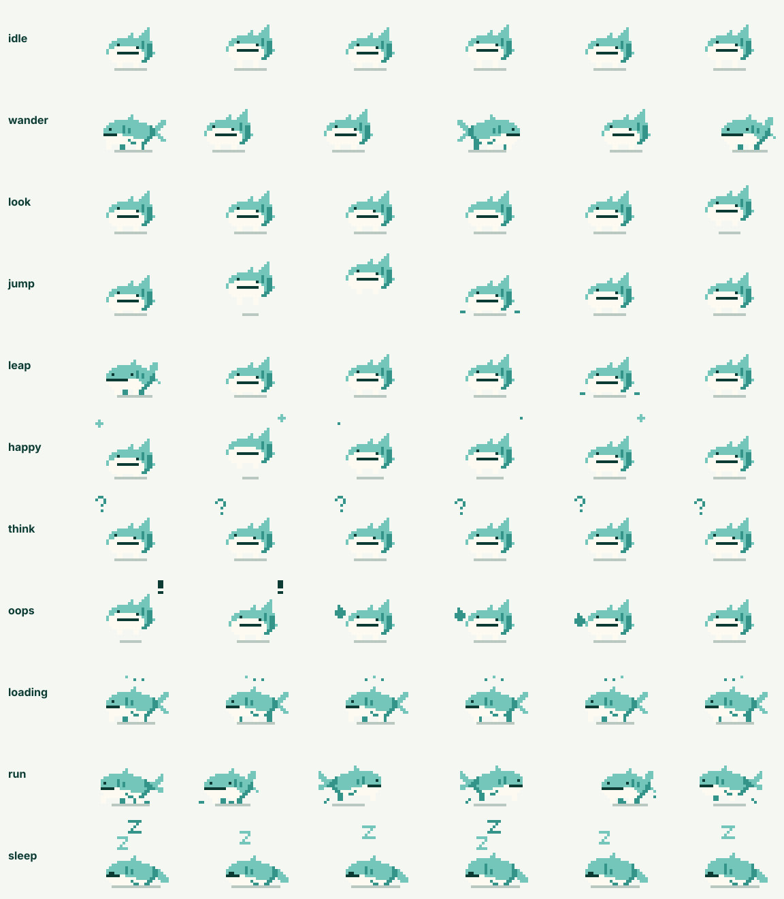

# Kino

Kino is Seekino's pixel whale shark: the little companion who lives in the chat. It is the in-app pet; the vector whale shark in `assets/mascot/` stays as the brand logo.



Kino is drawn from code, not from image files. `engine.ts` holds the pixel poses, builds a timeline of frames for each state and rasterises them. `Kino.tsx` plays those frames as a crisp SVG. The design came from `docs/ui-design/seekino-mascot-pixel/` (direction A, "terminal dumpling"), and the palette, the straight-line mouth and the gill slits follow that brand spec. No teeth and no new colours.

## States

| State | What Kino does | Where it is used |
| --- | --- | --- |
| `idle` | Faces you, breathes, blinks, glances left and right | Empty chat (the default) |
| `wander` | Walks to one end, turns to the screen, walks back | Answer queued |
| `look` | Turns to the screen, glances, small hop | Hovering an interactive Kino; waking up while a new question is sent |
| `think` | Looks up at a floating question mark | Checking evidence; no clips found |
| `loading` | Walks in place under three blinking dots | Writing the answer; connecting |
| `run` | Sprints between the ends, skids at each turn | Searching for clips |
| `sleep` | Lies down, breathes, floats Zs | On the latest bubble once its answer is done; empty chat after 45 s idle |
| `jump` | Crouches, jumps seven pixels high, lands with dust | Reaction: poking Kino |
| `leap` | Gets up on the old perch, crouches, flies along an arc, lands with dust | Reaction: a new turn starts and Kino moves to the new bubble |
| `happy` | Two bouncy hops, squinting, with sparkles | Reaction: an answer just finished, or a poke |
| `oops` | Startled hop with "!", head shake, then a sweat drop | Reaction: an answer failed; error messages |

Changing state always continues from the current pose. Kino stands up before walking off, turns before facing you, and skids if it was running. Kino shows a single still frame when the system asks for reduced motion, and pauses when the tab is hidden.

## Kino as a small NPC

Kino behaves like a game NPC: a finite-state machine driven by what is happening in the app. It needs no AI model. The inputs are events the app already has:

- **Assistant phase** (`ProgressMascot`): queued → `wander`, retrieving → `run`, evaluating → `think`, responding → `loading`. When a live answer finishes, Kino plays `happy` (or `oops` if it failed) and then falls asleep on top of that bubble.
- **New turn**: there is only ever one Kino per conversation, perched on the newest assistant bubble. While the next question is being sent it wakes up (`look`). When the new bubble appears, the old perch hands its position to the new one (`handoff.ts`), and Kino `leap`s down from where it slept to a random spot on the new bubble, then gets to work.
- **Attention** (`interactive`): hovering or focusing turns Kino towards you. Clicking or tapping plays `jump` / `happy`, and five quick pokes in a row startle it (`oops`).
- **Idleness** (`dozeAfterMs`): with no pointer, key or wheel activity, Kino falls asleep. Any input wakes it, and it gets up on its own.

If Kino ever needs more personality, the next step is still rules rather than a model: weighted random idle variations, a mood value that rises with successful answers and falls with errors, and time-of-day behaviour (sleepier at night). A language model would only be worth it for Kino to *say* things, and the chat Supervisor already covers that.

## Using it

```tsx
import { Kino } from "../../shared/kino/Kino";

<Kino state="think" width={38} scale={2} ground={false} />
<Kino interactive dozeAfterMs={45_000} title="Poke Kino" />
<Kino state="idle" reaction={{ name: "happy", key: answerId }} onReactionEnd={() => {}} />
```

- `width`: scene width in sprite pixels (minimum 38). Kino paces inside it.
- `scale`: CSS pixels per sprite pixel. Keep it a whole number so pixels stay sharp.
- `ground`: draws the dashed ground line and the contact shadow.
- `reaction`: plays `jump`, `happy` or `oops` once each time `key` changes, then returns to `state`.
- `perch` / `start` / `leapFrom`: used for the bubble-to-bubble leap. `perch` records Kino's position on unmount. The next perch reads it with `takePerch`, starts Kino in the old pose (`start`), and passes the offset to the old position (`leapFrom`). While `leap` plays, Kino crouches for two frames, then the component flies the sprite at display rate under gravity (a short spring up, then an accelerating fall, about half a second for a typical drop) while the engine holds one stretched airborne pose. If the page is hidden, Kino lands straight away. The leap only happens inside an element marked `data-kino-stage` (the chat thread), and only if the new perch mounts within a second of the old one leaving.
- `interactive`: renders Kino as a button. Its label defaults to "Kino"; pass `title` for a translated one.
- `delayed`: fades in after 300 ms so quick loading states never flash.
- Colours come from CSS variables (`--pixel-mascot-body`, `-shade`, `-belly`, `-ink`, `-spark`, `-ground`, `-shadow`), mapped to the brand tokens in `kino.module.css`. `spark` is the bright tone of effects and matches the body by default. The light theme draws effects in shade so they read on the pale canvas; dark mode keeps the brand palette.

## Adding a move

1. Add the state to `MascotState`, `STATES` and `STATE_FPS` in `engine.ts` (the FPS must divide 30).
2. Write a `Builder` method that pushes frames. Use `lift` for jumps, `bob` for breathing or crouching, `look`/`blink` for the eyes, and `fx` for effects such as glyphs, dust or sparkles. Keep effects inside the scene.
3. Add a case in `buildTimeline`: what Kino does first goes in `intro`, and the repeating part goes in `loop`.
4. Add a test in `engine.test.ts`. The shared tests already check that every state stays inside the scene, keeps its feet on the ground and loops back to its start.
5. Regenerate the contact sheet: `cd web && node scripts/build-kino-sheet.ts`.
